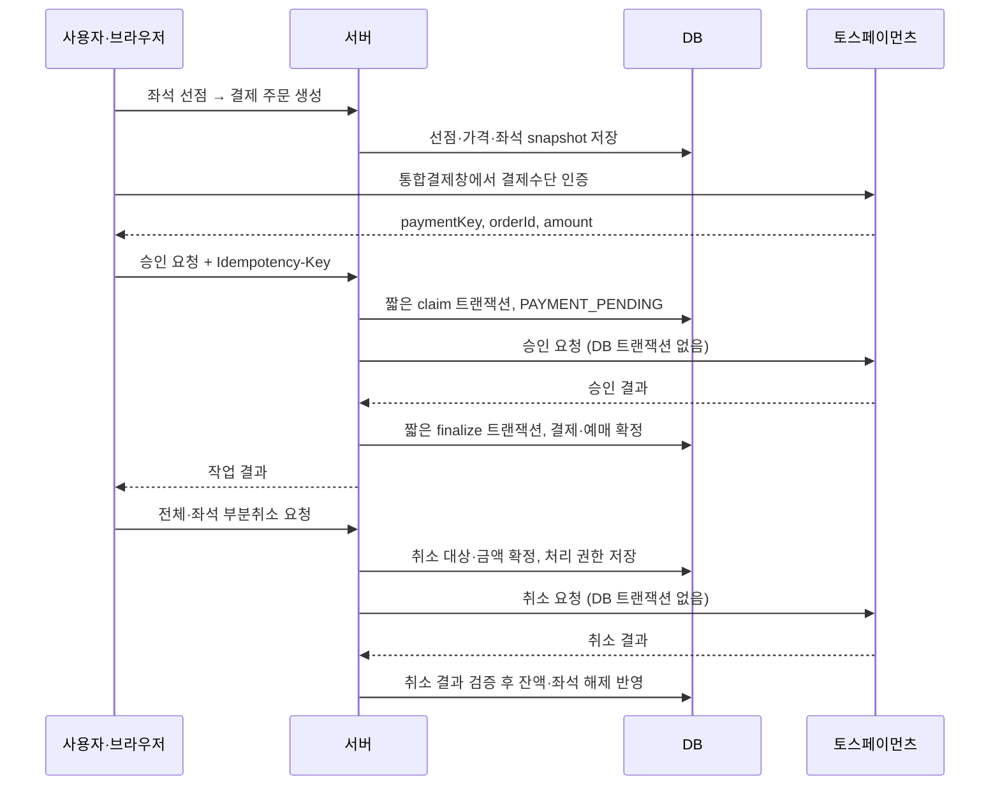

# spring-cgv-24th

CEOS 24기 백엔드 스터디 - CGV 클론 코딩 프로젝트

## 4주차 구현 및 개선

이번 과제에서는 좌석 선점에 결제를 연결하고, 동시에 들어오거나 결과를 받지 못한 요청을 처리했습니다. 아래 3주차 내용은 당시 구현 기록입니다. 현재 예매는 **선점 → 결제 주문 → 결제수단 인증 → 서버 승인 → 예매 확정**으로 처리하며, 직접 예매 `POST /api/v1/reservations`와 무료 확정 `POST /api/v1/seat-holds/{reservationId}/confirm`은 API와 서비스에서 제거했습니다.

### 구현 범위와 가정

- 학습용 CGV 클론이며 실제 CGV의 내부 구현을 설명하는 것은 아닙니다. 단일 서버, 단일 MySQL DB를 가정했습니다.
- 영화 예매의 카드·간편결제를 우선 구현했습니다. 토스페이먼츠 API 개별 연동의 테스트 키와 SDK v2 통합결제창을 사용합니다. 매점 결제, 가상계좌 입금, 자동결제는 확장 범위입니다.
- 가격은 좌석당 **10,000원(KRW)**으로 정했습니다. 원 단위 정수 `long`/`Long`을 사용하고 주문 생성 시 단가·총액·좌석을 보존해, 승인과 환불에 클라이언트가 보낸 가격을 사용하지 않습니다.
- 좌석 선점은 기존의 최대 8석, 5분, 연장 불가 정책을 유지합니다. 결제가 시작된 선점은 결과를 확인할 때까지 점유를 보호합니다.
- 명시적인 조회 복구 API를 구현했습니다. 자동 복구 스케줄러, 운영 대시보드와 Webhook 수신은 이번 구현 범위에 포함하지 않았습니다.

### 리뷰 반영과 책임 분리

- `Reservation.hold()`에서 사용자, 상영, 요청 키, 만료 시각을 필수값으로 검사합니다. 팩터리를 직접 호출해도 필요한 값이 빠진 선점이 만들어지지 않습니다. 요청 키는 서비스의 기존 선점 조회에도 필요하므로, 서비스 시작에서 null을 검사해 조회·잠금 전에 `INVALID_REQUEST`로 거부합니다. 만료 시각 계산은 서비스의 `Clock`과 선점 정책이 맡습니다.
- 보안 경로의 수동 문자열·정규식 비교를 `PathPatternRequestMatcher`의 HTTP 메서드와 명시적 경로 조합으로 정리했습니다. JWT 필터와 인가 설정에 같은 공개 경로 기준을 전달하고, Controller에 없는 메서드·경로 조합과 비슷한 접두사의 경로를 기본 거부합니다. 공개 조회에서 잘못되거나 만료된 JWT를 검사하지 않는 기존 정책은 유지했습니다.
- 여러 좌석 중 뒤의 좌석에서 실패하면 선점과 점유를 모두 롤백합니다. MySQL 테스트에서는 A2 잠금 충돌을 만든 뒤 A1 점유가 남지 않고, 별도 트랜잭션이 A1 잠금을 다시 얻는 것까지 확인했습니다.
- 결제 없이 `RESERVED`로 바뀌는 직접 예매·무료 확정 경로를 제거했습니다. 결제 승인과 예매 확정이 같은 최종 트랜잭션에서 반영되도록 연결했습니다.

기존 `domain/{도메인}` 구조를 유지하고, 결제 요청 순서를 조정하는 서비스와 DB 트랜잭션을 담당하는 서비스를 나눴습니다. 외부 API를 기다리는 동안 DB 잠금과 커넥션을 잡고 있지 않기 위한 분리입니다.

| 코드 | 맡은 책임과 분리 이유 |
| --- | --- |
| [PaymentWorkflowService](src/main/java/com/ceos/cgv/domain/payment/service/PaymentWorkflowService.java) | 승인·취소·복구 순서와 외부 호출 조정. `Propagation.NEVER`로 호출자 트랜잭션도 거부 |
| [PaymentTransactionService](src/main/java/com/ceos/cgv/domain/payment/service/transaction/PaymentTransactionService.java) | 짧은 처리 권한 확보와 최종 반영 트랜잭션. 소유권·상태·금액·멱등성 검증 |
| [ReservationPaymentService](src/main/java/com/ceos/cgv/domain/reservation/service/payment/ReservationPaymentService.java) | 예매 도메인의 결제 시작·확정·좌석 취소·실패 해제. 기존 좌석 잠금과 점유 검증 재사용 |
| [PaymentGateway](src/main/java/com/ceos/cgv/domain/payment/gateway/PaymentGateway.java) | 프로젝트가 소유하는 승인·조회·취소 계약. 서비스에 토스 전용 DTO를 전달하지 않음 |
| [TossPaymentGateway](src/main/java/com/ceos/cgv/domain/payment/infrastructure/toss/TossPaymentGateway.java) | 토스 HTTP 호출·응답 변환·외부 오류 분류. 전용 DTO와 설정도 `payment/infrastructure/toss`에 배치 |

엔티티는 생성 규칙과 상태 전이를, 서비스는 조회·권한 검증·처리 순서를 맡습니다. 신규 DTO와 엔티티에는 `@Builder`를 사용하며, 엔티티 Builder는 생성 ID·감사 시각을 입력으로 노출하지 않습니다. `Reservation.hold()` 같은 의미 있는 생성 경로도 유지했습니다. 성공 응답·업무 예외·감사는 기존 `ApiResponse`, `BusinessException`/`ErrorCode`, `BaseTimeEntity`를 사용하고, 오류 응답은 `ErrorResponse`와 `GlobalExceptionHandler` 경로를 유지합니다. 예약과 결제가 실제로 같은 시간 기준을 사용하게 되어 `Clock`만 [global 설정](src/main/java/com/ceos/cgv/global/config/ClockConfig.java)으로 옮겼습니다. 가격·결제 상태·외부 호출 계약은 결제 도메인에 두었습니다.

### 주문부터 승인, 취소까지

사용자는 먼저 좌석을 선점합니다. 서버가 선점을 기준으로 주문을 만든 뒤, 브라우저가 통합결제창에서 결제수단을 인증합니다. 인증 성공 redirect는 예매 확정 결과가 아니므로, 서버가 저장 주문과 요청을 검증한 뒤 토스 승인 API를 호출합니다. [통합결제창 연동 가이드](https://docs.tosspayments.com/guides/v2/payment-window/integration)



`claim → PG 호출 → finalize`는 서로 다른 단계입니다. 먼저 처리 작업을 DB에 커밋하므로, 외부 호출 직후 서버 오류가 나도 작업 ID를 기준으로 결과를 다시 확인할 수 있습니다. PG와 DB를 하나의 원자적 트랜잭션으로 묶을 수 없다는 점을 전제로 설계했습니다.

| API | 용도 |
| --- | --- |
| `POST /api/v1/seat-holds` | 좌석 선점, UUID `Idempotency-Key` 필요 |
| `DELETE /api/v1/seat-holds/{reservationId}` | 결제 전 선점 해제 |
| `POST /api/v1/payment-orders` | `{reservationId}`로 주문 생성. 신규 201, 같은 선점의 기존 주문 200 |
| `GET /api/v1/payment-orders/{orderId}` | 본인 주문의 저장 정보 조회 |
| `POST /api/v1/payments/confirm` | `{paymentKey, orderId, amount}`로 승인, UUID `Idempotency-Key` 필요 |
| `GET /api/v1/payments/{paymentId}` | 본인 결제의 최신 DB 상태·잔액·좌석·진행 작업 조회 |
| `POST /api/v1/payments/{paymentId}/cancellations` | `{reservedSeatIds, reason}`으로 취소, UUID `Idempotency-Key` 필요 |
| `GET /api/v1/payment-operations/{operationId}` | 저장된 작업 상태 조회 |
| `POST /api/v1/payment-operations/{operationId}/reconcile` | PG 조회 결과를 검증해 미완료 작업 복구 |
| `DELETE /api/v1/reservations/{reservationId}` | 유료 예매의 잔여 전체 취소. `Idempotency-Key` 필요, 성공 시 204 |

주문·결제·작업 API는 JWT 인증과 본인 소유권 검증을 거칩니다. 성공 JSON은 `ApiResponse`로 반환합니다. 승인·취소·복구에서 `PROCESSING`, `UNKNOWN`, `COMPENSATING`은 **HTTP 202**와 작업 조회 `Location`을 반환하고, 완료 작업은 200으로 반환합니다. 200 작업 응답도 `status=FAILED`일 수 있으므로 HTTP 성공만으로 결제 성공을 판단하지 않습니다. 일반 작업 GET은 상태 조회가 성공한 것이므로 200입니다. 204는 본문이 없습니다. 결제 정보가 없는 기존 `RESERVED` 예매에만 이전 취소 동작을 허용합니다.

### 저장 정보와 상태 전이

| 모델 | 저장하는 정보 |
| --- | --- |
| `PaymentOrder` | 회원·선점 ID, 외부 주문 ID, 주문명, 주문 당시 좌석 단가·총액·기한 |
| `PaymentOrderSeat` | 주문 당시 예매 좌석 ID·좌표와 취소 시각 |
| `Payment` | PG 결제 식별자, 결제 상태·잔액·수단·승인 시각·영수증 URL·누적 취소 이력, `activeOperationId` |
| `PaymentOperation` | 승인/취소 구분, 원본 요청 UUID·지문, 고정 PG 멱등키, 요청 금액·직전 잔액·실제 취소 좌석, 처리 상태와 완료 응답 |

결제 금액의 상태와 한 요청의 처리 상태를 구분했습니다. 예를 들어 부분취소 결과를 아직 받지 못했다면 `Payment`는 마지막 확정 상태인 `DONE`을 유지하고, 취소 `PaymentOperation`은 `UNKNOWN`으로 남습니다. 결제 GET의 `activeOperationId`로 그 작업을 찾아 복구할 수 있습니다.

| 대상 | 상태와 의미 |
| --- | --- |
| `Payment` | `READY → PROCESSING → DONE → PARTIALLY_CANCELED → CANCELED`. 확정 승인 거절은 `FAILED`, 승인 후 예매 확정의 영구 실패는 `COMPENSATING → CANCELED` |
| `PaymentOperation` | `PROCESSING`: 처리 권한 확보 / `UNKNOWN`: 외부 결과 또는 DB 반영 불명확 / `COMPENSATING`: 승인 보상취소 확인 중 / `SUCCEEDED`, `FAILED`: 완료 |
| `Reservation` | `HELD → PAYMENT_PENDING → RESERVED`. 확정 승인 실패·보상취소 확인 후 `RELEASED`. 유료 부분취소는 선택 좌석만 취소하며, 모두 취소했을 때 `CANCELED` |

`PAYMENT_PENDING`은 선점 TTL 만료 대상에서 제외하고 회원의 활성 선점 한도에는 포함합니다. 느린 결제 중 좌석을 다른 사람이 다시 선점하는 문제를 막기 위해서입니다. 같은 선점 키 재시도도 기존 pending 결과를 재사용합니다. 대신 외부 결과가 오래 불명확하면 점유가 계속 유지되므로 명시적인 복구가 필요합니다.

### 승인 전에 서버가 검증하는 값

1. 주문·선점이 인증된 회원의 것인지 확인합니다.
2. 새 승인을 시작할 때 선점이 `HELD`이고 기한이 남았는지, 영화가 공개 상태인지, 모든 좌석의 점유자가 해당 선점인지 확인합니다.
3. 요청 `amount`와 서버 주문의 총액을 비교합니다. 이미 결제 키가 연결됐다면 같은 키인지 확인하고, 다른 주문에서 같은 `paymentKey`를 쓰는 것도 unique 제약으로 막습니다.
4. 같은 요청 키의 지문과 기존 작업, 진행 중 작업, 이미 승인·취소된 결제 상태를 확인해 외부 호출 여부를 결정합니다.
5. PG 응답의 `paymentKey`, `orderId`, 원금, 잔액, 승인 상태, 승인 시각과 취소 이력을 다시 검증합니다. 값이 맞을 때만 결제와 예매를 함께 확정합니다.

claim 전에 만료됐거나 영화가 비공개라면 PG 호출 없이 롤백합니다. 이때 `HELD` 정리는 기존 lazy expiry 또는 사용자의 선점 해제로 처리합니다. 이미 `PAYMENT_PENDING`인 작업을 같은 방식으로 만료·해제하지 않습니다.

### 전체 취소와 좌석 부분취소

부분취소는 `reservedSeatIds`에 선택한 예매 좌석 ID를, 전체 취소는 `null`을 전달합니다. 전체 취소는 **그 시점에 남은 좌석과 잔액**을 대상으로 합니다. 클라이언트가 취소 금액을 정하지 않고, 서버가 주문 당시 단가 × 대상 좌석 수로 계산합니다.

- 빈 목록, 중복 ID, 이미 취소된 좌석, 다른 주문의 좌석, 타인의 결제, 잔액을 초과하는 요청을 거부합니다. 같은 완료 요청의 재전송은 저장된 응답을 반환합니다.
- PG 응답의 식별자·원금·예상 잔액을 확인하고, 이전 취소 이력이 보존됐는지 검증합니다. 취소 거래 키가 중복되지 않는지, 각 거래가 완료됐는지, 누적 취소 합계가 `원금 - 잔액`인지도 확인합니다.
- 누적 부분취소로 잔액이 0원이 되어도 PG 상태가 `PARTIAL_CANCELED`로 남을 수 있습니다. 위 금액·이력 검증을 모두 통과하면 내부 상태는 잔액을 기준으로 `CANCELED`로 정리합니다. 상태 문자열만 보고 완료 처리하지 않습니다.
- PG 취소 성공을 확인한 뒤에만 결제 잔액, 주문 좌석과 예매 좌석의 취소 시각, 실제 좌석 점유를 같은 트랜잭션에서 변경합니다. 취소가 불명확하면 기존 잔액과 점유를 유지합니다.

### 타임아웃과 DB 오류 뒤의 복구

타임아웃은 토스가 결제에 실패했다는 뜻이 아닙니다. 요청은 처리됐지만 응답만 유실됐을 수 있으므로, 새 키로 승인·취소를 반복하지 않고 작업을 보존합니다. 일반 주문·결제·작업 GET은 DB만 조회하고, `reconcile`에서만 PG의 현재 결과를 확인합니다.

| 상황 | 처리 |
| --- | --- |
| 공식 오류 의미와 HTTP 상태가 일치하는 확정 승인 거절 | 작업 `FAILED`, 결제 `FAILED`, pending 선점 해제 |
| 확정 취소 거절 | 작업 `FAILED`, 마지막 확정 잔액과 좌석 점유 유지 |
| 네트워크·타임아웃·5xx·처리 중 응답·예상 밖 데이터 | 작업 `UNKNOWN`, 진행 작업과 점유 유지. DB 전체 장애면 먼저 커밋한 `PROCESSING` 작업 ID 반환 |
| PG 승인·취소 성공 뒤 DB finalize 일시 실패 | `UNKNOWN`으로 보존. PG 조회 결과로 같은 finalize를 다시 실행 |
| 승인 성공 뒤 좌석 소유권 상실 등 영구 확정 실패 | 별도 고정 멱등키로 전체 보상취소. 확인 전에는 `COMPENSATING`과 pending 유지 |
| 보상취소 완료 확인 | 결제를 `CANCELED`, 승인 작업을 `FAILED`로 끝내고 본인이 아직 점유한 좌석만 해제. 타인 점유는 보존 |

복구에서도 주문·금액·취소 이력을 검증합니다. 조회 결과가 없거나 아직 승인 전이라면 실패로 단정하지 않습니다. 이미 끝난 작업은 PG 조회와 좌석 변경을 반복하지 않습니다. DB 상태를 수동으로 훼손해 예매 정리 자체가 불가능한 경우에는 보상 확인 후에도 처리 상태가 남을 수 있습니다.

### 동시성과 멱등성을 함께 처리한 이유

동시성 문제는 두 요청이 같은 이전 상태를 읽고 각각 처리할 수 있어서 생깁니다. 같은 주문에서 둘 다 `READY`를 읽으면 승인 요청이 두 번 나갈 수 있고, 같은 좌석 취소에서 둘 다 취소 전 잔액을 읽으면 중복 환불과 잔액 덮어쓰기가 생길 수 있습니다.

| 방법 | 원리·장점 | 이번 과제에서 고려한 점 |
| --- | --- | --- |
| `synchronized` / JVM Lock | 한 프로세스에서 같은 임계 구역을 직렬화 | 단일 서버에서는 가능하지만 DB 변경과 요청 이력을 함께 보존하려면 별도 처리가 필요 |
| 낙관적 락 | 버전이 같은 경우만 갱신하고 충돌을 감지 | 경합이 적을 때 유용. PG를 먼저 호출한 뒤 충돌·재시도하면 외부 부작용을 별도로 제어해야 함 |
| 비관적 락 | 변경할 DB 행을 먼저 잠금 | 최신 상태를 확인하며 권한을 확보할 수 있음. 대기·교착·커넥션 점유를 줄이도록 범위를 짧게 유지 |
| 조건부 `UPDATE` | 상태 조건이 맞는 행만 원자적으로 변경, 변경 행 수로 성공 판정 | 단일 상태·재고 변경에 간결함. 일반 UPDATE도 경합 시 기다릴 수 있고 다좌석 점유·이력 반영은 별도 트랜잭션 필요 |
| unique 제약 | 중복 식별자·조합의 저장을 DB가 거부 | 서로 다른 주문의 같은 PG 키 경쟁에도 최종 방어선. 외부 호출 순서 전체를 대신 제어하지는 않음 |
| 분산 락 | 여러 서버에서 공유하는 잠금 소유권 사용 | 만료·소유권·DB 정합성 설계가 추가로 필요. 현재 단일 DB의 행 잠금으로 충족해 별도 인프라를 도입하지 않음 |

좌석에는 기존 `FOR UPDATE NOWAIT`를 유지했습니다. 이미 잠긴 좌석은 즉시 `SEAT_BUSY`로 돌려주려는 정책에 맞기 때문입니다. 결제에는 **짧은 `PESSIMISTIC_WRITE` 잠금 + 처리 작업 커밋 + unique 제약**을 적용했습니다. `READ_COMMITTED` 트랜잭션에서 결제 → 예매 → 정렬된 좌석 순서로 잠그고, 필요한 객체는 잠금 뒤 refresh합니다. PG 응답 대기 중에는 트랜잭션을 유지하지 않습니다. [MySQL 잠금 조회와 NOWAIT](https://dev.mysql.com/doc/refman/8.4/en/innodb-locking-reads.html)

참고 영상의 조건부 UPDATE와 결제 진행 상태 아이디어를 검토했으며, 현재 좌석의 즉시 충돌 응답·다좌석 롤백과 결제 복구 흐름에 맞게 위 방법을 선택했습니다. [참고 영상](https://www.youtube.com/watch?v=1Ex2iQRO9tI&t=379s)

멱등성은 **같은 의도의 요청이 나중에 다시 와도 처리 효과를 추가하지 않는 것**입니다. 동시성 제어는 요청이 겹칠 때의 경쟁을 다루고, 멱등성은 응답 유실·재전송·완료 뒤 재시도까지 다룹니다. DB 잠금만으로 완료 뒤의 재전송을 구분할 수 없고, 멱등키만으로 서로 다른 키의 동시 요청을 막을 수 없어 둘을 함께 적용했습니다.

- 주문은 `reservationId` unique로 같은 선점당 한 개만 만듭니다.
- 승인·취소 작업은 `(userId, type, requestUUID)` unique와 SHA-256 요청 지문을 저장합니다. 같은 키로 다른 금액·좌석·사유를 보내면 충돌로 거부합니다.
- 전체 취소의 지문은 원본 의도인 `FULL + 사유`로 만들고, 실제 취소 좌석·금액은 claim 당시 snapshot으로 따로 저장합니다. 완료 뒤 남은 좌석이 달라져도 같은 전체 취소 요청을 재현할 수 있습니다.
- 우리 요청 키와 별도로 PG용 UUID를 한 번 생성해 저장하고, 승인·취소 재확인에 같은 키를 사용합니다. 보상취소 키도 별도로 고정합니다. 어댑터는 키를 새로 만들거나 자동 재시도하지 않습니다.
- 같은 완료 키는 **당시 저장한 결과**를 반환합니다. 이후 부분취소가 있었더라도 예전 승인 응답은 당시 `DONE` 결과이며, 현재 잔액은 결제 GET으로 확인합니다. 이미 `DONE`인 주문의 다른 승인 키도 PG를 다시 호출하지 않고, 취소된 결제의 새 승인은 거부합니다.
- 처리 중에는 다른 요청 키가 와도 진행 작업을 반환해 외부 중복 호출을 막습니다. 처리 중 응답을 받은 새 취소 의도는 완료 후 상태를 다시 확인해야 합니다.

토스에도 POST의 `Idempotency-Key`를 전달합니다. 공식 문서상 키는 처음 사용한 날부터 15일간 유효하고, 같은 요청이 아직 처리 중이면 `IDEMPOTENT_REQUEST_PROCESSING` 오류가 올 수 있습니다. PG의 키 유효기간과 별개로 우리 DB에는 작업과 완료 응답을 보존합니다. [토스 멱등키 계약](https://docs.tosspayments.com/reference/using-api/authorization)

### 동시성 재현과 적용 전·후 결과

비교 실험은 **처리 권한 확보 없이 조회 → PG 요청 → 저장하는 단순 설계를 테스트 소스에서 가정한 것**입니다. 기존 저장소가 실제로 이중 과금했다는 의미는 아닙니다. 실제 토스 대신 `PaymentGateway` 대역을 사용하고, 두 요청의 조회 시점을 barrier로 맞춰 잘못된 결과를 재현한 뒤 같은 초기 데이터에서 실제 서비스와 비교했습니다. 실제 서비스 비교는 첫 PG 호출을 latch로 멈춘 동안 두 번째 요청을 실행합니다.

[PaymentConcurrencyComparisonTest](src/test/java/com/ceos/cgv/domain/payment/service/PaymentConcurrencyComparisonTest.java)의 테스트명은 다음과 같습니다.

- `처리권한없는_동일주문승인_2회호출을_재현하고_실제서비스의_1회호출과_비교한다`
- `처리권한없는_동일좌석중복환불과_잔액불일치를_재현하고_실제서비스와_비교한다`

실제 **MySQL 8.4.8**, 각각 2개 요청에서 확인한 값입니다.

| 실험 | 무제어 비교 구현 | 현재 서비스 |
| --- | --- | --- |
| 같은 주문 승인 | PG 대역 승인 2회, 확정 예매 1개 | PG 대역 승인 1회, 예매 확정 변경 1회 |
| 2석 중 같은 1석의 부분취소 | PG 대역 취소 2회, DB 잔액 10,000원 / PG 대역 잔액 0원 | PG 대역 취소 1회, DB·PG 대역 잔액 모두 10,000원 |
| 위 부분취소의 좌석 | 한 좌석만 취소·해제됐지만 중복 환불 | 한 좌석만 취소·해제, 다른 좌석 점유 유지 |

추가로 [PaymentConcurrencyIntegrationTest](src/test/java/com/ceos/cgv/domain/payment/service/PaymentConcurrencyIntegrationTest.java)에서 같은 키·다른 키 승인, 서로 다른 주문의 같은 PG 키, 부분취소와 잔여 전체취소의 중첩, 동시 reconcile을 검증했습니다. PG 성공 후 DB 오류와 느린 PG 중 TTL 만료도 재현해 pending 보존·조회 복구를 확인했습니다. PG 대역의 승인·취소·조회 안에서 실제 DB 트랜잭션이 비활성인지 검사했습니다.

다좌석 실패는 [SeatHoldConcurrencyIntegrationTest](src/test/java/com/ceos/cgv/domain/reservation/service/hold/SeatHoldConcurrencyIntegrationTest.java)의 `두번째_좌석의_NOWAIT_충돌은_첫번째_좌석까지_모두_롤백한다`로 확인합니다. A2를 잠근 상태에서 A1·A2 선점을 요청해 실패시킨 뒤, 신규 예매·좌석 이력·A1 점유가 남지 않고 A2 잠금이 유지되는 동안에도 A1을 다시 잠글 수 있었습니다. H2 통과만으로 MySQL NOWAIT 동작을 확인했다고 판단하지 않았습니다.

### 외부 HTTP Client와 오류 처리

| Client | 특징 | 선택 시 고려한 점 |
| --- | --- | --- |
| `RestClient` | 동기 호출, fluent API | 현재 MVC/JPA 서비스의 호출 흐름과 맞고 승인·조회·취소의 HTTP 처리를 직접 확인하기 쉬움 |
| `WebClient` | 비동기·논블로킹, reactive API | 많은 비동기 호출·스트리밍에 유용. 현재 JPA도 블로킹이며 단순 `.block()` 사용만으로 전체 흐름이 논블로킹이 되지는 않음 |
| `Feign Client` | 인터페이스·애너테이션으로 외부 HTTP 계약 선언 | 반복적인 클라이언트 선언에 편리하지만 이번 3개 호출에 Spring Cloud 설정·의존성을 더할 필요는 낮다고 판단 |

동기 MVC/JPA 환경에 맞춰 `RestClient`와 JDK `HttpClient`를 사용했습니다. 연결 3초, 응답 10초는 **과제용 설정**이며 토스 권장값으로 정한 것은 아닙니다. 외부 주소는 토스 API로 고정하고 redirect를 따라가지 않습니다. [Spring REST Clients](https://docs.spring.io/spring-framework/reference/integration/rest-clients.html), [Spring Cloud OpenFeign](https://docs.spring.io/spring-cloud-openfeign/reference/index.html)

응답은 필수 식별자·상태·정수 금액·취소 이력·시간 형식을 검사해 프로젝트 소유 타입으로 변환합니다. 알려진 공식 오류 코드와 HTTP 상태 조합만 확정 거절로 분류하고, 그 외 오류·미래 상태·잘못된 응답은 `UNKNOWN`으로 분류합니다. 임의의 외부 오류 본문이나 메시지를 우리 응답에 그대로 복사하지 않으며, 실제 키·인코딩 인증값·Authorization 헤더가 로그와 예외에 남지 않게 했습니다. API 키는 `TOSS_CLIENT_KEY`, `TOSS_SECRET_KEY` 환경변수로 읽고 서버가 테스트 키 조합만 허용합니다.

### Webhook을 추가한다면

Webhook은 PG에서 상태 변경을 우리 서버 URL로 보내는 알림입니다. 토스는 개발자센터에서 이벤트와 수신 URL을 등록하고 JSON을 HTTP POST로 보냅니다. 결제·취소 상태 이벤트를 제공하며, 10초 안에 200 응답을 받지 못하면 최대 7회 재전송합니다. [토스 Webhook 가이드](https://docs.tosspayments.com/guides/v2/webhook)

현재 서비스에 붙인다면 **누락된 결과를 복구할 신호**로 사용하겠습니다. 알림 수신 → PG 조회 → 주문·금액 검증 → 기존 멱등 finalize를 재사용하는 흐름입니다. 중복·재전송과 도착 순서 차이를 고려해 이벤트 도착만으로 잔액·좌석을 변경하지 않고, 완료 작업을 다시 적용하지 않아야 합니다. 이벤트별 공식 검증 방식도 확인해야 합니다. 이번 과제에서는 역할과 제공 방식을 조사했으며, 수신 endpoint는 구현하지 않았습니다.

### 실행과 검증

Java 21과 Node.js가 필요합니다. MySQL 검증에는 실행 중인 Docker가 필요합니다.

```sh
# 기본 Java 테스트: H2, 실제 토스 호출 없음
./gradlew test

# 예약·결제·스키마 검증: 일회용 MySQL 8.4.8 컨테이너
./gradlew mysqlTest

# 데모 화면 동작: DOM·fetch·SDK 대역
node --test src/test/js/payment-demo.test.js

# API 개별 연동 테스트 키를 환경변수에 등록한 뒤 실행
./gradlew bootRun --args='--spring.profiles.active=payment-demo --server.port=8088'
```

`TOSS_CLIENT_KEY`, `TOSS_SECRET_KEY`에 개발자센터의 API 개별 연동 테스트 키를 등록합니다. 키값은 소스·README에 적지 않습니다. 브라우저용 설정 API는 인증된 사용자에게 client key와 통화만 제공하고 secret은 반환하지 않습니다. 키가 없거나 라이브·다른 연동 방식의 키라면 외부 호출 전에 차단합니다.

브라우저에서 [결제 데모](http://localhost:8088/payment-demo.html)를 열고 가짜 계정 `paymentdemo` / `DemoPayment123!`로 로그인합니다. `A1,A2` 선점 → 주문 생성 → 통합결제창 인증 → 서버 승인 → A1 부분취소 → 잔여 전체취소 순서로 확인할 수 있습니다. 인증에 실제 결제 앱이나 본인 인증 화면이 나타날 수 있지만, 테스트 키 환경에서 승인된 결제는 실제 출금되지 않습니다. [토스 테스트 환경](https://docs.tosspayments.com/guides/v2/get-started/environment)

데모는 전용 H2 메모리 DB를 사용하고 서버 종료 시 데이터가 삭제됩니다. 다른 DB URL을 넣으면 JPA 초기화 전에 차단합니다. MySQL Testcontainers는 별도의 일회용 DB로 검증하며 기존 개발 DB를 초기화하지 않습니다. 서버 재시작 후 이전 브라우저 상태가 남아 있으면 데모 로그아웃 후 다시 시작합니다.

| 검증 대상 | 확인한 결과 |
| --- | --- |
| 기본 Java 테스트, H2 | 총 329건 중 328개 통과·skip 1, 실패·오류 0 |
| 실제 MySQL 8.4.8, `mysql-test` | 예약·결제·동시성·스키마 61개 통과, 실패·오류·skip 0 |
| JavaScript 데모 동작 | 11개 통과, 실패·skip 0 |
| `assemble` | 빌드 성공 |

최종 통합에서 `./gradlew test mysqlTest assemble`과 JavaScript 테스트를 실행한 결과입니다. 기본 Java 실행의 skip 1건은 MySQL 전용 `PaymentSchemaUpgradeIntegrationTest`를 분리한 것이며, 해당 스키마 검증의 실제 2개 경우는 `mysqlTest`에서 모두 실행했습니다.

위 자동화 검증의 PG는 테스트 대역입니다. MySQL 테스트는 시작 시 JDBC DB 제품명·버전·profile을 확인하며 Docker 실패를 H2나 skip으로 대체하지 않습니다. 전체 부하·멀티서버·운영 성능을 검증한 것은 아닙니다.

별도로 실제 토스 **TEST 환경**에서 통합결제창 카카오페이 인증 → 20,000원 승인 `DONE`·예매 2석 확정 → A1 10,000원 부분취소 → 잔여 10,000원 취소를 확인했습니다. PG의 완료 취소 이력 2개 합계는 20,000원, 잔액은 0원이었습니다.

마지막 취소에서 PG 상태는 `PARTIAL_CANCELED`로 남아 기존 검증이 작업을 `UNKNOWN`으로 보류했습니다. 금액·이력 검증을 유지하며 이 상태를 처리하도록 보완한 뒤, **기존 DB 데이터를 보존하고 reconcile 한 번의 PG 조회로** 작업 `SUCCEEDED`, 결제·예매 `CANCELED`, 잔액 0원과 두 좌석 `AVAILABLE`을 확인했습니다. 새 PG 취소 요청은 보내지 않았습니다. 전체 취소의 같은 UUID 재전송은 같은 완료 결과를 반환하고, 전체 취소 뒤 이전 부분취소 UUID를 재전송하면 당시 잔액 10,000원 응답이 보존되는 것도 확인했습니다.

### 기존 MySQL 스키마에 반영할 때

스키마 변경은 [수동 SQL](src/main/resources/db/manual/week-04-payment.sql)로 제공합니다. 애플리케이션을 중지하고 백업한 뒤 `SHOW CREATE TABLE`로 기존 `reservations.status` ENUM과 `reserved_seats` baseline을 비교해 **한 번만** 적용해야 합니다. 이미 `canceled_at`이나 결제 테이블이 있다면 다시 적용할 수 없습니다. MySQL DDL은 암묵적으로 커밋되므로 부분 실패 시 현재 스키마를 확인해야 하며, 결제 이력을 지우는 자동 DROP 롤백은 제공하지 않습니다. 자동 마이그레이션 프레임워크는 도입하지 않았습니다.

[PaymentSchemaUpgradeIntegrationTest](src/test/java/com/ceos/cgv/domain/payment/schema/PaymentSchemaUpgradeIntegrationTest.java)에서 서로 다른 기존 ENUM 순서 2개를 구성해 기존 예매 5행·좌석 이력 5행을 각각 넣은 뒤 SQL을 적용했습니다. 기존 컬럼 값과 ENUM 순서가 유지되고, 기존 좌석의 `canceled_at`은 null이며 새 `PAYMENT_PENDING` 저장이 가능함을 확인했습니다. 이후 실제 ORM으로 선점 → 주문 → 승인 → 부분취소와 DTO 조회도 수행했습니다.

새 결제 테이블의 unique와 실제 엔티티 연관 FK도 검증했습니다. 회원·예매·좌석의 snapshot ID와 `activeOperationId`는 scalar 값이므로 FK가 없어 존재 여부를 DB 제약으로 보장하지 않습니다. 다른 기존 DB의 추가 상태·default·컬럼 차이까지 자동 이관하거나 별도 Hibernate schema validate를 검증한 것은 아니므로 적용 전 실제 baseline 확인이 필요합니다.

## 3주차 구현 및 개선

### 인증, 인가

- 별도 로그인 ID를 사용하는 회원가입, 로그인과 Spring Security 기반 JWT 인증을 구현했습니다.
- Access Token은 30분, Refresh Token은 14일로 설정했습니다. 회원당 Refresh Token 하나를 해시로 저장하고, 재발급 시 교체하며 로그아웃 시 폐기합니다.
- 개인 예매, 주문은 토큰의 회원 ID로 처리하고 소유권을 확인합니다. 운영용 등록 API와 영화 비공개 처리는 ADMIN 권한으로 제한했습니다.

### 영화 예매

- 회차별 좌석(`ScreeningSeat`)을 생성하고, 요청한 좌석에 비관적 락(`FOR UPDATE NOWAIT`)을 걸어 같은 좌석의 중복 예매를 막았습니다. 잠금 충돌 시 기다리지 않고 오류를 반환합니다.
- 한 번에 최대 8석을 5분간 선점할 수 있습니다. 선점 연장은 허용하지 않으며, 유효한 선점, 확정 예매는 같은 요청 키로 재시도하면 기존 결과를 반환합니다.
- 선점 확정, 해제, 만료 처리를 추가하고, 예매 상태와 좌석 점유를 함께 변경하도록 정리했습니다. 상세 조회에도 만료 상태와 시각을 반영했습니다.
- 직접 예매의 만료 정리를 트랜잭션 밖으로 분리해 추가 커넥션을 기다리는 문제를 수정했습니다. 기존 좌석 데이터를 연결하는 백필도 정상 만료된 선점을 처리하도록 보완했습니다.
- 영화 삭제는 비공개 전환으로 처리해 기존 예매 이력을 보존합니다.

### 매점 주문

- 동시 주문으로 재고 차감이 겹치지 않도록 영화관별 재고에 비관적 락(`PESSIMISTIC_WRITE`)을 적용했습니다. 상품 ID 순서로 잠금을 얻고, 모든 항목을 검증한 뒤 차감합니다.
- 주문 당시 단가(`unitPrice`)를 보존하고, 주문 항목과 총액을 함께 생성하도록 변경했습니다. null 주문 항목과 잘못된 재고 차감 수량도 차단했습니다.

### 공통 구조와 오류 처리

- 인증 기능은 `auth`, 공통 보안 코드는 `global/security`로 분리했습니다. 예매 코드는 서비스, 정책, 값 객체, 스케줄러의 역할에 따라 나눴습니다.
- 예매, 주문, 상영 서비스에서 응답 DTO를 완성하고 OSIV를 껐습니다. 재시도할 때 이전 트랜잭션의 좌석 상태를 재사용하지 않도록 했습니다.
- 보안 오류도 공통 `ErrorResponse`를 사용합니다. 일반 요청 오류가 401로 바뀌지 않도록 오류 디스패치를 보완하고, Swagger에 Bearer 인증과 오류 응답을 명시했습니다.

## JWT 인증 흐름

### JWT 구조와 토큰의 역할

- Header에는 서명 알고리즘 같은 메타데이터가 들어갑니다. 현재는 `HS256`을 사용합니다.
- Payload에는 회원 ID, 역할, 만료 시각 같은 Claim이 들어갑니다.
- Signature는 Header와 Payload를 서명한 값입니다. 서버의 키로 서명을 검증해 내용이 바뀌었는지 확인합니다.

현재 사용하는 서명된 JWT의 Header와 Payload는 Base64URL로 인코딩되어 있어 내용을 읽을 수 있습니다. 서명이 내용을 암호화하는 것은 아니므로 비밀번호 같은 민감한 정보는 넣지 않았습니다. [JWT 표준](https://www.rfc-editor.org/rfc/rfc7519.html)

Access Token은 일반 API 요청의 인증에 사용하고, Refresh Token은 새 Access Token을 받는 데 사용합니다. 두 토큰의 구분은 용도에 따른 것이며, 반드시 JWT여야 하는 것은 아닙니다. 현재 프로젝트에서는 둘 다 JWT로 만들고 `token_type`으로 용도를 구분합니다.

쿠키는 브라우저에 값을 저장하고 조건에 맞는 요청에 자동으로 첨부하는 수단입니다. 세션은 서버가 로그인 상태를 보관하는 방식이며, 보통 쿠키로 세션 ID를 전달합니다. JWT는 서명된 정보를 전달하는 토큰 형식이고, 이번 프로젝트는 `Authorization: Bearer <access-token>` 헤더로 전달합니다.

### Access Token에 담은 Claim

| Claim | 사용 목적 |
| --- | --- |
| `sub` | 내부 회원 ID로 요청한 사용자를 식별 |
| `role` | `USER`, `ADMIN` 역할 구분 |
| `token_type` | `ACCESS`인지 확인해 Refresh Token의 일반 API 사용 차단 |
| `iss` | 발급자가 `spring-cgv-24th`인지 확인 |
| `iat` | 토큰 발급 시각 |
| `exp` | 토큰 만료 시각 |

`JwtService`는 서명, 허용 알고리즘, 발급자, 만료 시각, 토큰 용도와 필수 Claim을 확인합니다. 검증이 끝난 뒤에만 회원 ID와 역할을 사용하며, 서명키는 `CGV_JWT_SECRET_BASE64` 환경변수로 전달합니다.

### 로그인과 JWT 인증 처리

```text
로그인 요청
→ AuthenticationManager
→ DaoAuthenticationProvider
→ CgvUserDetailsService에서 회원 조회
→ PasswordEncoder로 저장된 해시와 비밀번호 비교
→ 인증 성공 후 토큰 발급
```

회원가입 시 비밀번호는 `PasswordEncoder`로 해시해서 저장합니다. 없는 계정과 틀린 비밀번호는 모두 `401 LOGIN_FAILED`로 응답하고 토큰을 발급하지 않습니다. 로그인과 JWT 인증에는 `UserDetails`를 구현한 `CgvUserDetails`를 사용합니다. 로그인용 객체에는 저장된 비밀번호 해시가 필요하고, JWT용 객체는 검증된 회원 ID와 역할로 만들며 비밀번호를 담지 않습니다.

```text
보호 API 요청
→ JwtAuthenticationFilter에서 Bearer Token 추출
→ JwtService에서 토큰 검증
→ CgvUserDetails와 Authentication 생성
→ 새 SecurityContext에 인증 객체 설정
→ 인가 처리 후 컨트롤러 호출
```

필터는 `OncePerRequestFilter`를 상속하고, 인가 처리보다 앞에서 실행됩니다. `SecurityConfig`에서 직접 생성해 Security 체인에만 등록하므로 서블릿 필터로 중복 등록하지 않았습니다.

### 인증, 인가와 오류 처리

인증은 요청한 사용자가 누구인지 확인하는 것이고, 인가는 그 사용자가 해당 작업을 할 수 있는지 확인하는 것입니다.

- 토큰이 없으면 인증 객체를 만들지 않고 다음 필터로 넘깁니다. 보호 API라면 `401 TOKEN_NOT_EXIST`를 반환합니다.
- 보호 API에 만료되거나 잘못된 토큰이 들어오면 필터에서 `AuthenticationEntryPoint`를 호출하고 요청을 종료합니다. 각각 `TOKEN_EXPIRED`, `TOKEN_INVALID`로 구분합니다.
- 공개 조회는 JWT 검증을 생략합니다. 만료되거나 잘못된 토큰을 함께 보내도 공개 데이터는 조회할 수 있습니다.
- `@AuthenticationPrincipal`로 받은 회원 ID를 사용하고, 예매 조회와 취소는 소유권도 확인합니다. 관리자도 다른 회원의 예매를 취소할 수 없습니다.
- 역할을 Authentication에 넣을 때 `ROLE_`를 붙이고, 관리자 API에서는 `hasRole("ADMIN")`으로 검사합니다. 일반 회원가입은 `USER`로 고정합니다.

Security 체인의 인증 실패는 `AuthenticationEntryPoint`, 권한 부족은 `AccessDeniedHandler`가 처리합니다. 필터 계층에서는 `@RestControllerAdvice`에 맡기지 않고 같은 `ErrorResponse`를 직렬화해 `status`, `code`, `message` 형식으로 반환합니다.

### STATELESS와 CSRF 설정

`SessionCreationPolicy.STATELESS`로 인증 정보를 세션에 저장하지 않고 매 요청의 JWT를 확인합니다. 사용하지 않는 `formLogin`, `httpBasic`도 비활성화했습니다.

이번 API는 세션이나 인증 쿠키를 사용하지 않고, 클라이언트가 Bearer 헤더에 토큰을 직접 넣습니다. 브라우저가 인증 정보를 자동 첨부하는 쿠키 인증을 사용하지 않는 전제에서 CSRF 보호를 껐습니다. 이후 인증 쿠키를 도입한다면 CSRF 설정도 다시 검토해야 합니다. [Spring Security CSRF 문서](https://docs.spring.io/spring-security/reference/servlet/exploits/csrf.html)

### 인증 요청별 처리 결과

H2 기반 자동화 테스트로 아래 결과를 확인했습니다. Payload를 변경한 토큰은 임시 H2 서버에 실제 HTTP 요청을 보내서도 확인했습니다.

| 요청 상황 | 확인한 결과 |
| --- | --- |
| 올바른 로그인 정보 | 200, Access Token 발급 |
| 없는 계정, 잘못된 비밀번호 | 모두 401 `LOGIN_FAILED`, 토큰 미발급 |
| 토큰 없이 공개 영화 조회 | 200 |
| 정상 토큰으로 영화 찜 | 200 |
| 토큰 없이 보호 API 호출 | 401 `TOKEN_NOT_EXIST`, 공통 JSON |
| 만료된 토큰으로 보호 API 호출 | 401 `TOKEN_EXPIRED` |
| 변조되거나 형식이 잘못된 토큰 | 401 `TOKEN_INVALID` |
| 다른 키로 서명한 토큰 | 401 `TOKEN_INVALID` |
| 일반 사용자로 관리자 API 호출 | 403 `ACCESS_DENIED`, 공통 JSON |
| 관리자로 영화 등록, 비공개 전환 | 각각 201, 204 |
| 정상 인증 요청 직후 토큰 없이 보호 API 호출 | 401, 이전 요청의 인증 정보가 남지 않음 |
| 다른 회원의 예매 조회, 취소 | 403 `ACCESS_DENIED`, 예매 상태 유지 |

관련 테스트: [로그인](src/test/java/com/ceos/cgv/domain/auth/controller/AuthLoginIntegrationTest.java), [JWT 인증 흐름](src/test/java/com/ceos/cgv/global/security/jwt/SecurityFlowIntegrationTest.java), [관리자 권한](src/test/java/com/ceos/cgv/domain/movie/controller/MovieAdminAccessIntegrationTest.java), [예매 소유권](src/test/java/com/ceos/cgv/domain/reservation/controller/ReservationControllerIntegrationTest.java)

## ERD


[ERD Cloud에서 보기](https://www.erdcloud.com/d/GgS73rR7gzSAZZXie)

---

<details>
<summary>이전 과제내용</summary>

아래는 이전 과제 작성 당시의 내용입니다.

## spring-cgv-24th

---

CEOS 24기 백엔드 스터디 - CGV 클론 코딩 프로젝트

## 목차

- [서비스와 과제 요구사항](#서비스와-과제-요구사항)
- [ERD와 모델링](#erd와-모델링)
- [도메인별 기능](#도메인별-기능)
- [세션 중 질문 정리](#세션-중-질문-정리)
- [구현하며 확인한 점과 보완 사항](#구현하며-확인한-점과-보완-사항)

## 서비스 요구사항

- 영화관과 영화 정보를 조회하고, 영화관, 영화를 찜합니다.
- 영화관 안의 상영관에서 상영 일정을 만들고 조회합니다.
- 상영 일정의 좌석을 예매하고, 예약을 취소합니다.
- 영화관별 매점 재고를 관리하고, 상품을 주문합니다. 주문 환불은 범위에 포함하지 않습니다.

## ERD와 모델링

[ERD와 모델링 설계 문서 보기](docs/erd설계문서.md)

## 도메인별 기능

코드는 `domain/{도메인}/{controller,dto,entity,repository,service}` 구조로 나눴습니다.

| 도메인 | 책임 |
| --- | --- |
| `user` | 사용자 엔티티와 저장소. 과제 조건에 따라 포함 |
| `cinema` | 영화관 조회, 영화관 찜, 상영관 생성 |
| `movie` | 영화 생성, 조회, 삭제, 영화 찜, 상영 일정 생성, 조회 |
| `reservation` | 좌석 예매, 조회, 취소와 좌석 검증 |
| `concession` | 상품, 지점별 재고 관리, 매점 주문과 주문 조회 |
| `global` | OpenAPI 설정과 공통 예외 응답 |

## 세션 중 질문 정리

### ORM과 JPA

#### Dirty Checking으로 UPDATE할 때 바뀌지 않은 컬럼도 매번 업데이트하나요? 개선해야 하나요?

Hibernate의 기본 UPDATE SQL은 변경된 필드만이 아니라 여러 매핑 컬럼을 포함할 수 있습니다. 반드시 최적화해야 하는 것은 아니며, 실제 병목이 확인된 경우 Hibernate의 `@DynamicUpdate`로 변경된 컬럼만 포함할 수 있습니다. 다만 SQL 모양이 다양해지는 비용도 있으므로 측정 후 적용합니다.

#### `flush`는 언제 일어나나요?

변경 내용을 DB에 동기화하는 시점입니다. 직접 `flush()`를 호출할 때, 트랜잭션이 커밋되기 전, 그리고 기본 `AUTO` 모드에서 대기 중인 변경과 충돌할 수 있는 쿼리를 실행하기 전에 발생할 수 있습니다. `flush`는 커밋과 같지 않습니다. 트랜잭션이 롤백되면 flush된 SQL도 최종 반영되지 않습니다.

#### 영속성 컨텍스트와 `EntityManager`, `EntityManager`와 트랜잭션은 항상 1:1인가요?

일반적으로 `EntityManager` 하나가 영속성 컨텍스트 하나를 관리합니다. 하지만 `EntityManager`와 트랜잭션의 수명이 항상 1:1인 것은 아닙니다. Spring Data JPA에서 보이는 `EntityManager` 참조는 공유 프록시일 수 있고, 실제 호출은 현재 트랜잭션에 연결된 엔티티 매니저로 위임됩니다. 확장 영속성 컨텍스트처럼 하나의 컨텍스트가 여러 트랜잭션에 걸치는 경우도 있습니다.

### 연관관계와 프록시

#### `@JoinColumn`을 생략하면 어떻게 되나요?

JPA가 기본 이름 규칙을 적용합니다. 예를 들어 `team` 필드가 `Team`의 `id`를 참조하면 기본 FK 컬럼명은 보통 `team_id`가 됩니다. 필드명, 참조 PK 이름, 매핑 방식에 따라 달라질 수 있으므로 생성된 스키마를 확인하거나 이름을 명시하는 편이 안전합니다.

#### 양방향 매핑은 항상 좋은가요?

아닙니다. 양쪽에서 객체 그래프를 따라갈 필요가 있을 때만 사용하면 됩니다. 양방향이면 양쪽 객체의 참조를 함께 맞춰야 하고, 그렇지 않으면 메모리의 객체 상태와 DB 관계가 어긋날 수 있습니다. 한 방향으로 충분하면 단방향이 더 단순합니다.

#### `Team.members`만 수정해도 DB에 반영되나요?

일대다/다대일 양방향 관계에서 보통 FK가 있는 `Member.team`이 연관관계의 주인입니다. 반대편인 `Team.members`만 바꾸면 DB FK 변경이 반영되지 않을 수 있습니다. 주인 필드를 변경하고, 필요하면 양쪽 객체 상태를 맞추는 편의 메서드를 둡니다.

#### `mappedBy` 없이 양쪽 모두에 `@JoinColumn`을 두면 어떻게 되나요?

JPA가 하나의 양방향 관계라고 알아서 합쳐주는 것이 아닙니다. 양쪽 필드가 각각 별개의 관계 매핑으로 해석되어 중복 FK나 불필요한 스키마가 생길 수 있습니다. 한쪽을 주인으로 두고 반대쪽에 `mappedBy`를 지정해야 합니다.

#### 내부 PK로 Long을 쓸까요, UUID를 쓸까요?

둘 중 하나만 골라야 하는 것은 아닙니다. 내부 DB 식별자는 Long PK로 두고, 외부에 노출할 식별자가 필요하면 별도 UUID/ULID를 둘 수 있습니다. 현재 프로젝트는 Long ID를 API 경로 등에 사용하므로 외부 식별자 분리는 아직 적용하지 않았습니다. UUID만으로 인증, 인가 문제가 해결되는 것은 아닙니다.

#### 프록시란 무엇이고, N+1과 어떤 관계가 있나요?

Hibernate 프록시는 지연 로딩할 연관 엔티티를 대신하는 객체입니다. 우선 식별자만 가진 대리 객체를 두고 실제 필드에 접근할 때 조회를 수행합니다. 여러 엔티티를 조회한 뒤 각 프록시의 값을 반복해서 읽으면 추가 쿼리가 건별로 나가 N+1이 발생할 수 있습니다. 즉, 지연 로딩은 필요할 때까지 조회를 미룰 뿐 N+1을 자동으로 없애지는 않습니다.

#### Hibernate 프록시와 Spring AOP 프록시는 어떻게 다른가요?

둘 다 실제 객체를 감싸거나 대신하는 프록시 패턴이지만 목적이 다릅니다. Hibernate 프록시는 연관 엔티티 지연 로딩에 쓰이고, Spring AOP 프록시는 트랜잭션, 로깅 같은 부가 동작을 메서드 호출 앞뒤에 적용합니다.

#### 양방향 `@OneToOne`에서 `nullable=true`이면 지연 로딩이 왜 어려울 수 있나요?

FK가 없는 반대편(주인이 아닌 쪽)을 조회할 때, 연관 행이 실제로 존재하는지 아니면 `null`인지 알려면 Hibernate가 추가 조회를 해야 할 수 있습니다. 그래서 `LAZY`를 선언해도 기대한 대로 미뤄지지 않는 경우가 있습니다. 구체적 동작은 관계 방향, Hibernate 버전, 바이트코드 향상 설정에 따라 달라집니다. 단방향 설계나 `@MapsId`, 바이트코드 향상 등이 선택지가 될 수 있습니다.

### 로딩 전략과 N+1

#### 항상 지연 로딩이 좋은가요?

항상 그렇지는 않습니다. 연관 데이터를 사용하지 않는 요청까지 불필요하게 읽는 일을 줄이기 위해 기본은 지연 로딩으로 두는 편이 안전하지만, 필요한 화면/요청에서는 fetch join, `@EntityGraph`, 배치 로딩 등 조회 목적에 맞는 방법을 선택해야 합니다. 트랜잭션 밖에서 지연 필드에 접근하지 않도록 DTO 변환 시점도 고려해야 합니다.

#### fetch join을 사용하면서 페이징하면 어떤 문제가 생기나요?

특히 컬렉션을 fetch join하면 한 부모 행이 여러 자식 행으로 늘어나 SQL 결과의 행 수와 부모 엔티티 수가 달라집니다. DB가 자식 행 기준으로 제한하면 원하는 부모 페이지와 달라질 수 있어 Hibernate가 메모리에서 페이징하거나 경고할 수 있습니다. 페이지 ID를 먼저 조회한 뒤 필요한 연관 데이터를 별도 조회하거나 배치 로딩을 검토합니다. 단일 값 연관관계(to-one) fetch join은 컬렉션 fetch join과 상황이 다릅니다.

#### `SimpleJpaRepository`는 싱글톤인데, 생성자로 받은 `EntityManager`가 매번 달라도 괜찮나요?

Spring Data JPA가 공유 `EntityManager` 프록시를 주입할 수 있기 때문입니다. 저장소는 이 프록시를 보유하고, 프록시가 현재 트랜잭션에 맞는 실제 `EntityManager`로 호출을 위임합니다. 따라서 저장소 싱글톤이 하나의 실제 영속성 컨텍스트를 모든 요청과 공유한다는 뜻은 아닙니다.

#### fetch join에서 `distinct`를 쓰지 않으면 어떤 일이 생기나요?

컬렉션 조인에서는 자식 행마다 부모 행이 반복되므로 결과 목록에 같은 부모가 여러 번 나타날 수 있습니다. JPQL `distinct`는 결과 엔티티 중복을 제거하겠다는 뜻이지만, SQL 행의 중복 제거와 엔티티 결과 중복 제거는 같지 않을 수 있습니다. Hibernate 버전에 따른 자동 중복 제거 동작도 있으니 실제 프로젝트 버전과 결과를 확인하고 필요할 때 사용합니다.

#### 자주 보는 fetch join 오류는 왜 생기며 어떻게 대응하나요?

- `firstResult/maxResults specified with collection fetch; applying in memory`: 컬렉션 fetch join과 DB 페이징의 행 단위가 맞지 않아 메모리 페이징으로 바뀔 수 있습니다. 페이지 ID 선조회와 연관 데이터 후조회, 배치 로딩 등을 검토합니다.
- `query specified join fetching, but the owner ... was not present in the select list`: fetch 대상 관계의 주인 엔티티를 조회 결과에 포함하지 않은 쿼리입니다. 주인 엔티티를 선택하거나, 엔티티를 가져오지 않는 DTO/컬럼 조회라면 fetch join 대신 일반 join을 사용합니다.
- `MultipleBagFetchException`: 여러 bag 컬렉션을 한 번에 fetch join하려는 상황에서 발생할 수 있습니다. 컬렉션을 쿼리별로 나누거나 배치 로딩을 고려합니다. 자료구조만 `Set`으로 바꾸기 전에 중복, 정렬, 도메인 의미도 확인해야 합니다.

## 구현하며 확인한 점과 보완 사항

### 1. 매점 상품 반복 조회 개선

주문 상품마다 `findById`를 반복 호출하던 구조를 `findAllById` 기반 일괄 조회로 변경했습니다. 조회한 상품은 `Map<Long, Product>`로 변환하여 반복문에서 바로 찾도록 했습니다.

```text
상품별 findById 반복
→ 상품 ID 일괄 조회
→ Map으로 변환
→ 메모리에서 상품 조회
```

상품 조회 쿼리를 주문 상품 수만큼 발생시키지 않고 한 번의 일괄 조회로 줄이는 것이 목적입니다.

### 2. 주문 상세 조회 N+1 개선

주문 항목만 가져오면 응답 DTO에서 상품명에 접근할 때 상품별 추가 조회가 발생할 수 있습니다. `FoodOrderRepository`의 EntityGraph에 `items.product`를 지정해 주문 항목과 상품을 함께 조회하도록 변경했습니다.

`open-in-view=false` 테스트에서 트랜잭션이 끝난 뒤에도 주문 항목의 상품명에 접근할 수 있는지 확인했습니다.

### 3. 공통 성공 응답 적용

성공 응답은 다음 형식으로 통일했습니다.

```json
{
  "status": 200,
  "message": "요청에 성공하였습니다.",
  "data": {}
}
```

생성 응답은 HTTP 201과 `data`를 반환하고, 조회 응답은 HTTP 200과 `data`를 반환합니다. `204 No Content`가 적절한 삭제, 찜 API와 오류 응답 형식은 유지했습니다.

### 4. 동시 좌석 예매 경쟁 조건 처리

기존에는 좌석 중복 여부를 확인한 뒤 예약을 저장했기 때문에, 동시에 들어온 두 요청이 모두 빈 좌석으로 판단할 수 있었습니다.

상영 일정 행을 `PESSIMISTIC_WRITE`로 잠그고, 좌석 중복 조회도 잠금 조회로 처리했습니다.
MySQL의 트랜잭션 스냅샷 문제를 피하기 위해 예약 생성 트랜잭션은 `READ_COMMITTED`를 사용합니다.

```text
상영 일정 행 잠금
→ 좌석 중복 확인
→ 예약, 좌석 저장
→ 커밋
```

같은 상영 일정의 두 번째 요청은 첫 번째 요청이 끝난 뒤 최신 예약 상태를 확인하고 중복 예약 오류를 반환합니다.

### 5. 동시 매점 주문의 재고 차감 처리

재고를 조회하고 차감하는 사이에 다른 주문이 들어오면 재고가 어긋날 수 있습니다.
`InventoryRepository`에 `PESSIMISTIC_WRITE` 기반 `ForUpdate` 조회를 추가하고,
주문 서비스가 재고 차감 전에 해당 행을 잠그도록 변경했습니다.

MySQL 통합 테스트에서 재고가 1개인 상태에서 2개를 주문하면 `STOCK_NOT_ENOUGH`로 실패하는지 확인했습니다.

### 6. 공통 시간 필드와 Builder 적용

Entity 생성 방식을 Builder로 통일했습니다. JPA용 protected 기본 생성자는 유지하고, 필수 값과 연관관계는 Builder가 붙은 생성자를 통해 설정합니다.

`Reservation`에는 `BaseTimeEntity`를 적용해 `created_at`, `updated_at`을 JPA Auditing으로 자동 기록하도록 했습니다. 이 공통 Entity는 실제로 시간 추적이 필요한 곳에만 적용했습니다.

### 7. 주요 비즈니스 로직 확인 필요

이번 프로젝트에서 다른 CRUD 로직보다 신경쓴 부분

- [`ReservationService.create()`](https://github.com/Wannys26/spring-cgv-24th/blob/Wannys26/src/main/java/com/ceos/cgv/domain/reservation/service/ReservationService.java): 좌석 유효성 검증, 요청 내부 중복 검증, 이미 예매된 좌석 확인, 동시 예매 방지 잠금, 예매와 좌석 저장 흐름을 확인합니다.
- [`FoodOrderService.create()`](https://github.com/Wannys26/spring-cgv-24th/blob/Wannys26/src/main/java/com/ceos/cgv/domain/concession/service/FoodOrderService.java): 상품별 수량 합산, 상품 일괄 조회, 영화관별 재고 잠금, 재고 부족 검증, 총액 계산, 재고 차감과 주문 저장 흐름을 확인합니다.

검증과 동시성 제어가 끝난 뒤 데이터를 저장하는 순서를 신경썼습니다

</details>
