## 🎬 CGV 클론코딩 서비스 소개

CGV의 핵심 서비스를 클론코딩한 프로젝트입니다.  
영화관 조회/찜, 영화 조회/찜, 영화 예매 및 취소, 매점 구매 6가지 핵심 기능을 구현했으며, 실제 CGV 서비스 화면을 참고하여 DB 모델링을 진행했습니다.

<details>
<summary><h2>ERD</h2></summary>

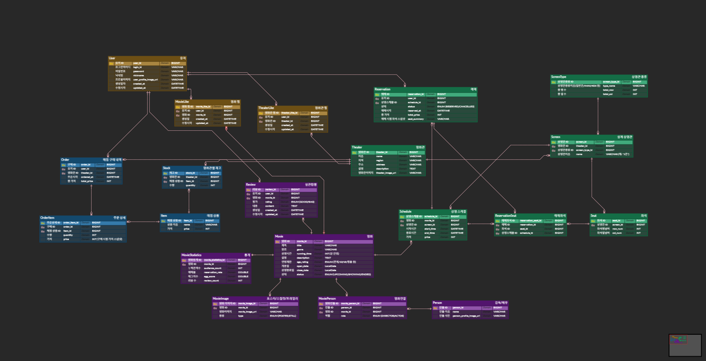
📎 [ERDCloud에서 보기](https://www.erdcloud.com/d/W8KHbPARz5j4dP2Ay)

## 1. 전체 엔티티 연관관계 정리

### 1-1. 유저

| 엔티티 | 설명 |
|---|---|
| `User` | 로그인 아이디(`loginId`) 기반 회원 정보. `createdAt`은 `BaseTimeEntity` 상속으로 자동 관리 |

### 1-2. 영화관 / 상영관 / 좌석

| 관계 | 타입 | 설명 | FK |
|---|---|---|---|
| Theater - Screen | 1 : N | 하나의 영화관은 여러 상영관을 가진다 | `Screen.theaterId` |
| ScreenType - Screen | 1 : N | 하나의 상영관 타입(일반관/IMAX 등)은 여러 상영관에 적용될 수 있다 | `Screen.screenTypeId` |
| Screen - Seat | 1 : N | 하나의 상영관은 여러 좌석을 가진다 | `Seat.screenId` |
| Theater - TheaterLike | 1 : N | 하나의 영화관은 여러 사용자에게 찜될 수 있다 (User와 TheaterLike를 통한 N:M) | `TheaterLike.theaterId` |

**설계 포인트 —**
"특별관/일반관 종류가 같으면 좌석이 동일하다"는 요구사항 때문에 처음엔 Seat를 ScreenType에 직접 연결하는 방식을 고려했으나, 이 경우 물리적으로 다른 상영관(예: 강남 IMAX 1관, 용산 IMAX 2관)이 동일한 Seat row를 공유하게 되어 좌석 점유 상태를 정확히 표현할 수 없는 문제가 있었습니다. 따라서 **Seat는 Screen에 직접 종속**시키고, "같은 타입이면 좌석 배치가 동일하다"는 요구사항은 **좌석 생성 시점의 로직**(ScreenType의 `totalRow × totalCol` 값을 참조해 생성)으로 보장하는 방식을 택했습니다.

### 1-3. 영화

| 관계 | 타입 | 설명 | FK |
|---|---|---|---|
| Movie - MovieImage | 1 : N | 하나의 영화는 여러 장의 포스터/스틸컷 이미지를 가진다 (`type`으로 POSTER/STILL 구분) | `MovieImage.movieId` |
| Movie - MovieStatistics | 1 : 1 | 하나의 영화는 하나의 통계 정보(예매율, 누적관객수, 에그지수)를 가진다 | `MovieStatistics.movieId` |
| Movie - MoviePerson | 1 : N | 하나의 영화에는 여러 감독/배우 정보가 연결될 수 있다 | `MoviePerson.movieId` |
| Person - MoviePerson | 1 : N | 한 인물은 여러 영화에 연결될 수 있다 (Movie와 Person이 MoviePerson을 통한 N:M) | `MoviePerson.personId` |
| Movie - MovieLike | 1 : N | 하나의 영화는 여러 사용자에게 찜될 수 있다 (User와 MovieLike를 통한 N:M) | `MovieLike.movieId` |
| Movie - Review | 1 : N | 하나의 영화에는 여러 리뷰가 작성될 수 있다 | `Review.movieId` |
| User - Review | 1 : N | 하나의 유저는 여러 영화에 리뷰를 작성할 수 있다 | `Review.userId` |

**설계 포인트 —**
실제 CGV 서비스를 참고해 상세페이지 구성 요소(포스터/스틸컷, 감독/배우, 예매율·누적관객수·에그지수, 실관람평)를 모두 반영하여 모델링을 진행했습니다. 다만 **API 구현은 미션에 명시된 6가지 기능 범위로 한정**했고, Review/Person은 Domain·Repository 계층까지만 구현했습니다.

**MovieStatistics를 Movie와 분리한 이유:**
예매율, 누적관객수, 에그지수 등은 정적인 영화 정보(제목, 줄거리 등)와 달리 계속 갱신되는 집계성 데이터라는 점에서 성격이 다르다고 판단해 별도 테이블로 분리했습니다. 등록/수정 API는 PATCH 하나로 upsert(있으면 갱신, 없으면 생성) 방식으로 구현했습니다.

### 1-4. 상영/예매

| 관계 | 타입 | 설명 | FK |
|---|---|---|---|
| Movie - Schedule | 1 : N | 하나의 영화는 여러 상영 회차를 가질 수 있다 | `Schedule.movieId` |
| Screen - Schedule | 1 : N | 하나의 상영관에서는 여러 상영 회차가 존재할 수 있다 | `Schedule.screenId` |
| User - Reservation | 1 : N | 하나의 유저는 여러 예매를 할 수 있다 | `Reservation.userId` |
| Schedule - Reservation | 1 : N | 하나의 상영 회차에는 여러 예매가 발생할 수 있다 | `Reservation.scheduleId` |
| Reservation - ReservationSeat | 1 : N | 하나의 예매는 여러 좌석을 포함할 수 있다 | `ReservationSeat.reservationId` |
| Seat - ReservationSeat | 1 : N | 하나의 좌석은 여러 회차에서 반복적으로 예매될 수 있다 | `ReservationSeat.seatId` |
| Schedule - ReservationSeat | 1 : N | 하나의 상영 회차에는 여러 예약 좌석 정보가 존재할 수 있다 | `ReservationSeat.scheduleId` |

**ReservationSeat에 scheduleId를 중복 저장한 이유**

`ReservationSeat`에는 이미 `reservationId`가 있고, `Reservation`에도 `scheduleId`가 있어 언뜻 중복처럼 보이지만, 이는 의도적인 비정규화입니다.

1. **동일 상영 회차의 동일 좌석 중복 예매 방지**: "같은 상영 회차(scheduleId)에서 같은 좌석(seatId)은 한 번만 예약 가능해야 한다"는 무결성을 DB 레벨에서 `UNIQUE(schedule_id, seat_id)` 제약으로 강제하려면, `ReservationSeat` 테이블 자체가 두 컬럼을 모두 갖고 있어야 합니다. `Reservation`을 조인해야만 회차를 알 수 있다면 단일 테이블 기준 유니크 제약을 만들 수 없습니다.
2. **팩토리 메서드로 불일치 가능성 차단**: `ReservationSeat.create(reservation, seat)`는 파라미터로 schedule을 별도로 받지 않고, 내부에서 `reservation.getSchedule()`을 그대로 사용하도록 구현하여 "예매의 상영 회차와 예매좌석의 상영 회차가 다르게 저장되는" 실수를 원천 차단했습니다.

**취소 시 ReservationSeat를 삭제하는 이유**
좌석 점유 여부는 `ReservationSeat`의 존재 여부로 판단하므로, 예매가 취소되면 해당 좌석이 다시 예매 가능한 상태로 돌아가야 합니다. 따라서 `Reservation.status`는 `CANCELLED`로 남기되(예매 이력 보존), `ReservationSeat` row는 삭제하여 좌석 재예매를 가능하게 했습니다. 다만 이 경우 취소된 예매를 조회했을 때 "어떤 좌석을 예매했었는지"를 알 수 없게 되는 문제가 있어, `Reservation`에 `seatSummary`(예: "A1, A2") 필드를 두어 예매 시점의 좌석 정보를 스냅샷으로 별도 보존했습니다.

**예매 취소 시간 제약**
실제 CGV 정책(상영 시작 20분 전까지 온라인 취소 가능)을 참고하여, 예매는 상영 시작 전까지, 취소는 상영 시작 20분 전까지만 가능하도록 서비스 로직에서 검증합니다.

### 1-5. 매점

| 관계 | 타입 | 설명 | FK |
|---|---|---|---|
| Item - Stock | 1 : N | 하나의 매점 메뉴는 여러 영화관에서 재고로 관리된다 | `Stock.itemId` |
| Theater - Stock | 1 : N | 하나의 영화관은 여러 매점 상품의 재고를 가진다 (Item과 Theater가 Stock을 통한 N:M) | `Stock.theaterId` |
| User - Order | 1 : N | 하나의 유저는 여러 매점 주문을 할 수 있다 | `Order.userId` |
| Theater - Order | 1 : N | 하나의 영화관에서는 여러 매점 주문이 발생할 수 있다 | `Order.theaterId` |
| Order - OrderItem | 1 : N | 하나의 주문은 여러 상품 항목을 포함할 수 있다 | `OrderItem.orderId` |
| Item - OrderItem | 1 : N | 하나의 상품은 여러 주문 항목에 포함될 수 있다 | `OrderItem.itemId` |

**설계 포인트 — Item(공통 메뉴)과 Stock(지점별 재고) 분리**
"모든 영화관의 매점 메뉴는 같지만, 재고는 지점별로 다르다"는 요구사항을 반영해 상품 마스터(`Item`)와 지점별 재고(`Stock`)를 분리했습니다.

**재고 차감의 동시성 처리**
재고 확인 후 차감하는 방식(select-then-update)은 동시 주문 시 재고가 음수가 될 수 있는 문제가 있어, `UPDATE ... SET quantity = quantity - ? WHERE quantity >= ?` 형태의 **조건부 UPDATE 쿼리**로 재고 차감을 원자적으로 처리했습니다. 영향받은 row가 0개면 재고 부족으로 판단해 예외를 던지고 트랜잭션 전체를 롤백합니다.

**가격 스냅샷**
`OrderItem.price`에는 주문 시점의 `Item.price`를 그대로 복사해 저장합니다. 이는 이후 매점 가격이 변동되더라도 과거 주문 내역의 결제 금액이 바뀌지 않도록 하기 위함입니다.

**"재고는 항상 1 이상" 요구사항 해석**

이 문구를 "재고 등록 시점"과 "구매로 인한 소진 시점" 두 가지로 나누어 해석했습니다.

- **등록 시점**: `Stock` 생성 시 `@Min(1)` 검증을 걸어, 재고를 0이나 음수로 초기 등록하는 것은 허용하지 않습니다.
- **구매(소진) 시점**: 정상적인 구매 누적으로 재고가 0이 되는 것은 "품절" 상태로 간주해 허용합니다. "재고는 항상 1 이상"을 "구매 후에도 항상 최소 1개가 남아있어야 한다"는 의미로 해석하면 마지막 남은 재고를 영원히 판매할 수 없는 매점이 되어 버리기 때문에, 이 문구는 데이터 정합성 관점(재고가 음수로 관리되거나, 처음부터 0으로 등록되는 경우가 없다는 것)의 규칙으로 해석했습니다.
- 재고 차감은 `UPDATE ... SET quantity = quantity - ? WHERE quantity >= ?` 형태의 조건부 UPDATE로 처리하여, 요청 수량만큼 남아있을 때만 차감이 성공하고 0까지는 정상적으로 소진될 수 있습니다.

## 2. 유니크 제약 조건 정리

| 테이블 | 제약 | 목적 |
|---|---|---|
| ReservationSeat | `UNIQUE(schedule_id, seat_id)` | 동일 회차에서 동일 좌석 중복 예매 방지 |
| Seat | `UNIQUE(screen_id, row_num, col_num)` | 같은 상영관 안에 동일 좌표(예: A1)의 좌석이 중복 생성되는 것 방지 |
| MovieLike | `UNIQUE(user_id, movie_id)` | 한 사용자가 같은 영화를 여러 번 찜하는 것 방지 |
| TheaterLike | `UNIQUE(user_id, theater_id)` | 한 사용자가 같은 영화관을 여러 번 찜하는 것 방지 |
| Stock | `UNIQUE(theater_id, item_id)` | 한 영화관에 같은 상품의 재고 row가 중복 생성되는 것 방지 |
| MovieStatistics | `UNIQUE(movie_id)` | 하나의 영화에 하나의 통계만 존재하도록 보장 (1:1 관계) |
| User | `UNIQUE(login_id)` | 로그인 아이디 중복 가입 방지 |

## 3. 서비스 로직에서 추가로 검증하는 부분

DB 제약만으로는 표현할 수 없어 서비스 계층에서 별도로 검증한 항목입니다.

- **좌석-상영관 일치 검증**: 예매 요청의 좌석들이 해당 상영 회차(`Schedule`)가 속한 상영관(`Screen`)의 좌석이 맞는지 확인
- **예매/취소 가능 시간 검증**: 상영 시작 전(예매), 상영 시작 20분 전(취소)까지만 허용
- **동시 예매 방어(2단계)**: 애플리케이션 레벨에서 좌석 점유 여부를 우선 조회해 명확한 에러 메시지(`SEAT_ALREADY_RESERVED`)를 반환하고, 동시 요청이 이 검증을 함께 통과하는 극단적 케이스는 DB 유니크 제약 위반(`DataIntegrityViolationException`)을 전역 예외 처리기에서 409로 변환해 최종 방어
- **재고 검증 및 원자적 차감**: 조건부 UPDATE 쿼리로 재고 부족 상황을 동시성 이슈 없이 처리
- **동일 상품 중복 주문 라인 병합**: 하나의 주문 요청에 같은 상품이 여러 줄로 들어와도 수량을 합산해 하나의 `OrderItem`으로 저장
- **본인 소유 데이터 검증**: 예매 상세조회/취소, 주문 상세조회는 요청한 사용자가 실제 소유자인지 확인 (`IsOwnedBy` 형태의 도메인 메서드로 구현)

## 4. 타임스탬프 설계 원칙

- **사건이 발생한 절대 시점**(User.createdAt, Reservation.reservedAt, Order.orderedAt 등) → `Instant` 사용
- **사람이 인지하는 로컬 시각**(Schedule.startTime/endTime — "9/14 19:30 상영") → `LocalDateTime` 사용
- **날짜만 의미 있는 값**(Movie.openDate/closeDate) → `LocalDate` 사용

</details>

<br>

<details>
<summary><h2>❓ 질문 정리</h2></summary>

### 1. `@JoinColumn`을 명시하지 않으면 어떻게 될까?

`@JoinColumn`을 생략해도 JPA가 기본 규칙에 따라 외래 키 컬럼명을 생성합니다.

예를 들어 `Member`에 다음과 같은 필드가 있다면 다음과 같이 동작합니다.

```java
@ManyToOne
private Team team;
```

기본적으로 **필드명 + `_` + 참조하는 PK 컬럼명**을 조합하여 `team_id`와 같은 형태의 외래 키를 사용합니다.

따라서 생략해도 동작하지만, 실제 테이블의 컬럼명을 명확히 표현하고 예상하지 못한 매핑을 방지하려면 `@JoinColumn(name = "team_id")`처럼 직접 명시하는 편이 좋습니다.

---

### 2. 양방향 매핑이 항상 좋을까?

항상 좋은 것은 아닙니다.

양방향 매핑을 사용하면 `Member -> Team`뿐만 아니라 `Team -> Member`로도 객체를 탐색할 수 있어 편리합니다. 하지만 양쪽 객체의 상태를 항상 동기화해야 한다는 문제가 있습니다.

예를 들어 다음과 같습니다.

```java
team.getMembers().add(member);
```

만 호출하고

```java
member.setTeam(team);
```

을 호출하지 않았다면 객체상으로는 `Team`에 `Member`가 존재하지만, `Member`에서는 `Team`이 `null`인 불일치 상태가 될 수 있습니다.

또한 엔티티를 그대로 JSON으로 변환하면 서로를 계속 참조하면서 순환 참조 문제가 발생할 수 있습니다.

따라서 기본적으로 단방향으로 설계하고, 반대 방향 탐색이 실제로 필요한 경우에만 양방향 관계를 추가하는 편이 좋습니다. 양방향으로 설계한다면 연관관계 편의 메서드를 함께 만들어 양쪽 상태를 동기화하는 것이 좋습니다.

---

### 3. PK 참조 vs UUID 참조

둘 중 하나만 선택하기보다는 **내부 DB에서는 Long PK를 사용하고, 외부 API에서는 UUID 같은 별도의 식별자를 사용하는 방식**이 적절합니다.

```java
@Id
@GeneratedValue(strategy = GenerationType.IDENTITY)
private Long id;

@Column(nullable = false, unique = true, updatable = false)
private String publicId;
```

Long 타입 PK는 크기가 작고 인덱스 관리에도 유리하기 때문에 내부 PK/FK로 사용하기 좋습니다.

반대로 API에서 `/members/1`, `/members/2`처럼 PK를 그대로 노출하면 다른 리소스의 ID를 쉽게 추측할 수 있고, DB의 내부 식별자가 외부에 그대로 드러난다는 단점이 있습니다.

따라서 내부 연관관계에서는 Long PK를 사용하고, 사용자에게 노출되는 값은 UUID/ULID 같은 별도의 식별자로 분리하는 방식이 역할도 명확하고 관리하기 편합니다.

---

### 4. `Team.members`만 수정하면 DB에도 반영될까?

반영되지 않습니다.

```java
@OneToMany(mappedBy = "team")
private List<Member> members;
```

여기서 `mappedBy`가 붙은 `Team.members`는 연관관계의 주인이 아닙니다.

실제 외래 키인 `team_id`는 `Member` 테이블이 가지고 있기 때문에 DB의 연관관계를 변경하려면 연관관계의 주인인 `Member.team`을 변경해야 합니다.

따라서 아래처럼 컬렉션에만 추가하면 다음과 같은 문제가 있습니다.

```java
team.getMembers().add(member);
```

메모리상의 `Team.members`는 변경되지만 외래 키는 변경되지 않습니다.

따라서 보통 다음과 같이 양쪽을 함께 변경하는 연관관계 편의 메서드를 만들어 사용합니다.

```java
public void setTeam(Team team) {
    this.team = team;
    team.getMembers().add(this);
}
```

---

### 5. `mappedBy` 없이 양쪽 모두에 `@JoinColumn`을 걸면 어떻게 될까?

양쪽 모두 같은 외래 키를 관리하려고 하기 때문에 문제가 발생할 수 있습니다.

예를 들어 `Member.team`과 `Team.members` 모두 `team_id`를 관리한다고 선언하면 JPA는 두 매핑을 하나의 양방향 관계가 아니라 각각 외래 키를 관리하는 독립적인 관계로 인식할 수 있습니다.

이 상태에서 양쪽에 서로 다른 값을 넣으면 다음과 같은 문제가 발생합니다.

```java
member.setTeam(teamA);
teamB.getMembers().add(member);
```

`Member` 쪽에서는 `team_id = teamA.id`를, `Team` 쪽에서는 `team_id = teamB.id`를 반영하려 하므로 서로 충돌하는 상태가 됩니다.

같은 값을 넣더라도 불필요한 SQL이 발생하거나 매핑 충돌의 원인이 될 수 있습니다.

따라서 양방향 관계에서는 **외래 키를 가진 쪽을 연관관계의 주인으로 두고, 반대쪽에는 `mappedBy`를 지정하는 방식**이 가장 명확합니다.

---

## Proxy 관련 질문

### 6-1. Proxy란?

Proxy는 실제 객체를 바로 가져오는 대신 실제 객체를 대신하는 **대리 객체**입니다.

JPA에서 지연 로딩을 사용하면 연관된 엔티티를 처음부터 모두 조회하지 않고 우선 Proxy 객체를 넣어둘 수 있습니다.

```java
Member member = em.find(Member.class, 1L);

// LAZY인 경우 이 시점에는 Team의 실제 데이터가
// 아직 조회되지 않았을 수 있다.
Team team = member.getTeam();
```

이후 실제 데이터가 필요한 시점에 Proxy가 초기화되면서 DB 조회가 발생합니다.

즉 Proxy를 이용하면 객체의 연관관계는 유지하면서 실제 데이터는 필요한 시점에 조회할 수 있습니다. 이것이 지연 로딩의 핵심입니다.

---

### 6-2. Proxy와 N+1 문제는 어떤 관계가 있을까?

Proxy를 사용한 지연 로딩은 **조회 시점을 늦춰줄 뿐, 필요한 쿼리의 개수를 자동으로 줄여주지는 않습니다.**

예를 들어 Member 100개를 한 번의 쿼리로 조회한 뒤 다음 코드처럼 연관 엔티티에 접근할 수 있습니다.

```java
for (Member member : members) {
    System.out.println(member.getTeam().getName());
}
```

각 Member의 Team 데이터에 접근하면 Proxy가 하나씩 초기화되면서 추가 쿼리가 계속 발생할 수 있습니다.

결국

- Member 목록 조회 1번
- 연관 데이터 조회 최대 N번

위와 같은 N+1 문제가 발생할 수 있습니다.

따라서 `LAZY`로 설정하는 것만으로 N+1 문제가 해결되지는 않으며, 필요한 경우 fetch join, `@EntityGraph`, Batch Fetching 같은 방법을 함께 사용해야 합니다.

---

### 6-3. Hibernate Proxy와 Spring AOP Proxy의 차이는?

둘 다 Proxy라는 이름을 사용하지만 목적은 다릅니다.

**Hibernate Proxy**는 JPA의 지연 로딩을 구현하기 위해 사용됩니다. 연관 엔티티를 바로 조회하지 않고 대리 객체를 두었다가 실제 값이 필요할 때 DB에서 조회합니다.

반면 **Spring AOP Proxy**는 객체의 메서드 호출을 가로채 앞뒤에 부가 기능을 적용하기 위해 사용합니다. 대표적으로 `@Transactional`이 있습니다.

예를 들어 다음과 같습니다.

```java
@Transactional
public void reserve() {
    ...
}
```

를 호출하면 Spring AOP Proxy가 메서드 호출을 가로채 트랜잭션 시작과 종료 처리를 수행합니다.

정리하면 Hibernate Proxy는 **엔티티의 지연 로딩**, Spring AOP Proxy는 **메서드 호출에 부가 기능을 적용하는 것**이 주요 목적이라는 차이가 있습니다.

---

### 6-4. 양방향 매핑 + `@OneToOne` + `nullable=true`에서 Proxy 문제가 발생하는 이유는?

세션 자료에는 당시 상황의 전체 코드가 나와 있지 않기 때문에, `@OneToOne`의 일반적인 Lazy Loading 문제를 기준으로 정리했습니다.

특히 양방향 `@OneToOne`에서 연관관계의 주인이 아닌 쪽은 자신의 테이블에 FK가 없습니다.

이때 관계가 optional, 즉 `nullable=true`라면 Hibernate 입장에서는 **연관된 객체가 실제로 존재하는지, 아니면 `null`인지 현재 엔티티의 정보만으로 판단하기 어렵습니다.**

Proxy를 생성하려면 연관 객체가 존재한다는 전제가 필요하지만, 실제로는 관계 자체가 없어 `null`일 수도 있습니다. 이를 확인하려면 결국 반대쪽 테이블을 조회해야 합니다.

따라서 이러한 `@OneToOne` 구조에서는 기대한 것처럼 단순하게 지연 로딩이 동작하지 않거나 추가 조회가 발생할 수 있습니다.

즉 `@OneToOne`에서 `LAZY`를 사용한다고 해서 모든 방향에서 무조건 Proxy만 생성되고 조회가 미뤄지는 것은 아니라는 점에 주의해야 합니다.

---

### 7. 그럼 항상 지연 로딩이 좋을까?

항상 좋은 것은 아닙니다.

연관 데이터를 거의 항상 같이 사용하는 상황이라면 매번 따로 조회하는 것보다 한 번에 가져오는 방식이 더 효율적일 수도 있습니다.

다만 엔티티 자체의 FetchType을 `EAGER`로 설정하면 필요하지 않은 상황에서도 항상 연관 엔티티를 조회하게 되어 예상하지 못한 N+1 문제가 발생할 수 있습니다.

따라서 기본적인 연관관계는 `LAZY`로 두고,

```java
select m
from Member m
join fetch m.team
```

처럼 **실제로 연관 데이터가 필요한 쿼리에서 fetch join이나 EntityGraph 등을 통해 함께 조회하도록 명시하는 방식**이 더 유연합니다.

---

### 8. fetch join과 페이징을 같이 사용하면 어떤 문제가 발생할까?

`ManyToOne`처럼 단일 객체를 fetch join하는 경우보다 `OneToMany` 같은 **컬렉션 fetch join에서 문제가 발생합니다.**

예를 들어 Team 하나에 Member가 여러 명 있다면 SQL JOIN 결과에서는 Team 데이터가 Member 수만큼 중복됩니다.

```text
TeamA - Member1
TeamA - Member2
TeamA - Member3
TeamB - Member4
...
```

이 상태에서 DB의 `LIMIT`, `OFFSET`을 바로 적용하면 의도한 "Team 10개"가 아니라 "JOIN 결과 row 10개"를 기준으로 데이터가 잘리게 됩니다.

따라서 Hibernate는 상황에 따라 데이터를 먼저 조회한 뒤 메모리에서 페이징을 수행할 수 있으며, 데이터가 많아지면 성능 저하와 메모리 사용량 증가 문제가 발생할 수 있습니다.

따라서 컬렉션 fetch join과 페이징이 함께 필요한 경우에는 보통 다음과 같은 방법을 사용합니다.

1. 먼저 부모 엔티티의 ID를 페이징해서 가져오고
2. 해당 ID들을 기준으로 연관 데이터를 다시 조회하거나
3. Batch Fetching을 이용하는 방식

위와 같은 방법으로 해결할 수 있습니다.

---

### 9. Dirty Checking의 UPDATE는 모든 컬럼을 업데이트하는데 개선이 필요할까?

Hibernate는 기본적으로 Dirty Checking으로 변경된 엔티티를 발견하면 UPDATE문에 여러 컬럼을 함께 포함시킬 수 있습니다.

예를 들어 `username`만 수정했더라도 다음과 같은 형태의 쿼리가 생성될 수 있습니다.

```sql
UPDATE member
SET username = ?, email = ?, age = ?
WHERE id = ?
```

이 방식은 UPDATE SQL의 형태가 일정하여 SQL을 재사용하기 쉽다는 장점이 있으므로 무조건 나쁜 것은 아닙니다.

하지만 컬럼이 많은 테이블에서 일부 값만 자주 변경된다면 불필요한 컬럼까지 UPDATE문에 포함될 수 있습니다.

Hibernate에서는 이 경우 `@DynamicUpdate`를 사용할 수 있습니다.

```java
@Entity
@DynamicUpdate
public class Member {
    ...
}
```

그러면 실제로 변경된 컬럼을 기준으로 UPDATE SQL을 생성합니다.

다만 수정되는 컬럼에 따라 SQL 형태가 달라질 수 있으므로 모든 엔티티에 무조건 적용하기보다는 컬럼 수와 수정 패턴을 고려하여 필요한 곳에 적용하는 것이 적절합니다.

---

### 10. flush는 언제 발생할까?

대표적으로 다음과 같은 상황에서 발생합니다.

- `em.flush()`를 직접 호출한 경우
- 트랜잭션이 commit되기 직전
- JPQL 쿼리를 실행하기 전 필요한 경우

flush는 영속성 컨텍스트를 비우는 것이 아니라 **영속성 컨텍스트의 변경 내용을 DB와 동기화하는 과정**입니다.

따라서 flush가 실행되어도 1차 캐시에 있던 엔티티가 사라지지 않습니다. 영속성 컨텍스트를 실제로 비우는 작업은 `clear()`입니다.

---

### 11. 영속성 컨텍스트와 EntityManager, EntityManager와 Transaction은 항상 1:1일까?

항상 1:1로 대응하는 것은 아닙니다.

JPA에서 EntityManager는 영속성 컨텍스트를 통해 엔티티를 관리하지만, 실제 관계는 환경과 영속성 컨텍스트의 생명주기에 따라 달라질 수 있습니다.

특히 Spring에서는 Repository가 싱글톤이어도 요청이나 트랜잭션마다 서로 다른 실제 EntityManager를 사용할 수 있습니다. Repository에 실제 EntityManager 하나를 고정해서 넣는 것이 아니라, 현재 트랜잭션에 맞는 EntityManager로 연결해주는 Proxy를 주입하기 때문입니다.

또한 하나의 EntityManager에서도 순차적으로 여러 트랜잭션을 수행할 수 있으며, extended persistence context처럼 하나의 영속성 컨텍스트가 여러 트랜잭션에 걸쳐 유지되는 경우도 있습니다.

따라서 개념적으로 무조건

```text
영속성 컨텍스트 : EntityManager : Transaction = 1 : 1 : 1
```

이라고 고정해서 생각하기보다는 각각의 생명주기가 다를 수 있다고 이해하는 것이 적절합니다.

---

## 추가로 생각해보기

### 12-1. `SimpleJpaRepository`는 싱글톤인데 EntityManager를 생성자 주입받아도 괜찮을까?

Repository가 싱글톤이기 때문에 EntityManager도 하나만 주입되어 여러 요청이 같은 EntityManager를 공유하는 것처럼 보일 수 있습니다.

하지만 실제로 Spring이 주입하는 것은 **특정 EntityManager 자체가 아니라 EntityManager를 대신하는 Proxy**입니다.

```text
SimpleJpaRepository
        ↓
EntityManager Proxy
        ↓
현재 Transaction에 연결된 실제 EntityManager
```

Repository 객체 자체는 싱글톤으로 하나만 존재하지만, 메서드가 실행될 때 Proxy가 현재 트랜잭션에 연결된 실제 EntityManager를 찾아 작업을 위임합니다.

따라서 여러 요청이 싱글톤 Repository를 동시에 사용해도 동일한 실제 EntityManager 하나를 무조건 공유하는 구조는 아닙니다.

---

### 12-2. fetch join에서 `distinct`를 사용하지 않으면 어떤 문제가 생길까?

특히 `OneToMany` 컬렉션을 fetch join하면 JOIN 결과에서 부모 엔티티가 자식 개수만큼 반복될 수 있습니다.

예를 들어 TeamA에 Member가 3명이라면 SQL 결과는 다음과 같습니다.

```text
TeamA - Member1
TeamA - Member2
TeamA - Member3
```

조회하려는 Team은 하나이지만 SQL 결과에서는 3개의 row가 생성됩니다.

이 때문에 JPA/Hibernate 버전과 조회 방식에 따라 조회 결과에서 동일한 부모 엔티티 참조가 중복되는 문제가 발생할 수 있습니다.

JPQL에서는 이런 경우 다음과 같이 작성할 수 있습니다.

```java
select distinct t
from Team t
join fetch t.members
```

위와 같이 `distinct`를 사용할 수 있습니다.

다만 `distinct`를 사용한다고 해서 JOIN으로 발생하는 row 자체가 없어지는 것은 아닙니다. 컬렉션 fetch join 자체가 결과 row 수를 증가시킬 수 있으므로 데이터 양이 많은 경우에는 이 점도 함께 고려해야 합니다.

---

### 12-3. fetch join 관련 에러 3가지

#### a. `HHH000104: firstResult/maxResults specified with collection fetch; applying in memory!`

컬렉션 fetch join과 페이징을 동시에 사용했을 때 발생할 수 있는 경고입니다.

JOIN으로 인해 하나의 부모 엔티티가 여러 row로 만들어지기 때문에 DB에서 단순하게 `LIMIT/OFFSET`을 적용하면 부모 엔티티 기준의 정확한 페이지를 만들기 어렵습니다.

따라서 Hibernate가 DB에서 페이징하지 않고 데이터를 가져온 뒤 메모리에서 페이징할 수 있으며, 데이터가 많으면 심각한 성능 문제가 발생할 수 있습니다.

**해결 방법**
- 컬렉션 fetch join과 직접적인 페이징을 피합니다.
- 부모 엔티티를 먼저 페이징한 뒤 별도 쿼리로 연관 데이터를 조회합니다.
- Batch Fetching을 활용합니다.

---

#### b. `query specified join fetching, but the owner of the fetched association was not present in the select list`

fetch join의 대상이 되는 연관관계의 **owner가 SELECT 결과에 포함되어 있지 않을 때** 발생합니다.

fetch join은 조회한 엔티티의 연관 데이터를 함께 채워주는 기능이기 때문에, 정작 해당 엔티티를 SELECT하지 않으면 fetch한 데이터를 넣어줄 대상이 없습니다.

예를 들어 다음과 같은 형태에서 발생할 수 있습니다.

```java
select t
from Member m
join fetch m.team t
```

위 쿼리는 Member의 `team`을 fetch하면서 정작 owner인 Member를 조회 결과에서 제외한 경우입니다.

따라서 다음과 같이 owner인 Member를 조회해야 합니다.

```java
select m
from Member m
join fetch m.team
```

DTO Projection이 목적이라면 fetch join 대신 일반 join을 사용하는 방법도 있습니다.

---

#### c. `MultipleBagFetchException: cannot simultaneously fetch multiple bags`

Hibernate에서 `List` 형태의 여러 컬렉션을 동시에 fetch join하려고 할 때 발생할 수 있습니다.

예를 들어 다음과 같습니다.

```java
Team -> List<Member>
Team -> List<Project>
```

두 컬렉션을 동시에 fetch join하면 SQL에서는 Member와 Project가 곱해지면서 Cartesian Product 형태가 됩니다.

Member가 10명이고 Project가 10개라면 하나의 Team에 대해 최대 100개의 row가 만들어질 수 있습니다.

Hibernate는 이런 결과에서 여러 Bag 컬렉션을 정상적으로 구성하기 어렵기 때문에 `MultipleBagFetchException`을 발생시킵니다.

**해결 방법**
- 여러 컬렉션을 한 번에 fetch join하지 않고 쿼리를 나눕니다.
- 필요한 경우 컬렉션 중 하나를 `Set` 등 다른 구조로 변경할 수 있는지 검토합니다.
- Batch Fetching을 사용해 여러 컬렉션을 나눠서 로딩합니다.

단순히 `distinct`를 추가한다고 해결되는 문제는 아닙니다.

</details>

<details>
<summary><h2>JWT / Spring Security</h2></summary>

<details>
<summary><h3>JWT를 활용한 인증 흐름</h3></summary>

### 인증과 인가

인증(Authentication)은 **요청을 보낸 사용자가 누구인지 확인하는 과정**이고, 인가(Authorization)는 **인증된 사용자가 특정 기능을 사용할 권한이 있는지 확인하는 과정**입니다.

| 구분 | 의미 | 프로젝트 적용 예시 |
| --- | --- | --- |
| 인증 | 사용자가 누구인지 확인합니다. | 로그인, Access Token 검증 |
| 인가 | 사용자가 해당 기능을 사용할 권한이 있는지 확인합니다. | 영화관 찜, 관리자 영화관 생성 |

일반 사용자가 정상적으로 로그인했더라도 `ADMIN` 권한이 필요한 영화관 생성 API에는 접근할 수 없습니다.

---

### HTTP의 Stateless 특성과 JWT 인증

HTTP 요청은 기본적으로 서로 독립적입니다.

따라서 로그인에 성공하더라도 서버가 별도로 인증 상태를 저장하지 않는다면 다음 요청에서 이전 로그인 정보를 알 수 없습니다.

이번 프로젝트에서는 서버 세션에 인증 정보를 저장하지 않고, 클라이언트가 매 요청마다 Access Token을 전달하는 방식으로 구성했습니다.

```text
로그인 요청
    ↓
사용자 인증
    ↓
Access Token 발급
    ↓
클라이언트가 Access Token 보관
    ↓
Authorization 헤더에 Access Token 전달
    ↓
서버가 요청마다 JWT 검증
```

Access Token은 다음 형식으로 전달합니다.

```http
Authorization: Bearer <access-token>
```

Spring Security에는 `SessionCreationPolicy.STATELESS`를 적용하여 이전 요청의 인증 상태가 다음 요청에 유지되지 않도록 구성했습니다.

---

### 쿠키, 세션, JWT의 역할

쿠키, 세션, JWT는 동일한 종류의 개념이 아닙니다.

| 구분 | 역할 |
| --- | --- |
| Cookie | 브라우저가 데이터를 저장하고 요청 시 함께 전송하기 위한 수단입니다. |
| Session | 서버가 사용자의 상태를 저장하고 Session ID로 사용자를 식별하는 방식입니다. |
| Token | 클라이언트가 자신의 인증 정보를 증명하기 위해 서버에 전달하는 값입니다. |
| JWT | Claim을 포함할 수 있는 토큰의 표현 형식 중 하나입니다. |

쿠키에는 Session ID를 저장할 수도 있고 JWT를 저장할 수도 있습니다.

이번 프로젝트에서는 인증 정보를 쿠키로 전달하지 않고 `Authorization` 헤더의 Bearer Token으로 전달합니다.

---

### JWT의 구조

JWT는 `Header`, `Payload`, `Signature` 세 부분으로 구성됩니다.

```text
xxxxx.yyyyy.zzzzz
  │     │     │
  │     │     └─ Signature
  │     └─────── Payload
  └───────────── Header
```

#### Header

Header에는 토큰의 타입과 서명에 사용된 알고리즘 정보가 포함됩니다.

```json
{
  "alg": "HS256",
  "typ": "JWT"
}
```

현재 프로젝트에서는 HS256 알고리즘을 이용하여 Access Token에 서명합니다.

#### Payload

Payload에는 사용자 및 토큰과 관련된 Claim이 저장됩니다.

현재 프로젝트의 Access Token에는 다음 Claim을 사용합니다.

| Claim | 값 | 용도 |
| --- | --- | --- |
| `sub` | 사용자 ID | 인증된 사용자를 식별합니다. |
| `role` | `USER` / `ADMIN` | 역할 기반 인가에 사용합니다. |
| `iat` | 토큰 발급 시각 | 토큰이 발급된 시간을 나타냅니다. |
| `exp` | 토큰 만료 시각 | Access Token의 유효 기간을 제한합니다. |

JWT의 Payload는 암호화된 영역이 아니므로 비밀번호와 같은 민감한 정보는 포함하지 않습니다.

#### Signature

Signature는 Header와 Payload가 토큰 발급 이후 변경되지 않았는지 검증하기 위해 사용합니다.

서버는 Secret Key를 이용해 토큰에 서명하며, 요청으로 전달된 JWT의 서명을 동일한 키를 기준으로 검증합니다.

서명이 일치하지 않는 경우 변조되었거나 신뢰할 수 없는 토큰으로 판단합니다.

즉 Signature는 JWT의 내용을 숨기는 용도가 아니라 **토큰의 무결성을 검증하는 용도**입니다.

---

### Access Token과 Refresh Token

Access Token과 Refresh Token은 사용 목적이 다릅니다.

| 구분 | Access Token | Refresh Token |
| --- | --- | --- |
| 목적 | 보호된 API 접근 | 새로운 Access Token 발급 |
| 사용 시점 | 일반 API 요청 | Access Token 재발급 |
| 일반적인 만료 기간 | 상대적으로 짧음 | 상대적으로 김 |
| 탈취 시 위험 | 권한 있는 API 호출 가능 | Access Token 재발급 가능 |

---

### 로그인 인증 흐름

로그인 시 애플리케이션에서 비밀번호를 직접 비교하지 않고 Spring Security의 인증 구조를 사용합니다.

```text
로그인 요청
    ↓
AuthenticationManager
    ↓
DaoAuthenticationProvider
    ↓
CustomUserDetailsService
    ↓
UserRepository에서 사용자 조회
    ↓
PasswordEncoder로 비밀번호 검증
    ↓
인증 성공
    ↓
Access Token 발급
```

`CustomUserDetailsService`는 사용자 조회와 `UserDetails` 반환을 담당합니다.

비밀번호 비교는 `DaoAuthenticationProvider`가 `PasswordEncoder`를 이용하여 수행합니다.

존재하지 않는 로그인 아이디와 잘못된 비밀번호는 모두 동일한 로그인 실패 응답으로 처리하여 사용자의 존재 여부가 노출되지 않도록 구성했습니다.

---

### JWT 인증 흐름

로그인 이후 보호 API 요청은 다음과 같이 처리됩니다.

```text
클라이언트 요청
Authorization: Bearer <access-token>
          ↓
JwtAuthenticationFilter
          ↓
Bearer Token 추출
          ↓
JWT 서명 / 만료 검증
          ↓
userId / role 추출
          ↓
CustomUserDetails 생성
          ↓
Authentication 생성
          ↓
새 SecurityContext 생성
          ↓
Authentication 저장
          ↓
인가 규칙 확인
          ↓
Controller
```

`JwtAuthenticationFilter`는 `OncePerRequestFilter`를 상속하여 구현했습니다.

정상적으로 검증된 JWT의 사용자 ID와 역할을 이용하여 `CustomUserDetails`를 만들고, 이를 principal로 갖는 `Authentication` 객체를 생성합니다.

이후 새로운 `SecurityContext`에 Authentication을 저장하여 현재 요청의 인증 정보로 사용합니다.

---

### Authentication과 SecurityContext

JWT 인증에 성공하면 다음과 같은 Authentication이 생성됩니다.

```text
Authentication
├── principal   = CustomUserDetails
├── credentials = null
├── authorities = ROLE_USER 또는 ROLE_ADMIN
└── authenticated = true
```

JWT 검증 이후에는 토큰 자체가 인증의 근거이므로 비밀번호를 Authentication에 저장하지 않습니다.

`SecurityContext`는 현재 요청의 Authentication을 보관합니다.

```text
SecurityContext
└── Authentication
    ├── principal
    └── authorities
```

Controller에서는 다음과 같이 인증된 사용자의 principal을 받을 수 있습니다.

```java
@AuthenticationPrincipal CustomUserDetails userDetails
```

---

### 401과 403의 차이

인증 실패와 인가 실패는 구분하여 처리했습니다.

| 상황 | HTTP Status | Error Code |
| --- | ---: | --- |
| 보호 API에 토큰 없이 접근 | 401 | `TOKEN_NOT_EXIST` |
| 만료된 토큰 | 401 | `TOKEN_EXPIRED` |
| 변조되거나 유효하지 않은 토큰 | 401 | `TOKEN_INVALID` |
| 인증됐지만 필요한 권한이 없음 | 403 | `ACCESS_DENIED` |

```text
401 Unauthorized
→ 사용자가 누구인지 인증할 수 없는 상태입니다.

403 Forbidden
→ 사용자가 누구인지는 알지만 해당 기능을 사용할 권한이 없는 상태입니다.
```

인증 실패는 `AuthenticationEntryPoint`, 인가 실패는 `AccessDeniedHandler`에서 처리합니다.

</details>

<details>
<summary><h3>구현 내용</h3></summary>

### 회원가입

테스트를 편리하게 하기 위해 회원가입 API를 구현했습니다.

```http
POST /api/auth/signup
```

회원가입 요청은 다음 정보를 전달받습니다.

```json
{
  "loginId": "user01",
  "nickname": "사용자1",
  "password": "password123"
}
```

비밀번호는 `PasswordEncoder`를 이용하여 해시한 뒤 DB에 저장합니다.

일반 회원가입에서는 역할을 입력받지 않으며 모든 사용자를 `USER` 권한으로 생성합니다.

따라서 클라이언트가 회원가입 요청을 통해 임의로 `ADMIN` 권한을 지정할 수 없는 구조입니다.

---

### 로그인 및 Access Token 발급

로그인 API는 다음과 같습니다.

```http
POST /api/auth/login
```

```json
{
  "loginId": "user01",
  "password": "password123"
}
```

로그인 요청은 `AuthenticationManager`에 전달하여 인증합니다.

인증에 성공한 경우 사용자 ID와 역할, 발급 시각, 만료 시각을 포함하는 Access Token을 발급합니다.

```text
sub  = userId
role = USER / ADMIN
iat  = 발급 시각
exp  = 만료 시각
```

---

### JWT 인증 필터

JWT 인증을 위해 `OncePerRequestFilter`를 상속한 `JwtAuthenticationFilter`를 구현했습니다.

필터의 처리 과정은 다음과 같습니다.

```text
Authorization 헤더 조회
        ↓
Bearer Token 추출
        ↓
JWT 검증
        ↓
CustomUserDetails 생성
        ↓
Authentication 생성
        ↓
SecurityContext 저장
```

Authorization 헤더가 존재하지 않는 경우에는 Authentication을 생성하지 않고 다음 필터로 요청을 전달합니다.

최종 접근 허용 여부는 `SecurityConfig`에 설정한 공개 API와 보호 API의 인가 규칙에 따라 결정됩니다.

#### JWT 검증 실패 정책

| 상황 | 처리 |
| --- | --- |
| Authorization 헤더 없음 | 인증 객체를 만들지 않고 다음 필터로 전달합니다. |
| Access Token 만료 | `401 TOKEN_EXPIRED`를 반환합니다. |
| 토큰 변조 또는 형식 오류 | `401 TOKEN_INVALID`를 반환합니다. |
| 정상 Access Token | Authentication을 SecurityContext에 저장합니다. |

토큰 검증에 실패한 경우 JWT 필터에서 `AuthenticationEntryPoint`를 직접 호출하고 필터 체인을 종료합니다.

공개 API는 토큰 없이 접근할 수 있습니다.

다만 클라이언트가 Authorization 헤더를 통해 Access Token을 명시적으로 전달한 경우에는 해당 토큰을 검증하며, 만료되거나 유효하지 않은 토큰이면 공개 API에서도 401 응답을 반환하도록 구성했습니다.

로그인, 회원가입, Swagger 관련 경로는 JWT 필터의 검사 대상에서 제외했습니다.

---

### Stateless 인증 설정

이번 프로젝트에서는 인증 정보를 Bearer Header로만 전달하고 서버 세션과 인증 쿠키를 사용하지 않습니다.

```java
.sessionManagement(session ->
        session.sessionCreationPolicy(SessionCreationPolicy.STATELESS))
```

따라서 로그인에 성공하더라도 인증 상태가 서버에 저장되지 않으며, 보호 API 요청마다 Access Token을 다시 전달해야 합니다.

또한 JWT 필터가 매 요청마다 JWT를 검증하고 새로운 Authentication과 SecurityContext를 생성합니다.

---

### CSRF 설정

이번 프로젝트에서는 CSRF 보호를 비활성화했습니다.

```java
.csrf(csrf -> csrf.disable())
```

CSRF는 브라우저가 인증 쿠키를 요청에 자동으로 포함하는 특성을 악용하는 공격과 밀접한 관련이 있습니다.

이번 구현에서는 인증 정보를 쿠키가 아닌 `Authorization: Bearer <access-token>` 헤더를 통해 명시적으로 전달하고, 서버 세션에 인증 상태를 저장하지 않습니다.

따라서 이번 과제의 인증 방식에서는 CSRF 보호를 비활성화하여 구성했습니다.

---

### 영화관 찜 API 사용자 인증

사용자 인증이 필요한 API로 영화관 찜 기능을 선택했습니다.

```http
POST /api/theaters/{theaterId}/likes
DELETE /api/theaters/{theaterId}/likes
```

기존에는 요청 파라미터로 `userId`를 전달받는 구조였습니다.

```text
기존

Request Parameter userId
        ↓
TheaterLikeService
```

이 방식은 클라이언트가 임의의 사용자 ID를 지정할 수 있다는 문제가 있습니다.

이를 다음과 같이 변경했습니다.

```text
변경

JWT
 ↓
JwtAuthenticationFilter
 ↓
CustomUserDetails
 ↓
@AuthenticationPrincipal
 ↓
인증된 userId
 ↓
TheaterLikeService
```

Controller에서는 다음과 같이 현재 인증된 사용자를 전달받습니다.

```java
@AuthenticationPrincipal CustomUserDetails userDetails
```

영화관 찜 및 찜 취소 처리에는 `userDetails.getUserId()`를 사용합니다.

따라서 클라이언트가 임의의 사용자 ID를 전달하여 다른 사용자의 데이터에 접근할 수 없도록 구성했습니다.

---

### 영화관 찜 소유권 보호

`@AuthenticationPrincipal`은 현재 인증된 사용자를 식별하기 위한 기능이고, 실제 소유권 보호는 인증된 사용자 ID를 데이터 조회 조건에 포함하는 방식으로 구현했습니다.

영화관 찜 취소 시 다음 조건으로 데이터를 조회합니다.

```text
인증된 userId + theaterId
        ↓
findByUserIdAndTheaterId()
        ↓
현재 사용자의 찜 데이터만 조회
        ↓
삭제
```

따라서 사용자 A가 특정 영화관을 찜한 상태에서 사용자 B가 동일한 영화관에 대한 찜 취소 요청을 보내더라도 B의 사용자 ID를 기준으로 데이터를 조회합니다.

사용자 A의 찜 데이터는 조회 대상이 아니므로 다른 사용자의 찜을 삭제할 수 없는 구조입니다.

---

### 역할 기반 접근 제어

사용자 역할은 `USER`와 `ADMIN`으로 구분했습니다.

| Role | 설명                   |
| --- |----------------------|
| `USER` | 일반 사용자               |
| `ADMIN` | 관리자 기능을 사용할 수 있는 사용자 |

DB에는 다음과 같이 역할을 저장합니다.

```text
USER
ADMIN
```

Spring Security의 권한으로 변환할 때 `CustomUserDetails#getAuthorities()`에서 `ROLE_` 접두사를 추가합니다.

```text
ADMIN
 ↓
ROLE_ADMIN
 ↓
hasRole("ADMIN")
```

관리자 전용 API로 영화관 생성 API를 사용했습니다.

```http
POST /api/theaters
```

`SecurityConfig`에는 다음 규칙을 적용했습니다.

```java
.requestMatchers(HttpMethod.POST, "/api/theaters").hasRole("ADMIN")
```

따라서 접근 결과는 다음과 같습니다.

| 요청 | 결과 |
| --- | --- |
| 토큰 없이 영화관 생성 | `401 TOKEN_NOT_EXIST` |
| `USER` 토큰으로 영화관 생성 | `403 ACCESS_DENIED` |
| `ADMIN` 토큰으로 영화관 생성 | 정상 처리 |

일반 회원가입으로 생성된 사용자는 항상 `USER` 권한을 갖습니다.

테스트용 관리자 계정은 일반 회원가입으로 생성한 뒤 DB의 역할 값을 `ADMIN`으로 변경하여 준비했습니다.

DB에서 역할을 변경한 이후에는 새로 로그인하여 `ADMIN` 역할이 포함된 Access Token을 다시 발급받아 사용합니다.

---

### 인증·인가 실패 공통 응답 처리

Spring Security의 인증·인가 실패는 Security Filter Chain에서 발생하므로 `@RestControllerAdvice`에서 자동으로 처리되지 않습니다.

따라서 `AuthenticationEntryPoint`와 `AccessDeniedHandler`를 별도로 구현하여 `SecurityConfig`에 연결했습니다.

| 처리기 | 역할 |
| --- | --- |
| `AuthenticationEntryPoint` | 인증이 필요한 요청의 인증 실패를 처리합니다. |
| `AccessDeniedHandler` | 인증된 사용자의 권한 부족을 처리합니다. |

#### 인증 실패

토큰이 존재하지 않거나 JWT 검증에 실패한 경우 `AuthenticationEntryPoint`에서 401 응답을 생성합니다.

```text
토큰 없음
→ TOKEN_NOT_EXIST

토큰 만료
→ TOKEN_EXPIRED

토큰 변조 / 형식 오류
→ TOKEN_INVALID
```

JWT 검증에 실패한 경우에는 필터에서 실패 원인을 request attribute에 저장한 뒤 `AuthenticationEntryPoint`를 직접 호출하고 요청 처리를 종료합니다.

#### 인가 실패

정상적으로 인증된 사용자이지만 필요한 역할이 없는 경우에는 `AccessDeniedHandler`를 통해 403 응답을 생성합니다.

```text
ROLE_USER
    ↓
ADMIN 전용 API 요청
    ↓
권한 부족
    ↓
ACCESS_DENIED
```

#### 공통 JSON 응답

Security 계층의 오류 역시 기존 프로젝트의 `ApiResponse` 형식을 사용하도록 `SecurityResponseWriter`에서 JSON 응답을 공통으로 생성합니다.

```json
{
  "isSuccess": false,
  "code": "TOKEN_EXPIRED",
  "message": "토큰이 만료되었습니다.",
  "data": null
}
```

최종 오류 정책은 다음과 같습니다.

| 상황 | HTTP Status | Error Code |
| --- | ---: | --- |
| 보호 API에 토큰 없이 접근 | 401 | `TOKEN_NOT_EXIST` |
| 만료된 Access Token | 401 | `TOKEN_EXPIRED` |
| 변조되거나 유효하지 않은 Access Token | 401 | `TOKEN_INVALID` |
| 인증됐지만 권한 부족 | 403 | `ACCESS_DENIED` |

</details>

<details>
<summary><h3>정상·실패 상황 테스트</h3></summary>

JWT 및 Spring Security 인증·인가 로직을 Swagger를 이용하여 수동으로 테스트했습니다.

### 정상 로그인

올바른 로그인 아이디와 비밀번호를 전달한 경우 인증에 성공하고 Access Token이 정상적으로 발급되는 것을 확인했습니다.

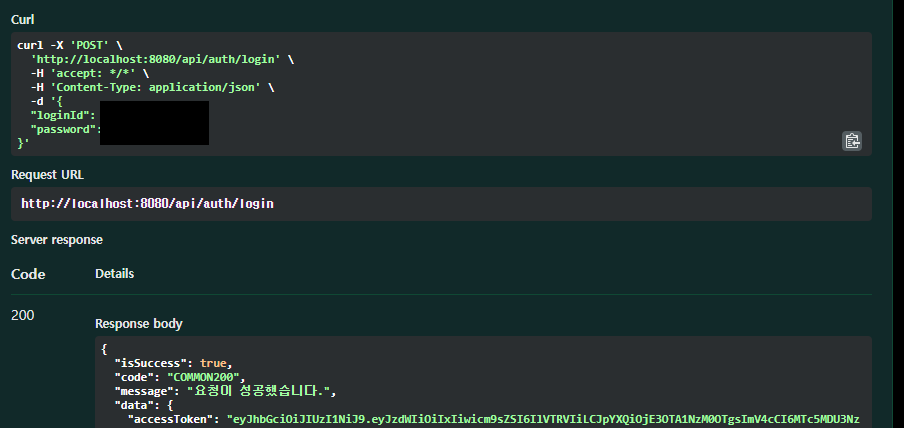

### 로그인 실패

존재하지 않는 로그인 아이디와 잘못된 비밀번호를 각각 사용하여 로그인 요청을 수행했습니다.

두 경우 모두 `401 Unauthorized`와 동일한 `LOGIN_FAILED` 응답이 반환되며 Access Token이 발급되지 않는 것을 확인했습니다. 이를 통해 사용자의 존재 여부가 로그인 실패 응답을 통해 구분되지 않도록 구성했습니다.

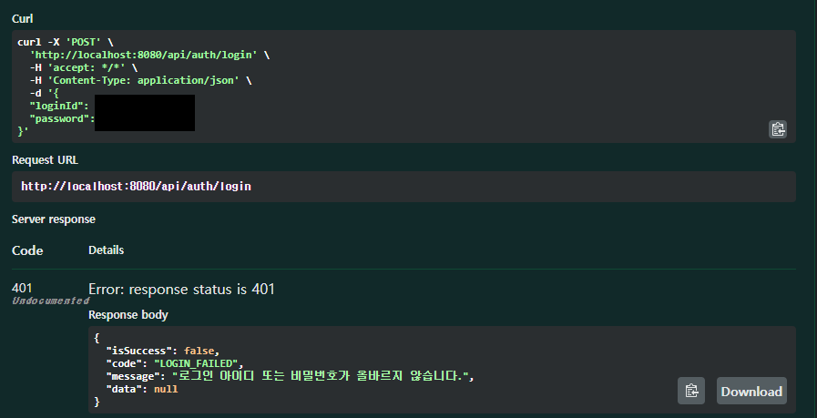

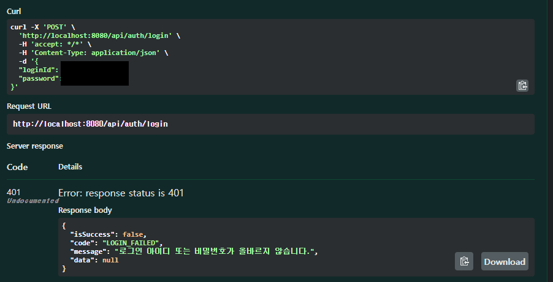

### 공개 API 접근

Authorization 헤더 없이 영화관 조회 API를 호출했을 때 정상적으로 처리되는 것을 확인했습니다.

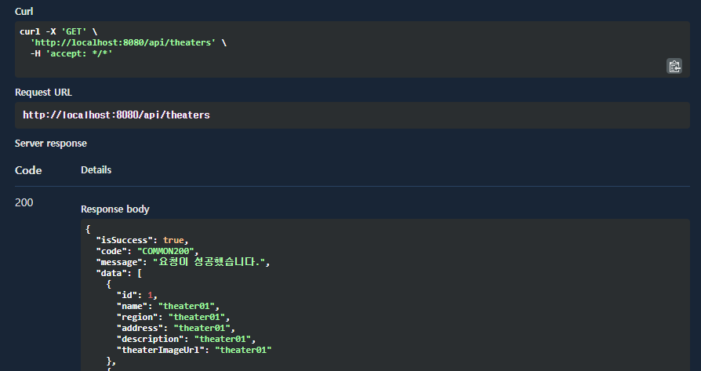

### 정상 토큰으로 보호 API 접근

정상적으로 발급된 Access Token을 `Authorization: Bearer <access-token>` 형식으로 전달하여 영화관 찜 API를 호출했습니다.

JWT 인증 필터에서 토큰 검증 후 Authentication이 SecurityContext에 저장되며, `@AuthenticationPrincipal`을 통해 인증된 사용자의 ID를 사용하여 영화관 찜이 정상적으로 처리되는 것을 확인했습니다.

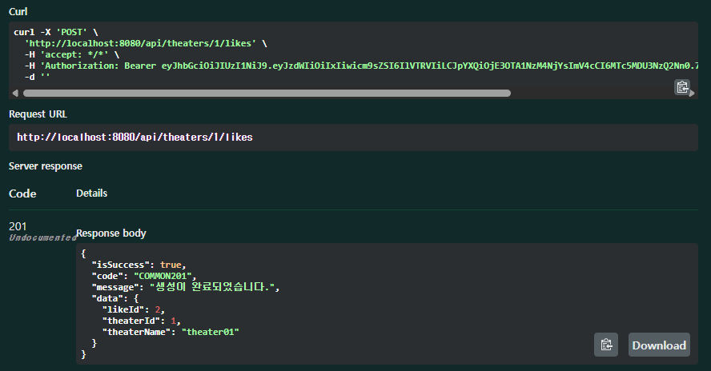

### 토큰 없이 보호 API 접근

Access Token 없이 영화관 찜 API를 호출한 경우 `401 Unauthorized`와 `TOKEN_NOT_EXIST` 응답이 반환되는 것을 확인했습니다.

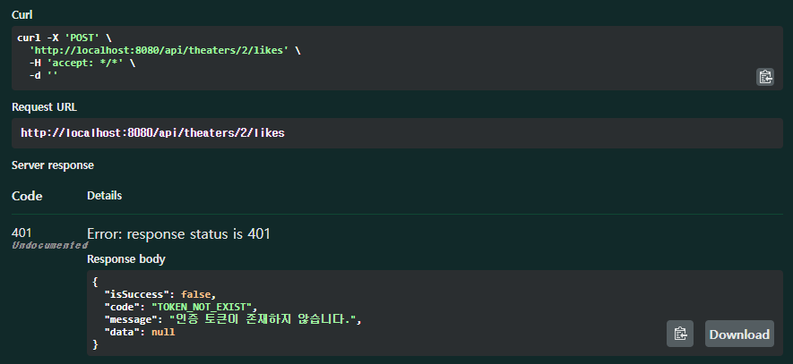

### 만료된 토큰

짧은 만료 시간을 적용하여 발급한 Access Token이 만료된 이후 보호 API를 호출했습니다.

`401 Unauthorized`와 `TOKEN_EXPIRED` 응답이 반환되는 것을 확인했습니다.

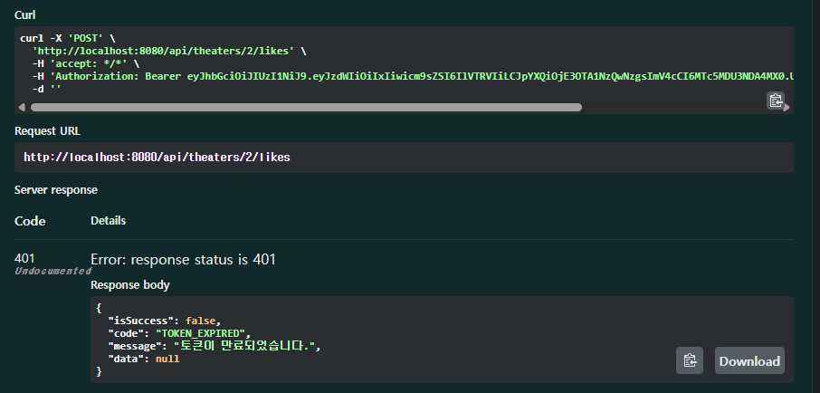

### 변조된 토큰

발급받은 JWT의 Payload 일부를 변경한 뒤 보호 API를 호출했습니다.

서명 검증에 실패하여 `401 Unauthorized`와 `TOKEN_INVALID` 응답이 반환되는 것을 확인했습니다.

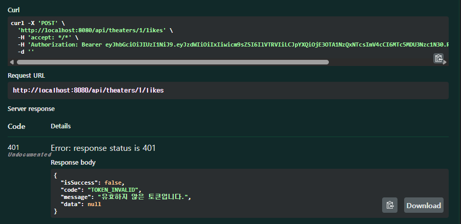

### 다른 서명 키로 발급된 토큰

Access Token 발급 시 사용한 서명 키와 다른 키를 서버의 검증 키로 설정한 뒤 기존 Access Token으로 보호 API를 호출했습니다.

서명 검증에 실패하여 `401 Unauthorized` 응답이 반환되는 것을 확인했습니다.

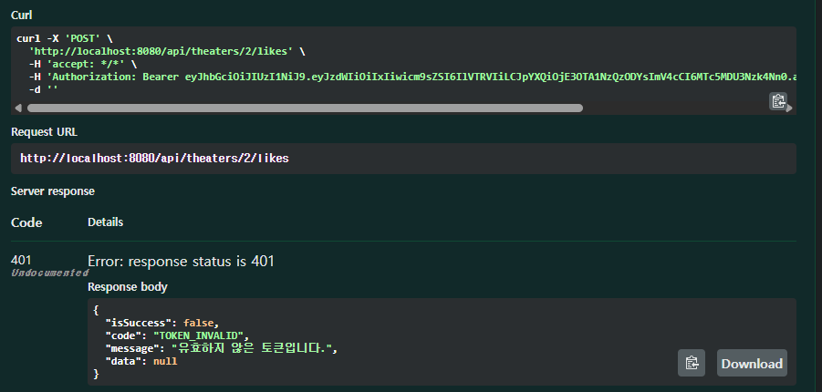

### 일반 사용자의 관리자 API 접근

`USER` 권한의 Access Token으로 관리자 전용 영화관 생성 API를 호출했습니다.

사용자 인증 자체는 성공했지만 `ADMIN` 권한이 없으므로 `403 Forbidden`과 `ACCESS_DENIED` 응답이 반환되는 것을 확인했습니다.

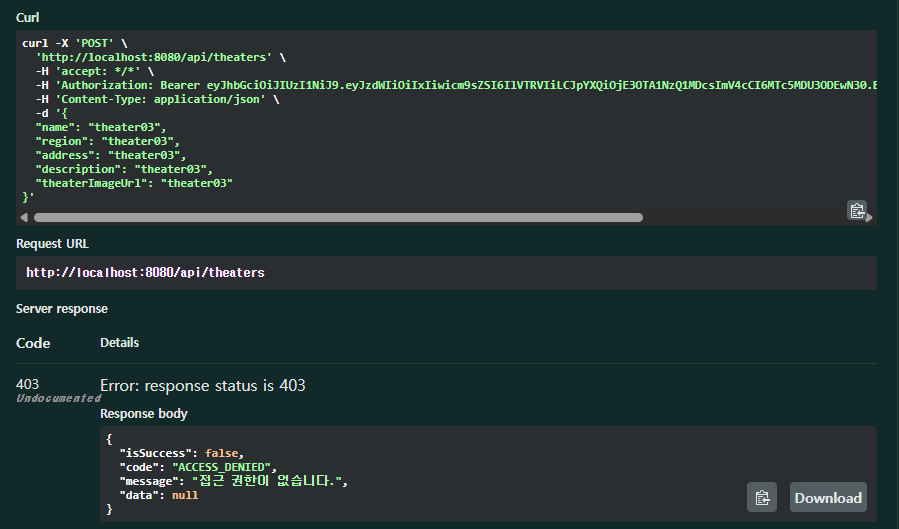

### 관리자의 관리자 API 접근

테스트용 관리자 계정으로 로그인하여 `ADMIN` 권한이 포함된 Access Token을 발급받았습니다.

해당 토큰으로 영화관 생성 API를 호출한 경우 정상적으로 영화관이 생성되는 것을 확인했습니다.

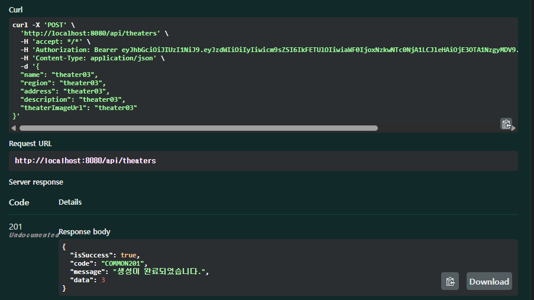

### Stateless 인증 확인

로그인 요청에 성공한 직후 Access Token을 전달하지 않고 보호 API를 호출했습니다.

이전 요청의 인증 상태가 유지되지 않고 `401 Unauthorized`가 반환되는 것을 확인했습니다. 이를 통해 서버가 세션에 인증 상태를 저장하지 않고 각 요청의 JWT를 이용하여 인증하는 Stateless 방식으로 동작하는 것을 확인했습니다.

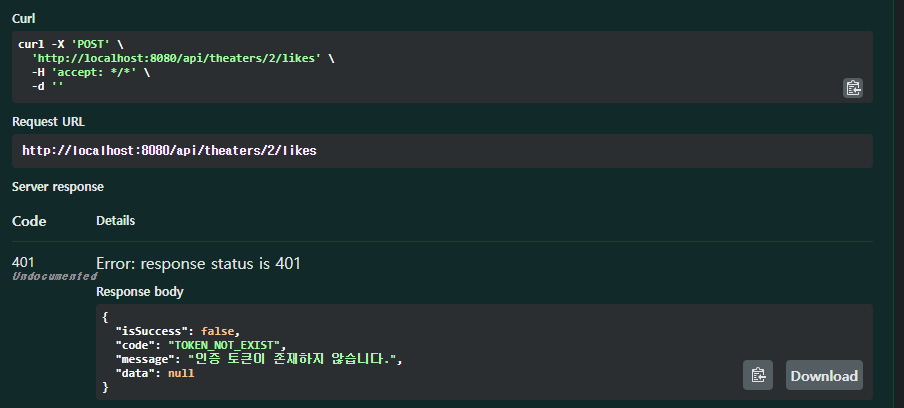

</details>

</details>

<details>
<summary><h2>💳 결제 연동과 동시성</h2></summary>

매점 주문과 영화 예매에 토스페이먼츠 테스트 결제를 연결하고, 결제·좌석·재고에서 발생할 수 있는 동시성 문제를 실제 DB로 재현한 뒤 해결했습니다.

이번 과제에서 가장 많이 고민한 질문은 다음 세 가지였습니다.

1. 클라이언트가 보낸 결제 정보를 어디까지 믿어도 되는가?
2. 여러 요청이 동시에 들어와도 돈·좌석·재고가 어긋나지 않으려면 어디에서 막아야 하는가?
3. 토스는 우리가 관리하는 서버가 아닌데, 응답을 못 받았을 때는 어떻게 해야 하는가?

<details>
<summary><h3>1. 코드 리팩토링 내용과 이유</h3></summary>

세션에서 정의한 읽기 좋은 코드, 즉 **변경하기 쉽고, 의존성이 명확하며, 도메인 규칙이 한 곳에 모여 있는 코드**를 기준으로 삼았습니다.
리팩토링은 **밖에서 보이는 동작 (API, 응답, 에러 코드)은 그대로 두고 구조만 바꾸는 것**을 원칙으로 했고, 아래에서 설명할 동시성 통합 테스트와 기존 단위 테스트를 안전망으로 사용했습니다. 리팩토링 전후로
같은 테스트가 모두 통과하는 것을 확인했습니다.

### R1. 예매 생성 메서드 분리 (KISS)

`ReservationService.create()` 하나에 입력 검증, 좌석 조회, 만료된 선점 정리, 저장이 모두 들어 있어 흐름을 읽기 어려웠습니다.
단계마다 이름 있는 private 메서드로 나누고, `create()`에는 순서만 남겼습니다. 검증 순서와 트랜잭션 경계는 그대로입니다.

```java
validateNoDuplicateSeats(request);

List<Seat> seats = findSeatsInScreen(request, schedule);

releaseExpiredHoldsOfRequestedSeats(request, now);

Reservation reservation = saveHold(user, schedule, seats, totalPrice, seatSummary, now);
```

### R2. 좌석 표기는 좌석이 안다 (캡슐화)

행 번호를 `A1` 같은 표기로 바꾸는 규칙을 서비스가 가지고 있었습니다. 좌석 자신의 정보로 만드는 값이므로 `Seat.getLabel()`로 옮겼습니다.

```java
// 전: seat -> rowNumToLabel(seat.getRowNum()) + seat.getColNum()
// 후: seats.stream().map(Seat::getLabel).collect(Collectors.joining(", "))
```

### R3. 상품 반복 조회 제거

주문 생성이 상품마다 `findById`를 두 번씩 호출해 상품이 N개면 조회 쿼리가 2N번 나갔습니다.
`findAllById`로 한 번에 조회한 뒤 `Map<Long, Item>`으로 재사용하도록 바꿔 조회를 1번으로 줄였습니다. 없는 상품이면 기존과 같은 `ITEM_NOT_FOUND`를 반환합니다.

```java
Map<Long, Item> itemById = itemRepository.findAllById(quantityByItemId.keySet()).stream()
		.collect(Collectors.toMap(Item::getId, Function.identity()));
```

### R4. 소유자 비교 캡슐화

`order.getUser().getId().equals(userId)`처럼 객체 내부를 따라 들어가는 비교가 서비스에 흩어져 있었습니다.
`Order.isOwnedBy()`로 감싸 이미 있던 `Reservation.isOwnedBy()`, `Payment.isOwnedBy()`와 같은 방식으로 맞췄습니다.

### R5. 결제 대상별 후처리 모으기 (응집도)

결제는 매점 주문 또는 영화 예매 중 하나에 연결됩니다. 그래서 `if (order != null) ... if (reservation != null) ...` 분기가 승인·실패·취소 메서드마다 흩어져 있었고, 새
흐름을 추가할 때 한쪽을 빠뜨리기 쉬웠습니다.
승인 확정 후처리, 미결제 해제 후처리, 전액 취소 후처리를 private 메서드 3개로 모았습니다.

결제 대상이 두 개뿐이라 인터페이스나 전략 패턴은 쓰지 않았습니다. 지금 요구사항에서는 분기를 한 곳에 모으는 것만으로 충분하고, 추상화를 추가하면 오히려 읽어야 할 코드가 늘어난다고 판단했습니다.

```java
handleApproved(payment);

handleUnpaidReleased(payment);
if(payment.

getBalanceAmount() ==0){

handleFullyCanceled(payment); }
```

### R6. 토스 응답 해석은 클라이언트 계층에서 (결합도)

서비스와 Facade가 `"DONE"`, `"NOT_FOUND_PAYMENT"` 같은 토스의 문자열 규약을 직접 비교하고 있었습니다.
해석을 `TossPaymentResponse.isDone()`, `TossPaymentException.isNotFoundPayment()`로 옮겨, 토스 규약이 바뀌어도 이 두 클래스만 고치면 되도록 했습니다.

### R7. (버그 수정) 동시 결제 요청의 잘못된 응답

같은 예매에 결제 요청이 동시에 두 번 오면 두 번째 요청이 "좌석 선점 시간이 만료되었습니다"를 받았습니다. 이중 결제는 막히지만 사용자가 만료된 것으로 오해할 수 있었습니다.
예매 상태 변경이 0건일 때 예매를 다시 조회해, 이미 결제 진행 중이면 `RESERVATION409_6`(이미 결제가 진행 중인 예매입니다)을 반환하도록 고쳤습니다. 이 항목은 응답이 바뀌므로 리팩토링이 아니라
버그 수정으로 분리했습니다.

### 의도적으로 하지 않은 것

- **토스 클라이언트를 인터페이스 뒤로 숨기기 (DIP)**: 세션에서는 외부 AI 호출을 인터페이스 뒤로 분리했습니다. 하지만 지금은 연동하는 PG가 토스 하나뿐이고, 테스트에서도 `@MockitoBean`으로
  충분히 대체할 수 있어 현재 요구사항 대비 과설계라고 판단했습니다. PG가 추가되는 시점에 분리하는 것이 맞다고 생각합니다.

</details>

<details>
<summary><h3>2. 동시성 문제와 해결 방법 조사</h3></summary>

### 동시성 문제란?

여러 요청이 같은 데이터를 동시에 읽고 쓰면서, 요청을 하나씩 처리했을 때와 다른 결과가 나오는 문제입니다.
웹 서버는 요청마다 다른 스레드에서 처리하고, 서버가 여러 대일 수도 있기 때문에 같은 행을 동시에 다루는 상황이 자연스럽게 생깁니다.

대표적인 형태는 두 가지입니다.

- **Lost Update**: 두 요청이 같은 값 (잔액 10,000)을 읽고 각자 계산한 결과 (9,000)를 저장해 한쪽의 변경이 사라집니다.
- **Check-then-act**: "비어 있는지 확인 → 저장" 사이에 다른 요청이 끼어들어, 둘 다 비어 있다고 판단하고 둘 다 저장합니다. (같은 좌석 이중 예매)

`@Transactional`만 붙인다고 해결되지 않습니다. 트랜잭션은 "한 요청 안의 작업을 원자적으로 커밋/롤백"하는 것이지, 다른 요청이 같은 행을 동시에 읽는 것을 막아주지는 않기 때문입니다. MySQL 기본
격리 수준 (REPEATABLE READ)에서 일반 SELECT는 락 없이 스냅샷을 읽습니다.

### 해결 방법 비교

| 방법                                | 원리                                                                                  | 장점                                                    | 단점                                                                                                                         | 적합한 상황                                          |
|-------------------------------------|---------------------------------------------------------------------------------------|---------------------------------------------------------|------------------------------------------------------------------------------------------------------------------------------|------------------------------------------------------|
| `synchronized`                      | JVM 안에서 한 번에 한 스레드만 임계 구역 진입                                         | 구현이 가장 간단                                        | 서버가 여러 대면 무의미. `@Transactional`과 함께 쓰면 메서드가 끝난 뒤 커밋되므로 그 사이에 다른 스레드가 들어와 문제가 남음 | 단일 서버, DB와 무관한 메모리 자원                   |
| 비관적 락 (`SELECT ... FOR UPDATE`) | 읽는 시점에 행에 배타 락을 걸어 다른 트랜잭션을 대기시킴                              | 충돌이 잦아도 확실하게 직렬화                           | 대기 시간, 데드락 가능성. 락을 오래 쥐면 처리량 저하                                                                         | 같은 행을 읽고 계산한 뒤 쓰는 작업, 충돌이 잦은 자원 |
| 낙관적 락 (`@Version`)              | 수정 시 버전이 그대로인지 확인하고, 바뀌었으면 실패                                   | 락 대기 없음, 충돌이 드물면 성능 좋음                   | 충돌 시 재시도 로직 필요. 충돌이 잦으면 재시도 폭주. 아직 없는 행의 INSERT 경쟁은 못 막음                                    | 충돌이 드문 수정                                     |
| 조건부 원자적 UPDATE                | `UPDATE ... SET x = x - 1 WHERE id = ? AND x >= 1`처럼 조건 확인과 변경을 한 문장으로 | 별도 락 조회 없이 DB가 행 단위로 판단. 짧고 빠름        | 단순한 조건에만 적용 가능. 여러 값을 읽고 복잡하게 계산하는 로직에는 부적합                                                  | 재고 차감, 상태 전이(`READY → IN_PROGRESS`)          |
| 유니크 제약                         | DB가 같은 키의 중복 INSERT를 거부                                                     | 마지막 안전망으로 가장 확실. 아직 없는 행의 경쟁도 막음 | 위반 예외를 의미 있는 응답으로 바꾸는 처리가 필요                                                                            | "같은 조합은 하나만" 존재해야 하는 데이터            |
| Named Lock (MySQL `GET_LOCK`)       | 문자열 키로 DB 수준 락                                                                | 아직 없는 행도 키로 잠글 수 있음                        | 커넥션 관리, 커밋 이후 해제 순서 등 운영 부담. 테스트용 H2에서 지원 안 됨                                                    | 행이 없는 자원을 키 단위로 직렬화                    |
| Redis 분산 락 (Lettuce, Redisson)   | 외부 저장소에 락 키를 두고 여러 서버가 공유                                           | DB 부하와 분리, 다중 서버·다중 DB 환경                  | Redis 인프라와 장애 대응 필요, 락 만료 시간 설계 필요                                                                        | 서버가 여러 대이고 DB 락만으로 부족한 경우           |

정리하면 "무엇을 보호해야 하는지"에 따라 방법이 달라집니다.
이미 있는 행을 읽고 계산해서 쓰면 비관적 락이나 조건부 UPDATE, 아직 없는 행을 만드는 경쟁이면 유니크 제약이나 Named Lock, DB 밖으로 범위가 넓어지면 분산 락이 적합합니다.

</details>

<details>
<summary><h3>3. 우리 서비스에서 발견한 동시성 문제</h3></summary>

| # | 지점                        | 동시에 들어오면 생기는 문제                                 | 왜 발생하는가                                                                   |
|---|-----------------------------|-------------------------------------------------------------|---------------------------------------------------------------------------------|
| ① | 결제 부분 취소              | 잔액보다 많이 환불되거나 잔액 기록이 어긋남                 | "잔액 조회 → 검사 → 차감"이 분리된 read-modify-write                            |
| ② | 영화 좌석 선점              | 같은 회차의 같은 좌석이 여러 명에게 팔림                    | "점유 여부 조회 → 저장"의 check-then-act                                        |
| ③ | 결제 승인                   | 버튼을 두 번 누르거나 요청이 재전송되면 승인이 두 번 시작됨 | 상태 확인과 승인 시작이 분리됨                                                  |
| ④ | 매점 재고 차감              | 재고보다 많이 팔림(오버셀링), 여러 상품 주문 시 데드락      | 결제 후 차감 방식이라 승인 시점에 경쟁이 몰림, 상품별 잠금 순서가 요청마다 다름 |
| ⑤ | 결제 승인 vs 좌석 선점 만료 | 결제는 됐는데 좌석은 만료되어 다른 사람에게 넘어감          | 승인 요청과 5분 만료 처리가 같은 예매를 동시에 변경                             |
| ⑥ | 결과 불명 결제 대사         | 같은 결제를 동시에 대사하면 재고가 두 번 차감됨             | 대사 시작 상태 확인이 분리됨                                                    |

</details>

<details>
<summary><h3>4. 해결 방법을 선택한 이유</h3></summary>

| #              | 선택한 방법                                                         | 선택 이유                                                                                                                                                                                                                                                 | 고려했지만 선택하지 않은 방법                                                                                                                                                                                        |
|----------------|---------------------------------------------------------------------|-----------------------------------------------------------------------------------------------------------------------------------------------------------------------------------------------------------------------------------------------------------|----------------------------------------------------------------------------------------------------------------------------------------------------------------------------------------------------------------------|
| ① 부분 취소    | `Payment` 행 비관적 락 + 잔액 선차감(예약)                          | 잔액을 읽고 계산해서 쓰는 로직이고, 돈이라 절대 틀리면 안 됩니다. 같은 결제끼리만 대기하므로 다른 사용자에게 영향이 없습니다. 락은 검증·예약 트랜잭션 안에서만 잡고, **토스 호출 중에는 잡지 않도록** 취소 금액을 먼저 잔액에서 빼두는 방식으로 했습니다. | 낙관적 락: 동시 취소가 몰리면 재시도가 필요하고, 실패 후 이미 나간 토스 취소와의 정합성 처리가 복잡해집니다.                                                                                                         |
| ② 좌석 선점    | `(schedule_id, seat_id)` 유니크 제약 + 만료 선점 정리               | 막아야 하는 대상이 "이 회차의 이 좌석"이라는 **아직 존재하지 않는 행**입니다. 없는 행은 `FOR UPDATE`로 잠글 수 없습니다. 유니크 제약은 보호할 키와 정확히 같은 단위로 DB가 직접 막아줍니다.                                                               | `Seat` 행 락: 다른 회차의 같은 물리 좌석까지 대기하게 됩니다. `Schedule` 행 락: 동작은 하지만 같은 회차의 다른 좌석 예매까지 한 줄로 서게 됩니다. Named Lock: 키는 정확하지만 커넥션·해제 순서 관리 부담이 있습니다. |
| ③ 중복 승인    | 조건부 UPDATE `READY/UNKNOWN → IN_PROGRESS`                         | 상태 확인과 선점을 한 문장으로 처리해 정확히 한 요청만 성공합니다. 이후 토스 호출은 트랜잭션 밖에서 하므로 락을 오래 쥐지 않습니다.                                                                                                                       | 비관적 락을 쥔 채 토스 호출: 최대 30초 동안 행 락과 커넥션을 점유합니다.                                                                                                                                             |
| ④ 재고         | 조건부 UPDATE `quantity >= ?` + 상품 ID 오름차순 차감               | 기존 코드에 이미 있던 방식이며, 음수 재고가 구조적으로 불가능합니다. 잠금 순서를 고정해 `[팝콘, 콜라]`와 `[콜라, 팝콘]` 주문이 서로를 기다리는 데드락을 막았습니다.                                                                                       | 비관적 락으로 재고 조회 후 차감: 결과는 같지만 쿼리가 늘고 락 범위가 넓어집니다.                                                                                                                                     |
| ⑤ 승인 vs 만료 | 예매 행 조건부 UPDATE `PENDING_PAYMENT → PAYING (expires_at > now)` | 아래에서 설명합니다.                                                                                                                                                                                                                                      | 스케줄러만으로 만료 처리: 스케줄러가 늦게 돌면 5분이 지난 선점이 유효해집니다.                                                                                                                                       |
| ⑥ 대사         | 조건부 UPDATE `UNKNOWN → IN_PROGRESS`                               | ③과 같은 패턴입니다.                                                                                                                                                                                                                                      | –                                                                                                                                                                                                                    |

### 결제와 만료 중 누가 이기는지를 정하는 한 지점

만료 직전에 결제 승인 요청과 만료 처리가 동시에 오는 상황이 가장 위험했습니다.
두 작업 모두 **같은 예매 행에 대한 조건부 UPDATE**로 만들었습니다.

```sql
-- 승인 시작 (토스 호출 전)
UPDATE reservation
SET status = 'PAYING'
WHERE id = ?
  AND status = 'PENDING_PAYMENT'
  AND expires_at > now
-- 만료 처리 (스케줄러, 신규 선점 전 정리)
UPDATE reservation
SET status = 'EXPIRED'
WHERE status = 'PENDING_PAYMENT'
  AND expires_at <= now
```

DB가 같은 행에 대한 UPDATE를 한 번에 하나씩 처리하므로 먼저 커밋된 쪽이 이기고, 진 쪽은 조건이 맞지 않아 0건이 됩니다.

- 승인이 이기면 `PAYING`이 되어 만료 대상에서 빠집니다.
- 만료가 이기면 승인은 **토스를 호출하기 전에** 거절됩니다. 돈이 빠져나가지 않습니다.

그래서 "결제는 됐는데 좌석은 풀린" 상태가 구조적으로 생기지 않습니다.
스케줄러 (10초 주기)는 정리 담당일 뿐이고, 정확성은 모든 판단에 들어간 `expires_at` 조건이 책임집니다.

</details>

<details>
<summary><h3>5. 동시성 문제 재현 과정</h3></summary>

기존 테스트는 모두 Mockito 단위 테스트라 레포지토리가 가짜였습니다. 가짜 레포지토리에는 락도 제약도 없어서 동시성 문제를 재현할 수 없습니다.
그래서 실제 MySQL과 실제 스레드를 사용하는 통합 테스트를 따로 만들었습니다.

- `@SpringBootTest` + `test` 프로필, 로컬 MySQL의 별도 스키마 `cgv_test` 사용 (테이블은 테스트 시작 시 생성, 종료 시 삭제)
    - H2 대신 MySQL을 쓴 이유: 락과 격리 수준 동작이 운영 DB와 같아야 재현 결과를 믿을 수 있기 때문입니다.
- 토스 API는 `@MockitoBean`으로 대체해 실제 결제 없이 반복 실행하고, 호출 횟수를 검증했습니다.
- `ExecutorService` + `CountDownLatch`로 모든 스레드가 준비될 때까지 기다렸다가 **동시에 출발**시켰습니다. 스레드를 순서대로 띄우면 사실상 하나씩 실행되어 경쟁이 생기지 않습니다.
- 테스트 클래스에는 `@Transactional`을 붙이지 않았습니다. 붙이면 스레드들이 커밋되지 않은 데이터를 서로 볼 수 없어 실제 상황과 달라집니다.

**적용 전 상태를 만든 방법**

운영 코드에 "락 끄기" 같은 옵션을 넣지 않기 위해, 해결 코드를 **잠시 제거한 상태로 같은 테스트를 실행 → 결과 기록 → 원래대로 복구**했습니다.

- ① 부분 취소: `Payment` 비관적 락 조회 (`findByIdForUpdate`)를 일반 `findById`로 바꿔 실행
- ② 좌석 선점: `ReservationSeat`의 유니크 제약 (`uk_schedule_seat`)을 제거하고 실행

①과 ②는 각각 **3회 반복 실행해 3회 모두 같은 결과**가 나오는 것을 확인했습니다. 복구 후에는 원본 파일과 해시가 일치하는지 확인했고, 커밋에는 해결 코드와 테스트만 포함했습니다.

</details>

<details>
<summary><h3>6. 동시성 제어 적용 전/후 결과</h3></summary>

| 시나리오                                   | 구분                       | 요청 | 성공   | 실패                                                 | 최종 데이터                                                                               |
|--------------------------------------------|----------------------------|------|--------|------------------------------------------------------|-------------------------------------------------------------------------------------------|
| ① 부분 취소 (10,000원 결제에 1,000원 취소) | 적용 전 (락 제거)          | 20   | 2      | `CannotAcquireLockException` 18 (`PAYMENT400_2`는 0) | **잔액 9,000 / 취소 이력 합계 2,000**                                                     |
| ① 부분 취소                                | 적용 후                    | 20   | 10     | `PAYMENT400_2`(잔액 초과) 10                         | 잔액 0 / 취소 이력 합계 10,000 / CANCELED / 토스 취소 10회                                |
| ② 같은 좌석 선점                           | 적용 전 (유니크 제약 제거) | 10   | **10** | 0                                                    | **좌석 점유 행 10 / 예매 10 / 결제 10**                                                   |
| ② 같은 좌석 선점                           | 적용 후                    | 10   | 1      | `RESERVATION409`(이미 예매된 좌석) 9                 | 좌석 점유 행 1 / 예매 1 / 결제 1                                                          |
| ③ 같은 결제 중복 승인                      | 적용 후                    | 10   | 1      | `PAYMENT409`(승인 불가 상태) 9                       | 토스 승인 호출 1회 / DONE / 재고 10→8 (수량 2, 1회만 차감)                                |
| ④ 재고 5개에 결제 10건                     | 적용 후                    | 10   | 5      | `PAYMENT409_1`(보상 취소) 5                          | 재고 0 (음수 없음) / PAID 5 / 보상 취소 5 / 토스 취소 5회                                 |
| ⑤ 선점 만료 후 승인, 만료 쿼리             | 적용 후                    | –    | –      | –                                                    | 토스 호출 없이 `RESERVATION409_3`, 만료 시 좌석·결제 정리 (실제 MySQL에서 JPQL 동작 확인) |

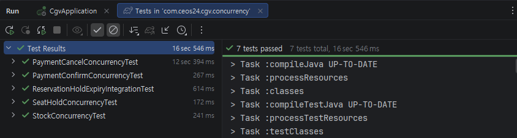

### 적용 전 ①에서 드러난 두 가지 문제

**1) Lost Update로 잔액이 어긋났습니다.**
취소 2건이 성공해 토스에는 2,000원 환불이 실제로 요청됐는데, 잔액은 8,000원이 아니라 9,000원으로 남았습니다. 두 요청이 모두 잔액 10,000을 읽고 각자 9,000을 저장해 한쪽 차감이 사라진
것입니다.
DB는 아직 9,000원을 더 환불할 수 있다고 믿으므로, 그대로 두면 결제 금액 (10,000원)보다 많은 11,000원까지 환불될 수 있습니다.

**2) 락을 뺐더니 오히려 데드락이 났습니다.**
처음에는 락을 빼면 초과 취소만 생길 것이라 예상했는데, 18건이 락 예외로 실패했습니다. 원인은 다음과 같습니다.

1. 취소 이력 (`payment_cancel`)을 INSERT할 때 MySQL은 FK 검사를 위해 부모 행 (`payments`)에 **공유 락 (S)**을 겁니다.
2. 커밋 시점에 잔액을 UPDATE하려면 같은 행에 **배타 락 (X)**이 필요합니다.
3. 여러 트랜잭션이 모두 S 락을 쥔 채 서로의 X 락을 기다리면서 교착 상태가 되고, MySQL이 이를 감지해 나머지를 강제로 롤백합니다.

`SELECT ... FOR UPDATE`는 처음부터 X 락을 잡고 시작하므로 S → X로 올라가는 단계가 없습니다. 그래서 요청이 한 줄로 처리되고 **Lost Update와 데드락이 함께 사라졌습니다.**

### 벌크 UPDATE와 영속성 컨텍스트

이번 과제의 해결책 대부분이 조건부 벌크 UPDATE (`@Modifying @Query`)입니다. 벌크 UPDATE는 영속성 컨텍스트를 거치지 않고 DB에 바로 실행되므로, 메모리에 올라온 엔티티와 DB 값이
어긋날 수 있습니다.
그래서 쿼리마다 실행 전에 미반영 변경을 먼저 내보낼지 (`flushAutomatically`), 실행 후 영속성 컨텍스트를 비울지 (`clearAutomatically`)를 따로 정했습니다.

| 쿼리                                              | 설정                        | 이유                                                                                                                                    |
|---------------------------------------------------|-----------------------------|-----------------------------------------------------------------------------------------------------------------------------------------|
| `StockRepository.decreaseStock` / `increaseStock` | `flushAutomatically = true` | 같은 트랜잭션의 `payment.approve()` 같은 미반영 변경을 UPDATE 전에 반영합니다. clear를 넣으면 이 변경이 사라질 수 있어 넣지 않았습니다. |
| `ReservationRepository.expireHolds`               | `clearAutomatically = true` | 이후 조회가 DB의 `EXPIRED` 상태를 읽어야 합니다.                                                                                        |
| `ReservationRepository.startPaying`               | `clearAutomatically = true` | 0건일 때 재조회가 DB의 `PAYING` 상태를 읽어야 합니다.                                                                                   |
| `PaymentRepository.updateStatusIfMatches`         | `clearAutomatically = true` | 선점한 상태를 이후 조회에서 DB 기준으로 읽습니다.                                                                                       |

`clearAutomatically` 때문에 지연 로딩이 필요한 값 (영화 제목 등)은 벌크 UPDATE 전에 미리 읽어 두었습니다.

</details>

<details>
<summary><h3>7. 전체 주문 및 결제 흐름</h3></summary>

결제가 필요한 기능은 **매점 주문**과 **영화 예매** 두 가지입니다. 두 기능은 결제 흐름은 같지만, 자원을 확보하는 시점이 다릅니다.

|                       | 매점                                          | 영화 예매                                         |
|-----------------------|-----------------------------------------------|---------------------------------------------------|
| 보호할 자원           | "아무 팝콘 하나" (수량)                       | "10시 회차 A1" (특정 좌석)                        |
| 확보 시점             | **결제 승인 후** 재고 차감                    | **결제 전** 5분간 좌석 선점                       |
| 이유                  | 결제창에서 이탈한 주문이 재고를 붙잡지 않도록 | 결제를 마쳤는데 좌석이 이미 팔린 상황을 막기 위해 |
| 결제 후 자원이 없으면 | 승인된 결제를 **보상 취소**                   | 발생하지 않음 (선점 중이라 다른 사람이 못 가져감) |

### 공통 흐름

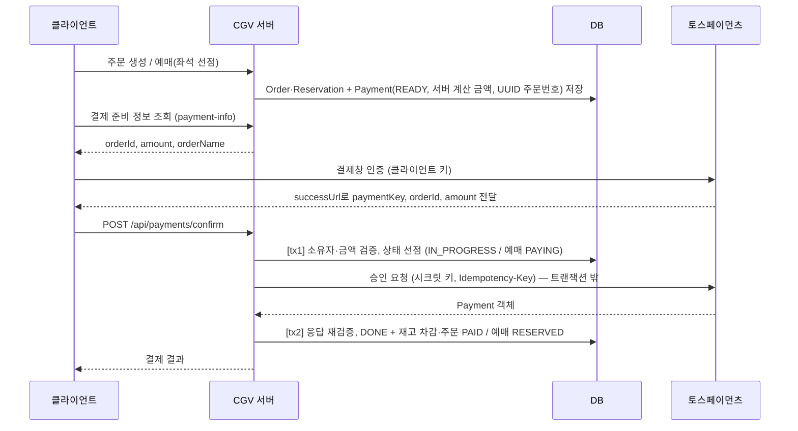

### API

| 단계                     | API                                                                            | 인증         |
|--------------------------|--------------------------------------------------------------------------------|--------------|
| 매점 주문 생성           | `POST /api/orders`                                                             | JWT          |
| 영화 예매(좌석 5분 선점) | `POST /api/reservations`                                                       | JWT          |
| 결제 준비 정보           | `GET /api/orders/{id}/payment-info`, `GET /api/reservations/{id}/payment-info` | JWT + 소유자 |
| 결제 승인                | `POST /api/payments/confirm`                                                   | JWT + 소유자 |
| 결제 조회                | `GET /api/payments/{paymentId}`                                                | JWT + 소유자 |
| 결제 취소 (전체/부분)    | `POST /api/payments/{paymentId}/cancel` + `Idempotency-Key` 헤더               | JWT + 소유자 |
| 결과 불명 결제 대사      | `POST /api/payments/{paymentId}/reconcile`                                     | JWT + 소유자 |
| 테스트 결제 페이지       | `/checkout.html` → `/payment-success.html`, `/payment-fail.html`               | –            |

프론트엔드가 없어 결제창을 띄울 수 있도록 정적 페이지 (`checkout.html`)를 만들었습니다. 결제창 인증을 거쳐야만 `paymentKey`가 발급되므로, Swagger만으로는 승인 성공을 확인할 수 없기
때문입니다.

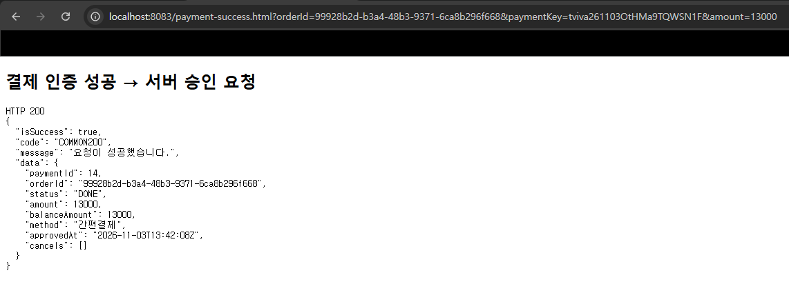
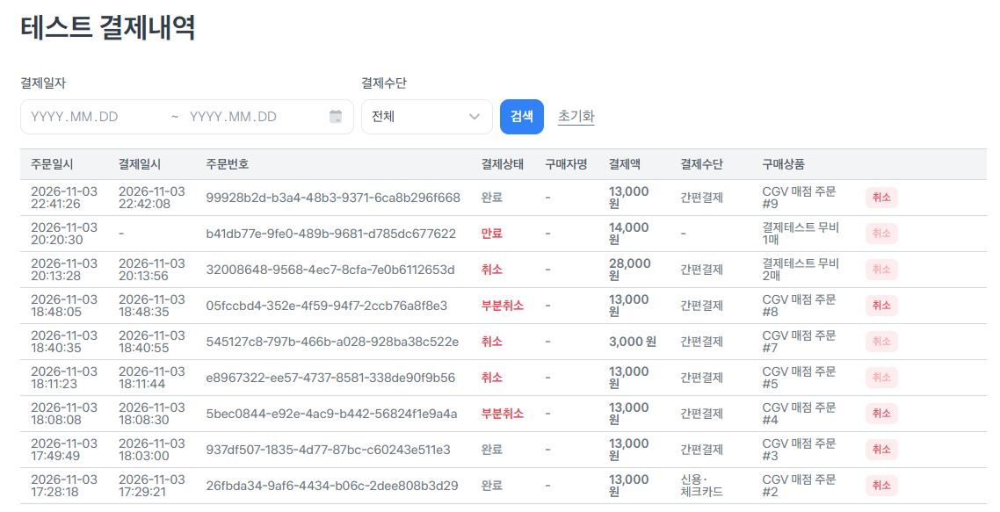

</details>

<details>
<summary><h3>8. 결제 상태와 상태 전이</h3></summary>

주문·예매의 상태와 결제 상태를 분리했습니다. "결제가 실패한 것"과 "주문이 취소된 것", "결과를 아직 모르는 것"을 구분하기 위해서입니다.

### Payment

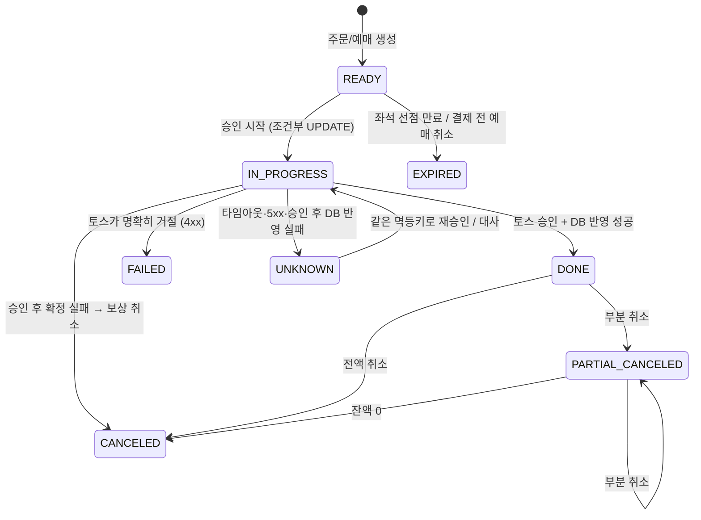

| 상태                            | 의미                                                      |
|---------------------------------|-----------------------------------------------------------|
| `READY`                         | 결제 대기. 주문·예매 생성 시 서버가 계산한 금액으로 생성  |
| `IN_PROGRESS`                   | 승인 요청 중. 중복 승인을 막기 위한 선점 상태             |
| `DONE`                          | 승인 완료                                                 |
| `PARTIAL_CANCELED` / `CANCELED` | 부분 취소 / 전액 취소 (`balanceAmount`로 남은 금액 관리)  |
| `FAILED`                        | 토스가 명확히 거절해 실패가 확정됨                        |
| `UNKNOWN`                       | 결과 불명. 실제로는 승인됐을 수 있어 실패로 단정하지 않음 |
| `EXPIRED`                       | 좌석 선점 만료 등으로 더 이상 결제할 수 없음              |

### 영화 예매

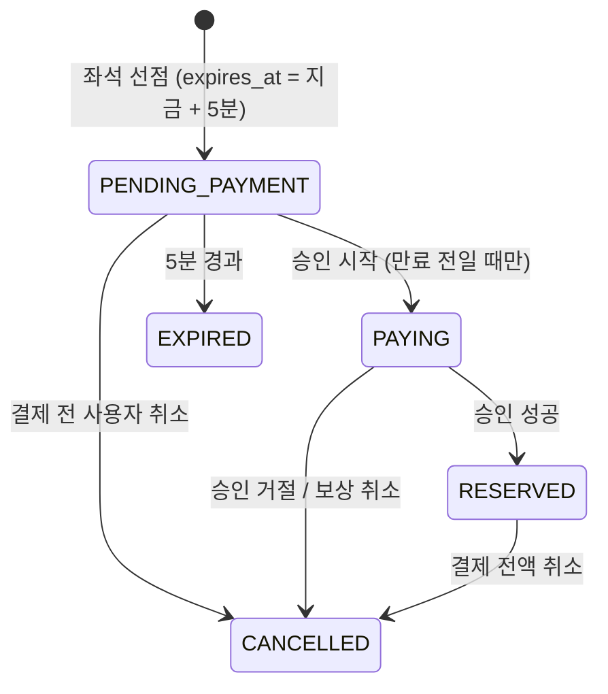

좌석 점유는 `ReservationSeat` 행으로 표현합니다. `PENDING_PAYMENT`, `PAYING`, `RESERVED`일 때만 행이 있고, `EXPIRED`·`CANCELLED`가 되면 행을 삭제해
좌석을 반환합니다. 예매 기록은 `Reservation`과 좌석 요약 (`seatSummary`)으로 남습니다.

`PAYING` 상태에서 결과가 불명 (`UNKNOWN`)이면 좌석을 **풀지 않습니다.** 실제로 결제가 성공했을 수 있기 때문에, 좌석을 놓치는 것보다 "돈은 냈는데 좌석이 없는" 상황을 막는 것을 우선했습니다.

### 매점 주문

`PENDING_PAYMENT` → `PAID`(승인 + 재고 차감 성공) → `CANCELED`(전액 취소 시 재고 복구, 또는 보상 취소)

</details>

<details>
<summary><h3>9. 결제 승인 과정</h3></summary>

```
[tx1] startApproval   : 결제 조회 → 소유자·금액 검증 → (예매) PENDING_PAYMENT → PAYING → READY/UNKNOWN → IN_PROGRESS
[트랜잭션 밖]          : 토스 승인 API 호출 (Idempotency-Key = "confirm-{토스 주문번호}")
[tx2] completeApproval: 토스 응답 재검증 → DONE 저장 → 매점: 재고 차감 + 주문 PAID / 예매: RESERVED
```

### 토스 호출을 트랜잭션 밖에서 하는 이유

트랜잭션이 시작되면 DB 커넥션을 하나 빌리고, 트랜잭션이 끝나야 반납합니다. 토스 응답을 기다리는 동안 (읽기 타임아웃 최대 30초) 커넥션을 쥐고 있으면, 요청이 몰릴 때 커넥션 풀이 고갈되어 결제와 상관없는
조회 API까지 멈춥니다.

그래서 흐름을 조율하는 `PaymentFacade`에는 트랜잭션을 두지 않고, DB 작업만 `PaymentService`의 짧은 트랜잭션으로 나눴습니다.
Facade에 트랜잭션이 없으므로 승인 확정 (tx2)이 롤백되더라도 그 뒤에 기록하는 `UNKNOWN` 상태는 별도 트랜잭션으로 커밋됩니다. 바깥 트랜잭션이 있으면 내부 호출이 그 트랜잭션에 합류해 실패 기록까지
함께 롤백되는데, 이 문제를 `REQUIRES_NEW` 없이 피할 수 있었습니다.

### OSIV를 끈 이유

위 설계를 하고 나서, 이전 과제 코드리뷰를 아직 반영하지 않아 OSIV (Open Session In View)가 기본으로 켜져 있다는 것을 확인했습니다. OSIV가 켜져 있으면 영속성 컨텍스트가 요청이 끝날
때까지 유지되고, 한 번 잡은 DB 커넥션도
요청이 끝날 때까지 반납되지 않습니다. 즉 Facade에서 트랜잭션을 나눠도 **토스를 기다리는 동안 커넥션을 계속 쥐고 있게 되어** 설계 의도가 절반만 동작하고 있었습니다.

`spring.jpa.open-in-view: false`로 껐고, 끄기 전에 모든 컨트롤러가 반환하는 응답 DTO가 서비스 트랜잭션 안에서 완성되는지, 컨트롤러·필터에서 지연 로딩이 일어나지 않는지 확인했습니다.

### 승인 후 주문 확정에 실패하면: 보상 취소

토스에서 승인이 끝난 결제는 우리 DB처럼 롤백할 수 없습니다. 그래서 tx2가 실패하면 (재고 부족, 응답 불일치, DB 오류 등) 반대 동작인 **전액 취소를 요청**해 되돌립니다.

- 예: 결제창에 머무는 사이 다른 주문이 먼저 승인되어 재고를 가져간 경우 → 재고 차감 실패 → tx2 롤백 (앞서 차감한 다른 상품 재고도 함께 롤백) → 토스 전액 취소 → 결제·주문 `CANCELED`,
  응답 `PAYMENT409_1`
- 보상 취소에도 고정 멱등키 (`compensate-{토스 주문번호}`)를 사용해 재시도해도 두 번 취소되지 않게 했습니다.
- 보상 취소마저 실패하면 상태를 지어내지 않고 `UNKNOWN`으로 남겨 대사 대상으로 만듭니다.

</details>

<details>
<summary><h3>10. 결제 승인 전에 서버에서 수행한 검증</h3></summary>

클라이언트가 보내는 `paymentKey`, `orderId`, `amount`는 모두 조작할 수 있습니다. 특히 `amount`는 successUrl 쿼리나 요청 본문에서 얼마든지 바꿀 수 있습니다.
그래서 승인은 브라우저가 토스를 직접 부르지 않고 반드시 우리 서버를 거치게 했고 (시크릿 키도 서버에만 있습니다), 서버에서 다음을 검증합니다.

| 검증             | 방법                                                                                            | 실패 시                    |
|------------------|-------------------------------------------------------------------------------------------------|----------------------------|
| 결제 존재        | `orderId`(우리가 발급한 UUID)로 `Payment` 조회                                                  | `PAYMENT404`               |
| 소유자           | JWT의 사용자 ID와 주문·예매 소유자 비교                                                         | `PAYMENT403`               |
| 금액             | 요청 `amount`와 **서버가 계산해 저장한 금액** 비교. 토스에도 요청값이 아니라 저장된 금액을 보냄 | `PAYMENT400_1`             |
| 상태             | `READY`/`UNKNOWN`일 때만 승인 시작 (이미 `DONE`이고 같은 `paymentKey`면 기존 결과 반환)         | `PAYMENT409`               |
| 좌석 선점 유효   | (예매) `PENDING_PAYMENT`이고 `expires_at > now`일 때만                                          | `RESERVATION409_3`         |
| 토스 응답 재검증 | 승인 후 응답의 `status == DONE`, `orderId`, `totalAmount`가 우리 값과 일치하는지                | `PAYMENT502_1` → 보상 취소 |

**주문번호를 DB PK가 아닌 UUID로 만든 이유**: PK는 1, 2, 3처럼 순서대로 늘어나 다른 사람의 주문번호를 추측할 수 있고, 매점 주문과 예매 테이블의 PK가 서로 겹칩니다. 토스 주문번호는 결제
건을 식별하는 값이므로 `Payment`가 갖도록 해, 승인 요청의 `orderId` 하나로 매점인지 예매인지 바로 찾을 수 있게 했습니다.

**소유자 검증의 전제**: 소유자 검증은 "주문을 만든 사람"과 "결제를 요청한 사람"을 비교합니다. 주문·예매 생성 API가 `userId`를 요청 파라미터로 받으면 소유자 정보 자체를 조작할 수 있으므로,
생성부터 결제까지 사용자 식별을 JWT로 통일해 검증 기준이 되는 값을 신뢰할 수 있게 했습니다.

</details>

<details>
<summary><h3>11. 전체/부분 취소 처리 방법</h3></summary>

```
POST /api/payments/{paymentId}/cancel
Idempotency-Key: {클라이언트가 만든 UUID}
{ "cancelReason": "단순 변심", "cancelAmount": 3000 }   ← cancelAmount가 없으면 남은 잔액 전액
```

```
[tx1, Payment 행 비관적 락]
  같은 멱등키 이력이 있으면 → 완료: 기존 결과 반환 / 처리 중: 409 / 결과 불명: 같은 키로 토스 재호출 / 실패: 409
  소유자·상태 검증 → 취소 금액 ≤ 잔액 검증 → 잔액에서 미리 차감(예약) + 취소 이력(REQUESTED) 저장 → 커밋
[트랜잭션 밖] 토스 취소 API 호출 (금액은 항상 명시, 멱등키 전달)
[tx2] 성공       → 이력 DONE, 잔액 0이면 CANCELED / 아니면 PARTIAL_CANCELED
      확정 실패   → 예약한 잔액 복원, 이력 FAILED
      결과 불명   → 이력 UNKNOWN, 잔액은 예약 상태 유지
```

### 남은 금액 관리

최초 결제 금액 (`amount`)과 취소 가능 잔액 (`balanceAmount`)을 분리했고, 취소 요청마다 `PaymentCancel` 이력 (금액, 사유, 멱등키, 상태, 토스 거래 키, 취소 시각)을
남깁니다.
잔액을 토스 호출 **전에** 미리 차감하는 이유는, 토스 호출 중에는 락을 쥐지 않으면서도 동시에 들어온 다른 취소가 같은 잔액을 중복으로 사용하지 못하게 하기 위해서입니다.

### 고려한 예외 상황

| 상황                               | 처리                                                                                                            |
|------------------------------------|-----------------------------------------------------------------------------------------------------------------|
| 이미 전액 취소된 결제를 다시 취소  | `PAYMENT409_4`                                                                                                  |
| 잔액보다 큰 금액 취소              | `PAYMENT400_2` (토스 호출 전 거절)                                                                              |
| 같은 취소 요청 재전송              | 같은 멱등키면 기존 결과 반환, 토스 재호출 없음                                                                  |
| 다른 결제에 썼던 멱등키            | `PAYMENT409_7`                                                                                                  |
| 취소 중 토스가 거절 (4xx)          | 예약한 잔액 복원, 이력 `FAILED`, 오류 응답                                                                      |
| 취소 중 타임아웃·5xx               | 이력 `UNKNOWN`, 잔액은 예약 상태 유지. 같은 멱등키로 재요청하면 토스가 첫 처리 결과를 돌려주므로 그 결과로 확정 |
| 토스에서는 취소됐는데 DB 반영 실패 | 이력을 `UNKNOWN`으로 남겨 같은 키로 재시도 가능                                                                 |

### 도메인별 취소 정책

- **매점**: 부분 취소는 금액만 환불하고 재고에는 영향이 없습니다. 잔액이 0이 되어 주문이 `PAID → CANCELED`로 바뀌는 순간에만 재고를 복구해, 여러 번 호출되어도 중복 복구가 없습니다.
- **영화 예매**: 전체 취소만 허용합니다 (부분 취소 시 `PAYMENT400_3`). 좌석 2개 중 일부만 환불하면 어느 좌석을 풀어야 하는지 금액과 어긋나기 때문입니다. 상영 20분 전 마감을 확인하고,
  취소 성공 시 좌석을 반환합니다.
  결제된 예매를 기존 예매 취소 API로 취소하면 환불 없이 좌석만 풀릴 수 있어, 결제 취소 API로만 취소하도록 막았습니다 (`RESERVATION409_4`).

**한계**: 결과 불명인 취소를 재시도했는데 토스가 거절하면, 앞선 요청이 실제로 성공했을 수도 있어 예약한 잔액을 자동으로 복원하지 않았습니다. 이 경우는 토스 조회 API로 확인하는 수동 대응이 필요합니다.

</details>

<details>
<summary><h3>12. 멱등성이 필요한 이유와 적용 방법</h3></summary>

### 멱등성이란?

같은 요청을 여러 번 보내도 한 번 보낸 것과 결과가 같은 성질입니다.

결제 요청을 보냈는데 네트워크가 끊겨 응답을 못 받으면, 사용자는 다시 버튼을 누르고 클라이언트는 자동으로 재전송할 수 있습니다. 이때 서버가 요청을 두 번 처리하면 **이중 결제, 이중 환불, 재고 이중 차감**이
생깁니다. 결제는 "재시도해도 안전해야" 하는 대표적인 작업입니다.

### 동시성 제어와 멱등성의 차이

- **동시성 제어**는 **서로 다른 요청**이 동시에 와도 데이터가 망가지지 않게 합니다. (1,000원 취소 요청 20건 → 락)
- **멱등성**은 **같은 요청**이 여러 번 와도 효과가 한 번만 나게 합니다. (네트워크 재전송 → 멱등키)

둘은 겹치기도 합니다. 같은 요청이 동시에 두 번 들어오면, 먼저 들어온 요청이 처리되는 동안 두 번째 요청은 락과 상태 검사에 막히고, 처리가 끝난 뒤에 도착한 요청은 멱등키로 기존 결과를 돌려받습니다.

### 토스페이먼츠의 멱등키

- `Idempotency-Key` 헤더로 보내며 POST API에 적용됩니다 (GET에는 의미가 없음).
- 최대 300자, 첫 요청부터 15일간 유효합니다.
- 같은 멱등키로 다시 요청하면 처리를 반복하지 않고 **첫 번째 요청의 결과를 그대로** 돌려줍니다.
- 첫 요청이 아직 처리 중일 때 같은 키로 요청하면 `409 IDEMPOTENT_REQUEST_PROCESSING`이 옵니다. 이 응답은 실패가 아니라 "결과 불명"으로 분류했습니다.

### 적용 방법

| 요청      | 멱등키                                             | 이유                                                                                                                                               |
|-----------|----------------------------------------------------|----------------------------------------------------------------------------------------------------------------------------------------------------|
| 결제 승인 | `confirm-{토스 주문번호}` (서버가 고정 생성)       | 결제 한 건의 승인은 논리적으로 한 번뿐이므로 결제 건 자체가 키가 될 수 있습니다. 결과 불명 후 재승인할 때도 같은 키라 토스가 첫 결과를 돌려줍니다. |
| 결제 취소 | 클라이언트가 만든 키 (`Idempotency-Key` 헤더 필수) | 한 결제에 부분 취소가 여러 번 있을 수 있어, "이게 아까 그 요청의 재전송인지 새 요청인지"는 요청을 보낸 쪽만 압니다.                                |
| 보상 취소 | `compensate-{토스 주문번호}`                       | 승인 후 확정 실패에 대한 취소도 한 번뿐이어야 합니다.                                                                                              |

키 하나로 세 계층에서 중복을 막습니다.

- **애플리케이션**: 이미 `DONE`인 승인, 이미 완료된 취소 키면 토스를 부르지 않고 기존 결과를 반환합니다.
- **DB**: 취소 이력의 멱등키에 유니크 제약을 걸어, 같은 키가 동시에 들어와도 하나만 저장됩니다.
- **PG**: 토스에도 같은 키를 전달해 우리 서버가 재시도해도 토스가 두 번 처리하지 않습니다.

</details>

<details>
<summary><h3>13. 사용한 HTTP Client와 선택 이유</h3></summary>

|             | RestClient                                    | WebClient                                                     | Feign Client                                  |
|-------------|-----------------------------------------------|---------------------------------------------------------------|-----------------------------------------------|
| 호출 방식   | 동기(블로킹), 메서드 체이닝                   | 비동기·논블로킹 (Reactor)                                     | 동기, 인터페이스 선언형                       |
| 추가 의존성 | 없음 (spring-web 포함)                        | `spring-boot-starter-webflux`                                 | Spring Cloud OpenFeign                        |
| 장점        | 코드가 간결하고 Spring MVC 구조와 그대로 맞음 | 대량 동시 호출, 스트리밍에 유리                               | API 명세가 자바 인터페이스로 드러나 읽기 쉬움 |
| 단점        | 호출 중 스레드가 대기                         | MVC에서 결과가 필요하면 결국 `block()`을 호출해 장점이 사라짐 | Spring Cloud 버전 호환 관리 필요              |

**RestClient를 선택했습니다.**

1. 결제 승인은 **결과를 받아야 다음 단계 (DB 반영)로 갈 수 있는 작업**이라 비동기로 할 이유가 없습니다.
2. 프로젝트가 Spring MVC 기반이라 WebClient를 쓰면 `block()`으로 기다리게 되어, 논블로킹의 장점 없이 의존성만 늘어납니다.
3. 호출할 토스 API가 승인·조회·취소 세 개뿐인데, Feign을 위해 Spring Boot 4.1과 Spring Cloud 버전을 맞추는 부담을 질 이유가 없다고 판단했습니다. 선언형 스타일이 필요해지면
   RestClient + `@HttpExchange`(HTTP Interface)로 추가 의존성 없이 같은 효과를 낼 수 있습니다.

구성은 연결 설정과 API 호출을 나눴습니다. `TossPaymentConfig`가 Base URL, 시크릿 키 Basic 인증 (`시크릿키:`를 base64 인코딩), 타임아웃을 설정한 `RestClient`를
빈으로 만들고, `TossPaymentClient`는 이를 주입받아 호출만 담당합니다. 덕분에 테스트에서는 `MockRestServiceServer`에 연결한 `RestClient`를 넣어 요청 헤더 (멱등키)와
오류 분기를 검증할 수 있었습니다.
시크릿 키는 코드에 쓰지 않고 환경변수 (`TOSS_SECRET_KEY`)로 주입합니다.

</details>

<details>
<summary><h3>14. 외부 API 오류 처리 방법</h3></summary>

가장 중요하게 생각한 원칙은 **"실패"와 "모름"을 구분하는 것**입니다.
승인 요청이 타임아웃 났더라도 토스 쪽에서는 이미 승인됐을 수 있습니다. 이를 실패로 처리하고 좌석을 풀거나 주문을 취소하면, 돈은 빠졌는데 상품이 없는 사고가 납니다.

| 상황                                                   | 분류                       | 처리                                                                      |
|--------------------------------------------------------|----------------------------|---------------------------------------------------------------------------|
| 토스 4xx (`code`, `message` 포함)                      | **확정 실패** (`rejected`) | 결제 `FAILED`, 예매 좌석 해제, `PAYMENT400` 응답. 토스 코드는 로그로 남김 |
| `409 IDEMPOTENT_REQUEST_PROCESSING`                    | 결과 불명                  | 같은 요청이 처리 중이므로 `UNKNOWN`                                       |
| 토스 5xx                                               | 결과 불명 (`unknown`)      | 결제 `UNKNOWN`, 예매는 `PAYING` 유지(좌석 유지), `PAYMENT502` 응답        |
| 연결·읽기 타임아웃 (3초 / 30초)                        | 결과 불명                  | 위와 동일                                                                 |
| 응답 본문이 비었거나 변환 실패                         | 결과 불명                  | 위와 동일                                                                 |
| 응답은 왔지만 `status`·`orderId`·금액이 우리 값과 다름 | 예상하지 못한 응답         | 확정하지 않고 보상 취소                                                   |
| 토스는 성공, 우리 DB 반영 실패                         | PG-DB 불일치               | 보상 취소, 보상도 실패하면 `UNKNOWN` + 에러 로그                          |

통신 계층 (`TossPaymentClient`)에서 `TossPaymentException`의 `resultUnknown` 여부로 이 구분을 끝내, 서비스는 `e.isResultUnknown()` 하나로
분기합니다.
응답 DTO에는 `@JsonIgnoreProperties(ignoreUnknown = true)`를 붙였습니다. 토스 Payment 객체는 필드가 많고 언제든 추가될 수 있어, 필요한 필드만 받고 나머지는 무시해야
외부 API가 바뀌어도 우리 서버가 깨지지 않습니다.

### 결과 불명 (UNKNOWN)을 해소하는 방법

- **재승인**: 같은 멱등키로 승인을 다시 요청하면 토스가 첫 처리 결과를 돌려줍니다.
- **대사 API** (`POST /api/payments/{id}/reconcile`): `UNKNOWN`인 결제만 토스 조회 API (`GET /v1/payments/orders/{orderId}`)로 실제
  상태를 확인합니다.
    - 토스가 `DONE` → 승인 확정 흐름을 그대로 수행 (재고 차감, 실패 시 보상 취소)
    - `NOT_FOUND_PAYMENT` → 토스에 승인된 결제가 없으므로 `FAILED`
    - 그 외 4xx (인증 오류 등)나 조회도 실패 → 실패로 단정하지 않고 `UNKNOWN` 유지
    - 대사 요청이 동시에 두 번 오면 재고가 두 번 차감될 수 있어, 대사 시작도 `UNKNOWN → IN_PROGRESS` 조건부 UPDATE로 선점합니다.

결제 정보 조회 (`GET /api/payments/{id}`)는 매번 토스를 부르지 않고 우리 DB만 조회합니다. 돈의 최종 진실은 토스에 있지만, 화면 조회까지 토스에 의존하면 느리고 토스 장애가 우리 조회
장애로 번집니다. 그래서 평소에는 우리 DB가 결제 정보를 들고 있고, 결과가 불확실할 때만 토스에 물어 맞춥니다.

</details>

<details>
<summary><h3>15. Webhook을 사용하는 이유와 현재 서비스에 적용한다면 맡게 될 역할</h3></summary>

### Webhook이란?

우리 서버가 외부 서버에 결과를 물어보는 (polling) 대신, **이벤트가 생겼을 때 외부 서버가 우리 서버로 HTTP 요청을 보내 알려주는** 방식입니다.

### 토스페이먼츠의 Webhook

- 개발자센터에서 수신 URL과 이벤트를 등록합니다. 결제 상태 변경 (`PAYMENT_STATUS_CHANGED`), 가상계좌 입금 (`DEPOSIT_CALLBACK`), 취소 상태 변경
  (`CANCEL_STATUS_CHANGED`) 등이 있습니다.
- 본문에는 이벤트 타입, 생성 시각, 상태가 바뀐 Payment 객체가 담깁니다.
- 받은 뒤 **10초 안에 200**을 응답해야 하며, 응답하지 않으면 최대 7회까지 재전송합니다. 그래서 수신 즉시 200을 응답하고 실제 처리는 비동기로 하는 것이 권장됩니다.
- 일반 결제 웹훅은 서명 헤더가 없어 위조된 요청일 수 있으므로, 받은 내용을 그대로 믿지 않고 **결제 조회 API로 교차 확인**해야 합니다.

### 결제 시스템에서 Webhook을 쓰는 이유

지금 구조에서 우리 서버는 **승인 API의 응답**으로만 결제 결과를 압니다. 그런데 응답은 타임아웃, 서버 재시작, 네트워크 단절로 언제든 유실될 수 있습니다.
또 결제 결과가 비동기로 정해지는 경우 (가상계좌 입금, 결제창 인증 후 승인하지 않아 만료되는 경우)나, 토스 개발자센터에서 직접 취소하는 경우처럼 우리 서버가 요청하지 않았는데 상태가 바뀌는 경우도 있습니다.
Webhook은 이런 변화를 토스 쪽에서 알려주는 **두 번째 통로**입니다.

### 현재 서비스에 적용한다면 맡게 될 역할

1. **결과 불명 (UNKNOWN) 자동 해소**: 지금은 사용자가 재승인하거나 대사 API를 호출해야 `UNKNOWN`이 풀립니다. `PAYMENT_STATUS_CHANGED`로 `DONE`/`CANCELED`
   이벤트를 받으면 대사 로직을 자동으로 실행해, `PAYING` 상태로 묶여 있는 좌석도 빠르게 정리할 수 있습니다.
2. **외부에서 발생한 취소 동기화**: 토스 개발자센터에서 직접 취소하면 우리 DB는 모릅니다. Webhook으로 받아 결제 상태·잔액·재고·좌석을 맞춥니다.
3. **결제수단 확장 대비**: 가상계좌처럼 승인 시점과 입금 시점이 다른 결제수단을 추가할 때 입금 확인을 Webhook으로 받습니다.

구현한다면 수신 API는 내용을 저장하고 즉시 200을 응답하고, 처리 단계에서는 Webhook 본문을 그대로 믿지 않고 이미 만든 대사 로직 (토스 조회 API로 재확인 → 상태 전이)을 재사용할 것입니다. 같은
이벤트가 여러 번 올 수 있으므로 이벤트 처리 역시 멱등해야 하는데, 지금의 상태 전이가 이미 조건부 UPDATE로 되어 있어 같은 결과가 두 번 와도 한 번만 반영됩니다.

이번 과제에서는 구현하지 않았고, 현재는 대사 API가 그 역할을 수동으로 대신하고 있습니다.

</details>


</details>
