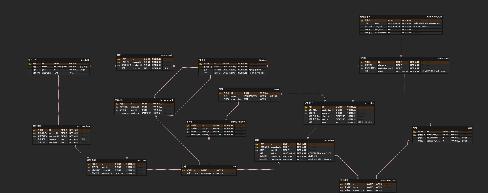

# CGV 서비스 데이터 모델링

## 1. 서비스 개요

CGV 클론 코딩 서비스는 사용자가 영화관과 영화를 조회하고, 관심 있는 영화관과 영화를 찜하며, 상영 회차의 좌석을 예매하거나 예매를 취소할 수 있는 서비스다. 영화관별 매점에서 상품을 구매하는 기능도 제공한다.

| 기능 | 관련 모델 |
| --- | --- |
| 영화관 조회 | cinema, auditorium, auditorium_type |
| 영화관 찜 | user, cinema_favorite, cinema |
| 영화 조회 | movie, screening |
| 영화 예매·취소 | user, screening, reservation, reservation_seat, seat |
| 영화 찜 | user, movie_favorite, movie |
| 매점 구매 | user, cinema, product, cinema_stock, purchase, purchase_item |

## 2. 요구사항과 설계 가정

### 미션 요구사항

- 모든 영화관에는 일반관과 특별관이 존재한다.
- 상영관 종류가 같으면 좌석 구성도 동일하다.
- 좌석은 통로나 중간 공백이 없는 직사각형 형태다.
- 모든 영화관의 매점 메뉴는 같으며, 재고는 영화관별로 관리한다.
- 재고는 항상 1 이상이다.
- 예매 취소를 제공하고 매점 구매 환불은 제공하지 않는다.

### 현재 모델을 설명하기 위한 가정

- 한 예매는 한 상영 회차에 대한 것이며 여러 좌석을 포함할 수 있다.
- 취소는 예매 전체에 적용하고, 예매 기록은 삭제하지 않고 상태를 변경한다.
- 상품 구매는 한 영화관에서 이루어지며 여러 상품을 포함할 수 있다.
- 상품 가격은 모든 영화관이 공통이고, 상영 회차 안에서는 좌석당 가격이 동일하다.
- 찜 해제는 해당 찜 기록을 삭제하는 방식으로 시작한다.
- 현재 ERD는 재고 수량을 1 이상으로 표시한다.
    - 판매 후 수량이 0이 되는 경우 생각해봐야함

## 3. 설계 및 모델링 과정

### 3.1. 사용자 행동에서 필요한 대상을 도출

먼저 기능을 구체적인 상황으로 풀어 필요한 정보를 찾았다. 예를 들어 “사용자가 특정 영화관의 상영관에서 특정 시간에 상영하는 영화의 좌석을 예매한다”는 행동에는 사용자, 영화관, 상영관, 영화, 상영 일정, 좌석, 예매가 필요하다.

대상 자체의 정보와 행동으로 발생하는 기록을 구분했다. 영화 이름은 영화의 속성이지만, 누가 어떤 회차를 예매했는지는 별도의 예매 기록이다. 찜과 구매도 각각 기록을 관리할 수 있도록 엔티티로 분리했다.

### 3.2. 양쪽의 개수를 확인해 관계 결정

영화관 하나는 여러 상영관을 가지지만 실제 상영관 하나는 한 영화관에 속하므로 1:N 관계로 설계했다. 영화 하나는 여러 회차에 상영되지만 회차 하나는 한 영화를 상영하므로 영화와 상영 일정도 1:N 관계다.

사용자는 여러 영화를 찜할 수 있고 영화도 여러 사용자에게 찜될 수 있다. 이러한 N:M 관계는 movie_favorite와 같은 중간 엔티티를 사용해 두 개의 1:N 관계로 표현했다.

### 3.3. 공통 정보와 개별 정보를 분리

- 영화 자체의 정보와 특정 시간·장소의 상영 정보를 movie와 screening으로 분리했다.
- 상영관 종류의 공통 좌석 규격과 실제 지점의 상영관을 auditorium_type과 auditorium으로 분리했다.
- 모든 영화관이 공유하는 상품 정보와 지점별 재고를 product와 cinema_stock으로 분리했다.
- 예매와 구매는 공통 정보를 가진 상위 기록과 여러 항목을 가진 상세 기록으로 분리했다.

## 4. ERD

CGV ERD



CGV ERD

## 5. 모델별 설명

| 모델 | 현재 ERD의 필드 | 역할과 설계 이유 |
| --- | --- | --- |
| user | id, name | 찜·예매·구매의 주체. 
이번 주에는 인증 정보를 제외한 최소 정보로 구성 |
| cinema | id, name, address, region | 영화관 지점의 정보를 관리
region은 지역별 조회에 사용 |
| auditorium_type | id, name, category, row_count, column_count | 일반관·특별관 종류와 공통 좌석 규격을 관리
category는 NORMAL 또는 SPECIAL을 나타냄 |
| auditorium | id, cinema_id, auditorium_type_id, name | 특정 지점의 실제 상영관 |
| seat | id, auditorium_id, row_number, column_number | 실제 상영관 안의 좌석 위치
예매 여부는 회차마다 다르므로 좌석 자체에 저장하지 않는다 |
| movie | id, name, release_date | 영화 이름과 개봉일을 관리
상영 장소와 시각은 screening에서 관리 |
| screening | id, auditorium_id, movie_id, starts_at, ends_at, price | 영화·상영관·시각을 결합한 상영 회차
price는 현재 해당 회차의 좌석당 가격 |
| cinema_favorite | id, cinema_id, user_id, created_at | 사용자와 영화관의 찜 관계 및 찜한 시각을 기록 |
| movie_favorite | id, user_id, movie_id, created_at | 사용자와 영화의 찜 관계 및 찜한 시각을 기록 |
| reservation | id, screening_id, user_id, status, reserved_at, cancelled_at | 사용자와 회차를 연결하는 예매 내역
CONFIRMED와 CANCELLED로 상태를 구분하며 취소 전 cancelled_at은 NULL |
| reservation_seat | id, seat_id, reservation_id | 한 예매에 포함된 좌석을 기록
여러 좌석을 예매하면 상세 행이 여러 개 생성 |
| product | id, name, price, description | 모든 영화관이 공유하는 메뉴
price는 현재 상품 단가이며 description은 선택 정보 |
| cinema_stock | id, cinema_id, product_id, quantity | 특정 영화관의 특정 상품 재고를 관리
동일 상품도 지점마다 다른 수량을 가짐 |
| purchase | id, user_id, cinema_id, purchased_at | 누가 어느 영화관에서 언제 구매했는지 기록
구매 지점은 재고 차감 대상을 결정 |
| purchase_item | id, product_id, purchase_id, quantity, unit_price | 구매 상품과 수량, 구매 당시 단가를 기록
현재 상품 가격이 바뀌어도 기존 구매 금액을 계산할 수 있다. |

## 6. 주요 관계

| 1쪽 모델 | N쪽 모델 | N쪽의 FK |
| --- | --- | --- |
| cinema | auditorium | cinema_id |
| auditorium_type | auditorium | auditorium_type_id |
| auditorium | seat | auditorium_id |
| auditorium | screening | auditorium_id |
| movie | screening | movie_id |
| user / cinema | cinema_favorite | user_id / cinema_id |
| user / movie | movie_favorite | user_id / movie_id |
| user / screening | reservation | user_id / screening_id |
| reservation / seat | reservation_seat | reservation_id / seat_id |
| cinema / product | cinema_stock | cinema_id / product_id |
| user / cinema | purchase | user_id / cinema_id |
| purchase / product | purchase_item | purchase_id / product_id |

## 7. 무결성 규칙과 구현 계획

### 7.1. 중복 방지 제약

| 테이블 | 적용할 UNIQUE | 목적 |
| --- | --- | --- |
| auditorium_type | (name) | 상영관 종류 이름 중복 방지 |
| auditorium | (cinema_id, name) | 같은 지점 안에서 상영관 이름 중복 방지 |
| seat | (auditorium_id, row_number, column_number) | 같은 상영관 안에서 좌석 위치 중복 방지 |
| cinema_stock | (cinema_id, product_id) | 지점·상품별 재고 기록을 하나로 유지 |
| cinema_favorite | (user_id, cinema_id) | 같은 영화관 중복 찜 방지 |
| movie_favorite | (user_id, movie_id) | 같은 영화 중복 찜 방지 |
| reservation_seat | (reservation_id, seat_id) | 한 예매 안에서 좌석 중복 방지 |
| purchase_item | (purchase_id, product_id) | 한 구매 안에서 동일 상품을 한 행으로 합치는 정책을 선택할 경우 적용 |

복합 UNIQUE는 각 컬럼에 따로 UNIQUE를 설정하는 것과 다르다. 예를 들어 auditorium.name만 UNIQUE이면 서로 다른 지점에서도 같은 “1관”이라는 이름을 사용할 수 없다.

### 7.2. 값과 상태 검증

- 좌석 규격과 좌석 행·열 번호는 양수다. 실제 좌석은 해당 종류의 규격 범위 안에 있어야 한다.
- 종류별 행 수 × 열 수만큼 모든 위치의 좌석이 있어야 한다.
- 상품 가격, 회차 가격, 구매 당시 단가는 0 이상이고 구매 수량은 1 이상이다.
- 상영 종료 시각은 시작 시각보다 뒤여야 한다.
- 같은 상영관의 상영 일정은 서로 겹치면 안 된다.


# CGV API 명세

## 접속 정보

- Base URL: `http://localhost:8080`
- Swagger UI: `http://localhost:8080/swagger-ui.html`

## 공통 성공 응답

모든 성공 응답은 다음 형식을 사용합니다.

```json
{
  "result": {},
  "resultCode": 200,
  "resultMsg": "SELECT SUCCESS"
}
```

| 작업 | HTTP 상태 | `resultMsg` |
| --- | --- | --- |
| 등록 | `201 Created` | `INSERT SUCCESS` |
| 조회 | `200 OK` | `SELECT SUCCESS` |
| 삭제·취소 | `200 OK` | `DELETE SUCCESS` |

등록 API의 `result`에는 생성된 데이터의 ID가 반환됩니다. 삭제 API의 `result`는 `null`입니다.

## 공통 오류 응답

```json
{
  "status": 404,
  "divisionCode": "M001",
  "resultMsg": "존재하지 않는 영화입니다.",
  "errors": [],
  "reason": null
}
```

DTO 검증에 실패하면 `errors`에 잘못된 필드 정보가 포함됩니다.

```json
{
  "status": 400,
  "divisionCode": "G011",
  "resultMsg": "요청 값이 유효하지 않습니다.",
  "errors": [
    {
      "field": "name",
      "value": "",
      "reason": "영화 이름은 필수입니다."
    }
  ],
  "reason": null
}
```

## 전체 API 목록

| 도메인 | Method | URL | 기능 |
| --- | --- | --- | --- |
| 영화 | `POST` | `/api/movies` | 영화 등록 |
| 영화 | `GET` | `/api/movies` | 영화 목록 조회 |
| 영화 | `GET` | `/api/movies/{movieId}` | 영화 상세 조회 |
| 영화 | `DELETE` | `/api/movies/{movieId}` | 영화 삭제 |
| 영화관 | `POST` | `/api/cinemas` | 영화관 등록 |
| 영화관 | `GET` | `/api/cinemas` | 영화관 목록 조회 |
| 영화관 | `GET` | `/api/cinemas/{cinemaId}` | 영화관 상세 조회 |
| 영화관 | `DELETE` | `/api/cinemas/{cinemaId}` | 영화관 삭제 |
| 상영관 | `POST` | `/api/cinemas/{cinemaId}/auditoriums` | 상영관과 좌석 등록 |
| 상영관 | `GET` | `/api/cinemas/{cinemaId}/auditoriums` | 영화관별 상영관 목록 조회 |
| 상영정보 | `POST` | `/api/screenings` | 상영 회차 등록 |
| 상영정보 | `GET` | `/api/cinemas/{cinemaId}/screenings` | 영화관별 상영정보 조회 |
| 좌석 | `GET` | `/api/screenings/{screeningId}/seats` | 상영 회차별 좌석 상태 조회 |
| 영화 찜 | `POST` | `/api/users/{userId}/favorite-movies/{movieId}` | 영화 찜 등록 |
| 영화 찜 | `GET` | `/api/users/{userId}/favorite-movies` | 영화 찜 목록 조회 |
| 영화 찜 | `DELETE` | `/api/users/{userId}/favorite-movies/{movieId}` | 영화 찜 삭제 |
| 영화관 찜 | `POST` | `/api/users/{userId}/favorite-cinemas/{cinemaId}` | 영화관 찜 등록 |
| 영화관 찜 | `GET` | `/api/users/{userId}/favorite-cinemas` | 영화관 찜 목록 조회 |
| 영화관 찜 | `DELETE` | `/api/users/{userId}/favorite-cinemas/{cinemaId}` | 영화관 찜 삭제 |
| 예매 | `POST` | `/api/users/{userId}/reservations` | 좌석 예매 |
| 예매 | `GET` | `/api/users/{userId}/reservations` | 사용자 예매 목록 조회 |
| 예매 | `GET` | `/api/users/{userId}/reservations/{reservationId}` | 예매 상세 조회 |
| 예매 | `DELETE` | `/api/users/{userId}/reservations/{reservationId}` | 예매 취소 |
| 매점 상품 | `GET` | `/api/cinemas/{cinemaId}/products` | 영화관별 상품·재고 조회 |
| 매점 구매 | `POST` | `/api/users/{userId}/purchases` | 매점 상품 구매 |
| 매점 구매 | `GET` | `/api/users/{userId}/purchases` | 사용자 구매 목록 조회 |
| 매점 구매 | `GET` | `/api/users/{userId}/purchases/{purchaseId}` | 구매 상세 조회 |


# 스터디 질문 답

## 1. 로딩 전략과 N+1 문제

### 1) `@JoinColumn`을 명시하지 않으면 어떻게 되는가?

`@ManyToOne`과 같은 연관관계에서 `@JoinColumn`을 생략하면 JPA가 기본 규칙에 따라 외래 키 컬럼명을 자동으로 생성한다.

기본 이름은 일반적으로 다음과 같다.

```
연관관계 필드명_참조하는 테이블의 PK 컬럼명
```

예를 들어 `Member`의 연관관계 필드가 `team`이고 `Team`의 PK 컬럼이 `id`라면 외래 키 컬럼명은 일반적으로 `team_id`가 된다.

```java
@ManyToOne
private Team team;
```

```
MEMBER.team_id → TEAM.id
```

다만 실제 컬럼명은 Hibernate나 Spring Boot의 네이밍 전략에 따라 달라질 수 있다. 따라서 DB 컬럼명을 명확하게 관리하려면 `@JoinColumn(name = "team_id")`처럼 직접 지정하는 것이 좋다.

---

### 2) 양방향 매핑이 항상 좋은가?

양방향 매핑이 항상 좋은 것은 아니다. 양쪽 엔티티에서 서로를 탐색해야 할 필요가 있을 때만 사용하는 것이 좋다.

양방향 매핑을 사용하면 `Member → Team`, `Team → Member`처럼 양쪽 방향으로 조회할 수 있다는 장점이 있다. 그러나 다음과 같은 단점도 발생한다.

- 연관관계의 주인과 비주인을 구분해야 한다.
- 양쪽 객체를 모두 동기화하지 않으면 객체 상태가 불일치할 수 있다.
- JSON 직렬화 시 순환 참조가 발생할 수 있다.
- 연관관계와 비즈니스 로직이 복잡해진다.
- 예상하지 못한 지연 로딩이나 N+1 문제가 발생할 수 있다.

따라서 기본적으로는 외래 키가 있는 쪽에서 단방향 `@ManyToOne`을 사용하고, 반대 방향 조회가 실제로 필요할 때만 `@OneToMany(mappedBy = "...")`를 추가하는 것이 좋다.

양방향 매핑을 사용한다면 다음과 같은 연관관계 편의 메서드로 양쪽 객체를 함께 변경해야 한다.

```java
public void changeTeam(Team team) {
    if (this.team != null) {
        this.team.getMembers().remove(this);
    }

    this.team = team;

    if (team != null) {
        team.getMembers().add(this);
    }
}
```

---

### 3) PK 참조와 UUID 참조 중 어떤 방식을 사용해야 하는가?

일반적으로 DB 내부에서는 `Long` 타입의 PK를 사용하고, 외부 API에는 별도의 UUID를 노출하는 방식을 많이 사용한다.

```java
@Entity
public class Member {

    @Id
    @GeneratedValue(strategy = GenerationType.IDENTITY)
    private Long id; // DB 내부 식별자

    @Column(nullable = false, unique = true, updatable = false)
    private UUID publicId; // 외부 노출용 식별자
}
```

각 방식의 특징:

| 구분 | Long PK | UUID |
| --- | --- | --- |
| 크기 | 작다 | 상대적으로 크다 |
| 인덱스 성능 | 좋다 | 상대적으로 불리할 수 있다 |
| 생성 방식 | DB에서 순차 생성한다 | 애플리케이션에서도 생성할 수 있다 |
| 값 추측 | 쉽다 | 어렵다 |
| 외부 노출 | 내부 데이터 규모가 드러날 수 있다 | 외부 노출에 적합하다 |

따라서 엔티티 간 외래 키 관계에는 내부용 `Long PK`를 사용하고, API 요청과 응답에는 `UUID publicId`를 사용하는 방식이 성능과 보안 측면에서 균형이 좋다.

---

### 4) `Team.members`만 수정하면 DB에 반영되는가?

DB에는 반영되지 않는다.

```java
@OneToMany(mappedBy = "team")
private List<Member> members;
```

`mappedBy`가 설정된 `Team.members`는 연관관계의 주인이 아닌 읽기 전용 방향이다. 실제 외래 키인 `team_id`는 `Member` 테이블에 있으므로, 연관관계의 주인인 `Member.team`을 수정해야 DB의 외래 키가 변경된다.

```java
team.getMembers().add(member); // 이것만으로는 DB의 team_id가 변경되지 않는다.
member.setTeam(team);          // 연관관계의 주인을 변경한다.
```

따라서 연관관계 편의 메서드를 통해 양쪽을 함께 수정하는 것이 안전하다.

---

### 5) `mappedBy` 없이 양쪽 모두에 `@JoinColumn`을 사용하면 어떻게 되는가?

JPA는 두 필드를 하나의 양방향 관계로 인식하지 않고, 각각 독립적으로 외래 키를 관리하는 관계로 인식할 수 있다.

```java
class Member {

    @ManyToOne
    @JoinColumn(name = "team_id")
    private Team team;
}

class Team {

    @OneToMany
    @JoinColumn(name = "team_id")
    private List<Member> members;
}
```

이 경우 양쪽 모두 동일한 `MEMBER.team_id`를 변경하려고 하므로 다음과 같은 문제가 발생할 수 있다.

- 불필요한 추가 `UPDATE` 쿼리가 실행될 수 있다.
- 두 객체의 값이 다르면 서로 다른 외래 키 값을 저장하려고 한다.
- 설정과 Hibernate 버전에 따라 컬럼 중복 매핑 오류가 발생할 수 있다.
- 어떤 객체의 상태를 기준으로 관계를 관리해야 하는지 불명확해진다.

따라서 외래 키가 있는 `Member.team`을 연관관계의 주인으로 설정하고, `Team.members`에는 다음과 같이 `mappedBy`를 지정해야 한다.

```java
@OneToMany(mappedBy = "team")
private List<Member> members;
```

---

### 6) Proxy란 무엇인가?

프록시는 실제 객체에 바로 접근하지 않고 그 객체를 대신해 자리를 차지하는 대리 객체이다.

JPA에서 지연 로딩을 사용하면 연관된 엔티티를 즉시 DB에서 조회하지 않고, 우선 해당 엔티티의 식별자를 가진 Hibernate 프록시 객체를 넣어둔다.

```java
Member member = em.find(Member.class, memberId);
Team team = member.getTeam(); // 아직 프록시일 수 있다.
team.getName();               // 실제 데이터가 필요해지는 시점에 SELECT가 실행된다.
```

프록시 객체는 실제 엔티티를 상속받아 만들어지며 식별자와 영속성 컨텍스트에 대한 정보를 가지고 있다. 실제 데이터에 접근하면 프록시가 초기화되면서 DB 조회가 발생한다.

프록시를 초기화할 때 영속성 컨텍스트가 이미 종료되었다면 `LazyInitializationException`이 발생할 수 있다.

---

### 7) Proxy와 N+1 문제는 어떤 관계인가?

지연 로딩에서는 연관된 엔티티를 프록시로 보관하고, 실제 데이터를 사용하는 순간마다 프록시를 초기화한다.

예를 들어 Member N명을 먼저 한 번의 쿼리로 조회한 다음 각 Member의 Team을 조회하면 다음과 같이 동작할 수 있다.

```
Member 목록 조회: 1번
각 Member의 Team 프록시 초기화: 최대 N번
전체 쿼리: 1 + N번
```

```java
List<Member> members = memberRepository.findAll();

for (Member member : members) {
    System.out.println(member.getTeam().getName());
}
```

따라서 프록시 자체가 N+1 문제의 원인은 아니지만, 반복문에서 여러 프록시를 하나씩 초기화하면 N+1 문제가 발생할 수 있다.

동일한 Team을 여러 Member가 참조하고 있고 해당 Team이 1차 캐시에 이미 존재한다면 실제 추가 쿼리 수는 줄어들 수 있다.

---

### 8) Hibernate Proxy와 Spring AOP Proxy의 차이는 무엇인가?

| 구분 | Hibernate Proxy | Spring AOP Proxy |
| --- | --- | --- |
| 목적 | JPA 지연 로딩 | 공통 부가 기능 적용 |
| 대상 | 엔티티 | Spring Bean |
| 대표 기능 | 연관 엔티티를 사용할 때 DB 조회 | 트랜잭션, 로깅, 보안 등 |
| 생성 방식 | 주로 엔티티의 하위 클래스 생성 | JDK 동적 프록시 또는 클래스 기반 프록시 |
| 동작 시점 | 연관된 실제 데이터에 접근할 때 | 프록시를 통해 메서드를 호출할 때 |

Hibernate Proxy는 실제 엔티티 조회를 미루기 위한 것이고, Spring AOP Proxy는 메서드 호출 앞뒤에 공통 로직을 적용하기 위한 것이다.

예를 들어 `@Transactional`은 Spring AOP Proxy를 통해 트랜잭션을 시작하고 종료한다.

---

### 9) 양방향 `@OneToOne`과 `nullable=true`에서 지연 로딩 프록시 문제가 발생하는 이유는 무엇인가?

`@OneToOne` 양방향 관계에서 외래 키가 없는 반대편 엔티티는 자신의 테이블만 조회해서는 연관된 객체가 존재하는지 알 수 없다.

특히 외래 키가 `nullable=true`이면 연관된 엔티티가 있을 수도 있고 없을 수도 있다. 그런데 프록시를 만들려면 최소한 대상 엔티티의 식별자를 알아야 한다.

따라서 Hibernate는 다음 두 가지를 판단하기 위해 추가 조회를 수행할 수 있다.

- 연관된 엔티티가 실제로 존재하는가?
- 존재한다면 해당 엔티티의 식별자는 무엇인가?

이 때문에 양방향 `@OneToOne`의 연관관계 주인이 아닌 방향에서는 `LAZY`를 설정해도 즉시 조회가 발생하거나 지연 로딩이 제대로 적용되지 않을 수 있다.

해결 방법으로는 다음을 고려할 수 있다.

- 불필요한 양방향 매핑을 제거한다.
- 외래 키를 실제 조회가 많이 일어나는 엔티티에 배치한다.
- `optional = false`처럼 연관관계가 반드시 존재하도록 설계한다.
- 공유 PK 구조라면 `@MapsId`를 사용한다.
- 조회 API에 맞춰 Fetch Join이나 DTO 조회를 사용한다.
- 필요한 경우 Hibernate bytecode enhancement를 검토한다.

---

### 10) 항상 지연 로딩이 좋은가?

지연 로딩에도 N+1 문제와 `LazyInitializationException` 같은 단점이 있으므로 항상 좋은 것은 아니다.

하지만 엔티티의 기본 FetchType은 가능한 한 `LAZY`로 설정하는 것이 권장된다. `EAGER`는 특정 조회에서 연관 데이터를 사용하지 않더라도 항상 조회하며, JPQL 목록 조회에서는 예상하지 못한 추가 쿼리와 N+1 문제를 발생시킬 수 있기 때문이다.

```java
@ManyToOne(fetch = FetchType.LAZY)
private Team team;
```

연관 데이터가 필요한 조회에서는 Fetch Join이나 `@EntityGraph`를 사용하여 해당 쿼리에서만 함께 가져오는 방식이 좋다.

즉, 엔티티의 기본 연관관계는 `LAZY`로 설정하고, 연관 데이터가 필요한 조회에서만 Fetch Join이나 EntityGraph로 명시적으로 함께 조회하는 것이 좋다.

---

### 11) Fetch Join과 페이징을 함께 사용하면 어떤 문제가 발생하는가?

`@ManyToOne`과 같은 To-One 관계의 Fetch Join은 행이 크게 증가하지 않으므로 일반적으로 페이징과 함께 사용할 수 있다.

문제는 `@OneToMany`와 같은 컬렉션 Fetch Join이다.

```java
select t
from Team t
join fetch t.members
```

Team 하나에 Member가 여러 명이면 SQL 결과에서는 Team 데이터가 Member 수만큼 중복된다. DB는 Team이 아니라 SQL 결과 행을 기준으로 페이징하기 때문에 다음 문제가 발생한다.

- 한 페이지의 Team 개수가 예상과 달라질 수 있다.
- 컬렉션 일부만 조회될 수 있다.
- Hibernate가 전체 결과를 메모리로 가져온 뒤 애플리케이션에서 페이징할 수 있다.
- 데이터가 많으면 메모리 사용량과 응답 시간이 크게 증가한다.

---

### 12) 싱글톤인 `SimpleJpaRepository`가 EntityManager를 주입받아도 안전한 이유는 무엇인가?

`SimpleJpaRepository`에 주입되는 객체는 일반적으로 실제 EntityManager 하나가 아니라 Spring이 만든 공유 EntityManager 프록시이다.

```
SimpleJpaRepository
        ↓
공유 EntityManager Proxy
        ↓
현재 트랜잭션에 연결된 실제 EntityManager
```

Repository는 싱글톤이지만 EntityManager 프록시는 메서드가 호출될 때 현재 스레드와 트랜잭션에 연결된 실제 EntityManager를 찾아 위임한다.

따라서 여러 요청이 같은 Repository 객체를 사용하더라도 실제로는 각 트랜잭션에 맞는 EntityManager가 사용된다. 스레드에 안전하지 않은 실제 EntityManager 하나를 모든 요청이 직접 공유하는 구조가 아니다.

---

### 13) Fetch Join에서 `distinct`를 사용하지 않으면 어떤 문제가 발생하는가?

일대다 컬렉션을 Fetch Join하면 SQL 결과에서 부모 엔티티가 자식 수만큼 중복된다.

예를 들어 Team 하나에 Member가 3명이면 SQL 결과에는 동일한 Team이 3개의 행으로 나타난다.

```java
select t
from Team t
join fetch t.members
```

---

## 2. ORM과 JPA

### 14) Dirty Checking이 모든 컬럼을 UPDATE하는 것은 개선해야 하는가?

Hibernate는 기본적으로 변경된 엔티티에 대해 변경되지 않은 컬럼까지 포함한 정적 UPDATE SQL을 생성할 수 있다.

```sql
UPDATE member
SET username = ?, email = ?, age = ?
WHERE id = ?
```

여기서 모든 엔티티를 무조건 UPDATE한다는 뜻은 아니다. Dirty Checking으로 변경이 감지된 엔티티의 모든 수정 가능 컬럼을 UPDATE한다는 의미이다.

모든 컬럼을 포함하면 SQL 형태가 일정하기 때문에 다음과 같은 장점도 있다.

- SQL 재사용과 실행 계획 캐싱에 유리하다.
- JDBC Batch 처리를 적용하기 쉽다.
- 매번 서로 다른 UPDATE SQL을 생성하지 않아도 된다.

따라서 컬럼 수가 적은 일반적인 엔티티라면 반드시 개선할 필요는 없다.

컬럼이 매우 많거나 일부 컬럼만 자주 변경된다면 Hibernate의 `@DynamicUpdate`를 사용할 수 있다.

```java
@Entity
@DynamicUpdate
public class Member {
}
```

`@DynamicUpdate`는 실제로 변경된 컬럼만 UPDATE SQL에 포함한다. 하지만 변경된 컬럼 조합마다 SQL이 달라져 SQL 캐싱이나 배치 처리에 불리할 수 있으므로 성능 측정 후 적용해야 한다.

그 밖에도 다음 방법을 사용할 수 있다.

- 자주 변경되는 필드를 별도 엔티티와 테이블로 분리한다.
- 변경하면 안 되는 필드에 `updatable = false`를 설정한다.
- 특정 컬럼만 수정하는 JPQL Update Query를 사용한다.
- 동시성 문제가 있다면 `@Version`을 이용한 낙관적 락을 적용한다.

---

### 15) Flush는 언제 발생하는가?

Flush는 영속성 컨텍스트의 변경 내용을 DB에 동기화하는 과정이다.

주요 발생 시점은 다음과 같다.

1. 직접 호출할 때 발생한다.

```java
entityManager.flush();
```

1. 트랜잭션을 Commit하기 직전에 발생한다.

```java
transaction.commit();
```

1. 기본 `FlushModeType.AUTO` 상태에서 JPQL 쿼리를 실행하기 전에 발생할 수 있다.

JPQL 조회 결과가 영속성 컨텍스트의 변경 내용과 달라지는 것을 방지하기 위해 필요한 경우 먼저 Flush한다.

1. Spring Data JPA의 `flush()` 또는 `saveAndFlush()`를 호출할 때 발생한다.

```java
memberRepository.saveAndFlush(member);
```

Flush는 SQL을 DB에 전달하는 것이며 트랜잭션을 Commit하는 것은 아니다. 따라서 Flush 이후에도 트랜잭션이 롤백되면 변경 내용은 최종적으로 DB에 저장되지 않는다.

---

### 16) 영속성 컨텍스트와 EntityManager는 항상 1:1인가?

항상 1:1이라고 단정할 수는 없다.

일반적인 애플리케이션 관리 방식에서는 하나의 실제 EntityManager가 하나의 영속성 컨텍스트를 관리한다. 하지만 Spring에서 주입받는 EntityManager는 실제 EntityManager가 아닌 프록시일 수 있다.

이 프록시는 실행 중인 트랜잭션에 따라 서로 다른 실제 EntityManager와 영속성 컨텍스트에 연결된다.

또한 확장 영속성 컨텍스트인 `PersistenceContextType.EXTENDED`를 사용하면 하나의 영속성 컨텍스트가 여러 트랜잭션에 걸쳐 유지될 수도 있다.

따라서 일반적인 실제 EntityManager 기준으로는 1:1에 가깝지만, Spring의 프록시와 영속성 컨텍스트 생명주기까지 고려하면 항상 고정된 1:1 관계는 아니다.

---

### 17) EntityManager와 트랜잭션은 항상 1:1인가?

항상 1:1은 아니다.

다음과 같은 경우에는 1:1이 아닐 수 있다.

- 하나의 EntityManager가 순차적으로 여러 트랜잭션에 사용될 수 있다.
- 확장 영속성 컨텍스트는 여러 트랜잭션에 걸쳐 유지될 수 있다.
- 조회 작업에서는 EntityManager가 트랜잭션 없이 존재할 수도 있다.
- JTA 환경에서는 하나의 트랜잭션에 여러 Persistence Unit의 EntityManager가 참여할 수 있다.


# 3주차 미션: Spring Security와 JWT 인증·인가

---

## 1. JWT 개념 정리

### 1.1 JWT의 구조

JWT(JSON Web Token)는 다음 세 부분으로 구성된다.

```
Header.Payload.Signature
```

#### Header

토큰의 종류와 서명 알고리즘 정보를 담는다.

```json
{
  "alg": "HS256",
  "typ": "JWT"
}
```

서버에서 허용한 `HS256` 알고리즘과 비밀키를 사용해 토큰을 생성하고 검증한다.

#### Payload

사용자와 토큰에 관한 Claim을 담는다.

| Claim | 의미 | 사용 값 |
| --- | --- | --- |
| `iss` | 토큰 발급자 | `cgv-api` |
| `sub` | 토큰의 주체 | 사용자 `username` |
| `iat` | 토큰 발급 시각 | 토큰 생성 시각 |
| `exp` | 토큰 만료 시각 | 설정된 만료 시간 |
| `role` | 사용자 권한 | `ROLE_USER`, `ROLE_ADMIN` |
| `type` | 토큰 종류 | `access`, `refresh` |

Payload는 Base64 URL Encoding된 값이지 암호화된 값이 아니다. 따라서 비밀번호, 개인정보와 같은 민감한 정보를 넣으면 안 된다.

#### Signature

Header와 Payload가 서버에서 발급된 이후 변조되지 않았음을 확인하는 서명이다.

클라이언트가 Payload의 `username`이나 `role`을 임의로 변경하면 기존 Signature와 일치하지 않으므로 서버가 해당 토큰을 거부한다.

JWT 서명은 내용을 숨기는 암호화가 아니라 무결성을 검증하기 위한 장치다.

### 1.2 Access Token과 Refresh Token

| 구분 | Access Token | Refresh Token |
| --- | --- | --- |
| 목적 | 일반 API 접근 | Access Token 재발급 |
| 만료 시간 | 비교적 짧음 | 비교적 김 |
| 전달 위치 | `Authorization` 헤더 | 재발급 요청 시 전달 |
| 서버 저장 | 필수 아님 | 현재 프로젝트에서는 DB 저장 |
| 일반 API 접근 | 가능 | 불가능 |

현재 토큰에는 `type` Claim이 들어 있다. `JwtTokenProvider.parseAccessToken()`은 `type=access`인 토큰만 허용하므로 Refresh Token을 일반 API 접근에 사용할 수 없다.

현재 구현은 로그인 시 두 토큰을 발급하고 Refresh Token을 DB에 저장하는 단계까지 완료했다. (Refresh Token 재발급과 로그아웃 시 폐기는 아직 미구현)

### 1.3 쿠키, 세션, JWT의 차이

- 쿠키는 브라우저가 데이터를 보관하고 요청에 실어 보내는 전달·저장 방식이다.
- 세션은 서버가 사용자 인증 상태를 저장하는 방식이다.
- JWT는 정보를 Claim으로 담고 서명하는 토큰 형식이다.

세션 기반 인증에서는 서버가 세션 저장소에 로그인 상태를 유지한다. JWT 기반 인증에서는 클라이언트가 매 요청마다 토큰을 보내고 서버는 토큰을 검증해 인증 정보를 다시 만든다.

이번 프로젝트는 세션과 인증 쿠키를 사용하지 않고 헤더로만 인증 정보를 전달한다.

```
Authorization: Bearer <access-token>
```

### 1.4 인증과 인가

- 인증(Authentication)은 사용자가 누구인지 확인하는 과정이다.
- 인가(Authorization)는 인증된 사용자가 해당 기능을 사용할 권한이 있는지 확인하는 과정이다.

예를 들어 로그인과 JWT 검증은 인증이고, 일반 사용자가 영화 등록 API를 호출하지 못하게 막는 것은 인가다.

| 상태 코드 | 의미 | 예시 |
| --- | --- | --- |
| `401 Unauthorized` | 사용자를 인증할 수 없음 | 토큰 없음, 만료 또는 변조된 토큰 |
| `403 Forbidden` | 인증됐지만 필요한 권한이 없음 | `ROLE_USER`로 관리자 API 호출 |

쉽게 표현하면 `401`은 “누구인지 확인할 수 없음”, `403`은 “누구인지는 알지만 권한이 없음”이다.

### 1.5 OAuth 2.0과 JWT의 차이

OAuth 2.0은 제3자 애플리케이션에 제한된 접근 권한을 위임하기 위한 인가 프레임워크다. JWT는 정보를 서명해 전달하는 토큰 형식이다.

OAuth 2.0에서 Access Token의 형식으로 JWT를 사용할 수 있지만, OAuth 2.0의 모든 토큰이 반드시 JWT인 것은 아니다. 반대로 JWT를 사용한다고 해서 OAuth 2.0을 구현한 것도 아니다.

---

## 2. 프로젝트 인증 구조

### 2.1 주요 패키지 구조

```
global
├── config
│   ├── JwtConfig
│   ├── OpenApiConfig
│   └── SecurityConfig
├── filter
│   ├── LoginFilter
│   └── JwtAuthenticationFilter
├── handler
│   ├── LoginSuccessHandler
│   ├── LoginFailureHandler
│   ├── JwtAuthenticationEntryPoint
│   └── JwtAccessDeniedHandler
├── jwt
│   ├── JwtProperties
│   ├── JwtTokenClaims
│   ├── JwtTokenProvider
│   └── TokenType
└── exception
    ├── JwtTokenExpiredException
    └── JwtTokenInvalidException
```

### 2.2 JWT 의존성

```groovy
implementation 'io.jsonwebtoken:jjwt-api:0.13.0'
runtimeOnly 'io.jsonwebtoken:jjwt-impl:0.13.0'
runtimeOnly 'io.jsonwebtoken:jjwt-jackson:0.13.0'
```

### 2.3 외부 설정

```yaml
jwt:
secret: ${JWT_SECRET}
access-token-expiration: ${JWT_ACCESS_EXPIRATION}
refresh-token-expiration: ${JWT_REFRESH_EXPIRATION}
issuer: cgv-api
```

로컬 `.env` 예시

```
JWT_SECRET=<Base64로 인코딩된 충분히 긴 비밀키>
JWT_ACCESS_EXPIRATION=30m
JWT_REFRESH_EXPIRATION=14d
```

---

## 3. 회원가입과 로그인

### 3.1 회원가입

일반 회원가입 요청에서는 클라이언트가 권한을 선택할 수 없고 서버가 항상 `USER` 권한을 부여한다.

비밀번호는 평문으로 저장하지 않고 `BCryptPasswordEncoder`로 해시한 뒤 저장한다.

```java
UserEntity userEntity = UserEntity.createLocalUser(
        request.username(),
        passwordEncoder.encode(request.password()),
        request.nickname()
);
```

### 3.2 로그인 흐름

```
POST /login
→ LoginFilter가 username과 password 추출
→ AuthenticationManager에 인증 요청
→ DaoAuthenticationProvider
→ UserDetailsService로 사용자 조회
→ PasswordEncoder로 비밀번호 비교
→ 인증 성공
→ LoginSuccessHandler
→ Access Token과 Refresh Token 발급
```

로그인 요청 예시는 다음과 같다.

```
POST /login
Content-Type: application/json
```

```json
{
  "username": "test-user",
  "password": "password1234"
}
```

로그인 성공 응답은 다음과 같다.

```json
{
  "accessToken": "eyJ...",
  "refreshToken": "eyJ..."
}
```

존재하지 않는 계정과 잘못된 비밀번호는 계정 존재 여부가 노출되지 않도록 동일한 응답으로 처리한다.

```json
{
  "status": 401,
  "divisionCode": "AUTH001",
  "resultMsg": "아이디 또는 비밀번호가 올바르지 않습니다.",
  "errors": [],
  "reason": null
}
```

---

## 4. Access Token 발급과 검증

`JwtTokenProvider`는 토큰 생성과 검증을 담당한다.

토큰을 생성할 때 다음 정보를 포함한다.

```java
Jwts.builder()
        .issuer(properties.issuer())
        .subject(username)
        .claim("role", role)
        .claim("type", tokenType.value())
        .issuedAt(Date.from(issuedAt))
        .expiration(Date.from(expiresAt))
        .signWith(secretKey, Jwts.SIG.HS256)
        .compact();
```

검증할 때는 다음 항목을 확인한다.

- 서버가 가진 키와 서명이 일치하는가?
- 토큰이 만료되지 않았는가?
- `iss`가 서버에서 기대하는 `cgv-api`인가?
- Access Token과 Refresh Token의 종류가 일치하는가?
- `username`과 `role` Claim이 존재하는가?

검증에 성공한 토큰에서만 `username`과 `role`을 사용한다.

---

## 5. JWT 인증 필터와 SecurityContext

`JwtAuthenticationFilter`는 `OncePerRequestFilter`를 상속하며 요청마다 한 번 실행된다.

```
HTTP 요청
→ Authorization 헤더 확인
→ Bearer Access Token 추출
→ JwtTokenProvider.parseAccessToken()
→ username과 role 추출
→ UserDetails 생성
→ Authentication 생성
→ 새 SecurityContext에 Authentication 저장
→ 다음 필터로 전달
```

인증 객체를 만드는 핵심 코드는 다음과 같다.

```java
UserDetails principal = User.withUsername(claims.username())
        .password("")
        .authorities(claims.role())
        .build();

Authentication authentication =
        UsernamePasswordAuthenticationToken.authenticated(
                principal,
                null,
                principal.getAuthorities()
        );
```

JWT 검증 이후에는 비밀번호를 다시 사용할 필요가 없으므로 인증 객체에 비밀번호를 보관하지 않는다.

```java
SecurityContext context = SecurityContextHolder.createEmptyContext();
context.setAuthentication(authentication);
SecurityContextHolder.setContext(context);
```

토큰이 없는 요청은 인증 객체를 만들지 않고 다음 필터로 전달한다. 공개 API는 정상 처리되고, 보호 API는 이후 인가 단계에서 `401`로 처리된다.

---

## 6. Security 설정과 접근 제어

### 6.1 Stateless 설정

```java
.sessionManagement(session -> session
        .sessionCreationPolicy(SessionCreationPolicy.STATELESS)
)
```

서버 세션에 인증 상태를 저장하지 않는다. 따라서 정상 인증 요청 직후라도 다음 요청에 Access Token이 없으면 다시 `401`이 발생한다.

이번 인증 방식에서 사용하지 않는 기본 폼 로그인과 HTTP Basic 인증도 비활성화했다.

```java
.formLogin(AbstractHttpConfigurer::disable)
.httpBasic(AbstractHttpConfigurer::disable)
```

### 6.2 공개 API

다음 API는 토큰 없이 접근할 수 있다.

- Swagger와 OpenAPI 문서
- 회원 존재 확인
- 회원가입
- 로그인
- 영화 조회
- 영화관, 상영관, 매점 상품 조회
- 상영정보와 좌석 조회

### 6.3 로그인 사용자 API

`/api/me/**` 경로는 정상 Access Token이 필요하다.

```
POST   /api/me/favorite-movies/{movieId}
GET    /api/me/favorite-movies
DELETE /api/me/favorite-movies/{movieId}

POST   /api/me/favorite-cinemas/{cinemaId}
GET    /api/me/favorite-cinemas
DELETE /api/me/favorite-cinemas/{cinemaId}

POST   /api/me/reservations
GET    /api/me/reservations
GET    /api/me/reservations/{reservationId}
DELETE /api/me/reservations/{reservationId}

POST   /api/me/purchases
GET    /api/me/purchases
GET    /api/me/purchases/{purchaseId}
```

Controller는 클라이언트가 보낸 `userId`를 신뢰하지 않고 다음과 같이 인증 사용자를 받는다.

```java
@AuthenticationPrincipal UserDetails userDetails
```

Controller가 `userDetails.getUsername()`을 Service에 전달하면 Service가 실제 `UserEntity`를 조회한다. Repository에서 사용하는 사용자 ID는 클라이언트 입력값이 아니라 서버가 인증된 username으로 조회한 ID다.

상세 예매와 구매 내역은 인증 사용자의 ID와 데이터 소유자의 ID를 비교한다. 일치하지 않으면 실제 변경 전에 접근을 거부한다.

### 6.4 관리자 API

다음 운영 데이터 변경 API는 `hasRole("ADMIN")` 규칙을 적용했다.

(일반 회원가입은 항상 `ROLE_USER`를 부여. 관리자 계정은 DB 또는 테스트 데이터로 별도 준비해야 함)

```
POST   /api/movies
DELETE /api/movies/{movieId}

POST   /api/cinemas
DELETE /api/cinemas/{cinemaId}

POST   /api/cinemas/{cinemaId}/auditoriums
POST   /api/screenings
```

`hasRole("ADMIN")`은 내부적으로 `ROLE_ADMIN` 권한을 검사한다.

```
토큰 없음      → 401
ROLE_USER     → 403
ROLE_ADMIN    → 정상 처리
```

---

## 7. CSRF 설정

```java
.csrf(AbstractHttpConfigurer::disable)
```

이번 프로젝트는 세션이나 인증 쿠키를 사용하지 않고, 클라이언트가 직접 `Authorization` 헤더에 Bearer Token을 넣는 Stateless API다.

브라우저는 다른 사이트의 요청에 임의의 `Authorization` 헤더를 자동으로 붙이지 않으므로, CSRF 보호를 비활성화했다.

---

## 8. 인증·인가 실패 처리

필터 계층에서 발생한 예외는 `@RestControllerAdvice`가 자동으로 처리한다고 가정할 수 없다. 따라서 Spring Security 전용 처리기와 JWT 필터에서 공통 JSON 응답을 작성한다.

| 상황 | 처리 클래스 | HTTP 상태 | 코드 |
| --- | --- | --- | --- |
| 로그인 계정 또는 비밀번호 불일치 | `LoginFailureHandler` | 401 | `AUTH001` |
| 만료된 Access Token | `JwtAuthenticationFilter` | 401 | `AUTH002` |
| 변조되거나 유효하지 않은 토큰 | `JwtAuthenticationFilter` | 401 | `AUTH003` |
| 토큰 없이 보호 API 접근 | `JwtAuthenticationEntryPoint` | 401 | `AUTH004` |
| 인증됐지만 권한 부족 | `JwtAccessDeniedHandler` | 403 | `AUTH005` |

예를 들어 토큰 없이 보호 API에 접근하면 다음 응답을 반환한다.

```json
{
  "status": 401,
  "divisionCode": "AUTH004",
  "resultMsg": "인증 토큰이 필요합니다.",
  "errors": [],
  "reason": null
}
```

일반 사용자가 관리자 API에 접근하면 다음 응답을 반환한다.

```json
{
  "status": 403,
  "divisionCode": "AUTH005",
  "resultMsg": "해당 요청에 접근할 권한이 없습니다.",
  "errors": [],
  "reason": null
}
```

---

## 8. 구현하며 알게 된 점

JWT를 발급하는 것만으로 인증 구현이 끝나는 것이 아니었다. 발급된 토큰을 매 요청에서 검증하고, 검증된 정보로 `Authentication`을 만든 뒤 `SecurityContext`에 저장해야 Spring Security의 인가 기능과 `@AuthenticationPrincipal`을 사용할 수 있었다.

또한 URL의 `userId`를 제거하는 이유를 이해했다. API가 인증을 요구하더라도 클라이언트가 전달한 사용자 ID를 그대로 신뢰하면 다른 사용자의 데이터에 접근할 수 있다. JWT에서 확인한 username으로 서버가 사용자를 조회하고, 그 사용자의 ID로 찜·예매·구매를 처리해야 사용자별 접근 제어가 완성된다.

마지막으로 `401`과 `403`은 단순히 상태 코드만 다른 것이 아니라 실패 지점도 다르다는 것을 알게 되었다. 인증 정보가 없으면 `AuthenticationEntryPoint`, 인증은 됐지만 권한이 부족하면 `AccessDeniedHandler`가 동작한다. 필터에서 발생한 JWT 예외는 Controller 예외 처리와 별도로 다뤄야 한다는 점도 확인했다.

---

# 4주차 미션 : CGV 주문·결제와 동시성 처리 정리

## 1. 동시성 문제와 해결 방법 조사

### 동시성 문제란?

여러 요청이 같은 데이터를 비슷한 시점에 읽고 수정하면서, 처리 결과가 의도와 달라지는 문제다. 각 요청의 코드가 순서대로 실행될 때 정상이어도, 여러 요청의 실행 순서가 섞이면 문제가 생길 수 있다.

예를 들어 팝콘 재고가 1개 남았을 때 두 구매 요청이 다음 순서로 실행될 수 있다.

| 순서 | 요청 A | 요청 B |
| --- | --- | --- |
| 1 | 재고가 1개인지 확인한다. | |
| 2 | | 재고가 1개인지 확인한다. |
| 3 | 주문을 만들고 재고를 0개로 변경한다. | |
| 4 | | 주문을 만들고 재고를 0개로 변경한다. |

재고는 1개였지만 주문은 2개가 만들어질 수 있다.

문제의 원인은 재고를 확인하는 시점과 수정하는 시점 사이에 다른 요청이 들어올 수 있다는 것이다. 따라서 여러 요청이 같은 데이터를 확인하고 변경하는 순서를 제어해야 한다.

### 트랜잭션과 동시성 제어의 차이

트랜잭션은 여러 DB 작업을 하나의 단위로 처리하는 방법이다. 주문 저장과 재고 차감을 묶으면 두 작업을 함께 반영하거나, 오류가 났을 때 함께 되돌릴 수 있다.

하지만 `@Transactional`을 붙였다는 이유만으로 다른 구매 요청이 같은 재고를 동시에 확인하지 못하는 것은 아니다. 함께 반영할 작업을 묶는 것과, 여러 요청의 접근 순서를 정하는 것은 별개의 문제다.

### 해결 방법 비교

| 방법 | 동작 방식 | 장점 | 주의할 점과 적합한 상황 |
| --- | --- | --- | --- |
| `synchronized`, Java의 `Lock` | 같은 잠금 객체를 사용하는 스레드가 차례대로 실행되게 한다. | 한 프로그램 안에서 적용하기 쉽다. | 서로 다른 서버의 요청까지 제어하지 못한다. 한 서버 안의 공유 데이터에 적합하다. |
| DB 비관적 잠금 | 데이터를 읽을 때 변경을 위한 잠금을 먼저 얻는다. | 같은 DB의 데이터를 바꾸는 요청을 순서대로 처리할 수 있다. | 잠금 대기나 서로의 잠금을 기다리는 교착 상태가 생길 수 있다. 같은 재고·좌석에 요청이 몰리는 경우에 고려할 수 있다. |
| DB 낙관적 잠금 | 데이터를 읽었을 때의 버전과 수정할 때의 버전을 비교한다. | 충돌이 적을 때 미리 잠금을 오래 잡지 않아도 된다. | 충돌하면 실패 처리나 재시도가 필요하다. 이미 실행한 외부 결제까지 자동으로 되돌리지는 못한다. |
| 조건부 UPDATE | 수량이나 상태 조건을 만족할 때만 SQL 한 번으로 변경한다. | 재고 검사와 차감을 한 문장으로 처리할 수 있다. | 변경된 행 수를 확인해야 한다. 여러 상품 주문은 하나라도 실패하면 전체를 되돌려야 한다. |
| UNIQUE 제약조건 | 중복되면 안 되는 값의 조합을 DB에서 제한한다. | 서로 다른 서버가 요청해도 중복 저장을 막는다. | 재고 수량이나 취소 잔액 계산까지 해결해주지는 않는다. |
| 분산 잠금 | 여러 서버가 외부 저장소 등을 통해 같은 잠금을 사용한다. | 하나의 DB 행으로 제어하기 어려운 공유 작업에 적용할 수 있다. | 잠금 만료와 장애 처리 등이 필요하다. 현재 서비스는 공통 DB의 행 잠금으로 제어할 수 있어 추가하지 않았다. |

DB 잠금 조회는 트랜잭션이 끝날 때 해제된다. Spring Data JPA에서는 저장소 조회 메서드에 `@Lock`을 지정할 수 있다. 낙관적 잠금에 사용하는 `@Version`은 읽은 뒤 다른 요청이 데이터를 바꿨는지 확인한다.

## 2. 우리 서비스에서 발견한 동시성 문제

주문 생성, 결제 승인, 취소에서 같은 데이터에 여러 요청이 접근할 수 있었다. 중점적으로 확인한 지점은 다음과 같다.

| 대상 | 동시에 발생할 수 있는 요청 | 제어하지 않았을 때 생길 수 있는 문제 |
| --- | --- | --- |
| 매점 재고 | 같은 영화관의 같은 상품을 여러 사용자가 주문한다. | 남은 수량보다 많은 주문이 생성되거나 재고 값이 잘못 저장된다. |
| 영화 좌석 | 같은 회차의 같은 좌석을 여러 사용자가 선택한다. | 서로 다른 예매가 같은 좌석을 확보한다. |
| 결제 승인 | 하나의 주문에 승인 요청이 중복으로 들어온다. | 같은 결제에 승인 작업을 여러 개 시작하거나 결과를 중복 반영한다. |
| 부분 취소 | 남은 금액을 기준으로 서로 다른 취소 요청이 들어온다. | 각 요청은 가능한 금액으로 판단했지만 취소 합계는 잔액을 초과한다. |
| 재고 반환 | 같은 주문의 취소·실패 처리가 반복된다. | 주문 수량보다 많은 재고를 반환한다. |
| 처리 중 결제와 주문 만료 | 승인 응답을 기다리는 동안 만료·취소 요청이 들어온다. | 토스에서는 승인됐는데 우리 서버는 재고나 좌석을 다른 주문에 배정할 수 있다. |

특히 영화 예매는 결제 대기 상태에서도 좌석을 확보해야 한다. 확정 예매만 중복 검사에 포함하면, 결제 대기 중인 좌석을 다른 사용자가 다시 예매할 수 있다.`PENDING_PAYMENT`와 `CONFIRMED`를 모두 좌석을 점유하는 상태로 취급한다.

또한 결제 결과를 받지 못한 상황은 단순한 실패와 구분해야 한다. 토스에서는 성공했지만 응답만 유실됐을 수 있기 때문이다. 이때 재고나 좌석을 바로 해제하면 결제 결과와 주문 상태가 맞지 않게 된다.

## 3. 해결 방법을 선택한 이유

### 재고와 좌석에는 DB 비관적 잠금을 적용했다

재고와 좌석은 요청이 처리되는 순간에 다른 요청이 먼저 사용했는지 확인해야 하는 데이터다. 그래서 해당 데이터를 잠근 뒤 수량과 점유 상태를 검사하도록 했다.

매점 주문은 영화관별 재고를 잠근 다음 수량을 검사하고 차감한다. 영화 예매는 선택한 좌석을 잠근 다음 같은 회차의 점유 내역을 검사한다. 먼저 처리한 요청이 끝난 뒤 다음 요청이 상태를 확인하도록 만드는 방식이다.

서버가 여러 대가 되더라도 같은 DB를 사용하고 모든 변경 경로가 같은 잠금 규칙을 따르면 적용할 수 있다.

### 함께 성공해야 하는 DB 변경을 트랜잭션으로 묶었다

매점의 재고만 줄어들고 주문 저장이 실패하거나, 결제만 완료로 바뀌고 예매 확정은 실패하는 상황을 막기 위해 다음 작업들을 각각 묶었다.

| 처리 단위 | 같은 트랜잭션에 포함한 작업 |
| --- | --- |
| 매점 주문 생성 | 재고 잠금·검사, 금액 계산, 주문 생성, 재고 차감, 주문 상품 저장, 결제 대기 정보 저장 |
| 영화 예매 생성 | 좌석 잠금·중복 검사, 금액 계산, 결제 대기 예매·좌석 기록·결제 정보 저장 |
| 승인 준비 | 주문·결제 잠금, 요청 확인, 승인 처리 중 작업 저장 |
| 승인 결과 반영 | 토스 응답 확인, 결제 완료, 주문 구매 확정 또는 예매 확정, 작업 성공과 응답 결과 저장 |
| 전체 취소 결과 반영 | 결제 취소 반영, 주문·예매 취소, 재고 반환 또는 좌석 해제, 작업 성공 기록 |

### 토스 통신은 DB 트랜잭션 밖에서 수행

토스 응답을 기다리는 동안 DB 잠금을 계속 유지하면 다른 요청이 오래 대기할 수 있다. 그래서 승인·취소를 다음 세 단계로 나눴다.

```text
첫 번째 DB 트랜잭션: 확인·잠금 → PROCESSING 작업 저장 → 커밋
외부 통신: 토스 승인 또는 취소 요청
두 번째 DB 트랜잭션: 다시 잠금 → 결과 확인 → 관련 상태 변경 → 커밋
```

첫 번째 트랜잭션이 끝나면 잠금은 풀리지만, 처리 중이라는 기록은 DB에 남는다. 다른 요청은 이 기록을 확인해 새 승인·취소를 시작하지 못한다. 토스 통신을 담당하는 `PaymentService`와 DB 처리를 담당하는 `PaymentTransactionService`를 별도 Spring Bean으로 두어 각 트랜잭션이 실제 프록시를 통해 실행되게 했다.

### 잠금 순서와 조회 기준을 맞췄다

승인·취소·만료 처리는 주문 또는 예매 → 결제 → 작업 기록 순으로 잠근다. 여러 재고나 좌석은 ID 순으로 조회하도록 했다. 요청마다 잠금 순서가 달라 서로 기다리는 문제를 줄이기 위한 선택이다. 이 규칙이 모든 교착 상태를 없앤다는 의미는 아니다.

영화 예매 생성에는 `READ_COMMITTED`도 적용했다. 이는 다른 트랜잭션이 확정한 내용을 일반 조회마다 새로 읽는 격리 수준이다. 좌석 잠금을 기다린 뒤에는 먼저 완료된 예매를 확인해야 하기 때문이다. 다만 이 설정만으로 중복 예매가 방지되는 것은 아니므로 좌석 잠금과 함께 사용한다.

### DB 제약조건과 버전 검사도 함께 사용

주문번호, 결제 대상, 결제 키, 결제 작업의 멱등키 조합에 UNIQUE 제약조건을 두었다. `Payment`와 `PaymentOperation`에는 `@Version`을 적용해 오래된 값으로 결과를 덮어쓰는 것도 감지한다.

## 4. 동시성 문제 재현 과정

### 같은 결제의 승인 요청이 겹치는 상황

테스트: `승인중_동일요청이_동시에들어와도_PG승인은_한번만_호출한다`

1. 결제 대기 주문을 준비한다.
2. 첫 번째 승인 요청이 토스 호출에 도달하면 응답을 기다리게 한다.
3. 첫 요청이 처리 중인 동안 같은 본문과 멱등키로 요청 7개를 더 보낸다.
4. 추가 요청들이 처리 중 오류인 `PAY007`로 거절되는지 확인한다.
5. 첫 번째 토스 응답을 반환한다.
6. 첫 요청은 결제 완료가 되고, 토스 승인 호출은 총 1회인지 확인한다.

DB 트랜잭션을 종료한 뒤에도 `PROCESSING` 기록으로 중복 승인을 막는지 확인한다.
토스를 호출하는 시점에 DB 트랜잭션이 열려 있지 않은지도 검사한다.

### 서로 다른 부분 취소 요청이 겹치는 상황

테스트: `다른_부분취소도_직렬화하여_취소합계가_승인금액을_넘지_않는다`

1. 10,000원 결제를 승인한다.
2. 첫 번째 7,000원 취소 요청을 시작하고 토스 응답을 기다리게 한다.
3. 다른 멱등키로 7,000원 취소를 요청한다.
4. 첫 취소가 처리 중이므로 두 번째 요청이 `PAY007`로 거절되는지 확인한다.
5. 첫 취소를 성공시키고 잔액이 3,000원인지 확인한다.
6. 두 번째 요청을 다시 보내면 이제는 잔액 초과인 `PAY010`으로 거절되는지 확인한다.
7. 토스 취소 호출은 총 1회인지 확인한다.

잠금만 검사하는 것이 아니라, 외부 통신 중 새 작업을 막고 완료 후 잔액을 다시 확인하는 과정까지 검사한다.

### 같은 좌석을 동시에 예매하는 상황

테스트: `같은좌석을_동시에_예매해도_결제대기예매는_한건만_생성된다`

1. 미래 상영 회차와 선택 가능한 좌석을 준비한다.
2. 같은 회차의 같은 좌석 목록으로 예매 요청 8개를 준비한다.
3. 시작 신호를 주어 요청들을 동시에 실행한다.
4. 예매 생성 성공은 1건이고 나머지는 좌석 중복으로 거절되는지 확인한다.
5. 해당 회차에 예매와 결제가 각각 1건만 저장됐는지 확인한다.


## 5. 전체 주문 및 결제 흐름

### 주문 생성과 결제 승인은 다른 단계다

주문 생성은 무엇을 얼마에 구매할지 서버에 저장하고 재고나 좌석을 확보하는 단계다.
이때 토스 승인을 실행하지 않는다.
이후 사용자가 토스 결제창에서 인증하고, 우리 서버가 토스에 최종 승인을 요청해야 구매가 확정된다.

토스 결제는 요청·인증·승인의 과정으로 진행된다.

### 매점 구매 흐름

| 순서 | 요청 방향과 처리 | 결과 |
| --- | --- | --- |
| 1 | 클라이언트 → 우리 서버: `POST /api/me/purchases` | 영화관·상품·수량을 전달한다. |
| 2 | 우리 서버: 재고 잠금, 수량 검사, 금액 계산, 주문·상품·결제 정보 저장 | 주문 `PENDING_PAYMENT`, 결제 `READY`로 저장하고 재고를 차감한다. |
| 3 | 우리 서버 → 클라이언트: 주문 생성 응답 | `purchaseId`, `orderId`, `totalAmount`, `expiresAt` 등을 반환한다. |
| 4 | 클라이언트 → 토스 SDK: 결제창 요청 | 서버에서 받은 주문번호·금액으로 결제 인증을 진행한다. |
| 5 | 토스 인증 후 브라우저가 성공 URL로 이동 | 클라이언트가 `paymentKey`, `orderId`, `amount`를 받는다. |
| 6 | 클라이언트 → 우리 서버: `POST /api/me/payments/confirm` | 인증 결과와 승인용 멱등키를 보낸다. |
| 7 | 우리 서버 → 토스 서버: `POST /v1/payments/confirm` | 서버에서 요청을 확인하고 토스 승인을 요청한다. |
| 8 | 우리 서버: 승인 결과 저장 | 주문 `PAID`, 결제 `DONE`, 승인 작업 `SUCCEEDED`를 함께 저장한다. |

재고는 주문 생성 시 차감했으므로 승인 성공 시 다시 차감하지 않는다. 서버에 저장한 주문 금액은 이후 상품 가격이 바뀌어도 유지된다.

현재 매점 테스트 화면은 `/payment-demo/index.html`이다. 이 화면은 주문 생성부터 토스 인증 후 승인 API 호출까지 연결한다. 인증에 실패하거나 사용자가 결제창을 닫았다는 이유만으로 이미 확보한 재고를 즉시 반환하지는 않는다.

### 영화 예매 흐름

영화 예매는 `POST /api/me/reservations`로 상영 회차와 좌석 목록을 전달한다. 서버는 좌석을 잠그고 중복 여부를 확인한 뒤 `PENDING_PAYMENT` 예매, 좌석 기록, `READY` 결제를 함께 저장한다.

응답에는 `reservationId`, `paymentId`, `orderId`, `totalAmount`, `expiresAt`이 포함된다. 클라이언트는 이 주문번호와 금액으로 토스 인증을 진행하고 매점과 같은 승인 API를 사용한다. 승인 성공 시 결제는 `DONE`, 예매는 `CONFIRMED`가 되고 확정 시각을 기록한다.

### 조회·취소·만료

결제 조회는 `GET /api/me/payments/{paymentId}`를 사용한다. 일반 조회에서는 우리 DB의 결제 상태와 작업 이력을 읽는다. 영화 결제에는 현재 예매 상태와 확정 시각도 포함된다. 결과가 불명확한 승인을 복구할 때는 토스 조회를 추가로 사용한다.

취소는 `POST /api/me/payments/{paymentId}/cancellations`로 요청하고, 서버가 토스 취소 API를 호출한다. 매점은 전체·부분 금액 취소를 지원하고 영화는 전체 취소만 지원한다. 토스 취소 성공을 확인한 뒤 관련 상태를 반영한다.

매점 주문의 유효시간은 생성 후 30분이다. 영화 예매는 최대 10분이며 상영 시작 시각을 넘지 않는다. 이 시간은 서비스가 정한 주문·좌석 확보 정책이다. 매점은 승인 요청에서 만료를 확인하며, 영화는 좌석 조회와 새 예매 생성 때 안전하게 정리할 수 있는 만료 예매도 정리한다. 별도 주기 실행 작업은 없다.

승인 처리 중이거나 결과가 불명확한 예매는 기한이 지났다는 이유만으로 좌석을 해제하지 않는다. 실제 결제 여부를 확인하기 전에 다른 예매에 좌석을 넘기지 않기 위해서다.

## 6. 결제 상태와 상태 전이

주문과 결제, 결제 요청의 상태를 나눠 관리했다. 승인 응답을 받지 못했을 때도 주문이 취소된 것인지, 결제 결과 확인이 필요한 것인지 구분하기 위해서다.

### 결제 상태: Payment

| 상태 | 의미 |
| --- | --- |
| `READY` | 결제 대기 상태다. 최종 승인 성공을 아직 반영하지 않았다. |
| `DONE` | 승인 성공을 확인하고 저장했다. |
| `PARTIAL_CANCELED` | 승인 금액의 일부를 취소했고 잔액이 남아 있다. |
| `CANCELED` | 남은 결제 금액이 모두 취소됐다. |
| `ABORTED` | 명확한 승인 거절이나 미결제 예매 취소 등으로 승인 전에 종료됐다. |
| `EXPIRED` | 처리하지 않은 주문의 유효시간이 지나 종료됐다. |

```text
READY → DONE → PARTIAL_CANCELED → CANCELED
             └────────────────→ CANCELED
READY → ABORTED
READY → EXPIRED
```

부분 취소 후에도 잔액이 남아 있으면 `PARTIAL_CANCELED`를 유지하며 여러 번 더 취소할 수 있다. 잔액은 최초 결제 금액에서 취소 누계를 뺀 값이다.

### 매점 주문 상태: Purchase

| 상태 | 의미 |
| --- | --- |
| `PENDING_PAYMENT` | 주문을 만들고 재고를 확보했으며 결제를 기다린다. |
| `PAID` | 결제 승인이 완료됐다. |
| `PARTIALLY_CANCELED` | 결제 금액 일부가 취소됐다. |
| `CANCELED` | 주문이 취소됐다. |
| `EXPIRED` | 미결제 주문이 만료됐다. |
| `LEGACY_COMPLETED` | 결제 연동 전에 만들어진 구매 이력이다. 토스 승인 기록을 의미하지 않는다. |

```text
PENDING_PAYMENT → PAID → PARTIALLY_CANCELED → CANCELED
                      └───────────────────→ CANCELED
PENDING_PAYMENT → CANCELED 또는 EXPIRED
```

현재 매점의 부분 취소는 금액 기준이다. 취소된 상품 수량을 특정하지 않으므로 부분 취소 때 재고를 반환하지 않고, 전체 취소 시 주문 수량을 반환한다.

### 영화 예매 상태: Reservation

| 상태 | 의미 |
| --- | --- |
| `PENDING_PAYMENT` | 결제를 기다리며 좌석을 확보한 상태다. |
| `CONFIRMED` | 결제 승인 성공으로 예매가 확정됐다. |
| `CANCELLED` | 예매가 취소됐다. |
| `EXPIRED` | 미처리 예매가 만료됐다. |

```text
PENDING_PAYMENT → CONFIRMED → CANCELLED
PENDING_PAYMENT → CANCELLED 또는 EXPIRED
```

`PENDING_PAYMENT`와 `CONFIRMED`는 모두 좌석을 점유한다. 취소·만료된 예매는 좌석 기록을 삭제하지 않아도 점유 대상에서 제외되므로 다시 선택할 수 있다.

### 승인·취소 작업 상태: PaymentOperation

| 상태 | 의미 |
| --- | --- |
| `PROCESSING` | 승인 또는 취소 작업을 시작했고 아직 결과가 확정되지 않았다. |
| `SUCCEEDED` | 작업 성공과 관련 DB 변경을 저장했다. |
| `FAILED` | 작업이 거절된 사실을 확인했다. |
| `UNKNOWN` | 응답 유실 등으로 결과를 아직 확정할 수 없다. |

```text
PROCESSING → SUCCEEDED 또는 FAILED
PROCESSING → UNKNOWN
UNKNOWN → PROCESSING → SUCCEEDED / FAILED / UNKNOWN
```

`UNKNOWN`은 결제 자체의 상태가 아니라 요청 작업의 상태다. 예를 들어 승인 응답을 놓치면 결제는 `READY`, 예매는 `PENDING_PAYMENT`를 유지하면서 승인 작업만 `UNKNOWN`이 될 수 있다. 취소 응답을 놓쳤다면 기존 결제 상태와 금액을 유지하고 취소 작업을 `UNKNOWN`으로 기록한다.

## 7. 결제 승인 과정

승인 요청은 다음 API로 받는다. `paymentKey`는 토스 인증 결과이다.

```http
POST /api/me/payments/confirm
Authorization: Bearer <accessToken>
Idempotency-Key: <이번 승인 작업의 고유 키>
Content-Type: application/json

{
  "paymentKey": "<토스 인증 결과의 paymentKey>",
  "orderId": "<주문 생성 응답의 orderId>",
  "amount": 10000
}
```

### 1단계: 승인 준비

`PaymentController`는 로그인 사용자, 요청 본문, 멱등키를 `PaymentService.confirm()`에 전달한다. 서비스는 `PaymentTransactionService.prepareConfirm()`을 호출한다.

이 메서드는 주문·결제를 잠그고 저장된 주문과 요청이 일치하는지 확인한다. 같은 키의 작업이 이미 있다면 기존 결과나 처리 상태를 확인한다. 신규 작업이 가능할 때만 `PROCESSING` 작업을 저장하고 트랜잭션을 끝낸다.

이 시점에 결제가 완료된 것은 아니다. 외부 승인을 요청해도 되는 작업이라는 사실을 먼저 저장한 것이다.

### 2단계: 토스 승인 요청

트랜잭션 밖에서 `TossPaymentClient.confirm()`을 호출한다. 실제 요청 주소는 `POST https://api.tosspayments.com/v1/payments/confirm`이다.

서버가 보관한 시크릿 키로 인증하고, 작업에 저장된 PG 멱등키를 전달한다. 같은 승인 작업을 복구할 때도 이 키를 바꾸지 않는다. 시크릿 키는 클라이언트로 전달하지 않는다.

### 3단계: 승인 결과 반영

토스 응답을 받으면 `PaymentTransactionService.complete()`가 새 트랜잭션을 시작한다. 관련 데이터를 다시 잠그고 응답이 해당 주문의 정상 승인 결과인지 확인한다.

정상 승인이라면 결제 키, 결제수단, 승인 시각과 결제 완료 상태를 저장한다. 매점은 주문을 `PAID`로 바꾸고, 영화는 예매를 `CONFIRMED`로 바꾸며 확정 시각을 기록한다. 작업 성공 상태와 재요청에 돌려줄 결과도 함께 저장한다.

모든 DB 변경이 성공해야 승인 성공 응답을 반환한다. 토스에서 성공했더라도 DB 반영에 실패했다면 결과 확인이 필요한 상태로 남기고 복구하도록 한다.

## 8. 멱등성이 필요한 이유와 적용 방법

### 같은 요청을 다시 보내도 중복 처리하지 않아야 한다

멱등성은 같은 작업을 여러 번 요청해도 상태가 반복해서 바뀌지 않도록 하는 성질이다. 결제에서는 응답을 받지 못한 사용자가 같은 승인을 다시 보내거나, 취소 결과를 확인하지 못해 다시 취소할 수 있다.

응답을 받지 못했다는 사실만으로 첫 요청이 실행되지 않았다고 판단할 수 없다. 그래서 재요청을 새로운 결제로 처리하지 않고 기존 작업을 찾아 확인할 방법이 필요하다.

동시성 제어는 여러 요청이 같은 데이터를 바꾸는 순서를 다룬다. 멱등성은 재전송된 요청이 이미 처리한 작업인지 구분한다. 서로 다른 7,000원 취소 두 건의 충돌은 동시성 제어로 막고, 같은 7,000원 취소의 반복 전송은 멱등성으로 한 번만 반영한다.

### 우리 서버에서의 처리

클라이언트는 승인·취소 요청마다 `Idempotency-Key`를 만들고, 같은 요청을 다시 보낼 때 같은 본문과 키를 유지한다. 우리 서버는 다음 조합으로 작업을 구분한다.

```text
결제 ID + 작업 종류(CONFIRM / CANCEL) + 클라이언트 멱등키
```

이 조합에 DB UNIQUE 제약조건을 적용했다. 또한 작업 종류·주문번호·결제 키·금액·취소 사유를 SHA-256 해시로 저장해 요청 내용이 같은지 비교한다. 해시는 요청 내용을 비교하기 위한 값이며 결제 정보를 암호화해 보관하는 기능은 아니다. 전체 취소인지 특정 금액 취소인지도 별도로 비교한다.

| 같은 키로 들어온 요청의 상태 | 처리 |
| --- | --- |
| 요청 내용이 다르다. | `409 / PAY006`으로 거절한다. |
| 이미 성공했다. | 저장된 당시 성공 결과를 반환한다. |
| 명확하게 실패했다. | 기존 실패 결과에 따라 거절한다. |
| 아직 처리 중이다. | 처리 중 오류를 반환한다. 설정된 대기 기한이 지났다면 같은 작업으로 복구할 수 있다. |
| 결과가 불명확하다. | 같은 작업의 토스 결과를 확인하고 복구한다. 다른 신규 작업은 막는다. |

성공 응답은 작업 완료 당시의 결제 상태와 취소 누계를 보관한다. 나중에 전체 취소가 됐더라도 과거 승인 요청의 재응답은 당시 결과를 유지한다. 현재 상태는 결제 조회 API로 확인한다.

### 토스에 전달하는 멱등키

클라이언트가 보낸 멱등키를 그대로 토스에 보내지는 않는다. 서버가 결제 작업마다 별도의 무작위 식별자(UUID)를 만들어 `pgIdempotencyKey`에 저장하고 토스 요청의 `Idempotency-Key` 헤더로 전달한다. 서로 다른 주문이 같은 클라이언트 멱등키를 사용하더라도 PG 요청이 섞이지 않게 하기 위해서다.

최초 작업 시각부터 15일에서 1분을 뺀 시간이 지나면 기존 POST를 자동 재전송하지 않는다. 결과를 모르는 작업을 새 키로 다시 보내지 않고 확인이 필요한 대상으로 남긴다. 승인 건은 토스 조회로 성공을 확인할 수 있다면 DB 결과를 복구할 수 있다.

## 9. 사용한 HTTP Client와 선택 이유

### 비교한 방식

| 방식 | 특징 | 장점 | 이번 프로젝트에서 고려한 점 |
| --- | --- | --- | --- |
| `RestClient` | 요청 후 응답을 기다리는 동기 방식이다. | 호출 흐름과 오류 처리를 순서대로 읽기 쉽다. 기존 Spring Web 환경에서 사용할 수 있다. | 현재 MVC·JPA 기반 서비스의 처리 방식에 맞는다. |
| `WebClient` | 응답 대기 중 실행 스레드를 계속 점유하지 않는 논블로킹 방식으로 구성할 수 있다. | 많은 외부 요청을 비동기로 조합하는 구조에 활용할 수 있다. | 현재 DB 처리는 JPA의 동기 방식이다. 클라이언트 하나를 바꾸는 것만으로 전체가 논블로킹이 되는 것은 아니다. |
| Spring Cloud OpenFeign | 인터페이스와 애너테이션으로 외부 API를 선언하는 방식이다. | API가 많을 때 호출 정의를 인터페이스로 정리하기 좋다. | 별도 의존성과 설정이 필요하다. 현재는 승인·조회·취소 호출이 적고, 직접 응답 검사를 구성하는 것으로 충분했다. |

### RestClient를 선택한 이유

현재 서비스는 요청을 받으면 DB에서 주문과 작업을 확인하고, 토스 응답을 받은 뒤 다시 DB에 반영하는 동기 흐름이다. 이 구조에서는 `RestClient`로 승인 요청과 예외 처리를 순서대로 작성하는 것이 적합하다고 판단했다.

또한 토스 응답을 바로 엔티티에 저장하지 않고, 요청·응답 DTO와 `TossPaymentException`으로 통신 처리를 분리했다. `TossPaymentClient`는 HTTP 요청과 응답 확인을 담당하고, 주문 확정이나 재고 변경은 서비스가 결정한다.

### 실제 설정

`TossPaymentConfig`에서 JDK `HttpClient`와 `RestClient`를 생성한다. 기본 주소는 `https://api.tosspayments.com`이며 시크릿 키는 환경변수로 전달받아 Basic 인증에 사용한다.

연결 제한시간의 기본값은 5초, 응답 읽기 제한시간은 60초다. JSON의 소수 금액을 정수로 임의 변환하거나 정상 JSON 뒤에 추가 내용이 붙은 응답도 허용하지 않도록 설정했다.

`RestClient`를 사용하더라도 응답을 기다리는 실행 스레드는 점유한다. DB 트랜잭션을 외부 통신과 분리한 이유는 대기 중 DB 연결과 잠금을 불필요하게 유지하지 않기 위해서다.

## 10. 외부 API 오류 처리 방법

### 오류가 났다고 항상 결제 실패는 아니다

외부 통신이 실패한 이유와 실제 결제 결과를 나눠 판단했다. 응답이 오지 않았더라도 토스에서 결제가 완료됐을 수 있다. 이 경우 주문을 취소하거나 재고를 반환하면 실제 결제 상태와 달라질 수 있다.

통신 계층인 `TossPaymentClient`는 오류를 다음 세 종류로 구분한다.

| 구분 | 의미 |
| --- | --- |
| `API_ERROR` | 토스가 오류 HTTP 응답과 오류 코드를 반환했다. |
| `COMMUNICATION_ERROR` | 타임아웃이나 통신 단절 등으로 응답을 정상적으로 받지 못했다. |
| `INVALID_RESPONSE` | 응답이 비어 있거나 JSON·금액·결제 식별자 등이 예상과 다르다. |

서비스는 이 구분에 HTTP 상태와 오류 코드를 함께 확인해 상태 변경 여부를 결정한다. HTTP 4xx라는 이유만으로 모든 요청을 확정 실패로 처리하지 않는다.

### 상황별 처리

| 상황 | 처리 방식 |
| --- | --- |
| 확인한 승인 거절 코드와 400·403 응답 | 작업을 `FAILED`, 결제를 `ABORTED`로 바꾸고 주문·예매를 취소한다. 확보 자원도 함께 해제한다. |
| 확인한 취소 거절 코드와 400·403 응답 | 취소 작업만 `FAILED`로 바꾸고 기존 결제 금액·주문·재고를 유지한다. |
| 타임아웃·연결 오류·응답 유실 | 작업을 `UNKNOWN`으로 기록하고 기존 주문·결제·재고·좌석을 유지한다. |
| 5xx 또는 처리 여부를 확신할 수 없는 PG 오류 | 임의로 실패를 확정하지 않고 `UNKNOWN`으로 남긴다. |
| 결제 키·주문번호·금액·통화·상태가 맞지 않는 응답 | 정상 결과로 저장하지 않고 결과 확인이 필요한 상태로 둔다. |
| 토스 성공 후 DB 저장·커밋 실패 | 결과 반영을 롤백하고 별도 트랜잭션으로 `UNKNOWN`을 기록한다. 토스 성공을 DB 롤백으로 되돌렸다고 판단하지 않는다. |

### 결과를 모르는 요청의 복구

클라이언트는 같은 본문과 멱등키로 원래 승인 또는 취소 요청을 다시 보낸다.

승인은 먼저 토스의 `GET /v1/payments/{paymentKey}`로 실제 상태를 조회한다. 이미 `DONE`이면 응답을 확인해 우리 DB에 반영한다. 아직 승인 가능한 상태라면 재전송 허용 기간 안에서 같은 PG 멱등키로 승인을 요청한다. 승인되지 않은 종료 상태를 확인하면 그에 맞게 실패를 반영한다.

취소는 처음 저장한 금액·사유·PG 멱등키로 같은 요청을 다시 보낸다. 응답의 취소 거래, 누적 금액과 잔액이 예상과 일치하는지 확인한 뒤 반영한다. 새 키로 별도의 취소를 시작하는 방식으로 복구하지 않는다.
