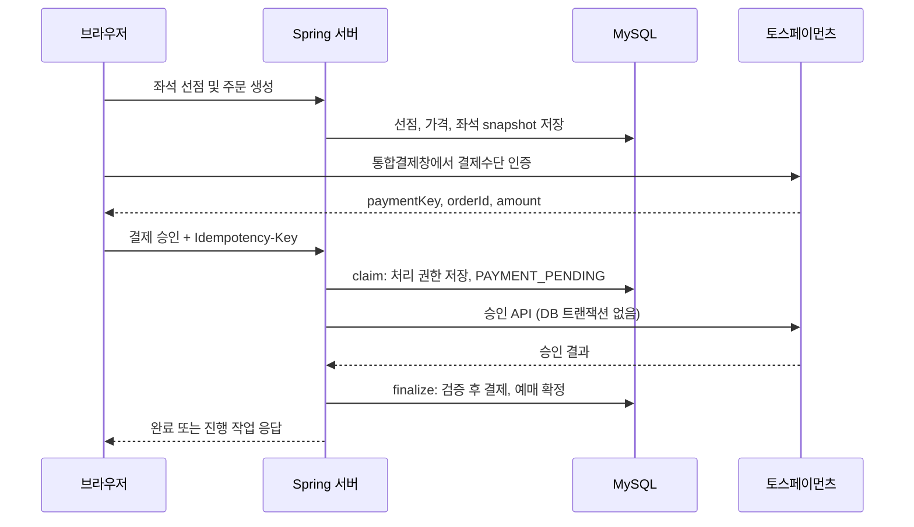
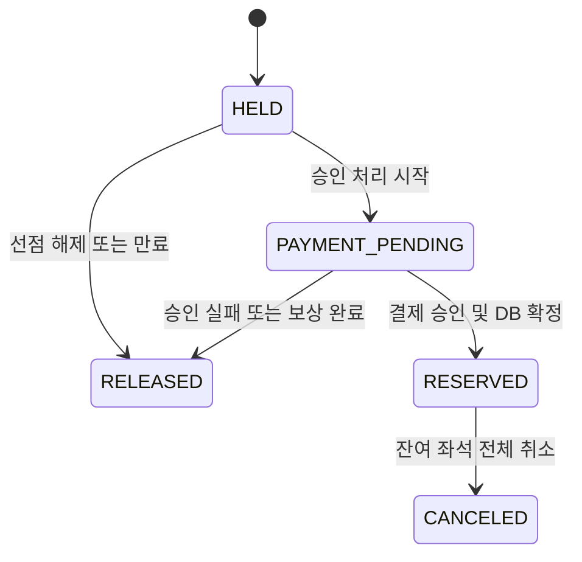
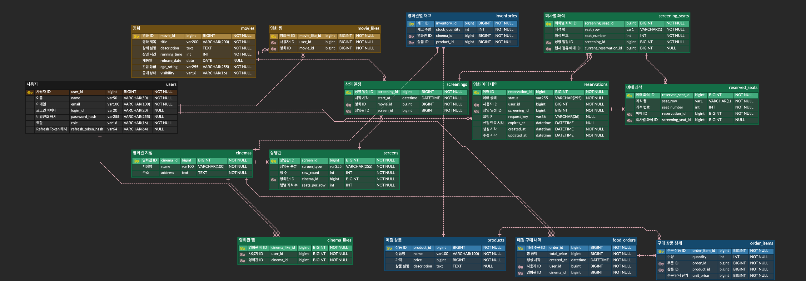

# spring-cgv-24th

CEOS 24기 백엔드 스터디 - CGV 클론 코딩 프로젝트

## 4주차 구현 및 개선

**목차**

- [1. 리팩토링](#1-코드-리팩토링과-리뷰-반영) / [2. 결제 흐름](#2-결제-시스템-설계)
- [3. 동시성](#3-동시성-문제-재현과-해결) / [4. 멱등성, 복구](#4-멱등성과-장애-복구)
- [5. 외부 연동](#5-외부-api-통신과-webhook) / [6. 실행](#6-로컬-실행-방법)
- [7. 검증](#7-테스트-결과와-스키마-적용) / [8. 회고](#8-구현하며-확인한-점)

### 1. 코드 리팩토링과 리뷰 반영

**설계 방향:** 엔티티는 생성 규칙과 상태 전이를, 서비스는 권한 검증과 처리 순서를, 인프라는 외부 HTTP 통신을 담당하도록 했습니다.
기존 `domain/{도메인}` 구조와 `ApiResponse`, `BusinessException`/`ErrorCode`, `ErrorResponse`,
`GlobalExceptionHandler`, `BaseTimeEntity`는 유지했습니다.

| 코드 | 책임과 분리 이유 |
| --- | --- |
| [PaymentWorkflowService](src/main/java/com/ceos/cgv/domain/payment/service/PaymentWorkflowService.java) | 승인, 취소, 복구 순서 조정. `Propagation.NEVER`로 외부 호출 중 DB 트랜잭션 유지 방지 |
| [PaymentTransactionService](src/main/java/com/ceos/cgv/domain/payment/service/transaction/PaymentTransactionService.java) | 짧은 claim/finalize 트랜잭션, 소유권, 상태, 금액, 멱등성 검증 |
| [ReservationPaymentService](src/main/java/com/ceos/cgv/domain/reservation/service/payment/ReservationPaymentService.java) | 선점의 결제 시작, 확정, 취소, 해제, 기존 좌석 잠금과 점유 검증 재사용 |
| [PaymentGateway](src/main/java/com/ceos/cgv/domain/payment/gateway/PaymentGateway.java) | 승인, 조회, 취소의 프로젝트 소유 계약. 서비스가 토스 전용 DTO에 의존하지 않도록 분리 |
| [TossPaymentGateway](src/main/java/com/ceos/cgv/domain/payment/infrastructure/toss/TossPaymentGateway.java) | 토스 HTTP 요청, 응답 변환 및 오류 분류 |

**리뷰에서 지적된 문제는 다음과 같이 수정했습니다.**

| 문제 | 개선 내용 |
| --- | --- |
| 필수값이 없는 선점 객체 생성 가능성 | `Reservation.hold()`에서 사용자, 상영, 요청 키, 만료 시각을 검증하고, 서비스도 조회, 잠금 전에 null 요청 키를 거부 |
| 경로 문자열 비교에 따른 보안 규칙 불명확성 | `PathPatternRequestMatcher`로 HTTP 메서드와 경로를 명시. JWT 필터와 인가 설정이 같은 공개 경로를 사용 |
| 다좌석 선점 중 뒷좌석 잠금 실패 | 전체 트랜잭션 롤백. MySQL에서 A2 충돌 후 A1 점유, 잠금이 남지 않음을 검증 |
| 결제 없이 확정되는 우회 경로 | 직접 예매 `POST /api/v1/reservations`와 무료 확정 `POST /api/v1/seat-holds/{reservationId}/confirm` 제거 |

공개 조회에서 잘못되거나 만료된 JWT를 검사하지 않는 기존 정책은 유지했습니다.
신규 DTO, 엔티티에는 `@Builder`를 적용하되 생성 ID와 감사 시각은 입력에서 제외하고, `Reservation.hold()`처럼 의미 있는 생성 경로를 유지했습니다.
예약과 결제가 같은 시간을 사용하도록 `Clock`만 [공통 설정](src/main/java/com/ceos/cgv/global/config/ClockConfig.java)으로 이동했습니다.

### 2. 결제 시스템 설계

**범위와 가정**

- 학습용 CGV 클론이며 실제 CGV 내부 구현을 설명하지 않습니다.
  **단일 서버, 단일 MySQL DB**를 가정합니다.
- 영화 예매의 카드, 간편결제를 우선 구현했습니다.
  **토스페이먼츠 API 개별 연동 TEST 키와 SDK v2 통합결제창**을 사용합니다.
  매점 결제, 가상계좌, 자동결제는 범위 밖입니다.
- 좌석당 **10,000원(KRW)**, 금액은 원 단위 `long`/`Long`입니다.
  선점은 **최대 8석, 5분, 연장 불가**입니다.
- 주문 당시 단가, 총액, 좌석을 snapshot으로 저장합니다.
  결제 승인 및 환불 금액을 클라이언트 입력에 맡기지 않습니다.

#### 주문부터 예매 확정까지



**왜 단계를 나눴나요?** `claim → PG 호출 → finalize`를 한 트랜잭션으로 묶으면 느린 외부 API를 기다리는 동안 DB 락과 커넥션을 점유합니다.
반대로 작업을 먼저 커밋하면 외부 승인 직후 서버가 중단되어도 저장된 작업 ID로 복구할 수 있습니다.
PG와 DB는 하나의 원자적 트랜잭션이 아닙니다.

토스 인증 성공 redirect는 **예매 확정이 아닙니다.** 서버가 `paymentKey`, `orderId`, `amount`를 검증하고 토스 승인 결과까지
확인해야 확정합니다.
`orderName`은 영화 제목과 ` N석`을 조합하며 UTF-16 길이 100 이하로, Unicode 서로게이트 쌍을 끊지 않고 생성합니다.
[토스 통합결제창 가이드](https://docs.tosspayments.com/guides/v2/payment-window/integration)

#### 무엇을 DB에 저장하나요?

| 모델 | 저장 목적 |
| --- | --- |
| `PaymentOrder` | 선점/회원, 외부 주문 ID, 주문명, 당시 단가, 총액, 기한 |
| `PaymentOrderSeat` | 주문 당시 좌석 ID, 좌표, 좌석별 취소 시각 |
| `Payment` | PG 결제 키, 확정 상태, 잔액, 결제수단, 승인 시각, 영수증 URL, 누적 취소 이력, `activeOperationId` |
| `PaymentOperation` | 승인/취소 요청 UUID, 지문, PG 멱등키, 금액, 대상 좌석, 처리 상태와 당시 완료 응답 |

**결제 상태와 개별 요청 상태를 구분**한 것이 핵심입니다.
예를 들어 부분취소 결과가 불명확해도 `Payment`는 마지막 확정 상태인 `DONE`, 해당 `PaymentOperation`은 `UNKNOWN`으로
유지할 수 있습니다.



| 상태 주체 | 핵심 상태 |
| --- | --- |
| `Reservation` | `HELD → PAYMENT_PENDING → RESERVED`; 해제 시 `RELEASED`, 잔여 좌석 전부 취소 시 `CANCELED` |
| `Payment` | `READY → PROCESSING → DONE → PARTIALLY_CANCELED → CANCELED`; 확정 거절 `FAILED`, 보상취소 중 `COMPENSATING` |
| `PaymentOperation` | `PROCESSING`(권한 확보), `UNKNOWN`(결과 불명확), `COMPENSATING`(보상 확인 중), `SUCCEEDED`/`FAILED`(완료) |

`PAYMENT_PENDING`은 선점 TTL 만료 대상에서 제외하지만 회원의 활성 선점 한도에는 포함합니다.
**결제 중 좌석이 다른 사용자에게 넘어가지 않게 하려는 정책**입니다.
대신 결과 불명확 상태가 오래 남을 수 있으므로 명시적인 복구 경로가 필요합니다.

#### 승인 전 검증

1. **소유권:** 인증 회원이 주문과 선점의 주인인지 확인합니다.
2. **선점 유효성:** 새 승인에서 `HELD`, 기한 미만료, 영화 공개 여부, 모든 좌석의 점유자를 확인합니다.
3. **금액과 식별자:** 요청 금액과 서버 주문 총액을 비교하고 `paymentKey`의 기존 연결, 다른 주문과의 중복을 검증합니다.
4. **중복 요청:** 요청 UUID, 지문, 진행 작업, 이미 승인/취소된 상태를 확인합니다.
5. **PG 응답:** 결제 키, 주문 ID, 원금, 잔액, 상태, 승인 시각, 취소 이력을 검증한 뒤 확정합니다.

claim 이전에 선점이 만료되었거나 영화가 비공개면 PG를 호출하지 않습니다.
`HELD` 정리는 기존 lazy expiry/선점 해제로 처리하며, 이미 `PAYMENT_PENDING`인 선점에는 같은 만료 로직을 적용하지 않습니다.

#### 전체 취소와 좌석 부분취소

| 방식 | 요청 | 서버 계산 |
| --- | --- | --- |
| 부분취소 | `reservedSeatIds`에 취소할 좌석 ID 목록 | 주문 당시 단가 × 선택 좌석 수 |
| 전체 취소 | `reservedSeatIds: null` | 요청 시점의 남은 좌석 전체와 잔액 |

빈 목록, 중복, 이미 취소된 좌석, 타인, 다른 주문의 좌석, 잔액 초과 요청은 거부합니다.
남은 좌석이 없는데 새로운 키로 전체 취소를 요청하면 PG 호출 없이 **409 `RESERVATION_ALREADY_CANCELED`**를 반환합니다.

취소 성공 뒤에는 **결제 잔액, 주문/예매 좌석의 취소 시각, 좌석 점유를 같은 DB 트랜잭션**에서 변경합니다.
PG 결과가 불명확하면 변경하지 않습니다.
PG의 식별자, 원금, 예상 잔액, 취소 거래 키, 완료 여부 및 누적 합계(`원금 - 잔액`)도 검증합니다.
누적 취소 후 잔액이 0원인데 PG 상태가 `PARTIAL_CANCELED`여도 검증을 통과하면 내부 상태를 `CANCELED`로 정리합니다.

#### 제공 API

| 영역 | API | 용도 |
| --- | --- | --- |
| 선점 | `POST /api/v1/seat-holds` | 좌석 선점, UUID `Idempotency-Key` |
| 선점 | `DELETE /api/v1/seat-holds/{reservationId}` | 결제 전 선점 해제 |
| 주문 | `POST /api/v1/payment-orders` | 선점 ID로 주문 생성, 신규 201 / 재사용 200 |
| 주문 | `GET /api/v1/payment-orders/{orderId}` | 저장된 주문 조회 |
| 결제 | `POST /api/v1/payments/confirm` | 결제 승인, UUID `Idempotency-Key` |
| 결제 | `GET /api/v1/payments/{paymentId}` | 최신 DB 상태, 잔액, 좌석 및 진행 작업 조회 |
| 취소 | `POST /api/v1/payments/{paymentId}/cancellations` | 전체 또는 좌석별 취소, UUID `Idempotency-Key` |
| 복구 | `GET /api/v1/payment-operations/{operationId}` | 저장된 작업 상태 조회 |
| 복구 | `POST /api/v1/payment-operations/{operationId}/reconcile` | PG 조회 후 미완료 작업 복구 |
| 예매 | `DELETE /api/v1/reservations/{reservationId}` | 유료 예매의 잔여 전체 취소, 성공 시 204 |

주문, 결제, 작업 API는 JWT와 소유권 검증을 사용합니다.
진행 중인 `PROCESSING`, `UNKNOWN`, `COMPENSATING`은 **HTTP 202 + 작업 조회 `Location`**, 완료된 작업은
**HTTP 200**입니다.
단, HTTP 200의 작업 본문도 `status=FAILED`일 수 있습니다.
일반 조회 GET은 200, 성공한 예매 DELETE는 본문 없는 204이며, 잘못된 숫자 ID는 400 `INVALID_REQUEST`입니다.

결제 정보가 없는 과거 `RESERVED` 예매에 한해서는 기존 취소 동작을 유지합니다.
새로 취소할 때는 좌석별 취소 시각을 기록하되, 과거에 기록되지 않은 시각을 임의로 만들지 않습니다.

### 3. 동시성 문제 재현과 해결

#### 어떤 문제가 발생할 수 있나요?

같은 주문에 대한 승인 요청 2개가 동시에 `READY`를 읽으면 **PG 승인 API를 중복 호출**할 수 있습니다.
같은 좌석의 취소 요청 2개도 동일한 과거 잔액을 읽으면 **중복 환불과 DB/PG 잔액 불일치**를 일으킬 수 있습니다.
좌석 선점에서는 두 요청이 같은 좌석을 동시에 점유하려는 경쟁도 발생합니다.

#### 어떤 방법을 비교했나요?

| 방법 | 원리와 장점 | 이 프로젝트에서의 판단 |
| --- | --- | --- |
| `synchronized` / JVM 락 | 한 JVM 안의 임계 구역 직렬화 | DB 처리 이력과 여러 인스턴스까지 일관되게 보호하지 못함 |
| 낙관적 락 | 버전 비교로 충돌 감지, 낮은 경합에 유리 | 외부 PG 호출 후 충돌하면 부작용 복구가 복잡함 |
| 비관적 락 | DB 행을 먼저 잠그고 최신 상태 확인 | 현재 선택. 대기, 교착을 줄이도록 트랜잭션을 짧게 유지 |
| 조건부 `UPDATE` | 상태가 맞을 때만 원자적으로 갱신 | 단순 상태 변경에 좋지만 다좌석/이력 처리엔 추가 설계 필요 |
| unique 제약 | DB가 중복 식별자 저장 거부 | 다른 주문의 동일 PG 키 등 최종 방어선으로 함께 사용 |
| 분산 락 | 여러 서버가 공유하는 락 | 현재 단일 DB 행 잠금으로 충분하여 별도 인프라 도입 안 함 |

**선택한 방법:** 좌석은 기존 `FOR UPDATE NOWAIT`를 유지하여 충돌 시 즉시 `SEAT_BUSY`를 반환합니다.
결제는 **짧은 `PESSIMISTIC_WRITE` 잠금 + 처리 작업 커밋 + unique 제약**을 사용합니다.
`READ_COMMITTED`에서 결제 → 예매 → 정렬된 좌석 순으로 잠그고 필요한 객체를 잠금 후 refresh합니다.
**PG 호출 중에는 DB 트랜잭션을 열어두지 않습니다.** [MySQL 잠금 조회](https://dev.mysql.com/doc/refman/8.4/en/innodb-locking-reads.html)

#### 어떻게 재현하고 검증했나요?

**주의:** 적용 전 결과는 과거 운영 코드의 이중 과금 사례가 아니라, **잠금 없이 `조회 → PG 요청 → 저장`을 수행하는 테스트용 단순 구현**과 비교한 것입니다.
동일 초기 데이터에서 요청 2개의 조회를 barrier로 맞추고, 실제 서비스 쪽은 첫 PG 호출을 latch로 멈춰 경쟁을 재현했습니다.
실제 PG 대신 `PaymentGateway` 대역을 사용했습니다.

| 동일한 요청 2개, MySQL 8.4.8 | 잠금 없는 비교 구현 | 현재 구현 |
| --- | --- | --- |
| 같은 주문 승인 | PG 대역 호출 **2회** | **1회**, 예매 확정 1회 |
| 같은 좌석 부분환불 | PG 대역 취소 **2회**. DB 잔액 10,000원 / PG 대역 잔액 0원 | **1회**. DB, PG 대역 잔액 모두 10,000원 |
| 취소 이후 좌석 | 중복 환불 발생 | 취소 좌석만 해제, 다른 좌석 점유 유지 |

근거: [PaymentConcurrencyComparisonTest](src/test/java/com/ceos/cgv/domain/payment/service/PaymentConcurrencyComparisonTest.java), [PaymentConcurrencyIntegrationTest](src/test/java/com/ceos/cgv/domain/payment/service/PaymentConcurrencyIntegrationTest.java). 같은/다른 요청 키, 서로 다른 주문에서 같은 PG 키, 부분/전체 취소 중첩, 동시 reconcile, 느린 PG 중 만료와 DB
오류도 확인했습니다.
PG 대역 호출 시 실제 DB 트랜잭션이 비활성인지 검사했습니다.

추가로 [SeatHoldConcurrencyIntegrationTest](src/test/java/com/ceos/cgv/domain/reservation/service/hold/SeatHoldConcurrencyIntegrationTest.java)에서 **A2를 잠근 채 A1, A2 선점을 시도**해 NOWAIT 충돌을 만들었습니다.
실패 뒤 A1 점유와 좌석 이력이 남지 않았고, A2 잠금이 유지되는 동안에도 A1을 다시 잠글 수 있었습니다.
MySQL 실측으로 확인했으며 H2 결과만으로 NOWAIT를 판단하지 않았습니다.

### 4. 멱등성과 장애 복구

**동시성 제어와 멱등성의 차이**

- **동시성 제어:** 지금 동시에 실행 중인 요청끼리 같은 데이터를 잘못 변경하지 않도록 막습니다.
- **멱등성:** 네트워크 응답을 잃어버려 **나중에 동일한 의도의 요청이 재전송되어도** 효과를 한 번만 적용합니다.

락만으로 과거 완료 요청을 알아볼 수 없고, 멱등키만으로 서로 다른 키의 동시 요청을 막을 수 없으므로 **둘 다 필요**합니다.

#### 중복 요청을 어떻게 구분하나요?

1. 주문은 `reservationId` unique로 같은 선점당 하나만 만듭니다.
2. 승인, 취소 작업은 `(userId, type, requestUUID)` unique와 SHA-256 요청 지문을 저장합니다.
  **같은 키로 다른 금액, 좌석, 사유**를 보내면 거부합니다.
3. 전체 취소의 지문은 원래 의도인 `FULL + 사유`를 보존하고, 실제 대상 좌석, 금액은 claim 시점 snapshot에 저장합니다.
4. PG용 멱등 UUID는 요청 키와 별도로 한 번 생성해 저장합니다.
  취소 재전송이나 보상취소에도 **각 작업의 고정 키**를 사용합니다.
5. 완료 요청의 재전송에는 **당시 저장한 응답**을 반환합니다.
  현재 잔액은 결제 GET으로 별도 조회합니다.
  이미 승인된 주문은 다른 승인 키가 와도 PG를 다시 호출하지 않습니다.
6. 진행 작업이 있다면 새 요청 키에도 해당 작업을 알려주고, 완료 여부를 확인한 다음 새 취소를 판단하도록 합니다.

토스 POST에도 `Idempotency-Key`를 보냅니다.
공식 문서상 키 유효기간은 처음 사용한 날부터 **15일**이며 처리 중 중복 요청에는 `IDEMPOTENT_REQUEST_PROCESSING`이 올 수 있습니다.
우리 DB의 처리 이력은 별도로 보존합니다.
[토스 멱등성 문서](https://docs.tosspayments.com/reference/using-api/authorization)

#### 토스 응답이 없거나 DB 저장이 실패하면?

**타임아웃은 결제 실패의 증거가 아닙니다.** PG가 처리했지만 응답만 유실됐을 수 있으므로, 바로 새로운 요청 키로 재승인, 재취소하지 않습니다.
일반 주문, 결제, 작업 GET은 **DB만 조회**하며, `POST /api/v1/payment-operations/{operationId}/reconcile`에서만 PG를 조회해 복구합니다.

| 상황 | 처리 정책 |
| --- | --- |
| 공식 오류 코드와 HTTP 상태가 일치하는 확정 승인 거절 | `FAILED` 처리 후 pending 선점 해제 |
| 확정 취소 거절 | 작업 `FAILED`, 마지막 확정 잔액, 좌석 점유 유지 |
| 네트워크 오류, 타임아웃, 5xx, 예상 못 한 응답 | 작업 `UNKNOWN`, 기존 잔액, 점유 보존 |
| PG 성공 후 DB finalize 일시 실패 | 작업 보존 후 PG 조회 결과로 finalize 재실행 |
| finalize 중 `SEAT_BUSY` | 새 트랜잭션으로 최대 3회 재시도, 계속 충돌하면 `UNKNOWN` |
| 취소 `UNKNOWN`, PG 잔액, 이력이 claim 이전과 동일 | 저장된 **동일 PG 멱등키**로 취소 재전송 |
| 승인 `UNKNOWN`, PG에서 결제 `NOT_FOUND` | 선점 만료 + 기본 30분 유예 전에는 대기, 이후 확정 실패로 정리 |
| 승인 성공 뒤 좌석 소유권 상실 등 영구 확정 실패 | 별도 고정 키로 보상취소, 확인 전 `COMPENSATING`과 점유 유지 |
| 보상취소 완료 확인 | 결제 `CANCELED`, 작업 `FAILED`; 본인이 아직 점유한 좌석만 해제 |

취소 오류 `EXCEED_CANCEL_AMOUNT_DISCOUNT_AMOUNT`는 **취소 경로에서 공식 HTTP 400과 일치할 때만** 확정 거절로 분류합니다.
다른 상태 코드나 승인 경로라면 `UNKNOWN`입니다.
부분취소가 최종 `FAILED`이면 새 UUID로 잔여 전체취소를 요청할 수 있습니다.
복구 때도 주문, 금액, 취소 이력을 재검증하며 완료 작업에는 PG 조회나 좌석 변경을 반복하지 않습니다.
DB 데이터를 수동 훼손해 예매 정리가 불가능하면 보상 완료 후에도 작업이 남을 수 있습니다.

### 5. 외부 API 통신과 Webhook

#### HTTP Client 선택

| 선택지 | 장점 | 판단 |
| --- | --- | --- |
| `RestClient` | Spring의 동기 HTTP API, fluent 방식 | **선택:** 현재 Spring MVC/JPA의 블로킹 흐름과 잘 맞음 |
| `WebClient` | 비동기, 논블로킹, 스트리밍에 강점 | JPA가 블로킹이고 `.block()`만으로 논블로킹 구조가 되지 않음 |
| `Feign Client` | 인터페이스로 외부 API 계약 선언 | 이번 승인, 조회, 취소 3개 호출에 Spring Cloud 의존성 추가 필요성 낮음 |

`RestClient`와 JDK `HttpClient`를 사용합니다.
**연결 3초, 응답 10초는 과제용 설정**이며 토스 권장값이 아닙니다.
외부 주소는 토스 API로 고정하고 리다이렉트를 따르지 않습니다.
응답의 식별자, 상태, 정수 금액, 취소 이력, 시각을 검증하며, 공식 오류 코드와 HTTP 상태 조합만 확정 거절로 판단합니다.
그 외는 `UNKNOWN`으로 취급합니다.
[Spring REST Clients](https://docs.spring.io/spring-framework/reference/integration/rest-clients.html), [OpenFeign](https://docs.spring.io/spring-cloud-openfeign/reference/index.html)

키는 `TOSS_CLIENT_KEY`, `TOSS_SECRET_KEY` 환경변수로 주입하고 TEST 키 조합만 허용합니다.
PG의 원문 오류, 실제 키, 인증 헤더를 응답, 로그에 노출하지 않습니다.

#### Webhook을 추가한다면?

Webhook은 PG가 상태 변화를 **우리 서버에 HTTP POST로 알리는 방식**입니다.
토스는 개발자센터에서 이벤트와 수신 URL을 등록하며, 10초 안에 200 응답이 없으면 최대 7회 재전송합니다.
[토스 Webhook 가이드](https://docs.tosspayments.com/guides/v2/webhook)

현재 구현에는 Webhook 수신 API가 **없습니다(과제 필수 구현 아님)**. 도입한다면 **결과 유실을 알아채는 신호**로만 쓰겠습니다.

`Webhook 수신 → PG 현재 상태 조회 → 주문/금액 검증 → 기존 멱등 finalize`

이벤트 중복, 역순 도착, 재전송을 고려해 알림만으로 바로 좌석이나 잔액을 수정하지 않고, 이벤트별 공식 검증 방식도 확인해야 합니다.

### 6. 로컬 실행 방법

Java 21과 Node.js가 필요합니다.
MySQL 통합 테스트에는 Docker가 필요하지만 **결제 데모 자체는 전용 H2 메모리 DB**로 실행됩니다.

```sh
# 토스 개발자센터의 'API 개별 연동' TEST 키를 같은 터미널에 등록
export TOSS_CLIENT_KEY="본인의_테스트_클라이언트키"
export TOSS_SECRET_KEY="본인의_테스트_시크릿키"

# 결제 데모 실행 (포트 8088)
./gradlew bootRun --args='--spring.profiles.active=payment-demo --server.port=8088'
```

[http://localhost:8088/payment-demo.html](http://localhost:8088/payment-demo.html) 접속 후 데모 계정 **`paymentdemo` / `DemoPayment123!`**로 로그인합니다.

`A1,A2 선점 → 주문 생성 → 결제창 인증 → 서버 승인 → A1 부분취소 → 잔여 전체취소` 순서로 확인할 수 있습니다.
테스트 키에서는 실제 금액이 출금되지 않지만 인증 과정에서 결제 앱이나 본인 인증 화면이 나올 수 있습니다.
[토스 테스트 환경](https://docs.tosspayments.com/guides/v2/get-started/environment)

- 데모 페이지(`payment-demo.html`, 성공/실패 페이지 및 JS, CSS)는 `payment-demo` 프로필에서만 공개됩니다.
  다른 프로필에서는 익명 접근이 **401**입니다.
- 데모 전용 H2 DB는 종료 시 삭제되며, 다른 DB URL을 넣으면 JPA 초기화 전 차단합니다.
  MySQL 테스트도 별도 일회용 컨테이너를 사용하므로 기존 DB를 초기화하지 않습니다.
- `GET /api/v1/payment-config`는 **로그인한 사용자에게만** 클라이언트 키와 통화를 반환하고, 시크릿 키는 반환하지 않습니다.
  키가 없거나 부적절하면 claim 전에 거부합니다.
- 선점/주문이 만료되어 409 `HOLD_EXPIRED`, `HOLD_NOT_ACTIVE`를 받으면 데모가 이전 상태를 정리하고 새 UUID로 다시 선점하도록 합니다.
  결과 불명확 오류에서는 기존 UUID를 유지합니다.
  미확정 작업 중에는 계정 전환을 막습니다.
- 재시작 후 브라우저의 이전 상태가 남으면 데모에서 로그아웃하고 다시 시작합니다.

### 7. 테스트 결과와 스키마 적용

#### 실행 명령

```sh
./gradlew test
./gradlew mysqlTest
node --test src/test/js/payment-demo.test.js
./gradlew assemble
```

**2026-10-13 최종 통합 결과(README 작성 당시의 기록)**

| 검증 | 결과 |
| --- | --- |
| 기본 Java/H2 | **387건 중 386건 통과, skip 1**, 실패, 오류 0 |
| 실제 MySQL 8.4.8, `mysql-test` | **83건 통과**, 실패, 오류, skip 0 |
| JavaScript 데모 | **49건 통과**, 실패, skip 0 |
| `assemble` | 빌드 성공 |

Java의 skip 1건은 MySQL 전용 `PaymentSchemaUpgradeIntegrationTest` 분리로 인한 것이며, 스키마 2개 케이스는 MySQL에서 실행했습니다.
추가 회귀 테스트로 환불 제한 오류 분류, 긴 Unicode 주문명, 만료 복구, 계정 전환, 과거 예매 취소 이력, 보안/Swagger, PG 취소 재전송, 거절, `NOT_FOUND` 유예,
`SEAT_BUSY` 재시도, 전체 취소 후 재취소 409, DTO 취소 시각 일치 등을 확인했습니다.
**자동화 테스트의 PG는 대역**이며 전체 부하, 멀티서버 운영 성능을 검증한 것은 아닙니다.

**실제 토스 TEST 검증:** 카카오페이 인증 → **20,000원 승인, 2석 확정** → A1 **10,000원 부분취소** → 남은 **10,000원 취소**를 수행했습니다.
마지막 PG 응답은 `PARTIAL_CANCELED`인데 잔액이 0원이라 기존 로직이 `UNKNOWN`으로 보류했습니다.
금액, 취소 이력 검증을 유지하며 처리 기준을 보완한 뒤 **기존 데이터로 `reconcile`을 한 번 실행**해 `SUCCEEDED`, 결제/예매 `CANCELED`,
잔액 0원, 두 좌석 `AVAILABLE`을 확인했습니다.
새 PG 취소 요청을 보내지 않았고, 같은 전체취소 UUID 및 이전 부분취소 UUID를 재전송하면 각각 **당시 완료 응답**이 재사용됐습니다.
할인 제한 응답 회귀 테스트는 공식 HTTP 모의응답 기반이며 실제 토스 거래로 다시 실행하지 않았습니다.

#### 기존 MySQL DB에 적용할 때

스키마는 [수동 SQL](src/main/resources/db/manual/week-04-payment.sql)로 제공합니다.
**애플리케이션 중지, 백업 후**, `SHOW CREATE TABLE`로 기존 `reservations.status` ENUM과 `reserved_seats` 구조를 대조하고 **한 번만** 적용해야 합니다.
`ddl-auto: update`만으로는 `PAYMENT_PENDING` ENUM이 추가되지 않습니다.
이미 Hibernate가 일부 신규 테이블/컬럼을 생성했다면 SQL 전체를 재실행하지 말고 ENUM 변경과 나머지 구조를 각각 비교해야 합니다.
MySQL DDL은 암묵적 커밋이 발생하므로 부분 실패 시 실제 스키마를 확인해야 하며 자동 DROP 롤백은 제공하지 않습니다.

[PaymentSchemaUpgradeIntegrationTest](src/test/java/com/ceos/cgv/domain/payment/schema/PaymentSchemaUpgradeIntegrationTest.java)에서 기존 ENUM 순서 2개와 기존 예매, 좌석 이력 각 5행을 유지한 채 스키마 업그레이드와 ORM 승인/부분취소를 검증했습니다.
새 결제 테이블의 unique와 엔티티 연관 FK도 확인했습니다.
다만 일부 snapshot ID 및 `activeOperationId`는 scalar라 FK로 존재를 보장하지 않으며, 모든 과거 DB 변형이나 별도 schema validate까지 검증한 것은 아닙니다.

### 8. 구현하며 확인한 점

- **락의 대상과 길이가 중요합니다.** 좌석 단위 `NOWAIT`과 결제 행의 짧은 잠금은 다르게 설계했고, PG 대기 시간에는 DB 락을 잡지 않도록 분리했습니다.
- **동시성 제어만으로 중복 결제를 막을 수 없습니다.** 동시에 실행되는 요청과 나중에 다시 오는 요청은 다른 문제여서, 저장된 작업 이력과 멱등키를 함께 사용했습니다.
- **외부 API의 성공과 우리 DB의 성공은 별개입니다.** 타임아웃이나 DB 저장 실패를 결제 실패로 단정하지 않고, `UNKNOWN`과 PG 조회 복구를 도입했습니다.
- **상태 이름만 믿으면 안 됩니다.** 실제 TEST 거래에서 PG 상태가 `PARTIAL_CANCELED`여도 잔액은 0원이었습니다.
  금액과 누적 취소 이력을 검증해 최종 상태를 결정하도록 보완했습니다.
- **남은 범위:** Webhook 자동 수신, 백그라운드 복구 스케줄러, 매점, 가상계좌, 자동결제, 멀티서버/부하 검증은 이번 구현에 포함하지 않았습니다.

---

<details>
<summary>이전 과제 내용</summary>

<details>
<summary>3주차</summary>

## 3주차 구현 및 개선

### 인증, 인가

- 별도 로그인 ID를 사용하는 회원가입, 로그인과 Spring Security 기반 JWT 인증을 구현했습니다.
- Access Token은 30분, Refresh Token은 14일로 설정했습니다. 회원당 Refresh Token 하나를 해시로 저장하고, 재발급 시 교체하며 로그아웃 시 폐기합니다.
- 개인 예매, 주문은 토큰의 회원 ID로 처리하고 소유권을 확인합니다. 운영용 등록 API와 영화 비공개 처리는 ADMIN 권한으로 제한했습니다.

### 영화 예매

- 회차별 좌석(`ScreeningSeat`)을 생성하고, 요청한 좌석에 비관적 락(`FOR UPDATE NOWAIT`)을 걸어 같은 좌석의 중복 예매를 막았습니다. 잠금 충돌 시 기다리지 않고 오류를 반환합니다.
- 한 번에 최대 8석을 5분간 선점할 수 있습니다. 선점 연장은 허용하지 않으며, 유효한 선점, 확정 예매는 같은 요청 키로 재시도하면 기존 결과를 반환합니다.
- 선점 확정, 해제, 만료 처리를 추가하고, 예매 상태와 좌석 점유를 함께 변경하도록 정리했습니다. 상세 조회에도 만료 상태와 시각을 반영했습니다.
- 직접 예매의 만료 정리를 트랜잭션 밖으로 분리해 추가 커넥션을 기다리는 문제를 수정했습니다. 기존 좌석 데이터를 연결하는 백필도 정상 만료된 선점을 처리하도록 보완했습니다.
- 영화 삭제는 비공개 전환으로 처리해 기존 예매 이력을 보존합니다.

### 매점 주문

- 동시 주문으로 재고 차감이 겹치지 않도록 영화관별 재고에 비관적 락(`PESSIMISTIC_WRITE`)을 적용했습니다. 상품 ID 순서로 잠금을 얻고, 모든 항목을 검증한 뒤 차감합니다.
- 주문 당시 단가(`unitPrice`)를 보존하고, 주문 항목과 총액을 함께 생성하도록 변경했습니다. null 주문 항목과 잘못된 재고 차감 수량도 차단했습니다.

### 공통 구조와 오류 처리

- 인증 기능은 `auth`, 공통 보안 코드는 `global/security`로 분리했습니다. 예매 코드는 서비스, 정책, 값 객체, 스케줄러의 역할에 따라 나눴습니다.
- 예매, 주문, 상영 서비스에서 응답 DTO를 완성하고 OSIV를 껐습니다. 재시도할 때 이전 트랜잭션의 좌석 상태를 재사용하지 않도록 했습니다.
- 보안 오류도 공통 `ErrorResponse`를 사용합니다. 일반 요청 오류가 401로 바뀌지 않도록 오류 디스패치를 보완하고, Swagger에 Bearer 인증과 오류 응답을 명시했습니다.

## JWT 인증 흐름

### JWT 구조와 토큰의 역할

- Header에는 서명 알고리즘 같은 메타데이터가 들어갑니다. 현재는 `HS256`을 사용합니다.
- Payload에는 회원 ID, 역할, 만료 시각 같은 Claim이 들어갑니다.
- Signature는 Header와 Payload를 서명한 값입니다. 서버의 키로 서명을 검증해 내용이 바뀌었는지 확인합니다.

현재 사용하는 서명된 JWT의 Header와 Payload는 Base64URL로 인코딩되어 있어 내용을 읽을 수 있습니다. 서명이 내용을 암호화하는 것은 아니므로 비밀번호 같은 민감한 정보는 넣지 않았습니다. [JWT 표준](https://www.rfc-editor.org/rfc/rfc7519.html)

Access Token은 일반 API 요청의 인증에 사용하고, Refresh Token은 새 Access Token을 받는 데 사용합니다. 두 토큰의 구분은 용도에 따른 것이며, 반드시 JWT여야 하는 것은 아닙니다. 현재 프로젝트에서는 둘 다 JWT로 만들고 `token_type`으로 용도를 구분합니다.

쿠키는 브라우저에 값을 저장하고 조건에 맞는 요청에 자동으로 첨부하는 수단입니다. 세션은 서버가 로그인 상태를 보관하는 방식이며, 보통 쿠키로 세션 ID를 전달합니다. JWT는 서명된 정보를 전달하는 토큰 형식이고, 이번 프로젝트는 `Authorization: Bearer <access-token>` 헤더로 전달합니다.

### Access Token에 담은 Claim

| Claim | 사용 목적 |
| --- | --- |
| `sub` | 내부 회원 ID로 요청한 사용자를 식별 |
| `role` | `USER`, `ADMIN` 역할 구분 |
| `token_type` | `ACCESS`인지 확인해 Refresh Token의 일반 API 사용 차단 |
| `iss` | 발급자가 `spring-cgv-24th`인지 확인 |
| `iat` | 토큰 발급 시각 |
| `exp` | 토큰 만료 시각 |

`JwtService`는 서명, 허용 알고리즘, 발급자, 만료 시각, 토큰 용도와 필수 Claim을 확인합니다. 검증이 끝난 뒤에만 회원 ID와 역할을 사용하며, 서명키는 `CGV_JWT_SECRET_BASE64` 환경변수로 전달합니다.

### 로그인과 JWT 인증 처리

```text
로그인 요청
→ AuthenticationManager
→ DaoAuthenticationProvider
→ CgvUserDetailsService에서 회원 조회
→ PasswordEncoder로 저장된 해시와 비밀번호 비교
→ 인증 성공 후 토큰 발급
```

회원가입 시 비밀번호는 `PasswordEncoder`로 해시해서 저장합니다. 없는 계정과 틀린 비밀번호는 모두 `401 LOGIN_FAILED`로 응답하고 토큰을 발급하지 않습니다. 로그인과 JWT 인증에는 `UserDetails`를 구현한 `CgvUserDetails`를 사용합니다. 로그인용 객체에는 저장된 비밀번호 해시가 필요하고, JWT용 객체는 검증된 회원 ID와 역할로 만들며 비밀번호를 담지 않습니다.

```text
보호 API 요청
→ JwtAuthenticationFilter에서 Bearer Token 추출
→ JwtService에서 토큰 검증
→ CgvUserDetails와 Authentication 생성
→ 새 SecurityContext에 인증 객체 설정
→ 인가 처리 후 컨트롤러 호출
```

필터는 `OncePerRequestFilter`를 상속하고, 인가 처리보다 앞에서 실행됩니다. `SecurityConfig`에서 직접 생성해 Security 체인에만 등록하므로 서블릿 필터로 중복 등록하지 않았습니다.

### 인증, 인가와 오류 처리

인증은 요청한 사용자가 누구인지 확인하는 것이고, 인가는 그 사용자가 해당 작업을 할 수 있는지 확인하는 것입니다.

- 토큰이 없으면 인증 객체를 만들지 않고 다음 필터로 넘깁니다. 보호 API라면 `401 TOKEN_NOT_EXIST`를 반환합니다.
- 보호 API에 만료되거나 잘못된 토큰이 들어오면 필터에서 `AuthenticationEntryPoint`를 호출하고 요청을 종료합니다. 각각 `TOKEN_EXPIRED`, `TOKEN_INVALID`로 구분합니다.
- 공개 조회는 JWT 검증을 생략합니다. 만료되거나 잘못된 토큰을 함께 보내도 공개 데이터는 조회할 수 있습니다.
- `@AuthenticationPrincipal`로 받은 회원 ID를 사용하고, 예매 조회와 취소는 소유권도 확인합니다. 관리자도 다른 회원의 예매를 취소할 수 없습니다.
- 역할을 Authentication에 넣을 때 `ROLE_`를 붙이고, 관리자 API에서는 `hasRole("ADMIN")`으로 검사합니다. 일반 회원가입은 `USER`로 고정합니다.

Security 체인의 인증 실패는 `AuthenticationEntryPoint`, 권한 부족은 `AccessDeniedHandler`가 처리합니다. 필터 계층에서는 `@RestControllerAdvice`에 맡기지 않고 같은 `ErrorResponse`를 직렬화해 `status`, `code`, `message` 형식으로 반환합니다.

### STATELESS와 CSRF 설정

`SessionCreationPolicy.STATELESS`로 인증 정보를 세션에 저장하지 않고 매 요청의 JWT를 확인합니다. 사용하지 않는 `formLogin`, `httpBasic`도 비활성화했습니다.

이번 API는 세션이나 인증 쿠키를 사용하지 않고, 클라이언트가 Bearer 헤더에 토큰을 직접 넣습니다. 브라우저가 인증 정보를 자동 첨부하는 쿠키 인증을 사용하지 않는 전제에서 CSRF 보호를 껐습니다. 이후 인증 쿠키를 도입한다면 CSRF 설정도 다시 검토해야 합니다. [Spring Security CSRF 문서](https://docs.spring.io/spring-security/reference/servlet/exploits/csrf.html)

### 인증 요청별 처리 결과

H2 기반 자동화 테스트로 아래 결과를 확인했습니다. Payload를 변경한 토큰은 임시 H2 서버에 실제 HTTP 요청을 보내서도 확인했습니다.

| 요청 상황 | 확인한 결과 |
| --- | --- |
| 올바른 로그인 정보 | 200, Access Token 발급 |
| 없는 계정, 잘못된 비밀번호 | 모두 401 `LOGIN_FAILED`, 토큰 미발급 |
| 토큰 없이 공개 영화 조회 | 200 |
| 정상 토큰으로 영화 찜 | 200 |
| 토큰 없이 보호 API 호출 | 401 `TOKEN_NOT_EXIST`, 공통 JSON |
| 만료된 토큰으로 보호 API 호출 | 401 `TOKEN_EXPIRED` |
| 변조되거나 형식이 잘못된 토큰 | 401 `TOKEN_INVALID` |
| 다른 키로 서명한 토큰 | 401 `TOKEN_INVALID` |
| 일반 사용자로 관리자 API 호출 | 403 `ACCESS_DENIED`, 공통 JSON |
| 관리자로 영화 등록, 비공개 전환 | 각각 201, 204 |
| 정상 인증 요청 직후 토큰 없이 보호 API 호출 | 401, 이전 요청의 인증 정보가 남지 않음 |
| 다른 회원의 예매 조회, 취소 | 403 `ACCESS_DENIED`, 예매 상태 유지 |

관련 테스트: [로그인](src/test/java/com/ceos/cgv/domain/auth/controller/AuthLoginIntegrationTest.java), [JWT 인증 흐름](src/test/java/com/ceos/cgv/global/security/jwt/SecurityFlowIntegrationTest.java), [관리자 권한](src/test/java/com/ceos/cgv/domain/movie/controller/MovieAdminAccessIntegrationTest.java), [예매 소유권](src/test/java/com/ceos/cgv/domain/reservation/controller/ReservationControllerIntegrationTest.java)

## ERD



[ERD Cloud에서 보기](https://www.erdcloud.com/d/GgS73rR7gzSAZZXie)

---

</details>

아래는 1~2주차 과제 작성 당시의 기록입니다.

## spring-cgv-24th

---

CEOS 24기 백엔드 스터디 - CGV 클론 코딩 프로젝트

## 목차

- [서비스와 과제 요구사항](#서비스와-과제-요구사항)
- [ERD와 모델링](#erd와-모델링)
- [도메인별 기능](#도메인별-기능)
- [세션 중 질문 정리](#세션-중-질문-정리)
- [구현하며 확인한 점과 보완 사항](#구현하며-확인한-점과-보완-사항)

## 서비스 요구사항

- 영화관과 영화 정보를 조회하고, 영화관, 영화를 찜합니다.
- 영화관 안의 상영관에서 상영 일정을 만들고 조회합니다.
- 상영 일정의 좌석을 예매하고, 예약을 취소합니다.
- 영화관별 매점 재고를 관리하고, 상품을 주문합니다. 주문 환불은 범위에 포함하지 않습니다.

## ERD와 모델링

[ERD와 모델링 설계 문서 보기](docs/erd설계문서.md)

## 도메인별 기능

코드는 `domain/{도메인}/{controller,dto,entity,repository,service}` 구조로 나눴습니다.

| 도메인 | 책임 |
| --- | --- |
| `user` | 사용자 엔티티와 저장소. 과제 조건에 따라 포함 |
| `cinema` | 영화관 조회, 영화관 찜, 상영관 생성 |
| `movie` | 영화 생성, 조회, 삭제, 영화 찜, 상영 일정 생성, 조회 |
| `reservation` | 좌석 예매, 조회, 취소와 좌석 검증 |
| `concession` | 상품, 지점별 재고 관리, 매점 주문과 주문 조회 |
| `global` | OpenAPI 설정과 공통 예외 응답 |

## 세션 중 질문 정리

### ORM과 JPA

#### Dirty Checking으로 UPDATE할 때 바뀌지 않은 컬럼도 매번 업데이트하나요? 개선해야 하나요?

Hibernate의 기본 UPDATE SQL은 변경된 필드만이 아니라 여러 매핑 컬럼을 포함할 수 있습니다. 반드시 최적화해야 하는 것은 아니며, 실제 병목이 확인된 경우 Hibernate의 `@DynamicUpdate`로 변경된 컬럼만 포함할 수 있습니다. 다만 SQL 모양이 다양해지는 비용도 있으므로 측정 후 적용합니다.

#### `flush`는 언제 일어나나요?

변경 내용을 DB에 동기화하는 시점입니다. 직접 `flush()`를 호출할 때, 트랜잭션이 커밋되기 전, 그리고 기본 `AUTO` 모드에서 대기 중인 변경과 충돌할 수 있는 쿼리를 실행하기 전에 발생할 수 있습니다. `flush`는 커밋과 같지 않습니다. 트랜잭션이 롤백되면 flush된 SQL도 최종 반영되지 않습니다.

#### 영속성 컨텍스트와 `EntityManager`, `EntityManager`와 트랜잭션은 항상 1:1인가요?

일반적으로 `EntityManager` 하나가 영속성 컨텍스트 하나를 관리합니다. 하지만 `EntityManager`와 트랜잭션의 수명이 항상 1:1인 것은 아닙니다. Spring Data JPA에서 보이는 `EntityManager` 참조는 공유 프록시일 수 있고, 실제 호출은 현재 트랜잭션에 연결된 엔티티 매니저로 위임됩니다. 확장 영속성 컨텍스트처럼 하나의 컨텍스트가 여러 트랜잭션에 걸치는 경우도 있습니다.

### 연관관계와 프록시

#### `@JoinColumn`을 생략하면 어떻게 되나요?

JPA가 기본 이름 규칙을 적용합니다. 예를 들어 `team` 필드가 `Team`의 `id`를 참조하면 기본 FK 컬럼명은 보통 `team_id`가 됩니다. 필드명, 참조 PK 이름, 매핑 방식에 따라 달라질 수 있으므로 생성된 스키마를 확인하거나 이름을 명시하는 편이 안전합니다.

#### 양방향 매핑은 항상 좋은가요?

아닙니다. 양쪽에서 객체 그래프를 따라갈 필요가 있을 때만 사용하면 됩니다. 양방향이면 양쪽 객체의 참조를 함께 맞춰야 하고, 그렇지 않으면 메모리의 객체 상태와 DB 관계가 어긋날 수 있습니다. 한 방향으로 충분하면 단방향이 더 단순합니다.

#### `Team.members`만 수정해도 DB에 반영되나요?

일대다/다대일 양방향 관계에서 보통 FK가 있는 `Member.team`이 연관관계의 주인입니다. 반대편인 `Team.members`만 바꾸면 DB FK 변경이 반영되지 않을 수 있습니다. 주인 필드를 변경하고, 필요하면 양쪽 객체 상태를 맞추는 편의 메서드를 둡니다.

#### `mappedBy` 없이 양쪽 모두에 `@JoinColumn`을 두면 어떻게 되나요?

JPA가 하나의 양방향 관계라고 알아서 합쳐주는 것이 아닙니다. 양쪽 필드가 각각 별개의 관계 매핑으로 해석되어 중복 FK나 불필요한 스키마가 생길 수 있습니다. 한쪽을 주인으로 두고 반대쪽에 `mappedBy`를 지정해야 합니다.

#### 내부 PK로 Long을 쓸까요, UUID를 쓸까요?

둘 중 하나만 골라야 하는 것은 아닙니다. 내부 DB 식별자는 Long PK로 두고, 외부에 노출할 식별자가 필요하면 별도 UUID/ULID를 둘 수 있습니다. 현재 프로젝트는 Long ID를 API 경로 등에 사용하므로 외부 식별자 분리는 아직 적용하지 않았습니다. UUID만으로 인증, 인가 문제가 해결되는 것은 아닙니다.

#### 프록시란 무엇이고, N+1과 어떤 관계가 있나요?

Hibernate 프록시는 지연 로딩할 연관 엔티티를 대신하는 객체입니다. 우선 식별자만 가진 대리 객체를 두고 실제 필드에 접근할 때 조회를 수행합니다. 여러 엔티티를 조회한 뒤 각 프록시의 값을 반복해서 읽으면 추가 쿼리가 건별로 나가 N+1이 발생할 수 있습니다. 즉, 지연 로딩은 필요할 때까지 조회를 미룰 뿐 N+1을 자동으로 없애지는 않습니다.

#### Hibernate 프록시와 Spring AOP 프록시는 어떻게 다른가요?

둘 다 실제 객체를 감싸거나 대신하는 프록시 패턴이지만 목적이 다릅니다. Hibernate 프록시는 연관 엔티티 지연 로딩에 쓰이고, Spring AOP 프록시는 트랜잭션, 로깅 같은 부가 동작을 메서드 호출 앞뒤에 적용합니다.

#### 양방향 `@OneToOne`에서 `nullable=true`이면 지연 로딩이 왜 어려울 수 있나요?

FK가 없는 반대편(주인이 아닌 쪽)을 조회할 때, 연관 행이 실제로 존재하는지 아니면 `null`인지 알려면 Hibernate가 추가 조회를 해야 할 수 있습니다. 그래서 `LAZY`를 선언해도 기대한 대로 미뤄지지 않는 경우가 있습니다. 구체적 동작은 관계 방향, Hibernate 버전, 바이트코드 향상 설정에 따라 달라집니다. 단방향 설계나 `@MapsId`, 바이트코드 향상 등이 선택지가 될 수 있습니다.

### 로딩 전략과 N+1

#### 항상 지연 로딩이 좋은가요?

항상 그렇지는 않습니다. 연관 데이터를 사용하지 않는 요청까지 불필요하게 읽는 일을 줄이기 위해 기본은 지연 로딩으로 두는 편이 안전하지만, 필요한 화면/요청에서는 fetch join, `@EntityGraph`, 배치 로딩 등 조회 목적에 맞는 방법을 선택해야 합니다. 트랜잭션 밖에서 지연 필드에 접근하지 않도록 DTO 변환 시점도 고려해야 합니다.

#### fetch join을 사용하면서 페이징하면 어떤 문제가 생기나요?

특히 컬렉션을 fetch join하면 한 부모 행이 여러 자식 행으로 늘어나 SQL 결과의 행 수와 부모 엔티티 수가 달라집니다. DB가 자식 행 기준으로 제한하면 원하는 부모 페이지와 달라질 수 있어 Hibernate가 메모리에서 페이징하거나 경고할 수 있습니다. 페이지 ID를 먼저 조회한 뒤 필요한 연관 데이터를 별도 조회하거나 배치 로딩을 검토합니다. 단일 값 연관관계(to-one) fetch join은 컬렉션 fetch join과 상황이 다릅니다.

#### `SimpleJpaRepository`는 싱글톤인데, 생성자로 받은 `EntityManager`가 매번 달라도 괜찮나요?

Spring Data JPA가 공유 `EntityManager` 프록시를 주입할 수 있기 때문입니다. 저장소는 이 프록시를 보유하고, 프록시가 현재 트랜잭션에 맞는 실제 `EntityManager`로 호출을 위임합니다. 따라서 저장소 싱글톤이 하나의 실제 영속성 컨텍스트를 모든 요청과 공유한다는 뜻은 아닙니다.

#### fetch join에서 `distinct`를 쓰지 않으면 어떤 일이 생기나요?

컬렉션 조인에서는 자식 행마다 부모 행이 반복되므로 결과 목록에 같은 부모가 여러 번 나타날 수 있습니다. JPQL `distinct`는 결과 엔티티 중복을 제거하겠다는 뜻이지만, SQL 행의 중복 제거와 엔티티 결과 중복 제거는 같지 않을 수 있습니다. Hibernate 버전에 따른 자동 중복 제거 동작도 있으니 실제 프로젝트 버전과 결과를 확인하고 필요할 때 사용합니다.

#### 자주 보는 fetch join 오류는 왜 생기며 어떻게 대응하나요?

- `firstResult/maxResults specified with collection fetch; applying in memory`: 컬렉션 fetch join과 DB 페이징의 행 단위가 맞지 않아 메모리 페이징으로 바뀔 수 있습니다. 페이지 ID 선조회와 연관 데이터 후조회, 배치 로딩 등을 검토합니다.
- `query specified join fetching, but the owner ... was not present in the select list`: fetch 대상 관계의 주인 엔티티를 조회 결과에 포함하지 않은 쿼리입니다. 주인 엔티티를 선택하거나, 엔티티를 가져오지 않는 DTO/컬럼 조회라면 fetch join 대신 일반 join을 사용합니다.
- `MultipleBagFetchException`: 여러 bag 컬렉션을 한 번에 fetch join하려는 상황에서 발생할 수 있습니다. 컬렉션을 쿼리별로 나누거나 배치 로딩을 고려합니다. 자료구조만 `Set`으로 바꾸기 전에 중복, 정렬, 도메인 의미도 확인해야 합니다.

## 구현하며 확인한 점과 보완 사항

### 1. 매점 상품 반복 조회 개선

주문 상품마다 `findById`를 반복 호출하던 구조를 `findAllById` 기반 일괄 조회로 변경했습니다. 조회한 상품은 `Map<Long, Product>`로 변환하여 반복문에서 바로 찾도록 했습니다.

```text
상품별 findById 반복
→ 상품 ID 일괄 조회
→ Map으로 변환
→ 메모리에서 상품 조회
```

상품 조회 쿼리를 주문 상품 수만큼 발생시키지 않고 한 번의 일괄 조회로 줄이는 것이 목적입니다.

### 2. 주문 상세 조회 N+1 개선

주문 항목만 가져오면 응답 DTO에서 상품명에 접근할 때 상품별 추가 조회가 발생할 수 있습니다. `FoodOrderRepository`의 EntityGraph에 `items.product`를 지정해 주문 항목과 상품을 함께 조회하도록 변경했습니다.

`open-in-view=false` 테스트에서 트랜잭션이 끝난 뒤에도 주문 항목의 상품명에 접근할 수 있는지 확인했습니다.

### 3. 공통 성공 응답 적용

성공 응답은 다음 형식으로 통일했습니다.

```json
{
  "status": 200,
  "message": "요청에 성공하였습니다.",
  "data": {}
}
```

생성 응답은 HTTP 201과 `data`를 반환하고, 조회 응답은 HTTP 200과 `data`를 반환합니다. `204 No Content`가 적절한 삭제, 찜 API와 오류 응답 형식은 유지했습니다.

### 4. 동시 좌석 예매 경쟁 조건 처리

기존에는 좌석 중복 여부를 확인한 뒤 예약을 저장했기 때문에, 동시에 들어온 두 요청이 모두 빈 좌석으로 판단할 수 있었습니다.

상영 일정 행을 `PESSIMISTIC_WRITE`로 잠그고, 좌석 중복 조회도 잠금 조회로 처리했습니다.
MySQL의 트랜잭션 스냅샷 문제를 피하기 위해 예약 생성 트랜잭션은 `READ_COMMITTED`를 사용합니다.

```text
상영 일정 행 잠금
→ 좌석 중복 확인
→ 예약, 좌석 저장
→ 커밋
```

같은 상영 일정의 두 번째 요청은 첫 번째 요청이 끝난 뒤 최신 예약 상태를 확인하고 중복 예약 오류를 반환합니다.

### 5. 동시 매점 주문의 재고 차감 처리

재고를 조회하고 차감하는 사이에 다른 주문이 들어오면 재고가 어긋날 수 있습니다.
`InventoryRepository`에 `PESSIMISTIC_WRITE` 기반 `ForUpdate` 조회를 추가하고,
주문 서비스가 재고 차감 전에 해당 행을 잠그도록 변경했습니다.

MySQL 통합 테스트에서 재고가 1개인 상태에서 2개를 주문하면 `STOCK_NOT_ENOUGH`로 실패하는지 확인했습니다.

### 6. 공통 시간 필드와 Builder 적용

Entity 생성 방식을 Builder로 통일했습니다. JPA용 protected 기본 생성자는 유지하고, 필수 값과 연관관계는 Builder가 붙은 생성자를 통해 설정합니다.

`Reservation`에는 `BaseTimeEntity`를 적용해 `created_at`, `updated_at`을 JPA Auditing으로 자동 기록하도록 했습니다. 이 공통 Entity는 실제로 시간 추적이 필요한 곳에만 적용했습니다.

### 7. 주요 비즈니스 로직 확인 필요

이번 프로젝트에서 다른 CRUD 로직보다 신경쓴 부분

- [`ReservationService.create()`](https://github.com/Wannys26/spring-cgv-24th/blob/Wannys26/src/main/java/com/ceos/cgv/domain/reservation/service/ReservationService.java): 좌석 유효성 검증, 요청 내부 중복 검증, 이미 예매된 좌석 확인, 동시 예매 방지 잠금, 예매와 좌석 저장 흐름을 확인합니다.
- [`FoodOrderService.create()`](https://github.com/Wannys26/spring-cgv-24th/blob/Wannys26/src/main/java/com/ceos/cgv/domain/concession/service/FoodOrderService.java): 상품별 수량 합산, 상품 일괄 조회, 영화관별 재고 잠금, 재고 부족 검증, 총액 계산, 재고 차감과 주문 저장 흐름을 확인합니다.

검증과 동시성 제어가 끝난 뒤 데이터를 저장하는 순서를 신경썼습니다

</details>
