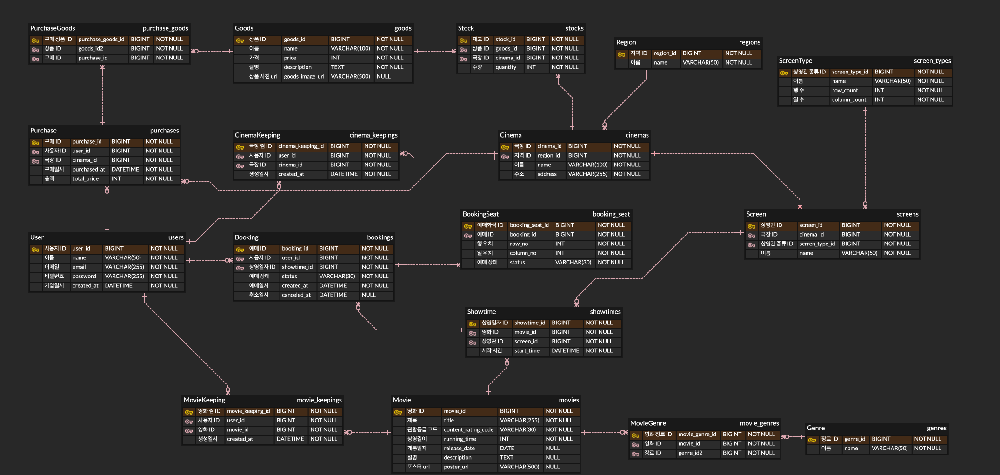
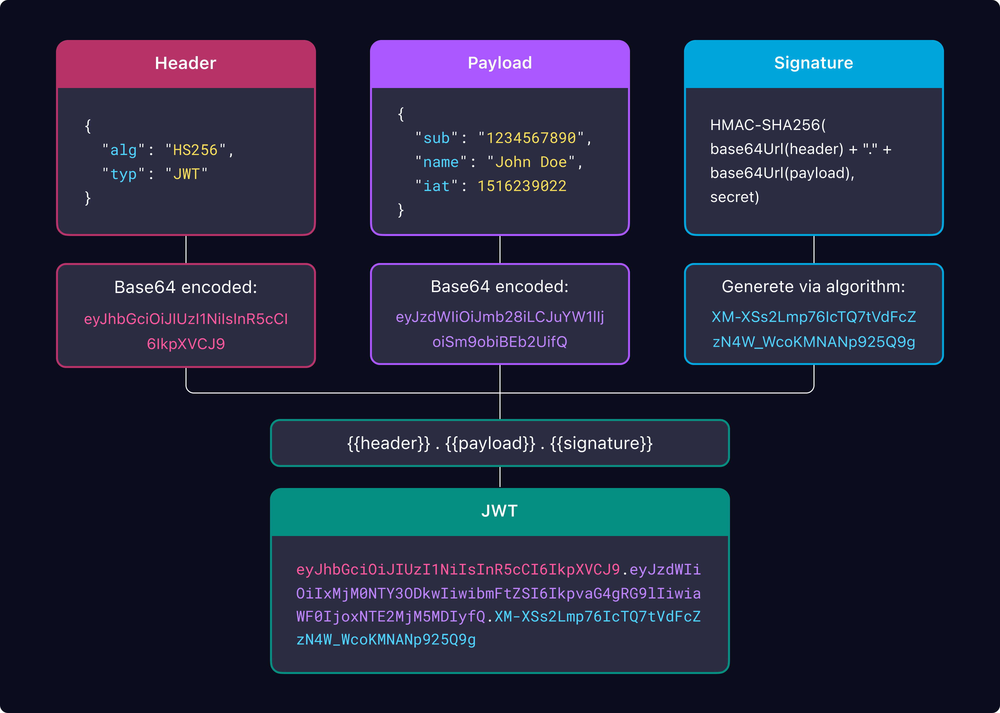
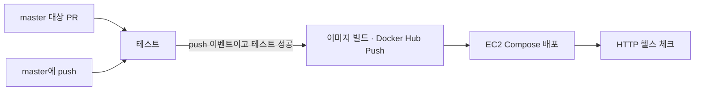

# spring-cgv-24th
CEOS 24기 백엔드 스터디 - CGV 클론 코딩 프로젝트

## ERD

[dbdiagram.io 가서 보기](https://dbdiagram.io/d/6af6cef04e0bad6598a16b62)

- 테이블들의 PK값은 변하지 않도록 별개의 단일 id를 만드는 방식으로 통일했습니다.
  - `@GeneratedValue(strategy = GenerationType.IDENTITY)`
  - 복합키도 사용할 수 있지만, 나중에 로직 단의 코드가 복잡해질 것이라 생각했는데, 리뷰어 분들은 어떻게 생각하시는지 궁금합니다!
- 테이블을 짤 때 가장 고민이 많았던 부분은 예매 관련 부분이었습니다.
  - 현재의 구조에서 예매와 관련된 테이블들은 다음과 같습니다.
    - `Booking`: 예매
    - `BookingSeat`: 예매 시 선택한 좌석(들)
    - `Showtime`: 상영일정, 즉 어떤 영화가 어떤 상영관에서 언제 상영되는지
  - 여기서 `Booking`과 `BookingSeat`가 연결되어 있고, `Booking`과 `Showtime`이 연결되어 있습니다.
  - 하지만 여기서 문제가 발생합니다!
    - 현재의 `BookingSeat`는 행과 열을 저장하지만, 상영일자(`Showtime`)를 저장하지는 않습니다. 그렇기 때문에 DB 단에서 (showtime_id, row_no, column_no)를 한번에 UNIQUE로 처리하지 못합니다.
    - 물론 로직 상으로 처리할 수는 있지만 DB 단에서는 중복예매가 가능하다는거죠.
    - 여기서 제가 생각해본 해결방법은 2가지 였습니다.
      1. `BookingSeat`와 `Showtime` 연결
         → 하지만 이 방식을 사용하면 연결이 돌고 돌아 Booking의 showtime_id와 BookingSeat의 showtime_id이 불일치 할 수 도 있는 상황이 발생합니다.
      2. `BookingSeat`와 `Showtime` 사이에 `ShowtimeSeat` 생성
         → 이 방법은 DB 상으로는 나름..? 깔끔해보이지만 ShowtimeSeat라는게 상영일자가 새로 생길때마다 모든 좌석에 대해 데이터가 생겨야 한다는 번거로움 + 불필요한 데이터 추가 라는 문제가 있습니다.
    - 코드리뷰를 통해, 1번 방식을 보충하는 방향으로 코드를 수정해보았습니다. 설계의 흐름을 정리하면 다음과 같습니다.
      1. **애플리케이션 레벨에서 불일치 방지**
         <br>: BookingSeat의 showtime을 외부에서 직접 세팅하지 않고, `Booking.addSeat()`를 통해서만 생성하도록 했습니다. 이때 `BookingSeat.showtime`은 항상 `Booking.showtime`에서 가져옵니다.
      2. **DB 레벨에서도 불일치 방지**
         <br>: 애플리케이션 코드만으로는 완전한 보장이 어렵기 때문에 `(booking_id, showtime_id)`를 복합 FK로 묶어 두 테이블의 상영 정보가 반드시 일치하도록 하였습니다.
      3. **좌석 중복 예매는 DB UNIQUE로**
         <br>: 같은 showtime + row + column에 활성 예약이 두 개 이상 생기지 못하도록 DB 제약을 두었습니다. 동시 요청이 들어와도 DB가 최종적으로 한 건만 허용하도록 합니다. 
      4. **취소 이력을 남기기 위해 상태값 사용**
      5. **MySQL에서는 active_seat generated column 사용**
         <br>: BOOKED이면 active_seat = 1, 이 외의 상태면 NULL이 되도록 DB가 자동 계산하게 하였습니다. 이후 `UNIQUE(showtime_id, row_no, column_no, active_seat)`를 걸어 현재 점유 중인 좌석만 중복을 막고, 취소/만료 이력은 여러 건 남길 수 있도록 하였습니다. 
      6. **현재 개발 단계에서는 schema.sql 사용**
         <br>: 아직 ddl-auto: create를 유지하고 있으므로 Hibernate가 테이블을 생성한 뒤 schema.sql에서 복합 FK, generated column, UNIQUE INDEX와 같이 코드 상으로 직접 추가하기 번거로운 사항들에 대해 추가 제약을 적용하고, data.sql에서는 더미 데이터만 넣도록 역할을 분리했습니다.

## 구현 코드
- 도메인 별로 개발을 해서 도메인형 구조로 코드를 짜보았습니다. 도메인 별로 개발을 하는데, `controller/`, `service/` 이런 식으로 계층형 구조를 쓰게 되면, 한 도메인과 관련된 코드를 쓰기 위해 모든 계층의 폴더를 열고 닫아야 하는것이 싫어서... 선택해보았습니다. 이 방법보다 계층형이 더 좋다! 하시는 분들의 의견도 궁금합니다.
- `createdAt` 필드가 중복되는 곳이 몇군데 있어서 `BaseEntity`로 JpaAuditing 기능을 분리하였습니다.
- 급하게 짠 코드들이 있어서... 아직 코드가 지저분합니다. 많은 잔소리와 지적... 부탁드립니다

## JWT를 활용한 인증 흐름 정리하기
### ① JWT는 무엇이고, Header·Payload·Signature는 무엇을 할까?

- **Header**
  - JWT에 사용한 서명 알고리즘과 토큰 타입 정보를 담음.
  - `alg`, `typ` 등의 값을 사용함.
  - Header의 `alg` 값을 그대로 신뢰하지 않고 서버가 허용한 알고리즘인지 검증해야 함.
- **Payload**
  - 사용자와 토큰에 대한 정보를 Claim 형태로 저장함.
  - `sub`, `iss`, `aud`, `exp`, `iat`, `role` 등의 정보를 담을 수 있음.
  - Base64URL로 인코딩될 뿐 암호화되는 것은 아니므로 비밀번호나 개인정보 같은 민감 정보는 넣지 않음.
- **Signature**
  - Header와 Payload가 발급 이후 변조되지 않았는지 확인하는 데 사용함.
  - 서버가 신뢰하는 키로 생성된 토큰인지 검증하는 역할을 함.
  - 데이터를 숨기는 암호화 기능은 아님.

### ② Access Token과 Refresh Token의 차이
- **Access Token**
  - 실제 API에 접근할 때 사용하는 토큰.
  - 일반적으로 유효기간을 짧게 설정.
  - API 요청 시 `Authorization: Bearer {token}` 형태로 전달.
- **Refresh Token**
  - 만료된 Access Token을 다시 발급받기 위해 사용하는 토큰.
  - Access Token보다 긴 유효기간을 가짐.
  - 일반 API 요청에는 사용하지 않고 토큰 재발급 요청에 사용.
  - 탈취될 경우 Access Token을 계속 발급받을 수 있으므로 더 안전하게 관리해야 함.
  - 재발급 시 Refresh Token도 새로 교체하는 Rotation 방식을 사용할 수 있음.

### ③ 쿠키, 세션, JWT의 역할
- **Cookie**
  - 브라우저가 값을 저장하고 서버 요청에 전달하는 수단.
  - 인증 방식 자체라기보다 데이터를 저장·전달하는 방법에 가까움.
- **Session**
  - 서버가 로그인한 사용자의 상태를 저장하는 방식.
  - 브라우저는 Session ID를 쿠키로 전달하고 서버는 해당 ID를 이용해 사용자를 찾음.
- **JWT**
  - 클라이언트가 서버에 제시하는 토큰의 형식 중 하나.
  - Claim을 포함하고 있으며 서버는 서명과 Claim을 검증해 사용자를 확인.
  - JWT를 `Authorization` 헤더로 전달할 수도 있고 Cookie에 저장해 전달할 수도 있음.

### 4. CGV 프로젝트의 Access Token에 필요한 Claim

- `sub`
  - 로그인한 사용자의 ID를 저장함.
  - 영화 찜, 예매 조회, 예매 취소 시 현재 사용자를 식별하는 데 사용함.
- `exp`
  - Access Token의 만료 시간을 저장함.
  - 만료된 토큰의 사용을 막음.
- `iat`
  - 토큰이 발급된 시간을 저장함.
- `role`
  - `USER`, `ADMIN` 등 사용자 권한을 구분하는 데 사용함.
  - 관리자 기능 접근 여부를 판단할 때 활용함.
- 필요에 따라 `iss`, `aud` 등을 추가해 올바른 서버가 발급한 토큰인지, CGV API용 토큰인지 확인할 수 있음.
- `movieId`, `reservationId`처럼 계속 바뀌는 데이터는 Access Token에 넣지 않음.
- 예매 취소 시에는 토큰의 `userId`와 DB의 예매 소유자를 비교해 권한을 확인함.

### 5. JWT 검증 결과가 Authentication과 SecurityContext로 연결되는 과정

- 클라이언트가 `Authorization` 헤더에 Access Token을 담아 요청
- JWT Filter가 요청에서 Bearer Token을 추출
- 토큰의 서명, 만료 여부 등을 검증
- 정상적인 토큰이면 Payload에서 `userId`, `role` 등의 정보를 꺼냄
- 해당 정보를 이용해 Spring Security의 `Authentication` 객체를 생성
- 생성한 `Authentication`을 `SecurityContext`에 저장
- `SecurityContextHolder`가 현재 요청의 인증 정보를 관리
- 이후 `AuthorizationFilter`가 `Authentication`의 권한 정보를 이용해 API 접근 가능 여부를 판단
- JWT 방식이 Stateless라면 요청마다 이 과정을 다시 수행

```
JWT 추출
→ JWT 검증
→ 사용자 정보 추출
→ Authentication 생성
→ SecurityContext 저장
→ 권한 확인
→ Controller 실행
```

### 6. 인증과 인가, 401과 403

- **인증(Authentication)**
  - 현재 요청을 보낸 사용자가 누구인지 확인하는 과정
  - 로그인이나 Access Token 검증이 인증에 해당
- **인가(Authorization)**
  - 인증된 사용자가 특정 기능을 사용할 권한이 있는지 확인하는 과정
  - 일반 사용자의 관리자 API 접근이나 다른 사용자의 예매 취소 가능 여부를 검사하는 것이 인가에 해당
- **401 Unauthorized**
  - 정상적인 인증 정보를 확인할 수 없을 때 반환
  - Access Token이 없거나, 만료되었거나, 위조된 경우 등이 해당
- **403 Forbidden**
  - 인증은 정상적으로 되었지만 해당 요청을 수행할 권한이 없을 때 반환
  - `USER`가 관리자 API에 접근하거나 다른 사용자의 예매를 취소하려는 경우 등이 해당
- 정리하면 **401은 “누구인지 확인할 수 없음”, 403은 “누구인지는 알지만 권한이 없음”으로 구분**

## 정상·실패 상황 테스트 결과

| 테스트 상황 | 요청·확인 대상 | 기대 결과 | 실행 결과 |
| --- | --- | --- | --- |
| 올바른 로그인 정보 | `POST /auth/login` | Access Token 발급 | 통과: 200, `accessToken`, `tokenType: Bearer`, `expiresIn: 1800` 반환 |
| 없는 계정 | `POST /auth/login` | 잘못된 비밀번호와 동일한 실패 응답, 토큰 미발급 | 통과: 401 `LOGIN_FAILED`, `accessToken` 없음 |
| 잘못된 비밀번호 | `POST /auth/login` | 없는 계정과 동일한 실패 응답, 토큰 미발급 | 통과: 401 `LOGIN_FAILED`, 두 실패 응답 본문 일치 |
| 토큰 없이 공개 API 호출 | `GET /movies`, `GET /cinemas` | 정상 처리 | 통과: 실제 필터 체인을 거쳐 검증용 조회 컨트롤러의 200 응답 |
| 정상 토큰으로 보호 API 호출 | `POST /bookings`, `POST /movies/10/keep`, `POST /cinemas/10/keep` | 정상 처리 | 통과: 실제 컨트롤러·서비스에서 201, 인증된 회원의 데이터 생성 요청 확인 |
| 토큰 없이 보호 API 호출 | `GET /api/admin/check` 및 찜·예매 요청 | 401 + 공통 JSON | 통과: 401 `TOKEN_NOT_EXIST` |
| 만료된 토큰 | 과거 `exp`로 정상 서명한 토큰으로 보호 API 호출 | 401 + 만료 오류 코드 | 통과: 401 `TOKEN_EXPIRED` |
| 변조된 토큰 | payload의 `ROLE_USER`를 `ROLE_ADMIN`으로 바꾸고 기존 서명 유지 | 401 + 유효하지 않은 토큰 오류 코드 | 통과: 401 `TOKEN_INVALID` |
| 다른 키로 서명한 토큰 | 설정된 검증 키와 다른 키로 서명 후 보호 API 호출 | 401 | 통과: 401 `TOKEN_INVALID` |
| 일반 사용자로 관리자 API 호출 | USER 토큰으로 `GET /api/admin/check` | 403 + 공통 JSON | 통과: 403 `ACCESS_DENIED` |
| 관리자로 관리자 API 호출 | ADMIN 로그인으로 발급받은 토큰으로 `GET /api/admin/check` | 정상 처리 | 통과: 200, 응답 본문 없음 |
| 정상 인증 직후 토큰 없는 요청 | 정상 요청 후 같은 MockMvc에서 토큰 없이 보호 API 재호출 | 이전 인증이 유지되지 않고 401 | 통과: 401 `TOKEN_NOT_EXIST`, 요청 종료 후 인증 컨텍스트 비어 있음 |

# 4주차 과제

## 1. 구현 범위와 리팩토링

매점 구매에 **주문 생성 → 재고 예약 → 토스 결제 승인 → 결과 저장** 흐름을 구현했습니다. 현재 취소 API는 **결제 전 주문 취소**이며, 결제 완료 후 환불과 결제 조회 API는 아직 구현하지 않았습니다.

| 변경 내용 | 이유 |
| --- | --- |
| `PurchaseService` / `PaymentOrderService` / `TossPaymentClient` 역할 분리 | 주문 생성, 결제 상태 관리, 외부 HTTP 통신의 책임을 구분 |
| `PurchaseGoods`에 구매 당시 상품명·단가 저장 | 상품 정보가 바뀌어도 주문 내역과 결제 금액 유지 |
| 서버 가격으로 총액 계산, 양수 수량·중복 상품·정수 오버플로 검증 | 클라이언트의 금액 조작과 잘못된 주문 방지 |
| 승인 준비·완료 트랜잭션 분리, `open-in-view=false` | PG 응답을 기다리는 동안 DB 잠금을 잡지 않고, 트랜잭션 안에서 최신 상태로 DTO 생성 |

## 2. 동시성 문제와 해결 방법

- 동시성 문제
  - 여러 요청이 같은 데이터를 읽고 변경할 때 실행 순서에 따라 결과가 달라지는 문제 
  - 예를 들어 재고 1개를 두 요청이 동시에 읽으면 둘 다 구매할 수 있다고 판단할 수 있음. `@Transactional`만으로 이런 확인·변경 사이의 경쟁이 모두 막히지는 않음.

| 방법 | 원리·장점 | 한계·적합한 상황 |
| --- | --- | --- |
| `synchronized` / `ReentrantLock` | JVM 안에서 임계 구역을 직렬화, 구현이 비교적 단순 | 여러 서버 간에는 공유되지 않음. 단일 JVM의 공유 자원에 적합 |
| 낙관적 락 | 버전으로 변경 충돌을 감지 | 충돌 시 재시도 필요. 충돌이 드문 수정에 적합 |
| 비관적 락 | DB 행을 잠가 다른 변경을 대기시킴 | 잠금 대기·데드락 가능. 같은 주문의 상태 확인과 변경에 적합 |
| 조건부 원자적 UPDATE | 조건 검사와 변경을 한 SQL에서 처리 | 복잡한 규칙 표현에는 한계. 재고·잔액 차감에 적합 |
| Redis 분산 락 | 여러 서버가 같은 락을 공유 | 별도 인프라와 만료·장애 처리 필요. 여러 자원에 걸친 작업에 적합 |
| 메시지 큐 | 같은 자원의 작업을 순서대로 소비하도록 구성 | 응답 지연·중복 소비 처리 필요. 비동기 처리에 적합 |

### 서비스에서 발견한 지점과 선택 이유

| 지점 | 제어가 없을 때의 문제 | 적용한 방법과 이유 |
| --- | --- | --- |
| 같은 상품의 동시 구매·재고 반환 | 초과 판매, 수량 변경 유실 | 조건부 UPDATE로 DB의 현재 수량을 직접 계산. 단순 수량 연산에 적합하고 별도 인프라가 필요 없음 |
| 같은 주문의 승인·취소 | 결제를 승인하면서 재고까지 반환 | 상태 조건부 UPDATE로 가능한 전이를 제한. 승인 준비·완료에는 비관적 락을 함께 사용해 상태 확인과 중복 결과 반환을 직렬화 |
| 같은 주문의 중복 취소 | 예약 재고를 두 번 반환 | `PENDING → CANCELED` 변경에 성공한 요청만 재고 반환 |
| 같은 회차·좌석의 동시 예매 | 같은 좌석을 중복 판매 | 기존 `schema.sql`의 활성 좌석 UNIQUE 제약으로 DB에서 차단. 충돌은 `SEAT_ALREADY_BOOKED`로 변환 |

**예) 재고 차감**

변경 행 수가 `1`이 아니면 재고 부족으로 처리합니다.

```sql
UPDATE stocks SET quantity = quantity - :quantity
WHERE cinema_id = :cinemaId AND goods_id = :goodsId
  AND :quantity > 0 AND quantity >= :quantity;
```

- 재고 예약과 주문 저장은 한 트랜잭션으로 묶어 일부 상품이 부족하면 모두 롤백합니다. 취소·재고 반환도 함께 성공하거나 롤백합니다.
- 구매·반환 모두 상품 ID 오름차순으로 갱신해 교차 잠금 가능성을 줄입니다. 원자적 UPDATE도 DB 잠금을 사용하므로 데드락 가능성이 없어지는 것은 아닙니다.
- 벌크 UPDATE에 `flushAutomatically`·`clearAutomatically`를 적용하고 상태를 재조회해 영속성 컨텍스트의 오래된 값이 응답에 사용되지 않도록 합니다.

## 3. 주문·결제 흐름과 검증

```text
주문 생성·재고 예약 → PENDING → 승인 준비·결제 키 저장 → CONFIRMING
                      │                               ├─ DONE + 승인 시각 → PAID
                      │                               └─ 가상계좌 발급 → WAITING_FOR_DEPOSIT
                      └─ 결제 전 취소·재고 반환 → CANCELED
```

- `CONFIRMING`: 승인 결과를 확정하기 전 상태로, 외부 호출 오류 시에도 유지
- `WAITING_FOR_DEPOSIT`: 입금 전 상태이며, 현재 입금 확인 후 `PAID`로 전환하는 로직은 없음
- `CANCELED`: 서비스의 결제 전 취소 상태

| API | 역할 |
| --- | --- |
| `POST /purchases` | 영화관·상품·수량을 받아 서버 가격으로 총액 계산, 재고 예약, UUID 주문번호 생성 |
| `GET /payments/config` | 테스트 클라이언트 키 반환 |
| `POST /payments/confirm` | `orderId`, `paymentKey`, `amount` 검증 → 토스 승인 → 상태 저장 |
| `POST /payments/{orderId}/cancel` | `PENDING` 주문만 취소하고 재고 반환. 이미 취소되었거나 승인 시작 후라면 409 |

## 4. 멱등성

- 같은 작업을 반복해도 한 번 처리한 것과 같은 최종 상태를 유지하는 성질
- 결제 응답이 유실되어 사용자가 재시도해도 중복 결제가 발생하지 않도록 필요
- **동시성 제어는 여러 요청이 공유 데이터를 망가뜨리지 않게 하고, 멱등성은 같은 요청을 여러 번 처리해도 효과가 중복되지 않게 함.** 결제에는 둘 다 필요!


- Toss Payments의 방법: 승인 요청마다 `Idempotency-Key: payment-confirm:{orderId}`를 사용해 서버 재시작·재요청에도 같은 키를 유지합니다.
- `CONFIRMING`에서는 같은 결제 키·금액으로 재시도할 수 있습니다. `PAID`·`WAITING_FOR_DEPOSIT`이면 소유자와 요청을 검증한 뒤 저장된 결과를 반환합니다.

[//]: # (- 동시 요청이 PG까지 전달될 수 있으므로 DB 제어와 PG 멱등키를 함께 사용합니다. 토스 멱등키는 최초 요청부터 15일간 유효하며, 이전 요청 처리 중에는 충돌 오류가 날 수 있습니다. 현재는 이를 `PAYMENT_UNAVAILABLE`로 반환하고 자동 재시도하지 않습니다. [토스 멱등키 문서]&#40;https://docs.tosspayments.com/reference/using-api/authorization#멱등키-헤더&#41;)

[//]: # (- 결제 전 중복 취소는 409로 거절해 재고의 중복 반환을 막습니다. 향후 PG 부분 취소에는 **취소 건별 고유 키**를 저장하고, 같은 취소의 재시도에만 재사용해야 합니다.)

## 5. HTTP Client 선택과 외부 API 오류 처리

| 방식 | 특징·장점 | 단점·적합한 상황 |
| --- | --- | --- |
| Feign Client | 인터페이스 선언으로 호출 코드를 간결하게 관리 | 의존성·설정 추가. 여러 외부 API의 계약 관리에 적합 |
| RestClient | 동기식이며 호출·오류 흐름을 순서대로 읽기 쉬움 | 응답 대기 중 스레드 점유. Spring MVC의 단순 요청·응답에 적합 |
| WebClient | 비동기·논블로킹, 스트리밍 지원 | 리액티브 흐름 학습·운영 부담. 많은 동시 I/O에 적합 |

현재 Spring MVC·JPA 기반에서 승인 결과를 받아 순차 처리하므로 **RestClient**를 선택했습니다. 반응형 처리가 필요하지 않고, 적은 수의 PG 호출을 별도 클라이언트로 관리하기에 충분하다고 판단했습니다. [Spring REST Clients](https://docs.spring.io/spring-framework/reference/integration/rest-clients.html), [OpenFeign](https://docs.spring.io/spring-cloud-openfeign/docs/current/reference/html/)

- 연결 5초·응답 읽기 15초 타임아웃을 설정하고, HTTP·통신·역직렬화 오류를 `502 PAYMENT_UNAVAILABLE`로 변환합니다. 응답 누락이나 필드·상태 불일치도 같은 오류로 처리합니다.
- PG 성공 여부를 모르는 상황에서 주문을 실패로 확정하거나 재고를 반환하면, 결제된 상품을 다시 팔 수 있습니다. 따라서 `CONFIRMING`과 재고 예약을 유지하고 동일 요청 재시도를 허용합니다.
- PG 승인 후 DB 저장이 실패해도 외부 결제까지 롤백되지는 않습니다. 현재는 동일 요청 재시도로 복구를 시도할 수 있지만, **PG 조회를 통한 상태 대조·자동 복구와 확정 실패 분류는 미구현**입니다.

## 6. Webhook의 역할

- Webhook: 이벤트가 발생했을 때 제공자가 등록된 URL로 알림을 보내는 방식
- 토스는 결제 상태 변경·가상계좌 입금 등의 이벤트를 제공하고 전송 실패 시 재전송 [토스 Webhook 가이드](https://docs.tosspayments.com/guides/v2/webhook)
- CGV에 적용한다면?
  - **가상계좌 입금 후 상태 갱신, 승인 응답 유실 시 상태 복구, 취소 내역 동기화**를 맡길 수 있음

## TODO

- [ ] **결제 조회:** 소유자를 검증하는 DB 기반 조회 API 구현, 결제수단 등 추가 저장 필드 결정.
- [ ] **전체·부분 취소:** 토스 취소 API 연동, 취소 이력·잔여액·환불 상태 관리, 초과 취소·이미 취소된 결제·PG 실패 처리.
- [ ] **취소 멱등성·동시성:** 취소 건별 멱등키와 결과 저장, 중복·동시 부분 취소 시 이중 환불과 잔액 오류 방지 및 테스트.
- [ ] **승인 복구·주문 만료:** 확정 실패와 결과 불명을 구분하고 PG 조회로 상태 대조. 장기 `CONFIRMING`·멱등키 유효기간 경과·미결제 주문의 재고 회수 정책 구현.
- [ ] **선택 — Webhook:** 이벤트 검증·중복 방어를 포함해 가상계좌 입금, 승인 누락, 취소 결과 동기화.

# 5주차 과제

## 1. 이번 주 목표와 배포 결과

이번 주에는 기존 CGV API를 **Docker로 실행하고, 테스트를 통과한 코드를 GitHub Actions로 EC2에 자동 배포하는 환경**을 구성했습니다. 로컬에서만 실행되던 애플리케이션을 서버에서도 같은 방식으로 빌드·실행하고, 코드 변경부터 배포 상태 확인까지 연결하는 데 집중했습니다.

- **배포 주소:** [http://43.202.206.26](http://43.202.206.26)
- **API 문서:** [Swagger UI](http://43.202.206.26/swagger-ui/index.html)
- **공개 API 확인:** [영화 목록 조회](http://43.202.206.26/movies)
- **서버 상태 확인:** [Actuator Health](http://43.202.206.26/actuator/health)

2026-11-13 기준으로 Swagger UI와 영화 목록 조회의 HTTP 200 응답, 헬스 체크의 HTTP 200 및 `status: UP` 응답을 확인했습니다.

## 2. Docker로 빌드와 실행 환경 통일하기

### 멀티 스테이지 Dockerfile

로컬에서 만든 JAR를 복사하는 대신, **Docker 이미지 빌드 과정 안에서 JAR까지 생성**하도록 했습니다. 프로젝트의 Java 버전에 맞춰 빌드와 실행 모두 Java 21을 사용합니다.

```text
빌드 단계: eclipse-temurin:21-jdk
  Gradle Wrapper·빌드 설정 복사 → 의존성 준비 → 소스 복사 → bootJar
                              ↓ 생성된 JAR만 복사
실행 단계: eclipse-temurin:21-jre
  java -jar app.jar → Spring Boot 실행(8080)
```

| 적용한 내용 | 선택한 이유 |
| --- | --- |
| JDK 빌드 단계와 JRE 실행 단계 분리 | 최종 이미지에는 빌드 도구·소스 대신 실행에 필요한 JRE와 JAR만 포함 |
| Gradle 설정·의존성 처리를 소스 복사보다 먼저 배치 | 소스만 바뀌었을 때 앞 단계의 Docker 빌드 캐시를 재사용 |
| `ENTRYPOINT ["java", "-jar", "app.jar"]` | 컨테이너 실행 시 애플리케이션 시작 명령을 고정 |
| `.dockerignore` 추가 | `.git`, 로컬 빌드 결과, IDE 설정, `.env`, 초기화 SQL 등을 빌드 컨텍스트에서 제외 |

`EXPOSE 8080`은 이미지가 사용하는 포트를 설명하는 설정이고, 실제 호스트 포트 연결은 Compose의 `ports`로 지정했습니다. 관련 파일: [Dockerfile](Dockerfile), [.dockerignore](.dockerignore)

## 3. 로컬과 운영 환경을 나누어 구성하기

같은 애플리케이션을 실행하더라도 로컬은 MySQL까지 함께 띄우고, 운영은 외부 DB(RDS)에 연결하도록 Compose 파일을 분리했습니다.

| 구분 | 로컬: `docker-compose.yaml` | 운영: `compose.prod.yaml` |
| --- | --- | --- |
| 애플리케이션 준비 | `build: .`로 이미지 빌드 | Docker Hub의 커밋 태그 이미지 사용 |
| DB | `mysql:8.4` 컨테이너 | `MYSQL_HOST`로 지정한 외부 MySQL |
| DB 접속 주소 | `jdbc:mysql://db:3306/...` | `jdbc:mysql://${MYSQL_HOST}:3306/...` |
| 앱 포트 | `8080:8080` | `127.0.0.1:8080:8080` |
| 데이터 보관 | `mysql-data` named volume | 앱 컨테이너와 분리된 외부 DB |
| SQL 초기화 | `ddl-auto=update`, `sql.init.mode=never` | `ddl-auto=update`, `sql.init.mode=never` |
| 재시작 정책 | `unless-stopped` | `unless-stopped` |

### 로컬: 컨테이너 간 통신과 데이터 보존

- 앱 컨테이너에서 `localhost`는 앱 자신을 가리키므로, MySQL에는 서비스 이름인 `db`로 접속합니다. Compose가 만드는 기본 네트워크에서 서비스 이름으로 통신할 수 있어 별도의 고정 IP를 지정하지 않았습니다. [Docker Compose 네트워크 문서](https://docs.docker.com/compose/how-tos/networking/)
- DB의 3306 포트는 호스트에 공개하지 않고 앱과 같은 Compose 네트워크 안에서 사용합니다.
- `mysqladmin ping` 헬스 체크와 `depends_on: condition: service_healthy`를 연결해 DB 헬스 체크가 통과한 뒤 앱을 시작합니다.
- `mysql-data:/var/lib/mysql`로 DB 데이터를 저장합니다. 컨테이너의 쓰기 레이어는 **컨테이너 삭제 시** 사라지므로 데이터를 별도 볼륨에 보관했습니다. 단순 중지·재시작만으로 쓰기 레이어가 삭제되는 것은 아닙니다. [Docker 저장소 문서](https://docs.docker.com/engine/storage/)

필수 환경변수를 `.env`에 준비한 뒤 다음과 같이 실행할 수 있습니다.

```bash
docker compose up -d --build
docker compose ps
docker compose logs -f app
docker compose down
```

`down`은 컨테이너와 네트워크를 정리하지만 named volume은 유지합니다. `down -v`는 DB 볼륨까지 삭제하므로 데이터 보존이 필요할 때는 사용하지 않습니다.

### 운영: 요청 경로와 설정 주입

```text
클라이언트 → EC2 공개 HTTP 주소(80) → Nginx
          → 호스트 127.0.0.1:8080 → Spring Boot 컨테이너(8080)
          → 외부 MySQL(RDS)
```

운영 Compose에서는 앱 포트를 호스트의 루프백 주소에만 연결했습니다. 배포 주소의 응답 헤더에서도 Nginx를 확인했으며, 워크플로우의 헬스 체크는 EC2의 `http://127.0.0.1/actuator/health` 로 요청하므로 80번 포트에서 앱으로 전달하는 프록시 구성이 전제됩니다. Nginx 설치·설정 파일은 현재 저장소에 포함되어 있지 않습니다.

DB 접속 정보, JWT 키, 토스 키는 이미지에 넣지 않고 실행 시 환경변수로 주입합니다. 기본 `application.yaml`의 `ddl-auto=create`, SQL 초기화 설정은 Compose 환경변수로 덮어써서, 재배포 때마다 테이블과 더미 데이터를 다시 초기화하지 않도록 했습니다.

다만 **`ddl-auto=update`가 `schema.sql`의 모든 추가 제약까지 만들어 주는 것은 아닙니다.** 복합 FK, 활성 좌석 generated column과 UNIQUE 인덱스는 운영 DB에 별도로 적용·확인해야 합니다. 현재 Docker 이미지에서는 `schema.sql`과 `data.sql`을 제외하고 자동 실행도 비활성화했습니다.

관련 파일: [로컬 Compose](docker-compose.yaml), [운영 Compose](compose.prod.yaml), [추가 DB 제약](src/main/resources/schema.sql)

## 4. CI에서 실행할 수 있도록 테스트 환경 분리하기

GitHub Actions의 Runner에는 제 로컬 MySQL이나 환경변수가 없습니다. 따라서 기존 컨텍스트 로딩 테스트가 로컬 환경에 의존하지 않도록 **H2와 `test` 프로필**을 추가했습니다.

- 테스트 런타임에만 H2 의존성을 추가하고, MySQL 호환 모드의 인메모리 DB를 사용합니다.
- `@ActiveProfiles("test")`로 테스트 설정을 적용하고 `create-drop`으로 테스트용 테이블을 생성·정리합니다.
- MySQL 전용 초기화 SQL은 실행하지 않으며, 공개된 테스트 전용 JWT 키를 사용합니다. 운영 키는 필요하지 않습니다.
- MockMvc로 헬스 체크의 익명 접근과 기존 보호 경로의 인증 요구를 함께 검증하도록 추가했습니다.

## 5. GitHub Actions로 테스트부터 배포 확인까지 연결하기

하나의 [워크플로우](.github/workflows/deploy.yml) 안에서 작업을 세 Job으로 나누고, `needs`로 앞 단계가 성공해야 다음 단계로 진행하도록 했습니다.



**현재 트리거는 `master` 기준**입니다. `week5` 브랜치에 push하는 것만으로는 배포되지 않으며, `master` 대상 PR에서는 테스트만, `master`에 push되면 테스트부터 배포까지 실행하도록 구성했습니다.

| Job | 실행 내용 |
| --- | --- |
| `test` | Ubuntu Runner에 JDK 21·Gradle 환경 구성 → `./gradlew test --no-daemon` |
| `build-and-push` | 테스트 성공 후 push 이벤트에서만 실행 → Buildx로 `linux/amd64` 이미지 빌드 → Docker Hub 업로드 |
| `deploy` | 운영 Compose 파일을 EC2로 복사 → SSH 접속 → `.env` 생성 → 설정 검증 → 이미지 pull → 앱 교체 → 헬스 체크 |

### 배포 단계에서 신경 쓴 부분

1. **배포 버전 추적:** 이미지에 `dev-${github.sha}` 형식의 태그를 붙여 어떤 커밋으로 만든 이미지인지 구분합니다.
2. **순차 배포:** deploy Job에 같은 `concurrency` 그룹과 `cancel-in-progress: false`를 지정해 실행 중인 배포가 취소되거나 다른 배포와 동시에 EC2를 변경하지 않도록 합니다.
3. **환경변수 파일 생성:** `printf`로 Secrets의 여러 줄 설정을 `.env`에 기록하고 이미지 이름·태그를 덧붙입니다. `umask 077`로 새 파일의 접근 권한도 제한합니다.
4. **실행 전 검증:** `set -eu`로 명령 실패·미정의 변수 사용 시 중단하고, `docker compose ... config --quiet`로 필수 변수와 설정을 확인한 다음 이미지를 가져옵니다.
5. **앱 교체:** `docker compose -f compose.prod.yaml up -d --no-deps app`으로 앱을 갱신합니다. 운영 DB는 별도 서버에 있으므로 교체 대상에 포함되지 않습니다.
6. **배포 후 확인:** 헬스 체크를 최대 30회 시도하고, 실패하면 2초 대기 후 재시도합니다. HTTP 성공과 `status: UP`을 확인하면 성공으로 종료하고, 끝까지 실패하면 앱 로그 80줄을 출력한 뒤 Job을 실패 처리합니다.

컨테이너가 실행됐다는 사실만으로 배포를 성공 처리하지 않고 HTTP 응답까지 확인하도록 했습니다. 다만 현재 헬스 체크는 **새 커밋의 실행 여부까지 식별하거나 실패 시 이전 이미지로 자동 복구하지는 않습니다.**

### 설정·보안·속도 최적화

| 항목 | 현재 적용 내용 |
| --- | --- |
| GitHub Variables | `DOCKER_IMAGE_NAME`: Docker Hub 이미지 경로 |
| GitHub Secrets | `DOCKER_USERNAME`, `DOCKER_PASSWORD`, `EC2_HOST`, `EC2_KEY`, `ENV_VARS` |
| `ENV_VARS`에 필요한 값 | `MYSQL_HOST`, `MYSQL_DATABASE`, `MYSQL_USER`, `MYSQL_PASSWORD`, `JWT_SECRET`, `TOSS_CLIENT_KEY`, `TOSS_SECRET_KEY` |
| 저장소·이미지에서 비밀정보 제외 | `.gitignore`와 `.dockerignore`에 `.env`, `.env.*` 제외 규칙 추가 |
| Workflow 권한 | `permissions: contents: read`로 저장소 읽기 권한만 부여 |
| Gradle 캐시 | 테스트 Job의 `gradle/actions/setup-gradle` 사용 |
| Docker 캐시 | Buildx의 `cache-from: type=gha`, `cache-to: type=gha,mode=max` 사용 |

로컬 Compose를 실행할 때는 위 운영 변수 대신 해당 파일에서 사용하는 MySQL 설정과 `MYSQL_ROOT_PASSWORD`도 준비해야 합니다. 운영 이미지 이름·태그는 워크플로우가 `.env`에 추가하므로 수동 배포 시에는 `IMAGE_NAME`, `IMAGE_TAG`를 직접 지정해야 합니다.

## 6. 시행착오와 배운 점

| 작업 중 수정한 부분 | 원인·변경 내용 | 배운 점 |
| --- | --- | --- |
| CI에서 Gradle Wrapper 실행 오류 | 기존 `.gitignore`의 `*.jar` 규칙으로 Wrapper JAR가 누락되어, `!/gradle/wrapper/gradle-wrapper.jar` 예외 규칙과 실제 파일 추가 | 로컬에 파일이 있어도 새 Runner가 받은 저장소에는 없을 수 있음. 빌드 실행에 필요한 파일도 버전 관리 대상인지 확인해야 함 |
| 테스트의 로컬 MySQL 의존 | H2 의존성·테스트 프로필·테스트용 JWT 키를 추가하고 SQL 초기화 비활성화 | 자동화 환경에서는 로컬 설정에 기대지 않는 테스트가 필요하며, 테스트가 보장하는 범위도 구분해야 함 |
| 운영 `ddl-auto` 변경 | 처음에는 `validate`였으나 현재 `update`로 변경 | `validate`는 기존 스키마를 검사할 뿐 생성하지 않음. 앱 배포와 DB 스키마 준비를 함께 고려해야 하며, 장기적으로는 명시적인 마이그레이션 관리가 필요 |
| 헬스 체크의 인증 요구 | 토큰 없이 배포 상태를 확인할 수 있도록 `GET /actuator/health`에 `permitAll()` 추가 | 정상 실행 중이어도 상태 확인 경로가 인증에 막히면 배포 검증이 실패할 수 있음. 필요한 경로만 공개하고 기존 보호 경로는 테스트로 확인 |

이번 작업을 통해 **이미지 생성, 컨테이너 실행, 실제 서비스의 정상 응답은 각각 확인해야 하는 단계**라는 점을 배웠습니다. 또한 앱 컨테이너는 교체할 수 있게 만들되, DB 데이터와 실행 환경 설정은 그 생명주기에서 분리해야 한다는 점을 실제 구성에 적용했습니다.

## 7. 다음 개선점

- [ ] **DB 마이그레이션:** Flyway 또는 Liquibase로 테이블·추가 제약 변경을 관리하고, 적용 후 `ddl-auto=validate` 사용 검토.
- [ ] **실패 시 롤백:** 직전 정상 이미지 태그를 기록하고 새 배포의 헬스 체크 실패 시 복구. 현재는 실패 표시와 로그 출력까지만 구현.
- [ ] **배포 중 가용성:** 현재 단일 앱 컨테이너 교체 방식에서 발생할 수 있는 중단을 줄이기 위해 Blue-Green 배포 검토.
- [ ] **불필요한 실행 줄이기:** README 등 문서만 수정한 경우를 위한 경로 필터 추가. 현재는 문서 변경도 이벤트 조건에 맞으면 실행됨.
