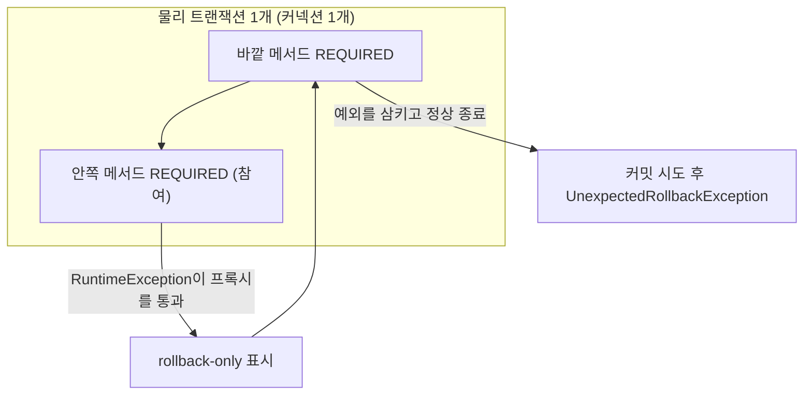
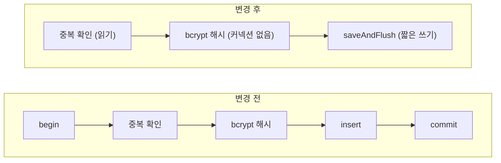
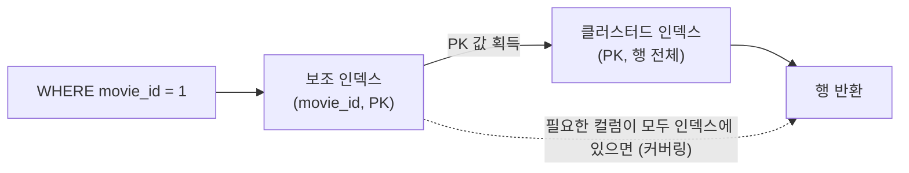
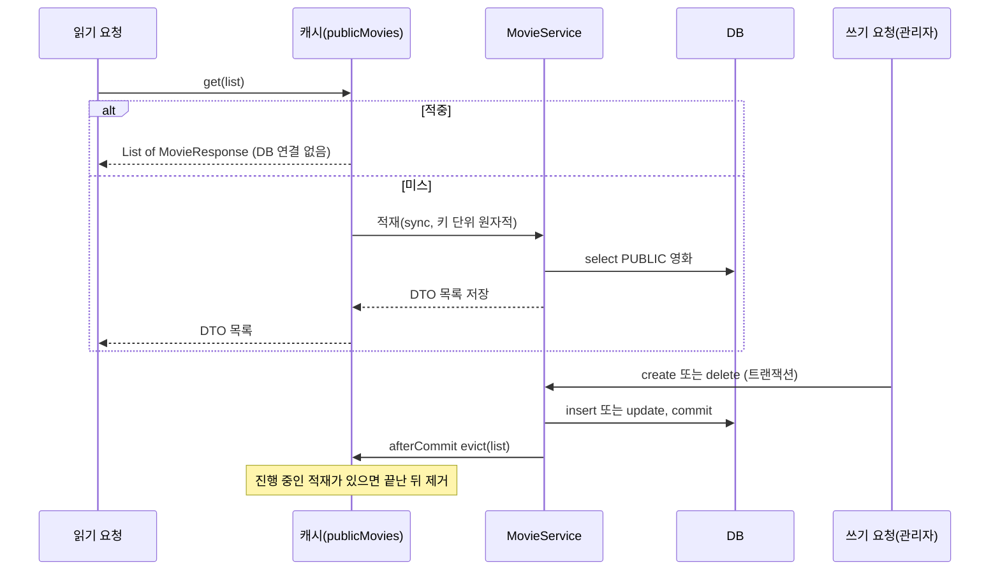
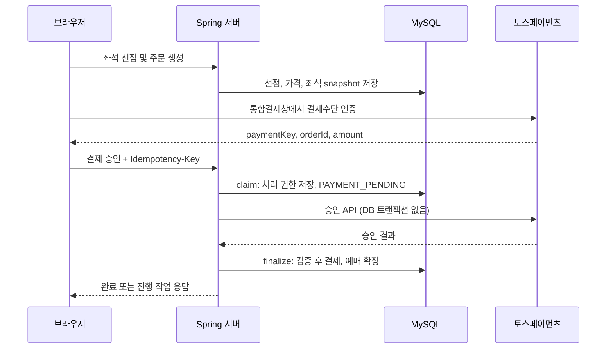
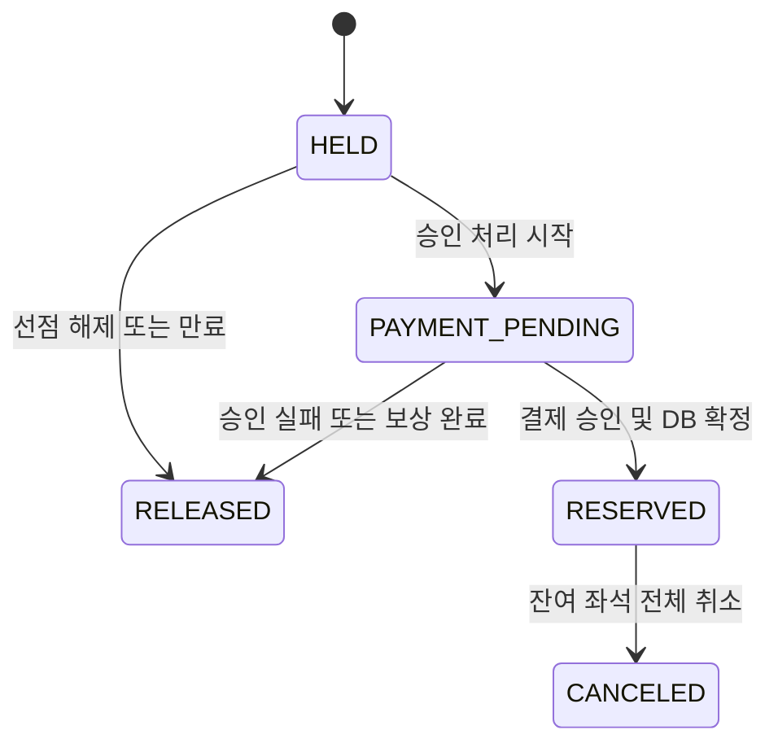
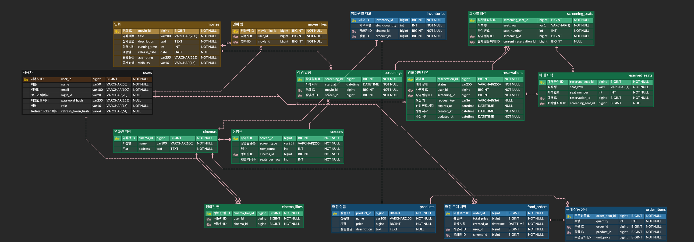

# spring-cgv-24th

CEOS 24기 백엔드 스터디 - CGV 클론 코딩 프로젝트

## 7주차 트랜잭션과 성능 최적화

이번 주에는 스프링 트랜잭션 전파 속성을 조사하고, 이 서비스의 트랜잭션 경계를 점검해 고쳤습니다.
이어서 데이터베이스 인덱스 종류를 조사하고, 캐시, 인덱스, 쿼리 최적화를 실험했습니다.

학습용 프로젝트이므로 단일 서버와 단일 MySQL을 가정합니다. 실제 CGV의 내부 구현을 설명하는 글이 아닙니다.

| 표기 | 의미 |
| --- | --- |
| 구현 완료 | 코드에 반영했습니다. |
| 테스트 통과 | 자동 테스트로 확인했습니다. H2인지 MySQL인지 함께 적습니다. |
| 측정 결과 | 실제로 실행해 얻은 수치입니다. 측정 환경을 함께 적습니다. |
| 추가 개선 후보 | 이번에는 하지 않았고, 필요해지면 할 일입니다. |

| 미션 | 이 절의 위치 | 결과 |
| --- | --- | --- |
| 1. 트랜잭션 전파 속성 조사 | [1절](#1-트랜잭션-전파-속성) | 7가지 속성 비교, 프로젝트 사용처 정리 |
| 2. 서비스 트랜잭션 분석과 개선 | [2절](#2-cgv-서비스-트랜잭션-분석) | 서비스 전체 점검, 2건 개선 (구현 완료, 테스트 통과) |
| 3. 인덱스 종류 조사 | [3절](#3-인덱스-종류) | B-Tree, Hash, Bitmap 등 비교, 커버링 인덱스 |
| 4. 최적화 실험 3건 | [4절](#4-성능-최적화-실험) | 캐시, 복합 인덱스, 쿼리 수 축소의 전후 비교 |
| 5. 새롭게 알게 된 점 | [5절](#5-새롭게-알게-된-점) | 실험 중 확인한 사실 |

### 1. 트랜잭션 전파 속성

한 요청 안에서 서비스 메서드가 다른 서비스 메서드를 부를 때, 두 메서드가 한 묶음으로 커밋되는지 따로 커밋되는지를 정하는 규칙이 전파 속성입니다.
은행 창구에 비유하면, 이미 열린 거래 건에 이어서 처리할지, 새 거래 건을 따로 열지를 정하는 일입니다.
잘못 고르면 일부만 저장되거나, 커넥션이 부족해 서버가 멈출 수 있습니다.

#### 1-1. 물리 트랜잭션과 논리 트랜잭션

| 구분 | 설명 |
| --- | --- |
| 물리 트랜잭션 | 실제 DB 커넥션 하나에서 일어나는 begin부터 commit 또는 rollback까지입니다. |
| 논리 트랜잭션 | `@Transactional`이 붙은 메서드 하나가 만드는 경계입니다. |

전파 속성이 REQUIRED이면 안쪽 메서드는 새 물리 트랜잭션을 만들지 않고 바깥 것에 참여합니다.
그래서 논리 트랜잭션은 여러 개여도 물리 트랜잭션은 하나이고, 커밋할지는 가장 바깥 경계가 결정합니다.



#### 1-2. 전파 속성 7가지

| 전파 속성 | 기존 트랜잭션이 있을 때 | 없을 때 | 대표 용도 |
| --- | --- | --- | --- |
| REQUIRED (기본) | 참여 | 새로 시작 | 일반 서비스 쓰기 |
| REQUIRES_NEW | 기존을 중단하고 새 물리 트랜잭션 시작 | 새로 시작 | 바깥 결과와 무관하게 커밋해야 하는 작업 |
| SUPPORTS | 참여 | 트랜잭션 없이 실행 | 있으면 쓰고 없어도 되는 조회 |
| NOT_SUPPORTED | 기존을 중단하고 트랜잭션 없이 실행 | 트랜잭션 없이 실행 | 트랜잭션에 넣기 싫은 긴 작업 |
| MANDATORY | 참여 | `IllegalTransactionStateException` | 호출자의 트랜잭션이 전제인 보조 로직 |
| NEVER | `IllegalTransactionStateException` | 트랜잭션 없이 실행 | 트랜잭션 안에서 실행되면 안 되는 외부 호출 |
| NESTED | 같은 커넥션의 세이브포인트 | 새로 시작 (REQUIRED와 동일) | 안쪽만 부분 롤백 |

#### 1-3. 안쪽 롤백과 UnexpectedRollbackException

REQUIRED로 참여한 안쪽 메서드에서 예외가 프록시를 통과하면 물리 트랜잭션에 rollback-only가 표시됩니다.
바깥에서 `try/catch`로 예외를 삼켜도 표시는 지워지지 않습니다.
바깥이 정상 종료해 커밋하려는 순간 `UnexpectedRollbackException`이 발생합니다.

```java
// 일반적인 예시이며 이 프로젝트의 코드가 아닙니다.
@Transactional
public void outer() {
    try {
        inner.run();            // inner는 REQUIRED이고 RuntimeException을 던집니다.
    } catch (RuntimeException ignored) {
    }
}                               // 커밋 시도 -> UnexpectedRollbackException
```

| 해결 선택지 | 설명 |
| --- | --- |
| 예외를 삼키지 않음 | 바깥도 함께 롤백합니다. 가장 단순합니다. |
| 안쪽을 REQUIRES_NEW로 분리 | 독립 트랜잭션이라 안쪽 실패가 바깥 표시에 영향을 주지 않습니다. 1-4절의 위험을 먼저 확인합니다. |
| 안쪽을 NESTED로 둠 | 세이브포인트까지만 되돌립니다. 1-5절의 한계가 있습니다. |

기본 롤백 규칙은 `RuntimeException`과 `Error`입니다. 체크 예외는 `rollbackFor`를 지정하지 않으면 커밋됩니다.

#### 1-4. REQUIRES_NEW와 커넥션 풀 고갈

REQUIRES_NEW는 바깥 트랜잭션을 중단할 뿐 끝내지 않습니다. 바깥은 커넥션을 쥔 채 대기하고, 안쪽은 두 번째 커넥션을 새로 요구합니다.
스레드 N개가 동시에 바깥 트랜잭션에 들어와 커넥션을 1개씩 쥐고, 풀 크기가 N 이하이면 모두 두 번째 커넥션을 기다리며 서로를 막습니다. `connection-timeout`이 지나면 모두 실패합니다.

이 프로젝트의 배포 프로필 Hikari 풀은 5개이고 `connection-timeout`은 10초입니다(`application-deploy.yml`). 동시 5요청만으로도 같은 일이 생길 수 있습니다.
또 바깥이 잠근 행을 안쪽이 다시 잠그려 하면 자기 자신을 기다리는 락 대기도 생깁니다.

그래서 REQUIRES_NEW는 호출자에 바깥 트랜잭션이 없는 곳에서만 쓰는 것이 안전합니다.
이 설명은 원리이며 이 프로젝트에서 재현하지는 않았습니다. 대신 모든 REQUIRES_NEW 호출자가 트랜잭션 밖인지를 코드로 점검했습니다(2절).

#### 1-5. NESTED와 JPA의 한계

| 항목 | 내용 |
| --- | --- |
| 구현 방식 | JDBC 세이브포인트입니다. JTA에서는 쓸 수 없습니다. |
| 기본 설정 | `JpaTransactionManager`는 `nestedTransactionAllowed`가 기본 false입니다. 이 프로젝트의 트랜잭션 매니저를 직접 조회해도 false였습니다. |
| 바깥이 있을 때 호출하면 | `NestedTransactionNotSupportedException`이 납니다. 켜려면 매니저 설정을 바꿔야 합니다. |
| 켜더라도 | 세이브포인트는 JDBC 커넥션에만 적용됩니다. 롤백해도 영속성 컨텍스트의 엔티티 상태와 1차 캐시는 되돌아가지 않습니다. |
| 위험 | 롤백한 변경이 바깥 flush에서 다시 반영되거나 메모리 상태와 DB가 어긋날 수 있습니다. |
| 일반적인 선택 | JPA 환경에서는 NESTED보다 REQUIRES_NEW나 메서드 분리를 씁니다. |

이 프로젝트는 NESTED를 쓰지 않습니다. 설정값은 직접 확인했지만, "켜면 영속성 컨텍스트가 롤백되지 않는다"는 부분은 공식 문서 설명에 근거하며 직접 실행해 확인하지는 않았습니다.

#### 1-6. 자기 호출(self-invocation) 함정

`@Transactional`은 프록시가 가로채는 호출에서만 동작합니다.
같은 클래스 안에서 `this.other()`로 부르면 프록시를 거치지 않아 애너테이션이 무시됩니다.

| 항목 | 내용 |
| --- | --- |
| 증상 | REQUIRES_NEW가 적용되지 않고, readOnly와 격리 수준 설정도 사라집니다. |
| 해결 | 별도 빈으로 분리하거나 `TransactionTemplate`을 씁니다. |
| 이 프로젝트 | 빈 분리로 피했습니다. `SeatHoldService`와 `SeatHoldExpiryService`, `PaymentWorkflowService`와 `PaymentTransactionService`가 그 예입니다. |

#### 1-7. readOnly와 격리 수준

| 항목 | 내용 |
| --- | --- |
| `readOnly = true` | JPA에서는 flush 모드를 MANUAL로 바꿔 더티 체킹을 건너뛰고, JDBC 드라이버에 읽기 전용 힌트를 전달합니다. 조회 서비스의 의도가 분명해집니다. 쓰기와 섞인 흐름에 붙이면 변경이 저장되지 않으므로 주의합니다. |
| 기본 격리 수준 | MySQL(InnoDB)은 REPEATABLE READ, H2는 READ COMMITTED입니다. |
| 이 프로젝트의 선택 | 잠금 후 재조회 흐름은 READ_COMMITTED를 명시합니다. 잠금을 얻은 뒤의 일반 조회가 앞선 트랜잭션의 최신 커밋을 보게 하고, 갭 락 범위를 줄이기 위해서입니다. |
| 적용 시점 | 격리 수준은 트랜잭션을 새로 시작할 때만 적용됩니다. 참여하는 REQUIRED 안쪽에 지정해도 바깥 설정이 유지됩니다. |

#### 1-8. 이 프로젝트에서 쓰는 전파 속성

SUPPORTS, NOT_SUPPORTED, NESTED는 쓰지 않습니다.

| 전파 | 위치 | 이유 |
| --- | --- | --- |
| REQUIRED (기본) | `FoodCheckoutService`, `SeatHoldCreationService`, `PaymentTransactionService` 등 | 한 요청의 쓰기를 하나의 원자적 단위로 묶습니다. 격리는 READ_COMMITTED를 명시합니다. |
| REQUIRES_NEW | `SeatHoldExpiryService.expireIfElapsed`, `FoodOrderPaymentService.expireIfElapsed` | 만료 정리는 호출한 쪽의 롤백 결과와 상관없이 독립 커밋되어야 합니다. 호출자인 `SeatHoldService`와 두 스케줄러는 모두 트랜잭션이 없어 커넥션을 이중으로 쥐지 않습니다. |
| MANDATORY | `ScreeningSeatLockService.lockSeats`, `ReservationPaymentService`, `FoodOrderPaymentService`의 잠금 보조 메서드, `FoodOrderService.createCheckout`, `ReservationPaymentTarget.completeCancellation` | 좌석과 주문 잠금 보조 로직은 호출자의 잠금 트랜잭션 안에서만 의미가 있습니다. 트랜잭션 없이 호출되면 즉시 실패시켜 잠금 없는 실행을 막습니다. |
| NEVER | `PaymentWorkflowService`, `ReservationPaymentApplicationService` | 토스 호출은 read-timeout 10초까지 걸립니다. DB 트랜잭션이나 커넥션을 쥔 채 호출하지 않도록 구조로 강제합니다. 대신 짧은 트랜잭션 서비스를 여러 번 호출해 중간 상태를 저장합니다. |

예외 처리 설계 한 가지입니다. `SeatHoldTransitionService.release`는 만료 상태를 커밋해야 해서 예외를 던지지 않고 결과 객체(`HoldTransitionResult`)를 반환합니다.
예외 변환은 트랜잭션 밖의 `SeatHoldService`가 합니다. 예외를 던지면 같은 트랜잭션의 만료 처리까지 롤백되기 때문입니다.

### 2. CGV 서비스 트랜잭션 분석

`src/main`의 모든 서비스를 대상으로 트랜잭션 선언과 선언이 없는 서비스를 점검했습니다.
점검 질문은 여섯 가지입니다. 경계가 한 번의 확정 단위와 맞는지, 커넥션을 쥔 채 외부 호출이나 CPU 작업을 하는지(풀이 5개라 몇 건만 막혀도 다른 요청이 대기합니다), 락 순서와 격리 수준이 일관적인지, 조회에 readOnly가 있는지, 예외가 롤백 규칙대로 처리되는지, 자기 호출과 REQUIRES_NEW 호출자가 안전한지입니다.

#### 2-1. 판정 요약

판정은 "적절"(변경 불필요)과 "개선"(이번에 수정)으로 나눴습니다. 점검 표를 영역별로 묶었습니다.

| 영역 | 대상 | 속성 | 판정과 이유 |
| --- | --- | --- | --- |
| 인증 | `RefreshTokenService`, `LoginService.login` | REQUIRED, 로그인은 없음 | 적절. 회원 행 `FOR UPDATE`로 토큰 회전을 직렬화하고, bcrypt 검증은 트랜잭션 밖에서 합니다. |
| 인증 | `RegistrationService.register` | REQUIRED에서 없음으로 | 개선. bcrypt가 커넥션을 쥔 채 실행됐습니다. 2-3절 |
| 찜 | `MovieLikeService.toggle`, `CinemaLikeService.toggle` | READ_COMMITTED와 회원 행 잠금 추가 | 개선. 동시 토글이 유니크 위반 500이 됐습니다. 2-4절 |
| 결제 흐름 | `PaymentWorkflowService`, `ReservationPaymentApplicationService` | NEVER | 적절. PG 호출을 DB 트랜잭션 밖에 두는 핵심 장치이고 재시도의 `Thread.sleep`도 밖입니다. |
| 결제 확정과 조회 | `PaymentTransactionService`, `PaymentQueryService` | REQUIRED와 READ_COMMITTED, readOnly | 적절. 메서드마다 한 번의 확정 단위입니다. 읽기처럼 보이는 메서드도 결제 행 `FOR UPDATE`가 목적이라 readOnly가 맞지 않습니다. |
| 매점 | `FoodCheckoutService`, `FoodOrderService`, `FoodOrderPaymentService`, 정리 스케줄러 | READ_COMMITTED, MANDATORY, REQUIRES_NEW | 적절. 회원 잠금 뒤 재고를 상품 ID 순으로 잠그는 일관된 락 순서입니다. 만료 정리는 건별 REQUIRES_NEW라 긴 트랜잭션이 없습니다. |
| 예매 | `ReservationService.cancel`, `ReservationPaymentOrderService`, `ReservationPaymentService`, `ScreeningSeatLockService` | READ_COMMITTED, 보조 로직은 MANDATORY | 적절. 좌석 NOWAIT 잠금 뒤 상태를 재검증하고, 잠금 보조 로직은 트랜잭션 없이는 실패합니다. |
| 좌석 선점 | `SeatHoldCreationService`, `SeatHoldService`, `SeatHoldTransitionService`, `SeatHoldExpiryService`, 정리 스케줄러 | READ_COMMITTED, REQUIRES_NEW, 조정 계층은 없음 | 적절. 만료된 선점을 만나면 의도적으로 롤백한 뒤 조정 서비스가 만료 정리와 재시도를 합니다. |
| 관리와 일회성 | `ScreeningService.create`, `MovieService.delete`, `InventoryService.create`, 백필, 데모 시드 | REQUIRED | 적절. 상영과 좌석 일괄 저장 등을 한 단위로 묶습니다. 백필 실행기는 상영별로 프록시를 호출해 건별 커밋합니다. |
| 조회와 단일 저장 | 조회 서비스, `ProductService`, `CinemaService`, `ScreenService`, `UserService` | readOnly, 없음 | 적절. 단일 `save`나 단일 조회는 Spring Data 저장소 메서드의 자체 트랜잭션으로 충분합니다. |

`MovieService.create`는 점검 시점에는 단일 `save`라 트랜잭션이 필요 없었습니다.
이후 캐시 무효화를 커밋 뒤로 미루려고 `@Transactional`을 붙였습니다(4-1절).

#### 2-2. 공통 점검 결과

| 점검 | 결과 |
| --- | --- |
| 자기 호출 | 같은 클래스 안에서 `@Transactional` 메서드를 직접 부르는 곳이 없습니다. 모든 전환이 다른 빈 호출(프록시)입니다. |
| 체크 예외 | `BusinessException`, `PaymentGatewayException`, `ExpiredHoldEncountered`는 모두 비검사 예외라 `rollbackFor`가 필요한 곳이 없습니다. |
| PG 호출 | `TossPaymentGateway` 호출은 어떤 트랜잭션 안에서도 실행되지 않습니다. NEVER가 프록시 경계에서 보장합니다. |
| REQUIRES_NEW 호출자 | `SeatHoldService`, `SeatHoldCleanupService`, `FoodOrderCheckoutCleanupScheduler`가 모두 트랜잭션 밖이라 커넥션을 이중으로 쥐는 경로가 없습니다. |
| 기존 테스트 | `ReservationPaymentIntegrationTest`가 MANDATORY, `PaymentWorkflowIntegrationTest`가 NEVER의 동작을 이미 검증합니다. |

#### 2-3. 개선 1: 회원가입 bcrypt를 트랜잭션 밖으로

| 항목 | 내용 |
| --- | --- |
| 문제 | `RegistrationService.register`가 메서드 전체 `@Transactional`이라 `passwordEncoder.encode`(bcrypt)가 DB 커넥션을 쥔 채 실행됐습니다. 로그인은 bcrypt 검증을 트랜잭션 밖에서 하므로 가입만 일관성이 없었습니다. |
| 장애 시나리오 | 배포 프로필 Hikari 풀은 5개이고 `connection-timeout`은 10초입니다. 가입이 동시에 5건만 몰려도 bcrypt가 끝날 때까지 풀이 비어, 결제 확정과 좌석 선점 같은 다른 요청이 커넥션을 기다립니다. 대기가 길어지면 10초 뒤 실패합니다. 커넥션이 DB 작업이 아니라 CPU 작업 시간 동안 잡혀 있는 것이 문제입니다. |
| 변경 | `register`의 `@Transactional`을 제거했습니다. 중복 확인 두 번은 각자 저장소 읽기 트랜잭션, 저장은 `saveAndFlush` 하나의 쓰기 트랜잭션입니다. |
| 동작 보존 | 중복 가입 경쟁의 최종 방어선은 원래도 유니크 제약과 `DataIntegrityViolationException` 변환(`ACCOUNT_ALREADY_EXISTS`)이었습니다. 동작은 같습니다. |
| 상태 | 구현 완료, 테스트 통과 |



bcrypt 소요 시간(수십에서 수백 ms)은 일반적으로 알려진 값이며 이 환경에서 측정한 수치가 아닙니다.

| 테스트 | 확인 내용 |
| --- | --- |
| `RegistrationTransactionIntegrationTest.비밀번호_해시는_DB_트랜잭션_밖에서_수행되어_커넥션을_점유하지_않는다` | `encode` 호출 시점에 활성 트랜잭션이 없는지 확인합니다. 변경 전 코드에서 실패하고 변경 후 통과합니다. |
| `RegistrationConcurrencyIntegrationTest` | 동시 가입 시 1건만 성공합니다. 기존 테스트이며 통과합니다. |
| `RegistrationIntegrityIntegrationTest`, `AuthRegistrationIntegrationTest` | 기존 테스트이며 통과합니다. |

가입 관련 통합 테스트는 공용 `DatabaseIntegrationTest`를 상속하도록 바꿔 H2와 MySQL 양쪽에서 실행되게 했습니다. MySQL의 중복 키 변환 경로를 확인하기 위해서입니다.

#### 2-4. 개선 2: 찜 토글 동시 요청 직렬화

| 항목 | 내용 |
| --- | --- |
| 문제 | `MovieLikeService.toggle`과 `CinemaLikeService.toggle`이 회원을 잠금 없이 읽고(`findById`), 찜 존재 여부를 읽은 뒤 삽입 또는 삭제했습니다. 매점 주문과 좌석 선점은 회원 행을 먼저 잠그는 규칙이 있는데 찜만 빠져 있었습니다. |
| 장애 시나리오 | 같은 회원이 더블 클릭하거나 재시도해 토글이 동시에 두 번 들어오면, 두 트랜잭션이 모두 "찜 없음"으로 읽고 삽입합니다. 한쪽이 유니크 제약(`uk_movie_like_user_movie`) 위반으로 실패하고, 일반 예외 경로라 클라이언트는 500을 받습니다. |
| 가려진 이유 | MySQL에서는 영화 공유 잠금(`FOR SHARE`)끼리 호환되어 직렬화 효과가 없습니다. H2는 공유 잠금을 배타로 처리해 우연히 가려졌습니다. |
| 변경 | `findById`를 `findByIdForUpdate`로 바꿔 회원 행을 먼저 잠그고, `@Transactional(isolation = READ_COMMITTED)`로 잠금 뒤 조회가 앞선 커밋을 보게 했습니다. |
| 락 순서 | 회원, 영화 순입니다. `SeatHoldCreationService`와 같습니다. 영화 숨김은 영화 행만 잠그므로 교착이 생기지 않습니다. |
| 상태 | 구현 완료, 테스트 통과 |

| 테스트 | 변경 전 | 변경 후 |
| --- | --- | --- |
| `MovieLikeConcurrencyIntegrationTest.같은_회원의_동시_찜_토글은_회원_단위로_직렬화되어_모두_성공한다` | H2 통과, MySQL 실패 | H2, MySQL 통과 |
| `CinemaLikeConcurrencyIntegrationTest` 같은 이름의 테스트 | H2, MySQL 모두 `DataIntegrityViolationException`으로 실패 | H2, MySQL 통과 |

두 테스트는 8개 스레드가 동시에 토글해 전부 성공하고, 찜과 취소가 4번씩 번갈아 적용되어 최종 0건인지 확인합니다.
기존 `MovieLikeServiceTest`의 목은 새 호출(`findByIdForUpdate`)에 맞춰 수정했습니다.

#### 2-5. 의도적으로 바꾸지 않은 항목

| 항목 | 이유 |
| --- | --- |
| `SeatHoldExpiryService`, `FoodOrderPaymentService.expireIfElapsed`의 REQUIRES_NEW | 지금은 호출자가 모두 트랜잭션 밖이라 REQUIRED와 동작이 같습니다. 그래도 독립 커밋을 코드로 보장하는 설계 의도입니다. 호출자에 `@Transactional`을 붙이면 풀 5개 환경에서 커넥션 이중 점유가 생기므로 호출자를 트랜잭션 밖에 유지해야 합니다. |
| `FoodOrderService.create`, `InventoryService.create`, 백필의 기본 격리 | 첫 단계가 잠금 읽기이거나 단일 삽입이라 잠금 이후 읽기가 최신을 봅니다. 격리 통일은 동작 변화 위험 대비 실익이 작습니다. |
| `InventoryService.create`의 존재 확인과 삽입 사이 경쟁 | 동시 중복 생성 시 `DUPLICATE_INVENTORY` 대신 유니크 위반 500이 날 수 있습니다. 관리자 전용 저빈도 API이고 무결성은 제약이 지킵니다. 추가 개선 후보입니다. |
| `ScreeningService.create`의 영화 공유 잠금 유지 시간 | 삽입이 길어지면 같은 영화의 숨김 처리가 대기합니다. 현재 규모에서는 문제가 없고, 좌석 삽입의 배치 분할이 추가 개선 후보입니다. |

#### 2-6. 테스트 결과

| 명령 | 결과 |
| --- | --- |
| `./gradlew test` (H2, 트랜잭션 변경 브랜치) | 74개 스위트, 402개 테스트, 실패 0, 오류 0, 건너뜀 1 |
| `./gradlew mysqlTest` (MySQL 8.4.8) | 8개 스위트, 90개 테스트, 실패 0, 오류 0, 건너뜀 0 |
| 찜 토글 동시성 테스트 두 클래스를 MySQL 8.4.8로 실행 | 변경 전 2개 실패, 변경 후 2개 통과 |

건너뜀 1건은 MySQL 전용인 기존 `PaymentSchemaUpgradeIntegrationTest`이며 이번 변경과 무관합니다.
작업 당시 `mysqlTest` 작업의 대상 목록에 새 테스트가 없어서, 새 테스트는 `cgv.test.database`를 `mysql`로 바꿔 따로 실행했습니다. 로그의 `Database verification: engine=MySQL, version=8.4.8`로 실제 MySQL 사용을 확인했습니다.

### 3. 인덱스 종류

근거는 MySQL 8.4 Reference Manual이고, 프로젝트 DB는 MySQL 8.4(InnoDB)입니다.

#### 3-1. 인덱스가 필요한 이유

책의 색인과 같습니다. 색인이 없으면 단어를 찾으려고 책을 처음부터 넘겨야 합니다.
인덱스가 없으면 MySQL도 첫 행부터 끝까지 읽는 풀 테이블 스캔을 합니다. 색인도 책의 일부라서 내용이 바뀌면 함께 고쳐야 합니다.

이득은 WHERE, JOIN, ORDER BY, GROUP BY, MIN/MAX 조회가 빨라지는 것입니다. 비용은 INSERT, UPDATE, DELETE마다 인덱스도 갱신해야 하고, 디스크 공간과 버퍼 풀 메모리를 쓰며, 후보가 많아지면 옵티마이저가 고르는 시간도 늘어나는 것입니다.

#### 3-2. 종류 한눈에 보기

| 종류 | 자료 구조 | 잘하는 질의 | MySQL InnoDB |
| --- | --- | --- | --- |
| B-Tree | B+Tree | 동등, 범위, 정렬 | 기본 인덱스입니다. |
| Hash | 해시 테이블 | 동등 비교 | 직접 만들 수 없습니다. MEMORY 엔진 전용이고 InnoDB는 내부 자동 기능만 있습니다. |
| Bitmap | 값별 비트맵 | 낮은 카디널리티 분석 | 없습니다. Oracle 등에서 제공합니다. |
| FULLTEXT | 역색인 | 단어 검색 | 지원합니다. |
| SPATIAL | R-Tree | 공간 질의 | 지원합니다. |
| 복합, 유니크, 프리픽스 | B-Tree 변형 | 조건별 | 지원합니다. |
| 함수형, 내림차순, 보이지 않는 인덱스 | B-Tree 변형 | 조건별 | 8.0 이상에서 지원합니다. |

#### 3-3. B-Tree (InnoDB에서는 B+Tree)

| 항목 | 내용 |
| --- | --- |
| 동작 | 정렬된 키를 트리로 관리합니다. 루트에서 리프까지 보통 몇 단계만 내려가면 찾습니다. 리프 페이지가 서로 이어져 있어, 범위의 시작점을 찾은 뒤 옆으로 읽으면 됩니다. |
| 쓸 수 있는 조건 | `=`, `>`, `<`, `BETWEEN`, `IS NULL`, 상수로 시작하는 `LIKE 'abc%'` |
| 클러스터드 인덱스 | 행 전체를 담은 인덱스이고 보통 기본키(PK)입니다. PK가 없으면 첫 NOT NULL UNIQUE 인덱스를, 그것도 없으면 숨은 `GEN_CLUST_INDEX`를 씁니다. |
| 보조 인덱스 | 인덱스 컬럼과 PK 값을 담습니다. 행 전체는 없어서 PK로 한 번 더 찾아갑니다. PK가 길면 모든 보조 인덱스가 커집니다. |
| 장점 | 동등, 범위, 정렬을 모두 처리합니다. 복합 인덱스의 왼쪽 접두 컬럼을 활용합니다. |
| 단점 | 쓰기마다 트리를 갱신하고 페이지가 분할될 수 있습니다. 선택도가 낮으면 이득이 작습니다. |
| 쓸 때 | 특별한 이유가 없으면 B-Tree입니다. 조회 조건, 조인 키, 정렬 기준이 대상입니다. |



#### 3-4. Hash

| 항목 | 내용 |
| --- | --- |
| 동작 | 키를 해시 함수에 넣어 위치를 바로 찾습니다. 동등 비교(`=`, `<=>`)에 매우 빠릅니다. |
| 제약 | 범위(`<`, `BETWEEN`)와 ORDER BY에 쓸 수 없습니다. 복합 키의 왼쪽 접두만으로는 찾을 수 없습니다. 두 값 사이의 행 수를 추정하지 못해 옵티마이저 판단에 불리할 수 있습니다. |
| MySQL에서의 위치 | `USING HASH`를 쓸 수 있는 엔진은 MEMORY와 NDB입니다. InnoDB에서 지정하면 경고가 나고 B-Tree로 대체됩니다. |
| 어댑티브 해시 인덱스 | InnoDB가 자주 읽는 페이지에 대해 자동으로 만드는 내부 구조라 사용자가 만들 수 없습니다. MySQL 8.4에서 `innodb_adaptive_hash_index` 기본값은 OFF이고, 경합이 생기면 부담이라 켜고 끈 상태를 벤치마크로 비교하라고 매뉴얼이 안내합니다. |
| 쓸 때 | MEMORY 엔진 임시 테이블에서 키 조회만 할 때 정도입니다. 일반적인 서비스 테이블에서는 선택지가 아닙니다. |

#### 3-5. Bitmap (MySQL InnoDB에서는 사용 불가)

| 항목 | 내용 |
| --- | --- |
| 동작 | 구분되는 값마다 비트 배열을 하나 둡니다. 비트 하나가 행 하나에 대응합니다. 여러 조건을 비트 AND/OR로 합쳐 테이블 접근 없이 개수를 셉니다. |
| 장점 | 값 종류가 적은 컬럼에서 작고 빠릅니다. 여러 조건의 조합 질의가 빠릅니다. |
| 단점 | 한 키가 많은 행을 가리켜 DML이 많은 행을 잠급니다. 동시 쓰기가 많은 OLTP에 맞지 않습니다. |
| 쓸 때 | 읽기 위주의 분석(DW) 환경에서 낮은 카디널리티 컬럼을 조합할 때입니다. MySQL에는 없으므로 복합 B-Tree 인덱스나 별도 집계 테이블로 대신합니다. |

#### 3-6. 그 밖의 인덱스

| 종류 | 동작과 제약 | 쓸 때 | 이 프로젝트 |
| --- | --- | --- | --- |
| FULLTEXT | 단어와 문서의 역색인입니다. `MATCH ... AGAINST`로 조회하고 한국어는 `WITH PARSER ngram`을 씁니다. 커밋 후에야 검색에 보입니다. | `LIKE '%키워드%'` 본문 검색 | 영화 제목 검색이 생기면 후보입니다. |
| SPATIAL | R-Tree로 좌표와 도형을 인덱싱합니다. 공간 컬럼은 NOT NULL이어야 합니다. | 반경, 영역 질의 | 영화관 위치 검색이 생기면 후보입니다. |
| 복합 | 컬럼 여러 개를 이은 B-Tree입니다(최대 16개). 컬럼 순서가 성능을 좌우합니다. | 함께 쓰는 조건과 정렬이 반복되는 질의 | `idx_reservation_status_expires_at (status, expires_at)` |
| 유니크 | 중복을 막으면서 조회에도 쓰입니다. NULL은 여러 개 허용합니다. | 비즈니스 규칙상 유일한 값 | `uk_screening_seat_coordinate (screening_id, seat_row, seat_number)` |
| 프리픽스 | 문자열 앞부분만 인덱싱합니다. 뒷부분을 구분하지 못해 filesort가 필요하고 커버링에 쓸 수 없습니다. | 긴 문자열의 앞부분 일치 | 없습니다. |
| 함수형, 내림차순, 보이지 않는 인덱스 (8.0 이상) | 식의 결과를 인덱싱하고, `DESC`를 실제 저장 방향에 반영하고, 옵티마이저가 무시하는 인덱스를 둡니다. | 식 조건, 혼합 정렬, 삭제 전 영향 확인 | 없습니다. |

#### 3-7. 조회 성능에 미치는 영향

| 주제 | 내용 |
| --- | --- |
| 선택도와 카디널리티 | 카디널리티는 인덱스 값의 서로 다른 종류의 수(추정치)입니다. 성별이나 `status`처럼 값 종류가 적은 컬럼은 단독 인덱스의 효과가 작고, 대부분의 행을 읽어야 하면 옵티마이저는 풀 스캔을 고릅니다. 다만 LIMIT으로 일부만 읽는 질의는 인덱스를 쓸 수 있습니다. |
| 왼쪽 접두 규칙 | `(col1, col2, col3)`은 `col1`, `col1, col2`, `col1, col2, col3` 조건에 쓰입니다. `col2` 단독이나 `col1 = ? OR col2 = ?`에는 일반적으로 쓰이지 않습니다. 8.0.13의 스킵 스캔은 제한된 예외입니다. |
| 컬럼 순서 | 동등 컬럼을 앞에, 범위와 정렬 컬럼을 뒤에 둡니다. 범위 조건을 만나면 그 뒤 컬럼은 탐색 범위를 좁히지 못합니다. `WHERE a = ? AND b > ? AND c = ?`에는 `(a, b, c)`보다 `(a, c, b)`가 낫습니다. |
| ORDER BY와 filesort | 인덱스는 이미 정렬되어 있어 순서가 맞으면 별도 정렬(filesort)을 생략합니다. 앞 컬럼을 동등 조건으로 고정하면 다음 컬럼 순서의 정렬이 유지됩니다. |

인덱스를 쓰지 못하는 대표적인 경우입니다.

| 원인 | 나쁜 예 | 개선 |
| --- | --- | --- |
| 컬럼에 함수 적용 | `WHERE DATE(start_at) = '2026-11-25'` | `start_at >= '2026-11-25' AND start_at < '2026-11-26'` |
| 암묵적 형변환 | 문자열 컬럼 `request_key = 123` | 문자열 `'123'`으로 비교합니다. 숫자 비교로 바뀌면 `'1'`, `' 1'`, `'1a'`가 모두 1이 됩니다. |
| 앞쪽 와일드카드 | `title LIKE '%기생%'` | 앞부분 일치 `'기생%'` 또는 FULLTEXT |
| OR 조건 | `a = 1 OR b = 2` | 두 컬럼에 각각 인덱스가 있으면 index_merge가 가능하고, 한쪽이라도 없으면 풀 스캔입니다. |

`EXPLAIN`으로 확인합니다. `type`은 const, eq_ref, ref, range가 좋은 쪽이고 ALL은 풀 스캔입니다. `key`가 NULL이면 인덱스를 쓰지 않은 것이고, `rows`와 `filtered`는 추정치입니다.
`Extra`의 `Using index`는 커버링이라 좋은 신호이고 `Using filesort`, `Using temporary`는 점검 대상입니다.
`EXPLAIN ANALYZE`(8.0.18 이상)는 쿼리를 실제로 실행해 실제 시간과 행 수를 보여 주며, 예상과 크게 다르면 통계 문제를 의심합니다. UPDATE와 DELETE에는 부작용이 있어 SELECT에만 씁니다.

#### 3-8. 비용과 주의점

| 주제 | 내용 |
| --- | --- |
| 쓰기 증폭 | INSERT는 모든 인덱스에 항목을 추가하고, 인덱스 컬럼을 바꾸는 UPDATE는 해당 인덱스에서 삭제와 삽입이 일어납니다. 트리 페이지가 가득 차면 분할됩니다. 쓰기가 몰리는 테이블(좌석 선점, 결제 상태)에는 신중히 추가합니다. |
| 저장 공간과 메모리 | 인덱스도 디스크에 저장되고 버퍼 풀에서 데이터 페이지와 메모리를 경쟁합니다. 보조 인덱스에는 PK 값이 들어갑니다. |
| 중복 인덱스 | `(a)`는 `(a, b)`가 있으면 대개 중복입니다. `(a, b)`와 `(b, a)`는 중복이 아닙니다. UNIQUE `(a)`는 제약 역할이 있어 지우면 안 됩니다. `sys.schema_redundant_indexes`로 후보를 찾고 지우기 전에 `INVISIBLE`로 먼저 확인합니다. |
| 외래키와 인덱스 | MySQL은 외래키 컬럼에 인덱스를 요구하고, 없으면 자동으로 만듭니다. 이후 그 컬럼을 앞에 둔 다른 인덱스가 생기면 자동 생성된 인덱스가 조용히 삭제될 수 있습니다. 이 프로젝트에서 직접 확인했습니다(4-2절). |
| 통계 | 옵티마이저는 샘플링한 카디널리티 추정치로 계획을 세웁니다. 대량 적재나 삭제 뒤 계획이 이상하면 `ANALYZE TABLE`로 통계를 다시 모읍니다. |
| 큰 테이블에 추가 | 보조 인덱스 추가는 제자리(in place) 처리라 동시 DML을 허용하지만, 시작과 끝에 메타데이터 락이 필요해 오래 열린 트랜잭션이 있으면 대기합니다. `ALGORITHM=INPLACE, LOCK=NONE`을 명시하면 지원되지 않을 때 즉시 오류가 납니다. FULLTEXT와 SPATIAL 추가는 DML을 차단합니다. |

#### 3-9. 커버링 인덱스 (선택)

쿼리가 읽는 모든 컬럼(SELECT, WHERE, ORDER BY)이 인덱스 안에 있으면 테이블 행을 읽지 않고 인덱스만으로 답합니다.
InnoDB의 보조 인덱스는 PK 컬럼을 자동으로 포함하므로 PK는 따로 넣지 않아도 됩니다. EXPLAIN의 Extra에 `Using index`가 표시됩니다.

장점은 테이블 접근을 없애 읽기가 빨라지고 정렬과 범위 조회에도 유리하다는 것입니다. 단점은 인덱스가 커져 쓰기 비용이 늘고, 컬럼을 하나 더 SELECT하면 바로 깨지며, JPA 엔티티 조회는 전체 컬럼이 필요해 DTO 조회가 전제된다는 것입니다.

| 프로젝트 예시 | 판단 |
| --- | --- |
| 영화별 상영 조회 `findAllByMovie_IdOrderByStartAt` | 엔티티 전체와 `movie`, `screen`을 함께 가져와 커버링이 아닙니다. `(movie_id, start_at, screen_id)`로 늘리면 `screenings` 컬럼을 모두 덮지만 테이블 크기와 비슷한 인덱스가 하나 더 생깁니다. 이번에는 채택하지 않았습니다(4-2절). |
| 만료된 선점 후보 `findExpiredHoldCandidates` | `r.id`와 `r.expiresAt`만 선택하는 생성자 표현식이라, 기존 `(status, expires_at)`와 암묵 PK로 커버링과 정렬 생략이 모두 가능한 모양입니다. 조건에 OR이 섞여 있어 실제 계획은 EXPLAIN으로 확인하지 않았습니다. 추가 개선 후보입니다. |

#### 3-10. 이 프로젝트의 인덱스 현황

| 테이블 | 인덱스 | 용도 |
| --- | --- | --- |
| `screenings` | `idx_screening_movie_start_at (movie_id, start_at)` (7주차 추가), 상영관 FK용 자동 인덱스 | 영화별 상영 조회, 상영관 FK |
| `screening_seats` | `uk_screening_seat_coordinate (screening_id, seat_row, seat_number)` | 같은 상영의 같은 좌석 중복 방지 |
| `reservations` | `idx_reservation_status_expires_at (status, expires_at)`, `uk_reservation_user_request_key (user_id, request_key)` | 만료된 선점 조회, 요청 멱등성 |
| `food_orders` | `idx_food_order_checkout_expiry (payment_status, hold_expires_at, order_id)`, `uk_food_order_checkout_key (user_id, checkout_request_key)` | 만료된 매점 주문 정리, 요청 멱등성 |

참고 자료입니다. 모두 MySQL 8.4 Reference Manual이고, Bitmap은 Oracle 문서를 참고했습니다.

- [How MySQL Uses Indexes](https://dev.mysql.com/doc/refman/8.4/en/mysql-indexes.html)
- [Comparison of B-Tree and Hash Indexes](https://dev.mysql.com/doc/refman/8.4/en/index-btree-hash.html)
- [Foreign Key Constraints](https://dev.mysql.com/doc/refman/8.4/en/create-table-foreign-keys.html)
- [Online DDL Index Operations](https://dev.mysql.com/doc/refman/8.4/en/innodb-online-ddl-operations.html)
- [Oracle Database Concepts: Indexes and Index-Organized Tables](https://docs.oracle.com/en/database/oracle/oracle-database/19/cncpt/indexes-and-index-organized-tables.html)

### 4. 성능 최적화 실험

6주차 부하 테스트에서 영화 목록과 좌석 조회는 앱 CPU 한도에 걸린 800 req/s 단계에서 Hikari 연결 획득 대기가 늘어 느려졌습니다([load-test/README.md](load-test/README.md)).
그 결과가 가리킨 후보 중 반복되는 공개 목록 캐시, 좌석 조회 쿼리 축소를 적용했고, 영화별 상영 일정에는 인덱스를 추가했습니다.

| 실험 | 변경 | 측정 방법 | 결과 요약 | 상태 |
| --- | --- | --- | --- | --- |
| 4-1 공개 영화 목록 캐시 | `GET /api/v1/movies`에 Caffeine 로컬 캐시, 커밋 뒤 무효화 | k6 부하 측정 | k6 결과는 4-1절 표에 기록합니다. 적중 시 쿼리와 세션이 0건임은 테스트로 확인했습니다. | 구현 완료, 테스트 통과(H2) |
| 4-2 영화별 상영 일정 복합 인덱스 | `screenings (movie_id, start_at)` 추가 | EXPLAIN, 서버 측 실행 시간 | 상영 예정 조건 18.24ms에서 9.09ms, 20건 제한 14.44ms에서 1.50ms, 전체 목록 19.50ms에서 16.82ms | 구현 완료, 측정 결과 |
| 4-3 좌석 조회 쿼리 최적화 | 엔티티 조회 대신 필요한 컬럼만 읽는 프로젝션 | Hibernate 문장 수, k6 부하 측정 | SELECT 4회에서 2회, 좌석 쿼리 컬럼 12개에서 4개 | 구현 완료, 테스트 통과(H2). k6 결과는 4-3절 표에 기록합니다. |

#### 측정 환경

실험마다 측정 도구가 달라 환경을 나눠 적습니다.

| 구분 | 내용 |
| --- | --- |
| k6 부하 측정 (4-1, 4-3) | 6주차와 같은 환경입니다. k6 1.5.0의 constant-arrival-rate 실행기, 목표 25, 150, 400, 800 req/s 단계별 40초. 앱 1 vCPU, DB 1 vCPU, Hikari 풀 5개, MySQL 8.4.8, Java 21, ARM64 Docker VM. 변경 전과 변경 후 빌드를 같은 DB에서 연달아 측정했습니다. |
| k6 픽스처 | 공개 영화 200편(전체 250편), 상영 회차 `10001`에 좌석 200석과 확정 예매 40건. 상영은 한 회차뿐이라 4-2의 인덱스 효과는 이 픽스처로 볼 수 없습니다. |
| 인덱스 실험 (4-2) | 일회용 `mysql:8.4` 컨테이너(서버 8.4.11). `linux/amd64` 이미지를 arm64 호스트에서 에뮬레이션으로 실행했고 `innodb_buffer_pool_size`는 128 MiB, 페이지는 16 KiB입니다. |
| 인덱스 실험 데이터 | 영화 500개, 상영관 200개, 상영 500,000건. 영화 1이 20,000건(4%), 나머지 499편이 각 961에서 962건. `start_at`은 2026년 1년 동안 마이크로초 단위 무작위입니다. |
| 인덱스 실험 방식 | 변경마다 `ANALYZE TABLE`, 쿼리당 워밍업 3회와 측정 50회. 시간은 `performance_schema`의 서버 측 실행 시간(결과 전송 포함)입니다. |
| 쿼리 수 측정 (4-3) | H2와 Hibernate `Statistics.getPrepareStatementCount()`로 실행한 문장 수를 셉니다. |

인덱스 실험은 6주차 환경과 서버 패치 버전(8.4.8과 8.4.11)과 실행 방식이 다릅니다. 같은 머신에서 한 번씩 돌린 값이라 절대값보다 전후 비율과 실행 계획을 봐야 합니다.

k6 표의 열은 6주차와 같은 방식으로 계산합니다([load-test/README.md](load-test/README.md)). 성공 RPS는 성공 응답 수를 실행 시간으로 나눈 값, 미시작 반복은 VU 부족으로 시작하지 못한 반복 수, 앱 CPU는 cgroup 사용량(100%가 1 vCPU), 요청당 SELECT는 `performance_schema`의 해당 SELECT 실행 증가분을 성공 요청 수로 나눈 값, 평균 연결 획득 시간은 Hikari `acquire` 합계와 횟수의 증가분 비율, 캐시 적중률은 `cache_gets_total`의 hit를 hit와 miss의 합으로 나눈 값입니다.

#### 4-1. 공개 영화 목록 캐시

| 미션 질문 | 답 |
| --- | --- |
| 어떤 전략인가 | cache-aside입니다. 읽기는 `@Cacheable`, 쓰기는 `@CacheEvict`이고, Spring Cache 추상화 위에 Caffeine 로컬 캐시를 씁니다. 단일 서버 가정이라 Redis는 쓰지 않습니다. |
| 무엇을 캐시하고 왜인가 | `GET /api/v1/movies`의 공개 영화 목록(`List<MovieResponse>`)입니다. 6주차에서 이 엔드포인트가 매 요청마다 `findAllByVisibility(PUBLIC)` 쿼리와 엔티티 200건 매핑을 했고, 읽기가 압도적으로 많은 반면 변경은 관리자 작업뿐이기 때문입니다. |
| 키와 TTL | 캐시 이름 `publicMovies`, 키는 고정 문자열 `list` 하나(목록에 파라미터가 없습니다). `expireAfterWrite` 10분, `maximumSize` 10, `recordStats` 켬입니다. |
| 데이터가 바뀌면 | 영화 생성과 비공개 처리(`MovieService.create`, `delete`)의 커밋 뒤에 해당 키를 제거합니다. |
| 오래된 데이터는 어디까지 허용하나 | 아래 표를 봅니다. 정상 경로는 즉시 무효화하고, 무효화를 거치지 않는 변경은 최대 10분입니다. |
| 적중과 미스의 응답 시간, 적중률 | 아래 k6 표에 기록합니다. |

캐시하는 값은 JPA 엔티티가 아니라 수정할 수 없는 DTO 목록입니다. 엔티티를 넣으면 영속성 컨텍스트가 닫힌 뒤의 지연 로딩과 가변 상태 공유 문제가 생깁니다.
상세 조회(`findById`), 상영, 좌석, 예매, 결제는 캐시하지 않고 항상 DB를 봅니다. 목록 캐시가 오래돼도 비공개 영화를 예매하거나 찜하는 일은 DB 검증(`ensurePublic`, `findByIdAndVisibility`)에서 막힙니다.



설계 결정은 세 가지입니다. 모두 `MovieCacheConfig`와 `MovieService`에 있습니다.

| 결정 | 이유 | 검증 |
| --- | --- | --- |
| `CacheManager`를 `TransactionAwareCacheManagerProxy`로 감쌈 | evict가 `afterCommit`으로 미뤄지고, 롤백되면 실행되지 않습니다. 커밋 전에 비우면 그 사이 조회가 옛 데이터를 다시 채울 수 있습니다. | 프록시를 제거하면 "커밋 전 유지", "롤백 시 유지" 테스트 2개가 실패합니다. |
| `@EnableCaching(order = LOWEST_PRECEDENCE - 1)`로 캐시 어드바이스를 트랜잭션 바깥에 둠 | 트랜잭션이 바깥이면 캐시 적중에도 읽기 전용 트랜잭션이 시작되고, `HibernateJpaDialect`가 연결을 즉시 획득해 적중해도 Hikari 연결을 씁니다. 그러면 최적화의 목적이 사라집니다. | 어드바이스 순서를 뒤집으면 "재조회 시 세션을 열지 않는다" 테스트가 실패합니다. |
| `@Cacheable(sync = true)` | 캐시가 비는 순간(만료, 무효화 직후)에 동시 요청이 모두 DB로 가는 쏠림(stampede)을 막습니다. 또 읽기 스레드가 커밋 전 목록을 읽은 직후 쓰기가 커밋·evict 되어도 옛 목록이 캐시에 남는 경합을 단일 JVM 안에서 닫습니다. Caffeine이 키 단위로 적재하고, 적재 중인 키의 무효화는 적재가 끝난 뒤 제거하기 때문입니다. | `sync = true`를 지우면 `MovieListCacheInFlightLoadIntegrationTest`가 실패합니다. 경합이 실제로 있었다는 뜻입니다. |

`sync = true`의 보장은 Caffeine 구현 특성에 기댑니다. 캐시 구현체를 바꾸면 다시 검증해야 합니다.

| 상황 | 결과 |
| --- | --- |
| 커밋 직후 evict 전의 극히 짧은 구간 | 이전 목록이 적중될 수 있습니다(밀리초 단위). 허용합니다. |
| 커밋 전 데이터를 읽는 중이던 조회 | 그 요청의 응답은 커밋 전 목록이지만 캐시에는 남지 않습니다. |
| 쓰기 롤백, 없는 영화 비공개 시도(예외) | evict하지 않습니다. DB도 바뀌지 않았으므로 캐시가 맞습니다. |
| DB 직접 수정(수동 SQL) | 최대 10분 오래된 목록입니다. 영화 목록 용도에서는 허용합니다. |
| 서버가 여러 대 | 인스턴스마다 별도 캐시라 무효화가 전달되지 않아 최대 10분 어긋납니다. 이번 범위 밖입니다. |

허용하는 이유는 영화 등록과 비공개를 관리자만 하고 빈도가 낮으며, 목록은 탐색 화면용이고 상태를 바꾸는 동작은 DB의 영화 상태를 검증하기 때문입니다. TTL 10분은 정합성의 주 수단이 아니라 안전 상한입니다.

테스트는 H2에서 통과했습니다(구현 완료). `MovieListCacheIntegrationTest`는 재조회 시 세션과 쿼리가 늘지 않음, 생성과 비공개 뒤 반영, 예외와 롤백 때 유지를 확인하고, `MovieListCacheInFlightLoadIntegrationTest`는 커밋 전 데이터를 읽는 도중 커밋이 일어나도 옛 목록이 남지 않음을 확인합니다. 위 세 결정을 각각 되돌리면 대응하는 테스트가 실패했습니다. 이 브랜치의 H2 전체 테스트는 410개(실패 0, 건너뜀 1)이고 MySQL 대상 검증은 하지 않았습니다.

적중률은 Micrometer의 `cache_gets_total`에서 hit를 hit와 miss의 합으로 나눠 관측합니다. 기동 직후 목록을 3회 호출하자 miss 1, hit 2였습니다.

k6 결과입니다. 변경 전은 캐시를 적용하기 전 빌드이고, 같은 DB에서 연달아 측정합니다. 이 표는 아직 채우지 않았고 `-`는 측정 후 채울 칸입니다. 6주차 1 vCPU 800 req/s의 p95는 698.6ms였고, 비교는 재측정한 변경 전 값으로 합니다.

<!-- K6_RESULTS_CACHE -->

| API | 구분 | 목표 req/s | 성공 RPS | p95 | p99 | 미시작 반복 | 앱 CPU | 요청당 SELECT | 평균 연결 획득 시간 | 캐시 적중률 |
| --- | --- | ---: | ---: | ---: | ---: | ---: | ---: | ---: | ---: | ---: |
| 영화 목록 | 변경 전 | 25 | - | - | - | - | - | - | - | 해당 없음 |
| 영화 목록 | 변경 후 | 25 | - | - | - | - | - | - | - | - |
| 영화 목록 | 변경 전 | 150 | - | - | - | - | - | - | - | 해당 없음 |
| 영화 목록 | 변경 후 | 150 | - | - | - | - | - | - | - | - |
| 영화 목록 | 변경 전 | 400 | - | - | - | - | - | - | - | 해당 없음 |
| 영화 목록 | 변경 후 | 400 | - | - | - | - | - | - | - | - |
| 영화 목록 | 변경 전 | 800 | - | - | - | - | - | - | - | 해당 없음 |
| 영화 목록 | 변경 후 | 800 | - | - | - | - | - | - | - | - |

적중과 미스를 따로 본 단건 응답 시간입니다.

<!-- K6_RESULTS_CACHE_LATENCY -->

| 구분 | 설명 | 응답 시간 | DB 쿼리 | DB 연결 사용 |
| --- | --- | ---: | ---: | --- |
| 미스 | 캐시가 빈 뒤 첫 요청(적재) | - | 1회 | 사용 |
| 적중 | 이후 요청 | - | 0회(테스트로 확인) | 사용 안 함 |

적중률의 기대값은 계산으로만 말할 수 있습니다. 800 req/s 단계는 40초 동안 약 32,000건이고, 캐시가 비는 순간은 단계 시작의 첫 요청뿐이라 미스는 많아야 1회입니다. 측정값은 위 표에 기록합니다.

남은 한계와 추가 개선 후보입니다. 적중해도 200건(약 40KB) 목록의 JSON 직렬화는 요청마다 일어나 CPU 비용이 남습니다(HTTP 캐시 헤더나 직렬화 결과 캐시 검토). 서버가 여러 대가 되면 공유 캐시(Redis)나 무효화 전파가 필요하고, TTL을 바꿔야 하면 `@ConfigurationProperties`로 뺄 수 있습니다. 모두 이번에는 구현하지 않았습니다.

#### 4-2. 영화별 상영 일정 복합 인덱스

대상은 `GET /api/v1/movies/{movieId}/screenings`의 `ScreeningRepository.findAllByMovie_IdOrderByStartAt`입니다. Hibernate가 `EntityGraph`로 `movies`와 `screens`를 조인해 만드는 SQL은 다음과 같습니다.

```sql
select s1_0.screening_id, s1_0.movie_id, m1_0.movie_id, ..., s1_0.screen_id, s2_0.screen_id, ..., s1_0.start_at
  from screenings s1_0
  join movies m1_0 on m1_0.movie_id = s1_0.movie_id
  join screens s2_0 on s2_0.screen_id = s1_0.screen_id
 where s1_0.movie_id = ?
 order by s1_0.start_at
```

조건은 같음(`movie_id =`)이고 정렬은 `start_at`입니다. `movie_id`만 인덱스에 있으면 같은 영화의 행을 찾은 뒤 `start_at`으로 다시 정렬(filesort)해야 합니다.

| 후보 | 판단 |
| --- | --- |
| `(movie_id, start_at)` | 채택. 같음 조건을 앞에, 정렬 컬럼을 뒤에 둬서 한 영화의 범위를 읽으면 이미 정렬되어 있습니다. `start_at >= ?` 범위 조건이 붙어도 한 구간만 읽고, `movie_id`만 쓰는 조회와 외래키 검사도 왼쪽 접두로 처리합니다. |
| `(start_at, movie_id)` | 기각. `movie_id` 같음 조건으로 범위를 좁히지 못합니다. |
| `(movie_id)` (기존 FK 인덱스) | 정렬을 못 합니다. 복합 인덱스가 대체하므로 중복이 됩니다. |
| `(movie_id, start_at, screen_id)` | 기각. 커버링이 되지만 한 쿼리에만 도움이 되고 인덱스가 더 커집니다. |

구현 완료 내용은 `Screening` 엔티티의 `@Table(indexes = ...)`와 수동 적용용 [week-07-indexes.sql](src/main/resources/db/manual/week-07-indexes.sql)입니다. 이름은 기존 규칙을 따라 `idx_screening_movie_start_at`입니다.
SQL 파일은 `ADD INDEX ..., ALGORITHM=INPLACE, LOCK=NONE`이고 확인 방법, 재실행 시 오류 1061만 나고 안전하다는 점, 롤백 문장을 주석에 적었습니다. `ScreeningIndexIntegrationTest`(H2)가 인덱스의 컬럼 순서를 확인합니다.

EXPLAIN 전후입니다(측정 결과). 평범한 영화 qD(962건)도 qA와 같이 `filesort`만 사라졌고 다른 항목은 같습니다. `rows`는 옵티마이저 추정치라 핫 영화의 실제 건수(20,000)보다 크게 잡히지만 계획 선택에는 영향이 없었습니다.

| 쿼리 | 시점 | type | key | rows | Extra |
| --- | --- | --- | --- | ---: | --- |
| qA 핫 영화 (20,000건) | 전 | ref | fk_screening_movie | 39,218 | Using filesort |
| qA 핫 영화 | 후 | ref | idx_screening_movie_start_at | 39,892 | (없음) |
| qB Hibernate 실제 SQL | 전 | const, ref, eq_ref | fk_screening_movie | 1 / 39,218 / 1 | Using filesort |
| qB Hibernate 실제 SQL | 후 | const, ref, eq_ref | idx_screening_movie_start_at | 1 / 39,892 / 1 | (없음) |
| qC 상영 예정 (9,991건) | 전 | ref | fk_screening_movie | 39,218 | Using where; Using filesort |
| qC 상영 예정 | 후 | range | idx_screening_movie_start_at | 19,006 | Using index condition |
| qE 상영 예정 20건 | 전 | ref | fk_screening_movie | 39,218 | Using where; Using filesort |
| qE 상영 예정 20건 | 후 | range | idx_screening_movie_start_at | 19,006 | Using index condition |

`EXPLAIN ANALYZE`로 보면 qA는 전에 인덱스 조회 위에 `Sort`(actual time 21.8..22.9)가 있었고 후에는 정렬 단계가 사라졌습니다. qE는 전에 20,000행을 읽고 정렬해 20건을 냈지만, 후에는 `Index range scan` 뒤 `Limit: 20 row(s)`로 20행만 읽었습니다.

서버 측 실행 시간입니다(50회, ms, 측정 결과).

| 쿼리 | 시점 | 중앙값 | 평균 | p95 | 중앙값 변화 |
| --- | --- | ---: | ---: | ---: | --- |
| qA 핫 영화 전체 | 전 / 후 | 19.50 / 16.82 | 20.07 / 16.89 | 22.97 / 17.44 | -14% |
| qB Hibernate SQL | 전 / 후 | 35.26 / 31.23 | 38.59 / 31.69 | 51.27 / 33.93 | -11% |
| qC 상영 예정 9,991건 | 전 / 후 | 18.24 / 9.09 | 20.69 / 9.12 | 30.28 / 9.22 | -50% |
| qD 평범한 영화 962건 | 전 / 후 | 1.84 / 0.98 | 2.25 / 1.00 | 3.90 / 1.10 | -47% |
| qE 상영 예정 20건 | 전 / 후 | 14.44 / 1.50 | 15.24 / 1.50 | 21.09 / 1.57 | -90% (약 9.6배) |

해석입니다.

| 관찰 | 해석 |
| --- | --- |
| 지금 API(영화의 상영 전부 반환)는 핫 영화에서 14%만 빨라졌습니다. | 인덱스가 없앤 것은 정렬(약 2.7ms, 기본 정렬 버퍼 256 KiB를 넘겨 병합 패스 1회)뿐입니다. `screen_id`가 인덱스에 없어 20,000행을 PK로 다시 찾는 비용이 지배적이라고 해석합니다. |
| 범위와 건수 제한에서 효과가 큽니다. | qC는 읽는 구간 자체가 절반이 되어 50%, qE는 정렬 없이 앞 20건만 읽어 약 10배입니다. |
| 평범한 영화도 47% 줄었습니다. | 정렬이 사라졌기 때문입니다. 다만 절대값은 1ms 안팎입니다. |

현재 API에는 "상영 예정만"이나 페이징이 없어서 큰 이득이 나는 조건을 아직 쓰지 않습니다. 그런 조건을 넣는 것은 추가 개선 후보입니다.

추가한 비용입니다(측정 결과).

| 항목 | 값 |
| --- | --- |
| 500,000건에서 `ADD INDEX` 소요 | 0.50초 (온라인 INPLACE) |
| 인덱스 개수 | 변경 전 PRIMARY + FK 인덱스 2개, 변경 후 PRIMARY + 2개로 같습니다. 복합 인덱스가 FK 인덱스를 대체했습니다. |
| 인덱스 크기 (같은 방식으로 만든 737,700건 비교) | `fk_screening_movie` 27.58 MiB에서 `idx_screening_movie_start_at` 33.61 MiB로 약 22% 증가, 보조 인덱스 합계 51,511,296B에서 57,835,520B로 +12.3% |
| 쓰기 비용 | 500,000건 채우기 4.006초 대 4.038초, 단건 INSERT 20,000회 0.410/0.498초 대 0.407/0.450초. 순서에 따른 잡음 범위이고 측정 가능한 지연은 없었습니다. |

실제 `screenings`에서는 `fk_screening_movie` 27.58 MiB가 `idx_screening_movie_start_at` 16.55 MiB로 작아졌지만 비교할 수 없습니다. 기존 FK 인덱스는 행을 하나씩 넣어 단편화됐고 새 인덱스는 `ALTER`가 정렬해 조밀하게 만들었기 때문입니다. 쓰기 비용이 늘지 않은 것도 인덱스를 더한 것이 아니라 FK 인덱스를 대체했기 때문이며, FK 인덱스가 따로 남는 환경이라면 인덱스가 하나 늘어 그만큼 쓰기 비용이 더해집니다.

FK 인덱스 관찰입니다. MySQL은 외래키 컬럼에 인덱스가 없으면 자동으로 만들고(이름은 제약 이름), 그 컬럼을 앞에 둔 다른 인덱스가 생기면 자동 생성 인덱스를 조용히 삭제합니다.

| 단계 | `SHOW INDEX` 결과 |
| --- | --- |
| 변경 전 | PRIMARY, `fk_screening_movie(movie_id)`, `fk_screening_screen(screen_id)` |
| `ADD INDEX idx_screening_movie_start_at (movie_id, start_at)` 후 | PRIMARY, `fk_screening_screen`, `idx_screening_movie_start_at`. `fk_screening_movie`는 사라졌고 FK 제약은 남았습니다. |
| Hibernate식 이름(`FK...`)의 FK에 SQL 파일 적용 | 같은 결과였습니다. |
| 같은 파일 재적용 | `ERROR 1061 Duplicate key name` |
| 복합 인덱스만 남은 상태의 `DROP INDEX` | `ERROR 1553 needed in a foreign key constraint`. 롤백 문장은 `ADD INDEX`와 `DROP INDEX`를 한 문장으로 합쳐야 성공합니다. |

추가 개선 후보입니다. 이 응답은 `screenId`, `screenType`, `movieId`만 쓰는데 `movies.description`(TEXT)까지 모든 행에 싣고 옵니다. `ScreeningResponse` 생성자 프로젝션으로 바꾸면 이득이 분명하지만, 4-2에서 측정한 쿼리를 바꾸게 되어 이번에는 하지 않았습니다.

#### 4-3. 좌석 조회 쿼리 최적화

대상은 `GET /api/v1/screenings/{screeningId}/seats`(`SeatAvailabilityService`)입니다. 응답에 필요한 값은 좌석 행, 번호, 상태뿐인데 엔티티를 조회해 SELECT 4회와 엔티티 하이드레이션이 일어났습니다.

변경 전 SQL 4회입니다(H2, `show-sql`).

```sql
select s1_0.screening_id, s1_0.movie_id, s1_0.screen_id, s1_0.start_at
  from screenings s1_0 where s1_0.screening_id = ?
select m1_0.movie_id, m1_0.age_rating, m1_0.description, m1_0.release_date, m1_0.running_time, m1_0.title, m1_0.visibility
  from movies m1_0 where m1_0.movie_id = ?
select ss1_0.screening_seat_id, cr1_0.reservation_id, cr1_0.created_at, cr1_0.expires_at, cr1_0.request_key,
       cr1_0.screening_id, cr1_0.status, cr1_0.updated_at, cr1_0.user_id, ss1_0.screening_id, ss1_0.seat_number, ss1_0.seat_row
  from screening_seats ss1_0 left join reservations cr1_0 on cr1_0.reservation_id = ss1_0.current_reservation_id
 where ss1_0.screening_id = ? order by ss1_0.seat_row, ss1_0.seat_number
select s1_0.screen_id, s1_0.cinema_id, s1_0.row_count, s1_0.screen_type, s1_0.seats_per_row
  from screens s1_0 where s1_0.screen_id = ?
```

변경 후 SQL 2회입니다.

```sql
select m1_0.visibility, s2_0.row_count, s2_0.seats_per_row
  from screenings s1_0 join movies m1_0 on m1_0.movie_id = s1_0.movie_id
  join screens s2_0 on s2_0.screen_id = s1_0.screen_id where s1_0.screening_id = ?
select ss1_0.seat_row, ss1_0.seat_number, cr1_0.status, cr1_0.expires_at
  from screening_seats ss1_0 left join reservations cr1_0 on cr1_0.reservation_id = ss1_0.current_reservation_id
 where ss1_0.screening_id = ? order by ss1_0.seat_row, ss1_0.seat_number
```

| 변경 | 내용 |
| --- | --- |
| `ScreeningRepository.findSeatLayoutById` | 영화 공개 여부, 상영관 행 수, 행당 좌석 수만 읽는 JPQL 생성자 프로젝션 1회입니다. |
| `ScreeningSeatRepository.findSeatOccupanciesByScreeningId` | 좌석 행, 번호, 점유 예약 상태, 만료 시각만 읽는 left join 프로젝션 1회입니다. |
| 내부 결과 타입 | `ScreeningSeatLayout`, `SeatOccupancy`를 `domain/movie/dto`에 둡니다. API 응답이 아니라 내부 조회 결과라 `*Response`로 이름 붙이지 않았습니다. |
| 만료 판정 공유 | 좌석 상태 계산이 `Reservation.isExpiredAt(status, expiresAt, now)` 정적 메서드를 씁니다. 엔티티 메서드 `isExpiredAt(now)`도 같은 규칙에 위임해 두 구현이 어긋나지 않습니다. |
| 제거 | 사용처가 서비스 한 곳뿐이던 `findAllByScreening_IdOrderBySeatRowAscSeatNumberAsc`를 지웠습니다. |

검사 순서(없는 상영, 비공개 영화, 좌석 수 불일치, 예상 밖 예약 상태)와 오류 코드는 그대로입니다.

| 시나리오 | 변경 전 | 변경 후 |
| --- | --- | --- |
| 정상 조회 (좌석 6개) | SELECT 4회 | SELECT 2회 |
| 비공개 영화 (`MOVIE_NOT_FOUND`) | 2회 | 1회 |
| 없는 상영 (`SCREENING_NOT_FOUND`) | 1회 | 1회 |
| 좌석 쿼리가 읽는 컬럼 | 12개 | 4개 |
| 좌석당 `Reservation`, `ScreeningSeat` 엔티티 하이드레이션 | 있음 | 없음 |

문장 수는 H2에서 Hibernate 통계로 측정했습니다. 변경 전 수치는 같은 테스트를 이전 코드에서 실행해 얻었습니다. MySQL에서도 같은 매핑이라 같을 것으로 보지만 직접 측정하지는 않았습니다.

테스트는 `SeatAvailabilityQueryCountIntegrationTest`(H2) 6개입니다. 문장 수 2회, 여섯 가지 좌석 상태 매핑과 정렬, 만료 시각 경계(정확히 지금이면 AVAILABLE, 1마이크로초 전이면 HELD), 없는 상영과 비공개 영화의 오류 코드와 쿼리 수, `SCREENING_SEATS_NOT_READY` 두 경우를 확인합니다. 변경 전 코드에서는 6개 중 문장 수를 확인하는 2개만 실패했습니다. 동작은 같고 쿼리 수만 줄었다는 뜻입니다. 기존 `ReservationExpiryViewIntegrationTest`도 통과하고, H2 전체 테스트는 좌석 조회 변경 시점 405건, 인덱스 추가 시점 406건(실패 0, 건너뜀 1)이었습니다.

다른 GET 엔드포인트의 N+1도 점검했습니다. 영화별 상영(문장 2회), 상품, 영화관, 영화 목록과 상세, 매점 주문 상세(`findWithItemsById`)는 N+1이 없었습니다. 상품과 영화관은 페이징이 없어 데이터가 커지면 무제한 조회가 되는 점만 주의합니다. 영화별 상영 응답의 프로젝션 개선은 4-2의 추가 개선 후보입니다.

k6 결과입니다. 이 표는 아직 채우지 않았고 `-`는 측정 후 채울 칸입니다. 6주차 1 vCPU 800 req/s의 좌석 조회는 p95 492.6ms, 평균 연결 획득 시간 142.33ms였고, 요청당 SELECT는 약 4회였습니다. 비교는 재측정한 변경 전 값으로 합니다.

<!-- K6_RESULTS_SEATS -->

| API | 구분 | 목표 req/s | 성공 RPS | p95 | p99 | 미시작 반복 | 앱 CPU | 요청당 SELECT | 평균 연결 획득 시간 | 캐시 적중률 |
| --- | --- | ---: | ---: | ---: | ---: | ---: | ---: | ---: | ---: | ---: |
| 좌석 조회 | 변경 전 | 25 | - | - | - | - | - | - | - | 해당 없음 |
| 좌석 조회 | 변경 후 | 25 | - | - | - | - | - | - | - | 해당 없음 |
| 좌석 조회 | 변경 전 | 150 | - | - | - | - | - | - | - | 해당 없음 |
| 좌석 조회 | 변경 후 | 150 | - | - | - | - | - | - | - | 해당 없음 |
| 좌석 조회 | 변경 전 | 400 | - | - | - | - | - | - | - | 해당 없음 |
| 좌석 조회 | 변경 후 | 400 | - | - | - | - | - | - | - | 해당 없음 |
| 좌석 조회 | 변경 전 | 800 | - | - | - | - | - | - | - | 해당 없음 |
| 좌석 조회 | 변경 후 | 800 | - | - | - | - | - | - | - | 해당 없음 |

추가 개선 후보입니다. 좌석 상태는 예약과 선점 만료에 따라 바뀌므로 캐시는 화면에 보이는 최신 상태와 무효화 기준을 먼저 정한 뒤에 검토합니다. 이번에는 적용하지 않았습니다.

### 5. 새롭게 알게 된 점

- **H2 테스트는 MySQL의 락 경쟁을 가렸습니다.** 찜 토글의 동시성 테스트가 H2에서는 통과하고 MySQL에서는 실패했습니다. H2는 `FOR SHARE`를 배타 잠금처럼 처리하지만 MySQL의 공유 잠금끼리는 서로 막지 않기 때문입니다. 동시성 테스트는 운영과 같은 DB로도 돌려야 합니다.
- **트랜잭션 경계는 DB 작업 시간만 덮어야 합니다.** 회원가입에서 bcrypt 해시가 트랜잭션 안에 있으면 CPU 작업 시간 동안 풀 5개 중 하나가 묶입니다. 코드는 정상이어도 풀이 작으면 다른 API가 영향을 받습니다. 로그인은 이미 밖에 있어서 가입만 일관성이 없었습니다.
- **캐시와 트랜잭션은 어드바이스 순서가 중요합니다.** 트랜잭션 어드바이스가 캐시보다 바깥이면 캐시 적중에도 읽기 전용 트랜잭션이 연결을 잡습니다. 순서를 뒤집은 변이 테스트가 실패하는 것으로 이 순서가 최적화의 전제임을 확인했습니다.
- **`sync = true`는 stampede 방지뿐 아니라 옛 데이터 재적재 경합도 막습니다.** Caffeine은 적재 중인 키의 무효화를 적재 뒤로 미룹니다. 옵션을 지우면 테스트가 실패해 경합이 실제로 있었음을 알 수 있었고, 구현체를 바꾸면 다시 검증해야 한다는 조건도 함께 배웠습니다.
- **인덱스는 전체 목록보다 범위와 건수 제한에서 효과가 큽니다.** 같은 인덱스가 전체 조회에서는 14%, 상영 예정 조건에서는 50%, 20건 제한에서는 90% 줄였습니다. 정렬은 없앴지만 20,000행을 PK로 다시 찾는 비용은 그대로 남기 때문입니다. 어떤 질의에 쓸지는 EXPLAIN과 실제 시간으로 확인해야 합니다.
- **MySQL은 FK용 자동 인덱스를 조용히 삭제합니다.** 복합 인덱스를 추가하자 `fk_screening_movie`가 사라지고 제약만 남았습니다. 이를 모른 채 롤백 문장을 쓰면 `ERROR 1553`이 납니다. 인덱스를 바꾸기 전후에 `SHOW INDEX`를 확인해야 합니다.
- **측정 데이터의 분포가 결과를 정합니다.** 6주차 픽스처는 상영이 한 회차뿐이라 영화별 상영 인덱스의 효과를 볼 수 없었습니다. 영화당 상영 건수가 다른 별도 데이터를 만들어 실험했고, 그래서 인덱스 실험은 k6 환경과 분리했습니다.

#### 구분 정리와 추가 개선 후보

| 구분 | 내용 |
| --- | --- |
| 구현 완료, 테스트 통과 | 회원가입 bcrypt 트랜잭션 분리, 찜 토글 직렬화, 공개 영화 목록 캐시, 좌석 조회 쿼리 축소, 상영 복합 인덱스 (H2 전체 테스트, 동시성은 MySQL 8.4.8로도 확인) |
| 측정 결과 | 상영 복합 인덱스의 EXPLAIN과 서버 측 실행 시간, 쿼리 수와 컬럼 수 전후. k6 결과는 4-1, 4-3절 표의 `-` 칸에 기록합니다. |
| 추가 개선 후보 | 영화별 상영 조회의 `ScreeningResponse` 프로젝션, 상영 예정 조건과 페이징, `InventoryService.create`의 유니크 위반 변환, `ScreeningService.create`의 좌석 삽입 배치 분할, 만료 선점 후보 쿼리의 EXPLAIN 확인, 캐시 적중 시 JSON 직렬화 비용과 HTTP 캐시 헤더, 다중 인스턴스용 공유 캐시 |

## 6주차 모니터링과 로깅

Spring Boot Actuator에서 노출한 메트릭을 Prometheus가 주기적으로 수집합니다. 앱의 JSON 로그 파일은 Alloy가 읽어서 Loki에 보냅니다. Grafana는 Prometheus와 Loki를 조회해 같은 시간 범위의 지표와 로그를 보여줍니다.

### 로컬 실행

새 로컬 DB를 쓰도록 Compose 프로젝트를 분리합니다. `.env.example`을 바탕으로 `.env`에 DB와 JWT 설정을 채우고 `APP_PORT=8080`, `GRAFANA_PORT=3000`, `GRAFANA_ADMIN_PASSWORD`를 설정합니다. Grafana의 기본 사용자 이름은 `admin`입니다.

```bash
docker compose -p cgv-monitoring -f compose.yml -f compose.monitoring.yml up -d --build
curl -i http://127.0.0.1:8080/api/v1/movies
```

[CGV 대시보드](http://127.0.0.1:3000/d/cgv-overview/cgv-overview)는 컨테이너를 올릴 때 생성됩니다. 앱과 Grafana는 루프백에서 열립니다. Actuator 관리 포트 `8081`, Prometheus, Loki는 Compose 네트워크에서 접근합니다. 로그 파일은 앱이 쓰고 Alloy가 읽기 전용으로 읽습니다. 애플리케이션 로그는 크기와 보관 기간을 제한하고, Prometheus와 Loki에도 보관 기간을 설정했습니다.

### 대시보드 구성

| 확인할 질문 | 지표 |
| --- | --- |
| 앱에서 메트릭을 가져올 수 있는가 | Prometheus `up` |
| 어느 API가 느려졌거나 실패했는가 | 초당 요청 수, 경로별 p95 응답 시간, 5xx 비율 |
| 서버 자원이 밀리고 있는가 | JVM 힙 메모리, Hikari 사용 중인 연결 수와 대기 수 |
| 예매나 결제에서 어떤 문제가 났는가 | 좌석 선점 충돌 사유별 건수, 승인·취소 결과 미확정 응답 수 |

좌석 선점 충돌은 일반적인 경쟁에서도 발생하고, 결제 미확정 응답은 HTTP `202`로 반환될 수 있습니다. 두 사례를 별도 지표로 두면 5xx 비율에 잡히지 않는 상황도 찾을 수 있습니다. 결제 지표는 작업 응답 기준이라 같은 작업을 재조회하거나 재시도할 때 다시 집계될 수 있습니다.

### 로그 확인

API 응답의 `X-Request-Id`를 복사해 Grafana Explore의 Loki 데이터 소스에서 요청을 찾을 수 있습니다. 요청 로그에는 메서드, 경로 템플릿, HTTP 상태, 소요 시간과 오류 코드를 남깁니다. 인증 헤더, 요청 본문, URL 쿼리와 결제 키는 수집 필드에서 제외했습니다.

Alloy는 요청 종료, 결제 미확정, 서버 오류, 매점 주문 정리 실패 이벤트를 Loki로 보냅니다. JDBC 원본 오류 메시지와 Tomcat의 잘못된 요청 파싱 메시지는 입력값이 포함될 수 있어 해당 로깅을 끕니다.

```logql
{app="cgv"} | json | requestId="응답의-X-Request-Id"
{app="cgv"} | json | errorCode="SEAT_HELD"
{app="cgv"} | json | event="payment_operation" | status="UNKNOWN"
```

### 검증

로컬 Compose에서 영화 목록 요청과 같은 좌석을 두 사용자가 선점하는 상황을 실행했습니다. Prometheus의 좌석 충돌 카운터가 증가하고, Grafana에서 `X-Request-Id`와 `SEAT_HELD`로 `409` 로그를 찾을 수 있었습니다. 결제 결과 미확정 로그와 카운터는 PG 테스트 대역으로 확인했습니다.

### 선택 과제 · 조회 부하 테스트

k6로 영화 목록과 상영 좌석 조회를 각각 25, 150, 400, 800 req/s에서 측정했습니다. 1 vCPU 앱의 800 req/s 단계에서는 영화 목록 p95가 698.6ms, 좌석 조회 p95가 492.6ms였고, Grafana에서 Hikari 연결 획득 대기가 늘었습니다. 앱 CPU 한도를 2 vCPU로 올리자 각각 2.6ms와 38.6ms로 줄고, 1 vCPU로 복원하자 다시 늘었습니다. [실행법과 상세 분석](load-test/README.md)

## 6주차 결제 리팩토링과 매점 결제

공통 결제는 PG 요청, 승인 금액 검증, 멱등성, 결과 복구를 담당합니다. 영화 예매는 좌석 상태를, 매점 주문은 주문 상태와 재고를 담당합니다. PG 호출은 DB 트랜잭션 밖에서 실행하고, 결제 결과와 좌석 또는 재고 변경은 같은 DB 트랜잭션에서 확정합니다.

| 매점 결제 순서 | 요청과 결과 |
| --- | --- |
| 재고 확보 및 결제 주문 생성 | `POST /api/v1/food-orders/checkout`에 Bearer 토큰, UUID `Idempotency-Key`, `cinemaId`와 `items`를 보냅니다. 항목은 `productId`와 `quantity`를 받습니다. `201` 응답의 `foodOrderId`로 주문을 조회하고, `orderId`, `orderName`, `totalAmount`로 토스 카드 결제창을 엽니다. |
| 결제 승인 | 결제창 인증 완료 뒤 `POST /api/v1/payments/confirm`에 `paymentKey`, `orderId`, `amount`와 승인용 UUID를 보냅니다. 서버가 저장한 주문 금액으로 승인 금액을 검증합니다. |
| 승인 전 해제 | `DELETE /api/v1/food-orders/{foodOrderId}/checkout`으로 확보한 재고를 반환할 수 있습니다. 승인 전 재고 확보는 5분 후 만료되며, 배치가 만료된 주문을 정리합니다. |
| 전액 취소 | `POST /api/v1/payments/{paymentId}/cancellations`에 취소용 UUID와 `reason`을 보냅니다. 취소가 확인되면 주문을 취소하고 재고를 반환합니다. 상품 수령을 추적하지 않는 학습용 시나리오를 가정합니다. |
| 결과 복구 | `202` 응답의 `Location`에서 결제 작업을 조회할 수 있습니다. `POST /api/v1/payment-operations/{operationId}/reconcile`로 PG 상태를 확인합니다. 결과를 모르는 동안에는 재고를 보존합니다. |

같은 체크아웃 키와 같은 상품별 총수량으로 다시 요청하면 `200`과 기존 결제 주문을 반환합니다. 같은 키로 다른 주문 내용을 보내면 `409`를 반환합니다. 만료되거나 해제된 주문을 다시 결제하려면 새 키로 체크아웃합니다. 정리 배치는 `cgv.food-checkout.cleanup-delay-ms`로 조절할 수 있으며 기본값은 60초입니다.

새 MySQL DB는 현재 엔티티로 스키마를 생성할 수 있습니다. 기존 4주차 스키마에는 앱을 멈추고 백업한 뒤 [6주차 MySQL 변경 SQL](src/main/resources/db/manual/week-06-food-payment.sql)을 한 번 적용합니다. `SHOW CREATE TABLE`로 `food_orders`, `payment_order`를 확인한 후 실행합니다. 기존 매점 주문은 체크아웃 상태가 없는 주문으로 유지됩니다.

## 5주차 구현 및 배포

### 1. AWS 배포 구성

학습용 단일 서버와 단일 DB를 기준으로 EC2와 RDS를 분리했습니다.
공개 서브넷의 EC2에서 Nginx가 HTTPS 요청을 받고, 앱은 같은 VPC의 비공개 RDS에 접속합니다.

| 구성 | 적용 내용 |
| --- | --- |
| EC2 | 서울 리전, Ubuntu 24.04, `t3.micro`, 암호화된 gp3 20GB, swap 1GB |
| RDS | MySQL 8.4.8, `db.t4g.micro`, 단일 AZ, 암호화된 gp3 20GB |
| Nginx | 호스트 80과 443에서 요청을 받고, TLS 처리 후 앱으로 전달 |
| 앱 | Java 21, `linux/amd64` 이미지, 호스트 `127.0.0.1:8080` → 컨테이너 8080 |
| 네트워크 | RDS 퍼블릭 접근 비활성화, EC2 보안 그룹에서 오는 3306만 허용 |
| SSH | 개발자 IP만 허용하고 배포 중에는 해당 runner IP의 `/32` 규칙을 임시 추가 |

- [Swagger](https://3.39.137.141.nip.io/swagger-ui/index.html)
- [상태 확인](https://3.39.137.141.nip.io/actuator/health)
- [영화 목록](https://3.39.137.141.nip.io/api/v1/movies)

고정 IP에 연결되는 `3.39.137.141.nip.io`에 Certbot의 webroot 방식으로 Let's Encrypt 인증서를 발급했습니다.
Nginx는 인증 경로를 HTTP로 제공하고 나머지 HTTP 요청을 HTTPS로 이동시킵니다. [Nginx 설정](deploy/nginx/cgv.conf)
`certbot.timer`가 인증서 갱신을 예약합니다. 갱신이 끝나면 훅이 Nginx 설정을 검사한 뒤 다시 불러옵니다. [갱신 훅](deploy/nginx/reload-nginx.sh)

새 전용 DB에 배포했으므로 초기 영화 데이터는 없습니다.

### 2. Docker와 실행 설정

[Dockerfile](Dockerfile)은 JDK 빌드 단계와 JRE 실행 단계를 분리했습니다.
실행 계정은 일반 사용자이며 JVM 최대 heap은 384MB입니다.
앱 컨테이너의 루트 파일시스템은 읽기 전용으로 두고 `/tmp`만 임시 쓰기를 허용했습니다.

- [compose.yml](compose.yml): 앱과 MySQL을 함께 실행합니다. DB 포트는 호스트에 공개하지 않고 named volume에 데이터를 저장합니다. 앱 계정으로 `SELECT 1`이 성공한 뒤 앱을 시작합니다.
- [compose-rds.yml](compose-rds.yml): RDS를 사용하는 서버용 구성으로 앱만 실행합니다.
- [application-deploy.yml](src/main/resources/application-deploy.yml): 환경변수로 DB 접속값을 받고 health만 노출합니다. 전용 학습 DB에 한해 `ddl-auto=update`를 사용합니다. 기존 DB의 스키마 이관을 대신하는 설정은 아닙니다.

실제 키와 비밀번호는 `.env`로 전달합니다. `.dockerignore`로 로컬 자료와 설정을 제외했고,
Gradle에서도 `application-local.yml`을 리소스와 최종 JAR에서 제외했습니다.
이전 빌드 폴더에 파일이 남아 있어도 boot JAR과 일반 JAR에 포함되지 않도록 확인했습니다.

로컬 실행은 [.env.example](.env.example)을 복사한 뒤 DB 비밀번호와 JWT 키를 채웁니다.
JWT 키는 Base64로 인코딩한 32바이트 이상의 난수가 필요합니다.
토스 키는 앱 기동에는 선택값이며 실제 결제 API 호출에는 API 개별 연동 TEST 키가 필요합니다.

```bash
cp .env.example .env
# .env 값을 설정한 뒤 실행합니다.
docker compose up -d --build --wait
curl --fail http://localhost/actuator/health
```

RDS 서버에서는 `APP_PORT=8080`, 접속 URL, 앱 전용 DB 계정, 비밀번호를 `.env`에 설정하고 실행합니다.
Spring은 Nginx가 전달하는 `Host`와 `X-Forwarded-Proto`를 사용해 외부 HTTPS 주소를 구성합니다.
현재 연결 URL은 `sslMode=REQUIRED`로 TLS 암호화를 사용합니다.
`payment-demo` 프로필은 H2 전용이므로 배포에 사용하지 않습니다.

```bash
docker compose -f compose-rds.yml up -d --no-build --wait
```

### 3. GitHub Actions 자동 배포

[deploy.yml](.github/workflows/deploy.yml)은 `Wannys26/spring-cgv-24th` 포크의 `Wannys26` 브랜치에서만 테스트와 배포 작업을 실행합니다.
기존 Java 테스트, 실제 MySQL 통합 테스트, JavaScript 테스트가 통과하면
커밋 SHA로 태그한 amd64 이미지를 빌드해 EC2로 전송합니다.
EC2는 Gradle 빌드 없이 이미지만 실행합니다.

AWS OIDC 역할은 이 저장소의 `Wannys26` 브랜치만 신뢰합니다.
앱 보안 그룹의 인바운드 규칙 추가와 삭제만 허용하며 장기 AWS 액세스 키는 저장하지 않습니다.
runner의 IP에 SSH를 잠시 허용하고 배포 종료 단계에서 해당 규칙 ID만 삭제합니다.
SSH 호스트 키는 서버 생성 로그와 대조해 고정했습니다.

| GitHub 설정 | 이름 |
| --- | --- |
| Secrets | `EC2_HOST`, `EC2_SSH_KEY`, `EC2_KNOWN_HOSTS` |
| Variables | `AWS_REGION`, `AWS_ROLE_ARN`, `EC2_SECURITY_GROUP_ID` |

이 저장소에는 위 설정을 등록했습니다. RDS 비밀번호와 토스 키는 서버 `.env`에만 둡니다.

[deploy.sh](scripts/deploy.sh)는 동시 배포를 막고 컨테이너의 health가 정상일 때만
`.env`의 실행 이미지 태그를 갱신합니다. 실패하면 이전 이미지로 복구를 시도하며 이전 이미지는 삭제하지 않습니다.
복구 범위는 앱 이미지입니다. Compose 파일이나 DB 스키마와 데이터까지 되돌리는 기능은 아닙니다.

단일 앱 컨테이너를 교체하므로 재시작 중 요청이 끊길 수 있습니다.
선택 미션인 무중단 배포는 적용하지 않았습니다.

### 4. 검증 결과

2026-11-10 로컬 실행과 실제 AWS 서버에서 확인했습니다.

| 검증 | 결과 |
| --- | --- |
| Java/H2 테스트 | 전체 387건, 실패 0, 오류 0, skip 1 |
| MySQL 8.4.8 통합 테스트 | 83건 통과, 실패 0, 오류 0, skip 0 |
| JavaScript 테스트 | 49건 통과 |
| 이미지 | amd64 빌드, 일반 사용자 실행, 로컬 설정 미포함 확인 |
| Compose 앱과 DB | 모두 healthy, 재생성 후 DB 데이터 유지 확인 |
| AWS HTTP 응답 | health, Swagger, 영화 목록 모두 200 |
| 배포 스크립트 | 실서버 이미지 교체와 health 확인 성공 |
| 실패 배포 복구 | 기동 실패 이미지 투입 후 이전 이미지가 healthy로 복구, 배포 명령은 실패 코드 1 반환 |
| workflow 구문 | actionlint, ShellCheck 통과 |

2026-11-11 HTTPS 적용 전에 `Wannys26` 브랜치의 GitHub Actions 테스트와 자동 배포가 성공했습니다. [실행 기록](https://github.com/Wannys26/spring-cgv-24th/actions/runs/42946939717)

같은 날 HTTPS 적용 후 Swagger, health, 영화 목록이 모두 200을 반환했고 OpenAPI의 서버 주소도 HTTPS로 표시됐습니다.
Certbot 모의 갱신과 갱신 훅을 통한 Nginx 설정 다시 불러오기도 확인했습니다.

이번 배포에서 토스의 실제 승인과 취소를 다시 검증한 것은 아닙니다.

### 5. 구현하며 확인한 점

컨테이너 프로세스가 실행 중이라는 사실만으로 DB 연결과 앱 기동까지 완료됐다고 볼 수 없었습니다.
DB의 실제 쿼리와 앱의 health를 나누어 확인하고, 이미지 태그도 정상 기동 뒤에 갱신하도록 했습니다.
또한 빌드 입력에서 파일을 제외하는 것과 기존 출력 폴더의 파일이 최종 JAR에 들어가지 않도록 하는 것은 별도로 확인해야 했습니다.

## 4주차 구현 및 개선

**목차**

- [1. 리팩토링](#1-코드-리팩토링과-리뷰-반영) / [2. 결제 흐름](#2-결제-시스템-설계)
- [3. 동시성](#3-동시성-문제-재현과-해결) / [4. 멱등성, 복구](#4-멱등성과-장애-복구)
- [5. 외부 연동](#5-외부-api-통신과-webhook) / [6. 실행](#6-로컬-실행-방법)
- [7. 검증](#7-테스트-결과와-스키마-적용) / [8. 회고](#8-구현하며-확인한-점)

### 1. 코드 리팩토링과 리뷰 반영

**설계 방향:** 엔티티는 생성 규칙과 상태 전이를, 서비스는 권한 검증과 처리 순서를, 인프라는 외부 HTTP 통신을 담당하도록 했습니다.
기존 `domain/{도메인}` 구조와 `ApiResponse`, `BusinessException`/`ErrorCode`, `ErrorResponse`,
`GlobalExceptionHandler`, `BaseTimeEntity`는 유지했습니다.

| 코드 | 책임과 분리 이유 |
| --- | --- |
| [PaymentWorkflowService](src/main/java/com/ceos/cgv/domain/payment/service/PaymentWorkflowService.java) | 승인, 취소, 복구 순서 조정. `Propagation.NEVER`로 외부 호출 중 DB 트랜잭션 유지 방지 |
| [PaymentTransactionService](src/main/java/com/ceos/cgv/domain/payment/service/transaction/PaymentTransactionService.java) | 짧은 claim/finalize 트랜잭션, 소유권, 상태, 금액, 멱등성 검증 |
| [ReservationPaymentService](src/main/java/com/ceos/cgv/domain/reservation/service/payment/ReservationPaymentService.java) | 선점의 결제 시작, 확정, 취소, 해제, 기존 좌석 잠금과 점유 검증 재사용 |
| [PaymentGateway](src/main/java/com/ceos/cgv/domain/payment/gateway/PaymentGateway.java) | 승인, 조회, 취소의 프로젝트 소유 계약. 서비스가 토스 전용 DTO에 의존하지 않도록 분리 |
| [TossPaymentGateway](src/main/java/com/ceos/cgv/domain/payment/infrastructure/toss/TossPaymentGateway.java) | 토스 HTTP 요청, 응답 변환 및 오류 분류 |

**리뷰에서 지적된 문제는 다음과 같이 수정했습니다.**

| 문제 | 개선 내용 |
| --- | --- |
| 필수값이 없는 선점 객체 생성 가능성 | `Reservation.hold()`에서 사용자, 상영, 요청 키, 만료 시각을 검증하고, 서비스도 조회, 잠금 전에 null 요청 키를 거부 |
| 경로 문자열 비교에 따른 보안 규칙 불명확성 | `PathPatternRequestMatcher`로 HTTP 메서드와 경로를 명시. JWT 필터와 인가 설정이 같은 공개 경로를 사용 |
| 다좌석 선점 중 뒷좌석 잠금 실패 | 전체 트랜잭션 롤백. MySQL에서 A2 충돌 후 A1 점유, 잠금이 남지 않음을 검증 |
| 결제 없이 확정되는 우회 경로 | 직접 예매 `POST /api/v1/reservations`와 무료 확정 `POST /api/v1/seat-holds/{reservationId}/confirm` 제거 |

공개 조회에서 잘못되거나 만료된 JWT를 검사하지 않는 기존 정책은 유지했습니다.
신규 DTO, 엔티티에는 `@Builder`를 적용하되 생성 ID와 감사 시각은 입력에서 제외하고, `Reservation.hold()`처럼 의미 있는 생성 경로를 유지했습니다.
예약과 결제가 같은 시간을 사용하도록 `Clock`만 [공통 설정](src/main/java/com/ceos/cgv/global/config/ClockConfig.java)으로 이동했습니다.

### 2. 결제 시스템 설계

**범위와 가정**

- 학습용 CGV 클론이며 실제 CGV 내부 구현을 설명하지 않습니다.
  **단일 서버, 단일 MySQL DB**를 가정합니다.
- 영화 예매의 카드, 간편결제를 우선 구현했습니다.
  **토스페이먼츠 API 개별 연동 TEST 키와 SDK v2 통합결제창**을 사용합니다.
  매점 결제, 가상계좌, 자동결제는 범위 밖입니다.
- 좌석당 **10,000원(KRW)**, 금액은 원 단위 `long`/`Long`입니다.
  선점은 **최대 8석, 5분, 연장 불가**입니다.
- 주문 당시 단가, 총액, 좌석을 snapshot으로 저장합니다.
  결제 승인 및 환불 금액을 클라이언트 입력에 맡기지 않습니다.

#### 주문부터 예매 확정까지



**왜 단계를 나눴나요?** `claim → PG 호출 → finalize`를 한 트랜잭션으로 묶으면 느린 외부 API를 기다리는 동안 DB 락과 커넥션을 점유합니다.
반대로 작업을 먼저 커밋하면 외부 승인 직후 서버가 중단되어도 저장된 작업 ID로 복구할 수 있습니다.
PG와 DB는 하나의 원자적 트랜잭션이 아닙니다.

토스 인증 성공 redirect는 **예매 확정이 아닙니다.** 서버가 `paymentKey`, `orderId`, `amount`를 검증하고 토스 승인 결과까지
확인해야 확정합니다.
`orderName`은 영화 제목과 ` N석`을 조합하며 UTF-16 길이 100 이하로, Unicode 서로게이트 쌍을 끊지 않고 생성합니다.
[토스 통합결제창 가이드](https://docs.tosspayments.com/guides/v2/payment-window/integration)

#### 무엇을 DB에 저장하나요?

| 모델 | 저장 목적 |
| --- | --- |
| `PaymentOrder` | 선점/회원, 외부 주문 ID, 주문명, 당시 단가, 총액, 기한 |
| `PaymentOrderSeat` | 주문 당시 좌석 ID, 좌표, 좌석별 취소 시각 |
| `Payment` | PG 결제 키, 확정 상태, 잔액, 결제수단, 승인 시각, 영수증 URL, 누적 취소 이력, `activeOperationId` |
| `PaymentOperation` | 승인/취소 요청 UUID, 지문, PG 멱등키, 금액, 대상 좌석, 처리 상태와 당시 완료 응답 |

**결제 상태와 개별 요청 상태를 구분**한 것이 핵심입니다.
예를 들어 부분취소 결과가 불명확해도 `Payment`는 마지막 확정 상태인 `DONE`, 해당 `PaymentOperation`은 `UNKNOWN`으로
유지할 수 있습니다.



| 상태 주체 | 핵심 상태 |
| --- | --- |
| `Reservation` | `HELD → PAYMENT_PENDING → RESERVED`; 해제 시 `RELEASED`, 잔여 좌석 전부 취소 시 `CANCELED` |
| `Payment` | `READY → PROCESSING → DONE → PARTIALLY_CANCELED → CANCELED`; 확정 거절 `FAILED`, 보상취소 중 `COMPENSATING` |
| `PaymentOperation` | `PROCESSING`(권한 확보), `UNKNOWN`(결과 불명확), `COMPENSATING`(보상 확인 중), `SUCCEEDED`/`FAILED`(완료) |

`PAYMENT_PENDING`은 선점 TTL 만료 대상에서 제외하지만 회원의 활성 선점 한도에는 포함합니다.
**결제 중 좌석이 다른 사용자에게 넘어가지 않게 하려는 정책**입니다.
대신 결과 불명확 상태가 오래 남을 수 있으므로 명시적인 복구 경로가 필요합니다.

#### 승인 전 검증

1. **소유권:** 인증 회원이 주문과 선점의 주인인지 확인합니다.
2. **선점 유효성:** 새 승인에서 `HELD`, 기한 미만료, 영화 공개 여부, 모든 좌석의 점유자를 확인합니다.
3. **금액과 식별자:** 요청 금액과 서버 주문 총액을 비교하고 `paymentKey`의 기존 연결, 다른 주문과의 중복을 검증합니다.
4. **중복 요청:** 요청 UUID, 지문, 진행 작업, 이미 승인/취소된 상태를 확인합니다.
5. **PG 응답:** 결제 키, 주문 ID, 원금, 잔액, 상태, 승인 시각, 취소 이력을 검증한 뒤 확정합니다.

claim 이전에 선점이 만료되었거나 영화가 비공개면 PG를 호출하지 않습니다.
`HELD` 정리는 기존 lazy expiry/선점 해제로 처리하며, 이미 `PAYMENT_PENDING`인 선점에는 같은 만료 로직을 적용하지 않습니다.

#### 전체 취소와 좌석 부분취소

| 방식 | 요청 | 서버 계산 |
| --- | --- | --- |
| 부분취소 | `reservedSeatIds`에 취소할 좌석 ID 목록 | 주문 당시 단가 × 선택 좌석 수 |
| 전체 취소 | `reservedSeatIds: null` | 요청 시점의 남은 좌석 전체와 잔액 |

빈 목록, 중복, 이미 취소된 좌석, 타인, 다른 주문의 좌석, 잔액 초과 요청은 거부합니다.
남은 좌석이 없는데 새로운 키로 전체 취소를 요청하면 PG 호출 없이 **409 `RESERVATION_ALREADY_CANCELED`**를 반환합니다.

취소 성공 뒤에는 **결제 잔액, 주문/예매 좌석의 취소 시각, 좌석 점유를 같은 DB 트랜잭션**에서 변경합니다.
PG 결과가 불명확하면 변경하지 않습니다.
PG의 식별자, 원금, 예상 잔액, 취소 거래 키, 완료 여부 및 누적 합계(`원금 - 잔액`)도 검증합니다.
누적 취소 후 잔액이 0원인데 PG 상태가 `PARTIAL_CANCELED`여도 검증을 통과하면 내부 상태를 `CANCELED`로 정리합니다.

#### 제공 API

| 영역 | API | 용도 |
| --- | --- | --- |
| 선점 | `POST /api/v1/seat-holds` | 좌석 선점, UUID `Idempotency-Key` |
| 선점 | `DELETE /api/v1/seat-holds/{reservationId}` | 결제 전 선점 해제 |
| 주문 | `POST /api/v1/payment-orders` | 선점 ID로 주문 생성, 신규 201 / 재사용 200 |
| 주문 | `GET /api/v1/payment-orders/{orderId}` | 저장된 주문 조회 |
| 결제 | `POST /api/v1/payments/confirm` | 결제 승인, UUID `Idempotency-Key` |
| 결제 | `GET /api/v1/payments/{paymentId}` | 최신 DB 상태, 잔액, 좌석 및 진행 작업 조회 |
| 취소 | `POST /api/v1/payments/{paymentId}/cancellations` | 전체 또는 좌석별 취소, UUID `Idempotency-Key` |
| 복구 | `GET /api/v1/payment-operations/{operationId}` | 저장된 작업 상태 조회 |
| 복구 | `POST /api/v1/payment-operations/{operationId}/reconcile` | PG 조회 후 미완료 작업 복구 |
| 예매 | `DELETE /api/v1/reservations/{reservationId}` | 유료 예매의 잔여 전체 취소, 성공 시 204 |

주문, 결제, 작업 API는 JWT와 소유권 검증을 사용합니다.
진행 중인 `PROCESSING`, `UNKNOWN`, `COMPENSATING`은 **HTTP 202 + 작업 조회 `Location`**, 완료된 작업은
**HTTP 200**입니다.
단, HTTP 200의 작업 본문도 `status=FAILED`일 수 있습니다.
일반 조회 GET은 200, 성공한 예매 DELETE는 본문 없는 204이며, 잘못된 숫자 ID는 400 `INVALID_REQUEST`입니다.

결제 정보가 없는 과거 `RESERVED` 예매에 한해서는 기존 취소 동작을 유지합니다.
새로 취소할 때는 좌석별 취소 시각을 기록하되, 과거에 기록되지 않은 시각을 임의로 만들지 않습니다.

### 3. 동시성 문제 재현과 해결

#### 어떤 문제가 발생할 수 있나요?

같은 주문에 대한 승인 요청 2개가 동시에 `READY`를 읽으면 **PG 승인 API를 중복 호출**할 수 있습니다.
같은 좌석의 취소 요청 2개도 동일한 과거 잔액을 읽으면 **중복 환불과 DB/PG 잔액 불일치**를 일으킬 수 있습니다.
좌석 선점에서는 두 요청이 같은 좌석을 동시에 점유하려는 경쟁도 발생합니다.

#### 어떤 방법을 비교했나요?

| 방법 | 원리와 장점 | 이 프로젝트에서의 판단 |
| --- | --- | --- |
| `synchronized` / JVM 락 | 한 JVM 안의 임계 구역 직렬화 | DB 처리 이력과 여러 인스턴스까지 일관되게 보호하지 못함 |
| 낙관적 락 | 버전 비교로 충돌 감지, 낮은 경합에 유리 | 외부 PG 호출 후 충돌하면 부작용 복구가 복잡함 |
| 비관적 락 | DB 행을 먼저 잠그고 최신 상태 확인 | 현재 선택. 대기, 교착을 줄이도록 트랜잭션을 짧게 유지 |
| 조건부 `UPDATE` | 상태가 맞을 때만 원자적으로 갱신 | 단순 상태 변경에 좋지만 다좌석/이력 처리엔 추가 설계 필요 |
| unique 제약 | DB가 중복 식별자 저장 거부 | 다른 주문의 동일 PG 키 등 최종 방어선으로 함께 사용 |
| 분산 락 | 여러 서버가 공유하는 락 | 현재 단일 DB 행 잠금으로 충분하여 별도 인프라 도입 안 함 |

**선택한 방법:** 좌석은 기존 `FOR UPDATE NOWAIT`를 유지하여 충돌 시 즉시 `SEAT_BUSY`를 반환합니다.
결제는 **짧은 `PESSIMISTIC_WRITE` 잠금 + 처리 작업 커밋 + unique 제약**을 사용합니다.
`READ_COMMITTED`에서 결제 → 예매 → 정렬된 좌석 순으로 잠그고 필요한 객체를 잠금 후 refresh합니다.
**PG 호출 중에는 DB 트랜잭션을 열어두지 않습니다.** [MySQL 잠금 조회](https://dev.mysql.com/doc/refman/8.4/en/innodb-locking-reads.html)

#### 어떻게 재현하고 검증했나요?

**주의:** 적용 전 결과는 과거 운영 코드의 이중 과금 사례가 아니라, **잠금 없이 `조회 → PG 요청 → 저장`을 수행하는 테스트용 단순 구현**과 비교한 것입니다.
동일 초기 데이터에서 요청 2개의 조회를 barrier로 맞추고, 실제 서비스 쪽은 첫 PG 호출을 latch로 멈춰 경쟁을 재현했습니다.
실제 PG 대신 `PaymentGateway` 대역을 사용했습니다.

| 동일한 요청 2개, MySQL 8.4.8 | 잠금 없는 비교 구현 | 현재 구현 |
| --- | --- | --- |
| 같은 주문 승인 | PG 대역 호출 **2회** | **1회**, 예매 확정 1회 |
| 같은 좌석 부분환불 | PG 대역 취소 **2회**. DB 잔액 10,000원 / PG 대역 잔액 0원 | **1회**. DB, PG 대역 잔액 모두 10,000원 |
| 취소 이후 좌석 | 중복 환불 발생 | 취소 좌석만 해제, 다른 좌석 점유 유지 |

근거: [PaymentConcurrencyComparisonTest](src/test/java/com/ceos/cgv/domain/payment/service/PaymentConcurrencyComparisonTest.java), [PaymentConcurrencyIntegrationTest](src/test/java/com/ceos/cgv/domain/payment/service/PaymentConcurrencyIntegrationTest.java). 같은/다른 요청 키, 서로 다른 주문에서 같은 PG 키, 부분/전체 취소 중첩, 동시 reconcile, 느린 PG 중 만료와 DB
오류도 확인했습니다.
PG 대역 호출 시 실제 DB 트랜잭션이 비활성인지 검사했습니다.

추가로 [SeatHoldConcurrencyIntegrationTest](src/test/java/com/ceos/cgv/domain/reservation/service/hold/SeatHoldConcurrencyIntegrationTest.java)에서 **A2를 잠근 채 A1, A2 선점을 시도**해 NOWAIT 충돌을 만들었습니다.
실패 뒤 A1 점유와 좌석 이력이 남지 않았고, A2 잠금이 유지되는 동안에도 A1을 다시 잠글 수 있었습니다.
MySQL 실측으로 확인했으며 H2 결과만으로 NOWAIT를 판단하지 않았습니다.

### 4. 멱등성과 장애 복구

**동시성 제어와 멱등성의 차이**

- **동시성 제어:** 지금 동시에 실행 중인 요청끼리 같은 데이터를 잘못 변경하지 않도록 막습니다.
- **멱등성:** 네트워크 응답을 잃어버려 **나중에 동일한 의도의 요청이 재전송되어도** 효과를 한 번만 적용합니다.

락만으로 과거 완료 요청을 알아볼 수 없고, 멱등키만으로 서로 다른 키의 동시 요청을 막을 수 없으므로 **둘 다 필요**합니다.

#### 중복 요청을 어떻게 구분하나요?

1. 주문은 `reservationId` unique로 같은 선점당 하나만 만듭니다.
2. 승인, 취소 작업은 `(userId, type, requestUUID)` unique와 SHA-256 요청 지문을 저장합니다.
  **같은 키로 다른 금액, 좌석, 사유**를 보내면 거부합니다.
3. 전체 취소의 지문은 원래 의도인 `FULL + 사유`를 보존하고, 실제 대상 좌석, 금액은 claim 시점 snapshot에 저장합니다.
4. PG용 멱등 UUID는 요청 키와 별도로 한 번 생성해 저장합니다.
  취소 재전송이나 보상취소에도 **각 작업의 고정 키**를 사용합니다.
5. 완료 요청의 재전송에는 **당시 저장한 응답**을 반환합니다.
  현재 잔액은 결제 GET으로 별도 조회합니다.
  이미 승인된 주문은 다른 승인 키가 와도 PG를 다시 호출하지 않습니다.
6. 진행 작업이 있다면 새 요청 키에도 해당 작업을 알려주고, 완료 여부를 확인한 다음 새 취소를 판단하도록 합니다.

토스 POST에도 `Idempotency-Key`를 보냅니다.
공식 문서상 키 유효기간은 처음 사용한 날부터 **15일**이며 처리 중 중복 요청에는 `IDEMPOTENT_REQUEST_PROCESSING`이 올 수 있습니다.
우리 DB의 처리 이력은 별도로 보존합니다.
[토스 멱등성 문서](https://docs.tosspayments.com/reference/using-api/authorization)

#### 토스 응답이 없거나 DB 저장이 실패하면?

**타임아웃은 결제 실패의 증거가 아닙니다.** PG가 처리했지만 응답만 유실됐을 수 있으므로, 바로 새로운 요청 키로 재승인, 재취소하지 않습니다.
일반 주문, 결제, 작업 GET은 **DB만 조회**하며, `POST /api/v1/payment-operations/{operationId}/reconcile`에서만 PG를 조회해 복구합니다.

| 상황 | 처리 정책 |
| --- | --- |
| 공식 오류 코드와 HTTP 상태가 일치하는 확정 승인 거절 | `FAILED` 처리 후 pending 선점 해제 |
| 확정 취소 거절 | 작업 `FAILED`, 마지막 확정 잔액, 좌석 점유 유지 |
| 네트워크 오류, 타임아웃, 5xx, 예상 못 한 응답 | 작업 `UNKNOWN`, 기존 잔액, 점유 보존 |
| PG 성공 후 DB finalize 일시 실패 | 작업 보존 후 PG 조회 결과로 finalize 재실행 |
| finalize 중 `SEAT_BUSY` | 새 트랜잭션으로 최대 3회 재시도, 계속 충돌하면 `UNKNOWN` |
| 취소 `UNKNOWN`, PG 잔액, 이력이 claim 이전과 동일 | 저장된 **동일 PG 멱등키**로 취소 재전송 |
| 승인 `UNKNOWN`, PG에서 결제 `NOT_FOUND` | 선점 만료 + 기본 30분 유예 전에는 대기, 이후 확정 실패로 정리 |
| 승인 성공 뒤 좌석 소유권 상실 등 영구 확정 실패 | 별도 고정 키로 보상취소, 확인 전 `COMPENSATING`과 점유 유지 |
| 보상취소 완료 확인 | 결제 `CANCELED`, 작업 `FAILED`; 본인이 아직 점유한 좌석만 해제 |

취소 오류 `EXCEED_CANCEL_AMOUNT_DISCOUNT_AMOUNT`는 **취소 경로에서 공식 HTTP 400과 일치할 때만** 확정 거절로 분류합니다.
다른 상태 코드나 승인 경로라면 `UNKNOWN`입니다.
부분취소가 최종 `FAILED`이면 새 UUID로 잔여 전체취소를 요청할 수 있습니다.
복구 때도 주문, 금액, 취소 이력을 재검증하며 완료 작업에는 PG 조회나 좌석 변경을 반복하지 않습니다.
DB 데이터를 수동 훼손해 예매 정리가 불가능하면 보상 완료 후에도 작업이 남을 수 있습니다.

### 5. 외부 API 통신과 Webhook

#### HTTP Client 선택

| 선택지 | 장점 | 판단 |
| --- | --- | --- |
| `RestClient` | Spring의 동기 HTTP API, fluent 방식 | **선택:** 현재 Spring MVC/JPA의 블로킹 흐름과 잘 맞음 |
| `WebClient` | 비동기, 논블로킹, 스트리밍에 강점 | JPA가 블로킹이고 `.block()`만으로 논블로킹 구조가 되지 않음 |
| `Feign Client` | 인터페이스로 외부 API 계약 선언 | 이번 승인, 조회, 취소 3개 호출에 Spring Cloud 의존성 추가 필요성 낮음 |

`RestClient`와 JDK `HttpClient`를 사용합니다.
**연결 3초, 응답 10초는 과제용 설정**이며 토스 권장값이 아닙니다.
외부 주소는 토스 API로 고정하고 리다이렉트를 따르지 않습니다.
응답의 식별자, 상태, 정수 금액, 취소 이력, 시각을 검증하며, 공식 오류 코드와 HTTP 상태 조합만 확정 거절로 판단합니다.
그 외는 `UNKNOWN`으로 취급합니다.
[Spring REST Clients](https://docs.spring.io/spring-framework/reference/integration/rest-clients.html), [OpenFeign](https://docs.spring.io/spring-cloud-openfeign/reference/index.html)

키는 `TOSS_CLIENT_KEY`, `TOSS_SECRET_KEY` 환경변수로 주입하고 TEST 키 조합만 허용합니다.
PG의 원문 오류, 실제 키, 인증 헤더를 응답, 로그에 노출하지 않습니다.

#### Webhook을 추가한다면?

Webhook은 PG가 상태 변화를 **우리 서버에 HTTP POST로 알리는 방식**입니다.
토스는 개발자센터에서 이벤트와 수신 URL을 등록하며, 10초 안에 200 응답이 없으면 최대 7회 재전송합니다.
[토스 Webhook 가이드](https://docs.tosspayments.com/guides/v2/webhook)

현재 구현에는 Webhook 수신 API가 **없습니다(과제 필수 구현 아님)**. 도입한다면 **결과 유실을 알아채는 신호**로만 쓰겠습니다.

`Webhook 수신 → PG 현재 상태 조회 → 주문/금액 검증 → 기존 멱등 finalize`

이벤트 중복, 역순 도착, 재전송을 고려해 알림만으로 바로 좌석이나 잔액을 수정하지 않고, 이벤트별 공식 검증 방식도 확인해야 합니다.

### 6. 로컬 실행 방법

Java 21과 Node.js가 필요합니다.
MySQL 통합 테스트에는 Docker가 필요하지만 **결제 데모 자체는 전용 H2 메모리 DB**로 실행됩니다.

```sh
# 토스 개발자센터의 'API 개별 연동' TEST 키를 같은 터미널에 등록
export TOSS_CLIENT_KEY="본인의_테스트_클라이언트키"
export TOSS_SECRET_KEY="본인의_테스트_시크릿키"

# 결제 데모 실행 (포트 8088)
./gradlew bootRun --args='--spring.profiles.active=payment-demo --server.port=8088'
```

[http://localhost:8088/payment-demo.html](http://localhost:8088/payment-demo.html) 접속 후 데모 계정 **`paymentdemo` / `DemoPayment123!`**로 로그인합니다.

`A1,A2 선점 → 주문 생성 → 결제창 인증 → 서버 승인 → A1 부분취소 → 잔여 전체취소` 순서로 확인할 수 있습니다.
테스트 키에서는 실제 금액이 출금되지 않지만 인증 과정에서 결제 앱이나 본인 인증 화면이 나올 수 있습니다.
[토스 테스트 환경](https://docs.tosspayments.com/guides/v2/get-started/environment)

- 데모 페이지(`payment-demo.html`, 성공/실패 페이지 및 JS, CSS)는 `payment-demo` 프로필에서만 공개됩니다.
  다른 프로필에서는 익명 접근이 **401**입니다.
- 데모 전용 H2 DB는 종료 시 삭제되며, 다른 DB URL을 넣으면 JPA 초기화 전 차단합니다.
  MySQL 테스트도 별도 일회용 컨테이너를 사용하므로 기존 DB를 초기화하지 않습니다.
- `GET /api/v1/payment-config`는 **로그인한 사용자에게만** 클라이언트 키와 통화를 반환하고, 시크릿 키는 반환하지 않습니다.
  키가 없거나 부적절하면 claim 전에 거부합니다.
- 선점/주문이 만료되어 409 `HOLD_EXPIRED`, `HOLD_NOT_ACTIVE`를 받으면 데모가 이전 상태를 정리하고 새 UUID로 다시 선점하도록 합니다.
  결과 불명확 오류에서는 기존 UUID를 유지합니다.
  미확정 작업 중에는 계정 전환을 막습니다.
- 재시작 후 브라우저의 이전 상태가 남으면 데모에서 로그아웃하고 다시 시작합니다.

### 7. 테스트 결과와 스키마 적용

#### 실행 명령

```sh
./gradlew test
./gradlew mysqlTest
node --test src/test/js/payment-demo.test.js
./gradlew assemble
```

**2026-10-13 최종 통합 결과(README 작성 당시의 기록)**

| 검증 | 결과 |
| --- | --- |
| 기본 Java/H2 | **387건 중 386건 통과, skip 1**, 실패, 오류 0 |
| 실제 MySQL 8.4.8, `mysql-test` | **83건 통과**, 실패, 오류, skip 0 |
| JavaScript 데모 | **49건 통과**, 실패, skip 0 |
| `assemble` | 빌드 성공 |

Java의 skip 1건은 MySQL 전용 `PaymentSchemaUpgradeIntegrationTest` 분리로 인한 것이며, 스키마 2개 케이스는 MySQL에서 실행했습니다.
추가 회귀 테스트로 환불 제한 오류 분류, 긴 Unicode 주문명, 만료 복구, 계정 전환, 과거 예매 취소 이력, 보안/Swagger, PG 취소 재전송, 거절, `NOT_FOUND` 유예,
`SEAT_BUSY` 재시도, 전체 취소 후 재취소 409, DTO 취소 시각 일치 등을 확인했습니다.
**자동화 테스트의 PG는 대역**이며 전체 부하, 멀티서버 운영 성능을 검증한 것은 아닙니다.

**실제 토스 TEST 검증:** 카카오페이 인증 → **20,000원 승인, 2석 확정** → A1 **10,000원 부분취소** → 남은 **10,000원 취소**를 수행했습니다.
마지막 PG 응답은 `PARTIAL_CANCELED`인데 잔액이 0원이라 기존 로직이 `UNKNOWN`으로 보류했습니다.
금액, 취소 이력 검증을 유지하며 처리 기준을 보완한 뒤 **기존 데이터로 `reconcile`을 한 번 실행**해 `SUCCEEDED`, 결제/예매 `CANCELED`,
잔액 0원, 두 좌석 `AVAILABLE`을 확인했습니다.
새 PG 취소 요청을 보내지 않았고, 같은 전체취소 UUID 및 이전 부분취소 UUID를 재전송하면 각각 **당시 완료 응답**이 재사용됐습니다.
할인 제한 응답 회귀 테스트는 공식 HTTP 모의응답 기반이며 실제 토스 거래로 다시 실행하지 않았습니다.

#### 기존 MySQL DB에 적용할 때

스키마는 [수동 SQL](src/main/resources/db/manual/week-04-payment.sql)로 제공합니다.
**애플리케이션 중지, 백업 후**, `SHOW CREATE TABLE`로 기존 `reservations.status` ENUM과 `reserved_seats` 구조를 대조하고 **한 번만** 적용해야 합니다.
`ddl-auto: update`만으로는 `PAYMENT_PENDING` ENUM이 추가되지 않습니다.
이미 Hibernate가 일부 신규 테이블/컬럼을 생성했다면 SQL 전체를 재실행하지 말고 ENUM 변경과 나머지 구조를 각각 비교해야 합니다.
MySQL DDL은 암묵적 커밋이 발생하므로 부분 실패 시 실제 스키마를 확인해야 하며 자동 DROP 롤백은 제공하지 않습니다.

[PaymentSchemaUpgradeIntegrationTest](src/test/java/com/ceos/cgv/domain/payment/schema/PaymentSchemaUpgradeIntegrationTest.java)에서 기존 ENUM 순서 2개와 기존 예매, 좌석 이력 각 5행을 유지한 채 스키마 업그레이드와 ORM 승인/부분취소를 검증했습니다.
새 결제 테이블의 unique와 엔티티 연관 FK도 확인했습니다.
다만 일부 snapshot ID 및 `activeOperationId`는 scalar라 FK로 존재를 보장하지 않으며, 모든 과거 DB 변형이나 별도 schema validate까지 검증한 것은 아닙니다.

### 8. 구현하며 확인한 점

- **락의 대상과 길이가 중요합니다.** 좌석 단위 `NOWAIT`과 결제 행의 짧은 잠금은 다르게 설계했고, PG 대기 시간에는 DB 락을 잡지 않도록 분리했습니다.
- **동시성 제어만으로 중복 결제를 막을 수 없습니다.** 동시에 실행되는 요청과 나중에 다시 오는 요청은 다른 문제여서, 저장된 작업 이력과 멱등키를 함께 사용했습니다.
- **외부 API의 성공과 우리 DB의 성공은 별개입니다.** 타임아웃이나 DB 저장 실패를 결제 실패로 단정하지 않고, `UNKNOWN`과 PG 조회 복구를 도입했습니다.
- **상태 이름만 믿으면 안 됩니다.** 실제 TEST 거래에서 PG 상태가 `PARTIAL_CANCELED`여도 잔액은 0원이었습니다.
  금액과 누적 취소 이력을 검증해 최종 상태를 결정하도록 보완했습니다.
- **남은 범위:** Webhook 자동 수신, 백그라운드 복구 스케줄러, 매점, 가상계좌, 자동결제, 멀티서버/부하 검증은 이번 구현에 포함하지 않았습니다.

---

<details>
<summary>이전 과제 내용</summary>

<details>
<summary>3주차</summary>

## 3주차 구현 및 개선

### 인증, 인가

- 별도 로그인 ID를 사용하는 회원가입, 로그인과 Spring Security 기반 JWT 인증을 구현했습니다.
- Access Token은 30분, Refresh Token은 14일로 설정했습니다. 회원당 Refresh Token 하나를 해시로 저장하고, 재발급 시 교체하며 로그아웃 시 폐기합니다.
- 개인 예매, 주문은 토큰의 회원 ID로 처리하고 소유권을 확인합니다. 운영용 등록 API와 영화 비공개 처리는 ADMIN 권한으로 제한했습니다.

### 영화 예매

- 회차별 좌석(`ScreeningSeat`)을 생성하고, 요청한 좌석에 비관적 락(`FOR UPDATE NOWAIT`)을 걸어 같은 좌석의 중복 예매를 막았습니다. 잠금 충돌 시 기다리지 않고 오류를 반환합니다.
- 한 번에 최대 8석을 5분간 선점할 수 있습니다. 선점 연장은 허용하지 않으며, 유효한 선점, 확정 예매는 같은 요청 키로 재시도하면 기존 결과를 반환합니다.
- 선점 확정, 해제, 만료 처리를 추가하고, 예매 상태와 좌석 점유를 함께 변경하도록 정리했습니다. 상세 조회에도 만료 상태와 시각을 반영했습니다.
- 직접 예매의 만료 정리를 트랜잭션 밖으로 분리해 추가 커넥션을 기다리는 문제를 수정했습니다. 기존 좌석 데이터를 연결하는 백필도 정상 만료된 선점을 처리하도록 보완했습니다.
- 영화 삭제는 비공개 전환으로 처리해 기존 예매 이력을 보존합니다.

### 매점 주문

- 동시 주문으로 재고 차감이 겹치지 않도록 영화관별 재고에 비관적 락(`PESSIMISTIC_WRITE`)을 적용했습니다. 상품 ID 순서로 잠금을 얻고, 모든 항목을 검증한 뒤 차감합니다.
- 주문 당시 단가(`unitPrice`)를 보존하고, 주문 항목과 총액을 함께 생성하도록 변경했습니다. null 주문 항목과 잘못된 재고 차감 수량도 차단했습니다.

### 공통 구조와 오류 처리

- 인증 기능은 `auth`, 공통 보안 코드는 `global/security`로 분리했습니다. 예매 코드는 서비스, 정책, 값 객체, 스케줄러의 역할에 따라 나눴습니다.
- 예매, 주문, 상영 서비스에서 응답 DTO를 완성하고 OSIV를 껐습니다. 재시도할 때 이전 트랜잭션의 좌석 상태를 재사용하지 않도록 했습니다.
- 보안 오류도 공통 `ErrorResponse`를 사용합니다. 일반 요청 오류가 401로 바뀌지 않도록 오류 디스패치를 보완하고, Swagger에 Bearer 인증과 오류 응답을 명시했습니다.

## JWT 인증 흐름

### JWT 구조와 토큰의 역할

- Header에는 서명 알고리즘 같은 메타데이터가 들어갑니다. 현재는 `HS256`을 사용합니다.
- Payload에는 회원 ID, 역할, 만료 시각 같은 Claim이 들어갑니다.
- Signature는 Header와 Payload를 서명한 값입니다. 서버의 키로 서명을 검증해 내용이 바뀌었는지 확인합니다.

현재 사용하는 서명된 JWT의 Header와 Payload는 Base64URL로 인코딩되어 있어 내용을 읽을 수 있습니다. 서명이 내용을 암호화하는 것은 아니므로 비밀번호 같은 민감한 정보는 넣지 않았습니다. [JWT 표준](https://www.rfc-editor.org/rfc/rfc7519.html)

Access Token은 일반 API 요청의 인증에 사용하고, Refresh Token은 새 Access Token을 받는 데 사용합니다. 두 토큰의 구분은 용도에 따른 것이며, 반드시 JWT여야 하는 것은 아닙니다. 현재 프로젝트에서는 둘 다 JWT로 만들고 `token_type`으로 용도를 구분합니다.

쿠키는 브라우저에 값을 저장하고 조건에 맞는 요청에 자동으로 첨부하는 수단입니다. 세션은 서버가 로그인 상태를 보관하는 방식이며, 보통 쿠키로 세션 ID를 전달합니다. JWT는 서명된 정보를 전달하는 토큰 형식이고, 이번 프로젝트는 `Authorization: Bearer <access-token>` 헤더로 전달합니다.

### Access Token에 담은 Claim

| Claim | 사용 목적 |
| --- | --- |
| `sub` | 내부 회원 ID로 요청한 사용자를 식별 |
| `role` | `USER`, `ADMIN` 역할 구분 |
| `token_type` | `ACCESS`인지 확인해 Refresh Token의 일반 API 사용 차단 |
| `iss` | 발급자가 `spring-cgv-24th`인지 확인 |
| `iat` | 토큰 발급 시각 |
| `exp` | 토큰 만료 시각 |

`JwtService`는 서명, 허용 알고리즘, 발급자, 만료 시각, 토큰 용도와 필수 Claim을 확인합니다. 검증이 끝난 뒤에만 회원 ID와 역할을 사용하며, 서명키는 `CGV_JWT_SECRET_BASE64` 환경변수로 전달합니다.

### 로그인과 JWT 인증 처리

```text
로그인 요청
→ AuthenticationManager
→ DaoAuthenticationProvider
→ CgvUserDetailsService에서 회원 조회
→ PasswordEncoder로 저장된 해시와 비밀번호 비교
→ 인증 성공 후 토큰 발급
```

회원가입 시 비밀번호는 `PasswordEncoder`로 해시해서 저장합니다. 없는 계정과 틀린 비밀번호는 모두 `401 LOGIN_FAILED`로 응답하고 토큰을 발급하지 않습니다. 로그인과 JWT 인증에는 `UserDetails`를 구현한 `CgvUserDetails`를 사용합니다. 로그인용 객체에는 저장된 비밀번호 해시가 필요하고, JWT용 객체는 검증된 회원 ID와 역할로 만들며 비밀번호를 담지 않습니다.

```text
보호 API 요청
→ JwtAuthenticationFilter에서 Bearer Token 추출
→ JwtService에서 토큰 검증
→ CgvUserDetails와 Authentication 생성
→ 새 SecurityContext에 인증 객체 설정
→ 인가 처리 후 컨트롤러 호출
```

필터는 `OncePerRequestFilter`를 상속하고, 인가 처리보다 앞에서 실행됩니다. `SecurityConfig`에서 직접 생성해 Security 체인에만 등록하므로 서블릿 필터로 중복 등록하지 않았습니다.

### 인증, 인가와 오류 처리

인증은 요청한 사용자가 누구인지 확인하는 것이고, 인가는 그 사용자가 해당 작업을 할 수 있는지 확인하는 것입니다.

- 토큰이 없으면 인증 객체를 만들지 않고 다음 필터로 넘깁니다. 보호 API라면 `401 TOKEN_NOT_EXIST`를 반환합니다.
- 보호 API에 만료되거나 잘못된 토큰이 들어오면 필터에서 `AuthenticationEntryPoint`를 호출하고 요청을 종료합니다. 각각 `TOKEN_EXPIRED`, `TOKEN_INVALID`로 구분합니다.
- 공개 조회는 JWT 검증을 생략합니다. 만료되거나 잘못된 토큰을 함께 보내도 공개 데이터는 조회할 수 있습니다.
- `@AuthenticationPrincipal`로 받은 회원 ID를 사용하고, 예매 조회와 취소는 소유권도 확인합니다. 관리자도 다른 회원의 예매를 취소할 수 없습니다.
- 역할을 Authentication에 넣을 때 `ROLE_`를 붙이고, 관리자 API에서는 `hasRole("ADMIN")`으로 검사합니다. 일반 회원가입은 `USER`로 고정합니다.

Security 체인의 인증 실패는 `AuthenticationEntryPoint`, 권한 부족은 `AccessDeniedHandler`가 처리합니다. 필터 계층에서는 `@RestControllerAdvice`에 맡기지 않고 같은 `ErrorResponse`를 직렬화해 `status`, `code`, `message` 형식으로 반환합니다.

### STATELESS와 CSRF 설정

`SessionCreationPolicy.STATELESS`로 인증 정보를 세션에 저장하지 않고 매 요청의 JWT를 확인합니다. 사용하지 않는 `formLogin`, `httpBasic`도 비활성화했습니다.

이번 API는 세션이나 인증 쿠키를 사용하지 않고, 클라이언트가 Bearer 헤더에 토큰을 직접 넣습니다. 브라우저가 인증 정보를 자동 첨부하는 쿠키 인증을 사용하지 않는 전제에서 CSRF 보호를 껐습니다. 이후 인증 쿠키를 도입한다면 CSRF 설정도 다시 검토해야 합니다. [Spring Security CSRF 문서](https://docs.spring.io/spring-security/reference/servlet/exploits/csrf.html)

### 인증 요청별 처리 결과

H2 기반 자동화 테스트로 아래 결과를 확인했습니다. Payload를 변경한 토큰은 임시 H2 서버에 실제 HTTP 요청을 보내서도 확인했습니다.

| 요청 상황 | 확인한 결과 |
| --- | --- |
| 올바른 로그인 정보 | 200, Access Token 발급 |
| 없는 계정, 잘못된 비밀번호 | 모두 401 `LOGIN_FAILED`, 토큰 미발급 |
| 토큰 없이 공개 영화 조회 | 200 |
| 정상 토큰으로 영화 찜 | 200 |
| 토큰 없이 보호 API 호출 | 401 `TOKEN_NOT_EXIST`, 공통 JSON |
| 만료된 토큰으로 보호 API 호출 | 401 `TOKEN_EXPIRED` |
| 변조되거나 형식이 잘못된 토큰 | 401 `TOKEN_INVALID` |
| 다른 키로 서명한 토큰 | 401 `TOKEN_INVALID` |
| 일반 사용자로 관리자 API 호출 | 403 `ACCESS_DENIED`, 공통 JSON |
| 관리자로 영화 등록, 비공개 전환 | 각각 201, 204 |
| 정상 인증 요청 직후 토큰 없이 보호 API 호출 | 401, 이전 요청의 인증 정보가 남지 않음 |
| 다른 회원의 예매 조회, 취소 | 403 `ACCESS_DENIED`, 예매 상태 유지 |

관련 테스트: [로그인](src/test/java/com/ceos/cgv/domain/auth/controller/AuthLoginIntegrationTest.java), [JWT 인증 흐름](src/test/java/com/ceos/cgv/global/security/jwt/SecurityFlowIntegrationTest.java), [관리자 권한](src/test/java/com/ceos/cgv/domain/movie/controller/MovieAdminAccessIntegrationTest.java), [예매 소유권](src/test/java/com/ceos/cgv/domain/reservation/controller/ReservationControllerIntegrationTest.java)

## ERD



[ERD Cloud에서 보기](https://www.erdcloud.com/d/GgS73rR7gzSAZZXie)

---

</details>

아래는 1~2주차 과제 작성 당시의 기록입니다.

## spring-cgv-24th

---

CEOS 24기 백엔드 스터디 - CGV 클론 코딩 프로젝트

## 목차

- [서비스와 과제 요구사항](#서비스와-과제-요구사항)
- [ERD와 모델링](#erd와-모델링)
- [도메인별 기능](#도메인별-기능)
- [세션 중 질문 정리](#세션-중-질문-정리)
- [구현하며 확인한 점과 보완 사항](#구현하며-확인한-점과-보완-사항)

## 서비스 요구사항

- 영화관과 영화 정보를 조회하고, 영화관, 영화를 찜합니다.
- 영화관 안의 상영관에서 상영 일정을 만들고 조회합니다.
- 상영 일정의 좌석을 예매하고, 예약을 취소합니다.
- 영화관별 매점 재고를 관리하고, 상품을 주문합니다. 주문 환불은 범위에 포함하지 않습니다.

## ERD와 모델링

[ERD와 모델링 설계 문서 보기](docs/erd설계문서.md)

## 도메인별 기능

코드는 `domain/{도메인}/{controller,dto,entity,repository,service}` 구조로 나눴습니다.

| 도메인 | 책임 |
| --- | --- |
| `user` | 사용자 엔티티와 저장소. 과제 조건에 따라 포함 |
| `cinema` | 영화관 조회, 영화관 찜, 상영관 생성 |
| `movie` | 영화 생성, 조회, 삭제, 영화 찜, 상영 일정 생성, 조회 |
| `reservation` | 좌석 예매, 조회, 취소와 좌석 검증 |
| `concession` | 상품, 지점별 재고 관리, 매점 주문과 주문 조회 |
| `global` | OpenAPI 설정과 공통 예외 응답 |

## 세션 중 질문 정리

### ORM과 JPA

#### Dirty Checking으로 UPDATE할 때 바뀌지 않은 컬럼도 매번 업데이트하나요? 개선해야 하나요?

Hibernate의 기본 UPDATE SQL은 변경된 필드만이 아니라 여러 매핑 컬럼을 포함할 수 있습니다. 반드시 최적화해야 하는 것은 아니며, 실제 병목이 확인된 경우 Hibernate의 `@DynamicUpdate`로 변경된 컬럼만 포함할 수 있습니다. 다만 SQL 모양이 다양해지는 비용도 있으므로 측정 후 적용합니다.

#### `flush`는 언제 일어나나요?

변경 내용을 DB에 동기화하는 시점입니다. 직접 `flush()`를 호출할 때, 트랜잭션이 커밋되기 전, 그리고 기본 `AUTO` 모드에서 대기 중인 변경과 충돌할 수 있는 쿼리를 실행하기 전에 발생할 수 있습니다. `flush`는 커밋과 같지 않습니다. 트랜잭션이 롤백되면 flush된 SQL도 최종 반영되지 않습니다.

#### 영속성 컨텍스트와 `EntityManager`, `EntityManager`와 트랜잭션은 항상 1:1인가요?

일반적으로 `EntityManager` 하나가 영속성 컨텍스트 하나를 관리합니다. 하지만 `EntityManager`와 트랜잭션의 수명이 항상 1:1인 것은 아닙니다. Spring Data JPA에서 보이는 `EntityManager` 참조는 공유 프록시일 수 있고, 실제 호출은 현재 트랜잭션에 연결된 엔티티 매니저로 위임됩니다. 확장 영속성 컨텍스트처럼 하나의 컨텍스트가 여러 트랜잭션에 걸치는 경우도 있습니다.

### 연관관계와 프록시

#### `@JoinColumn`을 생략하면 어떻게 되나요?

JPA가 기본 이름 규칙을 적용합니다. 예를 들어 `team` 필드가 `Team`의 `id`를 참조하면 기본 FK 컬럼명은 보통 `team_id`가 됩니다. 필드명, 참조 PK 이름, 매핑 방식에 따라 달라질 수 있으므로 생성된 스키마를 확인하거나 이름을 명시하는 편이 안전합니다.

#### 양방향 매핑은 항상 좋은가요?

아닙니다. 양쪽에서 객체 그래프를 따라갈 필요가 있을 때만 사용하면 됩니다. 양방향이면 양쪽 객체의 참조를 함께 맞춰야 하고, 그렇지 않으면 메모리의 객체 상태와 DB 관계가 어긋날 수 있습니다. 한 방향으로 충분하면 단방향이 더 단순합니다.

#### `Team.members`만 수정해도 DB에 반영되나요?

일대다/다대일 양방향 관계에서 보통 FK가 있는 `Member.team`이 연관관계의 주인입니다. 반대편인 `Team.members`만 바꾸면 DB FK 변경이 반영되지 않을 수 있습니다. 주인 필드를 변경하고, 필요하면 양쪽 객체 상태를 맞추는 편의 메서드를 둡니다.

#### `mappedBy` 없이 양쪽 모두에 `@JoinColumn`을 두면 어떻게 되나요?

JPA가 하나의 양방향 관계라고 알아서 합쳐주는 것이 아닙니다. 양쪽 필드가 각각 별개의 관계 매핑으로 해석되어 중복 FK나 불필요한 스키마가 생길 수 있습니다. 한쪽을 주인으로 두고 반대쪽에 `mappedBy`를 지정해야 합니다.

#### 내부 PK로 Long을 쓸까요, UUID를 쓸까요?

둘 중 하나만 골라야 하는 것은 아닙니다. 내부 DB 식별자는 Long PK로 두고, 외부에 노출할 식별자가 필요하면 별도 UUID/ULID를 둘 수 있습니다. 현재 프로젝트는 Long ID를 API 경로 등에 사용하므로 외부 식별자 분리는 아직 적용하지 않았습니다. UUID만으로 인증, 인가 문제가 해결되는 것은 아닙니다.

#### 프록시란 무엇이고, N+1과 어떤 관계가 있나요?

Hibernate 프록시는 지연 로딩할 연관 엔티티를 대신하는 객체입니다. 우선 식별자만 가진 대리 객체를 두고 실제 필드에 접근할 때 조회를 수행합니다. 여러 엔티티를 조회한 뒤 각 프록시의 값을 반복해서 읽으면 추가 쿼리가 건별로 나가 N+1이 발생할 수 있습니다. 즉, 지연 로딩은 필요할 때까지 조회를 미룰 뿐 N+1을 자동으로 없애지는 않습니다.

#### Hibernate 프록시와 Spring AOP 프록시는 어떻게 다른가요?

둘 다 실제 객체를 감싸거나 대신하는 프록시 패턴이지만 목적이 다릅니다. Hibernate 프록시는 연관 엔티티 지연 로딩에 쓰이고, Spring AOP 프록시는 트랜잭션, 로깅 같은 부가 동작을 메서드 호출 앞뒤에 적용합니다.

#### 양방향 `@OneToOne`에서 `nullable=true`이면 지연 로딩이 왜 어려울 수 있나요?

FK가 없는 반대편(주인이 아닌 쪽)을 조회할 때, 연관 행이 실제로 존재하는지 아니면 `null`인지 알려면 Hibernate가 추가 조회를 해야 할 수 있습니다. 그래서 `LAZY`를 선언해도 기대한 대로 미뤄지지 않는 경우가 있습니다. 구체적 동작은 관계 방향, Hibernate 버전, 바이트코드 향상 설정에 따라 달라집니다. 단방향 설계나 `@MapsId`, 바이트코드 향상 등이 선택지가 될 수 있습니다.

### 로딩 전략과 N+1

#### 항상 지연 로딩이 좋은가요?

항상 그렇지는 않습니다. 연관 데이터를 사용하지 않는 요청까지 불필요하게 읽는 일을 줄이기 위해 기본은 지연 로딩으로 두는 편이 안전하지만, 필요한 화면/요청에서는 fetch join, `@EntityGraph`, 배치 로딩 등 조회 목적에 맞는 방법을 선택해야 합니다. 트랜잭션 밖에서 지연 필드에 접근하지 않도록 DTO 변환 시점도 고려해야 합니다.

#### fetch join을 사용하면서 페이징하면 어떤 문제가 생기나요?

특히 컬렉션을 fetch join하면 한 부모 행이 여러 자식 행으로 늘어나 SQL 결과의 행 수와 부모 엔티티 수가 달라집니다. DB가 자식 행 기준으로 제한하면 원하는 부모 페이지와 달라질 수 있어 Hibernate가 메모리에서 페이징하거나 경고할 수 있습니다. 페이지 ID를 먼저 조회한 뒤 필요한 연관 데이터를 별도 조회하거나 배치 로딩을 검토합니다. 단일 값 연관관계(to-one) fetch join은 컬렉션 fetch join과 상황이 다릅니다.

#### `SimpleJpaRepository`는 싱글톤인데, 생성자로 받은 `EntityManager`가 매번 달라도 괜찮나요?

Spring Data JPA가 공유 `EntityManager` 프록시를 주입할 수 있기 때문입니다. 저장소는 이 프록시를 보유하고, 프록시가 현재 트랜잭션에 맞는 실제 `EntityManager`로 호출을 위임합니다. 따라서 저장소 싱글톤이 하나의 실제 영속성 컨텍스트를 모든 요청과 공유한다는 뜻은 아닙니다.

#### fetch join에서 `distinct`를 쓰지 않으면 어떤 일이 생기나요?

컬렉션 조인에서는 자식 행마다 부모 행이 반복되므로 결과 목록에 같은 부모가 여러 번 나타날 수 있습니다. JPQL `distinct`는 결과 엔티티 중복을 제거하겠다는 뜻이지만, SQL 행의 중복 제거와 엔티티 결과 중복 제거는 같지 않을 수 있습니다. Hibernate 버전에 따른 자동 중복 제거 동작도 있으니 실제 프로젝트 버전과 결과를 확인하고 필요할 때 사용합니다.

#### 자주 보는 fetch join 오류는 왜 생기며 어떻게 대응하나요?

- `firstResult/maxResults specified with collection fetch; applying in memory`: 컬렉션 fetch join과 DB 페이징의 행 단위가 맞지 않아 메모리 페이징으로 바뀔 수 있습니다. 페이지 ID 선조회와 연관 데이터 후조회, 배치 로딩 등을 검토합니다.
- `query specified join fetching, but the owner ... was not present in the select list`: fetch 대상 관계의 주인 엔티티를 조회 결과에 포함하지 않은 쿼리입니다. 주인 엔티티를 선택하거나, 엔티티를 가져오지 않는 DTO/컬럼 조회라면 fetch join 대신 일반 join을 사용합니다.
- `MultipleBagFetchException`: 여러 bag 컬렉션을 한 번에 fetch join하려는 상황에서 발생할 수 있습니다. 컬렉션을 쿼리별로 나누거나 배치 로딩을 고려합니다. 자료구조만 `Set`으로 바꾸기 전에 중복, 정렬, 도메인 의미도 확인해야 합니다.

## 구현하며 확인한 점과 보완 사항

### 1. 매점 상품 반복 조회 개선

주문 상품마다 `findById`를 반복 호출하던 구조를 `findAllById` 기반 일괄 조회로 변경했습니다. 조회한 상품은 `Map<Long, Product>`로 변환하여 반복문에서 바로 찾도록 했습니다.

```text
상품별 findById 반복
→ 상품 ID 일괄 조회
→ Map으로 변환
→ 메모리에서 상품 조회
```

상품 조회 쿼리를 주문 상품 수만큼 발생시키지 않고 한 번의 일괄 조회로 줄이는 것이 목적입니다.

### 2. 주문 상세 조회 N+1 개선

주문 항목만 가져오면 응답 DTO에서 상품명에 접근할 때 상품별 추가 조회가 발생할 수 있습니다. `FoodOrderRepository`의 EntityGraph에 `items.product`를 지정해 주문 항목과 상품을 함께 조회하도록 변경했습니다.

`open-in-view=false` 테스트에서 트랜잭션이 끝난 뒤에도 주문 항목의 상품명에 접근할 수 있는지 확인했습니다.

### 3. 공통 성공 응답 적용

성공 응답은 다음 형식으로 통일했습니다.

```json
{
  "status": 200,
  "message": "요청에 성공하였습니다.",
  "data": {}
}
```

생성 응답은 HTTP 201과 `data`를 반환하고, 조회 응답은 HTTP 200과 `data`를 반환합니다. `204 No Content`가 적절한 삭제, 찜 API와 오류 응답 형식은 유지했습니다.

### 4. 동시 좌석 예매 경쟁 조건 처리

기존에는 좌석 중복 여부를 확인한 뒤 예약을 저장했기 때문에, 동시에 들어온 두 요청이 모두 빈 좌석으로 판단할 수 있었습니다.

상영 일정 행을 `PESSIMISTIC_WRITE`로 잠그고, 좌석 중복 조회도 잠금 조회로 처리했습니다.
MySQL의 트랜잭션 스냅샷 문제를 피하기 위해 예약 생성 트랜잭션은 `READ_COMMITTED`를 사용합니다.

```text
상영 일정 행 잠금
→ 좌석 중복 확인
→ 예약, 좌석 저장
→ 커밋
```

같은 상영 일정의 두 번째 요청은 첫 번째 요청이 끝난 뒤 최신 예약 상태를 확인하고 중복 예약 오류를 반환합니다.

### 5. 동시 매점 주문의 재고 차감 처리

재고를 조회하고 차감하는 사이에 다른 주문이 들어오면 재고가 어긋날 수 있습니다.
`InventoryRepository`에 `PESSIMISTIC_WRITE` 기반 `ForUpdate` 조회를 추가하고,
주문 서비스가 재고 차감 전에 해당 행을 잠그도록 변경했습니다.

MySQL 통합 테스트에서 재고가 1개인 상태에서 2개를 주문하면 `STOCK_NOT_ENOUGH`로 실패하는지 확인했습니다.

### 6. 공통 시간 필드와 Builder 적용

Entity 생성 방식을 Builder로 통일했습니다. JPA용 protected 기본 생성자는 유지하고, 필수 값과 연관관계는 Builder가 붙은 생성자를 통해 설정합니다.

`Reservation`에는 `BaseTimeEntity`를 적용해 `created_at`, `updated_at`을 JPA Auditing으로 자동 기록하도록 했습니다. 이 공통 Entity는 실제로 시간 추적이 필요한 곳에만 적용했습니다.

### 7. 주요 비즈니스 로직 확인 필요

이번 프로젝트에서 다른 CRUD 로직보다 신경쓴 부분

- [`ReservationService.create()`](https://github.com/Wannys26/spring-cgv-24th/blob/Wannys26/src/main/java/com/ceos/cgv/domain/reservation/service/ReservationService.java): 좌석 유효성 검증, 요청 내부 중복 검증, 이미 예매된 좌석 확인, 동시 예매 방지 잠금, 예매와 좌석 저장 흐름을 확인합니다.
- [`FoodOrderService.create()`](https://github.com/Wannys26/spring-cgv-24th/blob/Wannys26/src/main/java/com/ceos/cgv/domain/concession/service/FoodOrderService.java): 상품별 수량 합산, 상품 일괄 조회, 영화관별 재고 잠금, 재고 부족 검증, 총액 계산, 재고 차감과 주문 저장 흐름을 확인합니다.

검증과 동시성 제어가 끝난 뒤 데이터를 저장하는 순서를 신경썼습니다

</details>
