# 1. DB 설계 설명
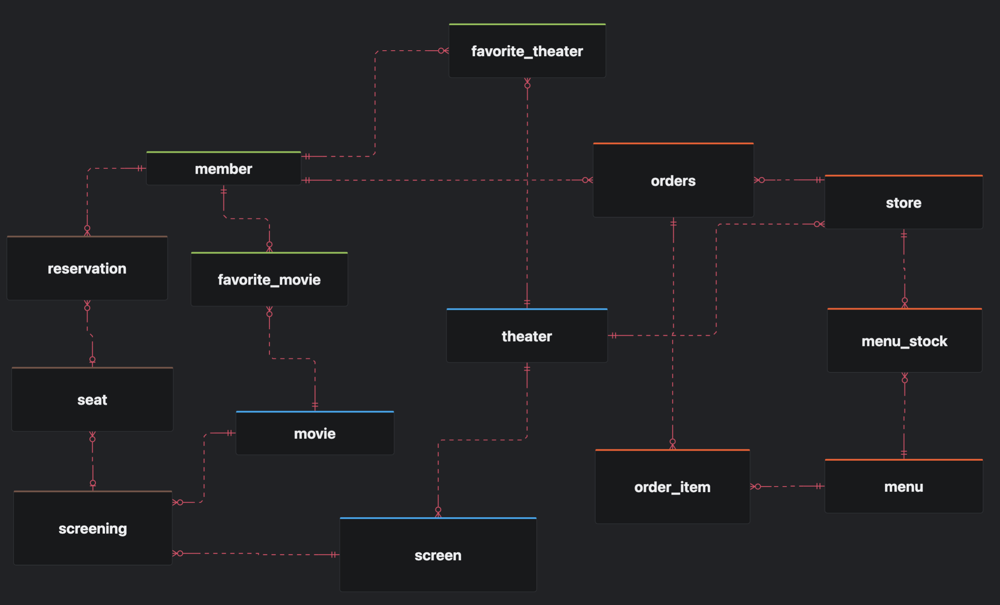

## 1-1. 테이블별 역할

| 테이블 | 역할 |
|---|---|
| member | 회원 |
| theater | 영화관 |
| screen | 상영관 (영화관에 속함) |
| screening | 상영 회차 (영화 + 상영관 + 시간) |
| seat | 좌석 (상영 회차에 속함) |
| reservation | 좌석 예약 |
| movie | 영화 |
| store | 매장 (영화관에 속함) |
| menu | 메뉴 |
| menu_stock | 매장별 메뉴 재고 |
| orders / order_item | 주문 / 주문 항목 |
| favorite_movie / favorite_theater | 찜한 영화 / 찜한 영화관 |

## 1-2. 테이블 관계

- theater 1 : N screen 1 : N screening 1 : N seat
- screening N : 1 movie
- seat 1 : 1 reservation N : 1 member
- theater 1 : 1 store
- store N : M menu (menu_stock으로 연결)
- member N : 1 orders 1 : N order_item N : 1 menu
- member N : M movie (favorite_movie), member N : M theater (favorite_theater)

## 1-3. 핵심 설계 포인트

1. seat를 screen이 아닌 screening에 종속시킴 —> 같은 물리적 좌석도 회차마다 예약 상태가 달라야 하므로
2. reservation.seat_id에 UNIQUE 제약 —> 동시 예약 경쟁 상황에서도 하나의 좌석에 하나의 예약만 존재하도록 DB 레벨에서 중복 예약을 차단
3. store.theater_id에 UNIQUE 제약 — 영화관 하나당 매장 하나라는 비즈니스 규칙을 DB 제약으로 강제
4. menu-store를 menu_stock 중간 테이블로 연결 — 같은 메뉴라도 매장마다 재고가 다르므로, 재고를 매장 단위로 독립 관리하기 위해 중간 테이블을 둠
5. order_item에 price, quantity를 별도 저장 — 메뉴를 참조만 하지 않고 주문 시점의 가격·수량을 저장해, 이후 메뉴 가격이 바뀌어도 과거 주문 내역이 변하지 않도록 설계


# 2. 추가 학습 내용 정리

## 2-1. Dirty Checking과 전체 컬럼 UPDATE

Hibernate는 엔티티마다 UPDATE SQL을 캐싱해서 재사용한다. 
이 SQL은 모든 컬럼을 SET 절에 포함하도록 미리 만들어지기 때문에, 
필드 하나만 바뀌어도 Dirty Checking이 감지하면 전체 컬럼이 UPDATE 대상이 된다.

따라서, 

- 컬럼 수가 많고 그중 일부만 자주 바뀌는 엔티티
- 컬럼에 DB 트리거가 걸려 있어, 변경되지 않은 컬럼까지 트리거가 동작하면 안 되는 경우

라면, 다음의 방법으로 효율을 높일 수 있다

### 개선 방법 — `@DynamicUpdate`

```java
@Entity
@DynamicUpdate
public class Member {
    @Id
    private Long id;
    private String name;
    private String email;
    private String phone;
    private String address;
}
```

위 코드처럼 엔티티 클래스에 `@DynamicUpdate`를 붙이면 Hibernate가 고정 SQL 대신, 
실제로 변경된 컬럼만 포함한 UPDATE 문을 매번 동적으로 생성한다.


### 주의할 점

| 상황 | 권장 여부 |
|---|---|
| 컬럼이 많고 일부 필드만 자주 변경 | `@DynamicUpdate` 적용 권장 |
| 컬럼이 적거나 대부분 필드가 함께 변경 | 기본(정적 UPDATE) 유지가 더 나을 수 있음 (동적 SQL 생성 비용 발생) |
| detached 엔티티를 `Session.update()`로 재부착 | `@SelectBeforeUpdate`를 함께 적용해야 `@DynamicUpdate`가 정상 동작 |


---

## 2-2. Flush가 발생하는 시점

Flush는 영속성 컨텍스트의 변경 내용을 실제 DB에 동기화하는 과정이다. 
아래 세 시점 모두 실제로 flush가 발생하는 시점이 맞다.

아래 예시에서 공통으로 쓰이는 tx는 트랜잭션을 다루는 EntityTransaction 타입 변수로,
EntityManager에서 아래와 같이 얻는다.

```java
EntityManager em = emf.createEntityManager();
EntityTransaction tx = em.getTransaction();
```

### ① `em.flush()` 직접 호출

```java
Member member = em.find(Member.class, 1L);
member.setName("변경된 이름");

em.flush();  // 이 시점에 즉시 UPDATE 쿼리 실행 (commit 전이라도)
```

이때 Dirty Checking의 기준이 되는 스냅샷도 flush된 값으로 함께 갱신된다. 
그래야 이후 다시 dirty checking을 할 때 방금 flush한 값을 기준으로 비교할 수 있다.

### ② 트랜잭션 commit 시

```java
tx.begin(); // 트랜잭션 시작
Member member = em.find(Member.class, 1L);
member.setName("변경된 이름");
tx.commit();  // 트랜잭션 커밋. 이 직전에 자동으로 flush 발생
```

### ③ JPQL 쿼리 실행 직전 (FlushMode.AUTO, 기본값)

```java
tx.begin(); // 트랜잭션 시작
Member member = em.find(Member.class, 1L);
member.setName("변경된 이름");

// 변경사항이 아직 DB에 반영되지 않았지만
// 아래 JPQL이 member 테이블을 조회하므로, 실행 직전 자동 flush 발생
List<Member> result = em.createQuery(
    "select m from Member m where m.name = :name", Member.class)
    .setParameter("name", "변경된 이름")
    .getResultList();
```

단, 항상 발생하는 것은 아니고, 실행하려는 쿼리가 아직 flush되지 않은 변경사항과 겹치는 테이블을 조회할 때만 선행 flush가 일어난다. 

아래와 같은 네이티브 SQL은 기본적으로 자동 flush 대상에서 제외된다.
```java
em.createNativeQuery("SELECT * FROM member WHERE name = ?")
  .setParameter(1, "변경된 이름")
  .getResultList();
```

네이티브 SQL은 Hibernate가 직접 파싱하는 JPQL과는 달리 그냥 문자열이라 Hibernate가 해당 SQL이 어떤 테이블을
건드리는지 알 수 없다. 그래서 기본적으로 자동 flush 대상에서 제외된다.
그 결과 네이티브 쿼리 실행 전 변경사항이 아직 DB에 반영되지 않아, stale(최신이 아닌) 데이터를 조회할 위험이 있다.
addSynchronizedEntityClass()로 동기화 대상 엔티티를 명시하거나, 쿼리 전 em.flush()를 직접 호출하여 해결해야 한다.

### FlushMode 정리

| 모드 | 동작 |
|---|---|
| `AUTO` (기본값) | commit 시 + 관련 쿼리 실행 직전에 flush |
| `COMMIT` | commit 시에만 flush |
| `MANUAL` | `flush()`를 명시적으로 호출할 때만 flush (읽기 전용 트랜잭션에 유리) |
| `ALWAYS` | 모든 쿼리 실행 전 매번 flush (공식 문서에서 "거의 항상 불필요"하다고 명시) |


---

## 2-3. 영속성 컨텍스트 · 엔티티 매니저 · 트랜잭션의 관계

결론부터 말하면, 셋이 항상 1:1은 아니다.

### 영속성 컨텍스트 ↔ 엔티티 매니저

Container-managed 환경에서는 영속성 컨텍스트 전파가 일어난다.

```java
// 동일한 JTA 트랜잭션 내에서
@Stateless
public class OrderService {
    @PersistenceContext
    EntityManager em1;   // 서로 다른 엔티티 매니저 인스턴스라도
}

@Stateless
public class PaymentService {
    @PersistenceContext
    EntityManager em2;   // 같은 트랜잭션 안이면 em1과 동일한 영속성 컨텍스트를 공유
}
```

- **Transaction-Scoped(기본값)** + Container-managed 
- → 여러 엔티티 매니저가 하나의 영속성 컨텍스트를 공유할 수 있음 (N:1)
- 
- **Application-managed** 엔티티 매니저 
- → 영속성 컨텍스트를 공유하지 않고 각자 독립적으로 가짐
- 
- **Extended(확장) 스코프** 
- → 특정 엔티티 매니저에 종속되어 생성·종료 시점을 함께함 (1:1에 가까움)

### 엔티티 매니저 ↔ 트랜잭션

```java
// Transaction-Scoped: 트랜잭션이 끝나면 영속성 컨텍스트도 함께 닫힘
tx.begin();
Member m = em.find(Member.class, 1L);
tx.commit();   // 여기서 영속성 컨텍스트 종료

tx.begin();    // 같은 em이라도 새로운 영속성 컨텍스트가 다시 생성됨
Member m2 = em.find(Member.class, 1L);
tx.commit();
```

반면 Extended 영속성 컨텍스트는 여러 트랜잭션에 걸쳐 존재할 수 있다.

```java
@Stateful
public class OrderEditor {
    @PersistenceContext(type = PersistenceContextType.EXTENDED)
    EntityManager em;
    // 이 em(영속성 컨텍스트)은 하나가 여러 트랜잭션에 걸쳐 유지될 수 있음
}
```

## 2-4. Proxy

### 2-4-1. Hibernate Proxy vs Spring AOP Proxy

| 구분 | Hibernate Proxy | Spring AOP Proxy |
|---|---|---|
| 목적 | 지연 로딩 | 횡단 관심사(트랜잭션, 로깅 등) 적용 |
| 대상 | JPA 엔티티 | 스프링 빈 |
| 구현 | 바이트코드 조작(cglib 등)으로 엔티티 상속 프록시 생성 | 인터페이스 구현 시 JDK 동적 프록시, 아니면 CGLIB |

둘 다 실제 객체 대신 동작을 가로채는 대리 객체이지만,
Hibernate Proxy는 데이터 접근 시점 제어가,
Spring AOP Proxy는 메서드 호출 가로채기가 목적이라는 점에서 근본적으로 다르다.

### 2-4-2. 양방향 매핑 + `@OneToOne` + `nullable=true`에서 프록시 문제

```java
@Entity
public class Member {
    @Id
    private Long id;

    @OneToOne(mappedBy = "member", fetch = FetchType.LAZY)
    private MemberProfile profile;   // 비주인 쪽 (nullable=true, 기본값)
}

@Entity
public class MemberProfile {
    @Id
    private Long id;

    @OneToOne(fetch = FetchType.LAZY)
    @JoinColumn(name = "member_id")
    private Member member;           // 주인 쪽 (FK 보유)
}
```
위와 같은 상황에서

```java
Member member = em.find(Member.class, 1L);
```
를 실행하면, FetchType.LAZY로 지정했음에도 member.profile은 실제로 즉시 로딩된다. 

왜일까?

Member(비주인) 쪽에는 profile 관련 컬럼이 테이블에 아예 없다. 
FK는 반대쪽인 MemberProfile 테이블에 있기 때문에,
Member를 조회하는 시점에는 이 회원에게 프로필이 있는지 없는지 Hibernate가 전혀 알 수 없는 것이다.

그런데 프록시는 "대상이 반드시 존재한다"를 전제로 만드는 빈 껍데기이기 때문에,
지금 이 자리에서 null로 둘지 프록시로 채울지 둘 중 하나로 확정해야 한다 (나중에 바꿀 수 없음).

그래서 Hibernate는 이 판단을 위해 MemberProfile 테이블을 조회해
"나를 참조하는 row가 있는지" 먼저 확인하는 SELECT를 추가로 날린다.
근데?? 이 확인 쿼리 자체가 이미 즉시 조회이기 때문에,
결과적으로 FetchType.LAZY를 지정해도 즉시 로딩처럼 동작하는 것이다.

---

## 2-5. Fetch Join + 페이징 문제

### 문제

컬렉션(1:N 관계인 comments)을 fetch join하면서 페이징(`setMaxResults`)을 동시에 걸면 문제가 생긴다.

```java
List<Post> posts = em.createQuery("""
    select p
    from Post p
    left join fetch p.comments
    order by p.createdOn
    """, Post.class)
    .setMaxResults(5)
    .getResultList();
```
분명히 5개만 가져오라고 `setMaxResults(5)`를 지정했지만, 
Hibernate는 이걸 그대로 실행하지 않고 경고를 띄운다.
```
WARN: HHH000104: firstResult/maxResults specified with collection fetch; applying in memory!
```
"in memory!"라는 말대로, DB에는 페이징 조건을 아예 전달하지 않고 
전체 데이터를 다 가져온 뒤 자바 메모리 안에서 5개만 잘라낸다는 뜻이다. 
실제 실행되는 SQL을 보면 이게 명확히 드러난다.

```sql
-- 실제 실행되는 SQL — LIMIT/OFFSET이 빠져 있음
SELECT p.id, p.created_on, p.title,
       c.id, c.post_id, c.review
FROM post p
LEFT OUTER JOIN post_comment c ON p.id = c.post_id
ORDER BY p.created_on
```

왜..?

컬렉션(1:N)을 fetch join하면 부모 1개에 자식 row가 여러 개 매핑된 결과셋이 만들어진다. 
이 상태에서 DB 레벨로 단순히 `LIMIT`을 걸면 자식 컬렉션 중간에서 결과가 잘려, 
부모 엔티티가 자식 데이터를 일부만 가진 채 반환될 수 있다. 
Hibernate는 데이터 일관성을 우선시하기 때문에, 
이 경우 SQL 레벨 페이징을 포기하고 전체 결과를 조회한 뒤 메모리에서 페이징을 수행한다. 

그 결과로 페이징 조건과 무관하게 전체 데이터가 매번 조회되는 엄청난 부작용이 생기는 것이다

### 해결 방법

**방법 1 — ID를 먼저 페이징 조회 후, 해당 ID로 fetch join**

```java
// 1단계: ID만 페이징 조회 (SQL 레벨 LIMIT 정상 적용)
List<Long> ids = em.createQuery("""
    select p.id
    from Post p
    order by p.createdOn
    """, Long.class)
    .setFirstResult(0)
    .setMaxResults(5)
    .getResultList();

// 2단계: 조회된 ID로 fetch join (컬렉션 전체를 가져와도 페이징 대상이 이미 5개로 고정됨)
List<Post> posts = em.createQuery("""
    select distinct p
    from Post p
    left join fetch p.comments
    where p.id in :ids
    order by p.createdOn
    """, Post.class)
    .setParameter("ids", ids)
    .getResultList();
```

**방법 2 — `@BatchSize`로 N+1 완화 (fetch join 대신 지연 로딩 유지)**

```java
@Entity
public class Post {
    @Id
    private Long id;

    @OneToMany(mappedBy = "post", fetch = FetchType.LAZY)
    @BatchSize(size = 100)
    private List<Comment> comments = new ArrayList<>();
}

// 부모는 정상적으로 SQL 레벨 페이징 적용
List<Post> posts = em.createQuery(
    "select p from Post p order by p.createdOn", Post.class)
    .setFirstResult(0)
    .setMaxResults(5)
    .getResultList();
// comments 접근 시 BatchSize 단위로 IN 절 묶어서 조회 (N+1 완화)
```

**방법 3 — 조기 감지를 위한 설정**

```properties
# 경고 로그 대신 예외를 발생시켜 실수를 조기에 발견
hibernate.query.fail_on_pagination_over_collection_fetch=true
```

# 3주차 README

## 1. **JWT를 활용한 인증 흐름 정리하기**

#### 1. JWT의 Header, Payload, Signature는 각각 어떤 역할을 하나요?

- Header: 토큰의 메타데이터(암호화 알고리즘과 토큰의 타입)를 담는다.
- Payload: 실제 전달하려는 Claim 데이터를 담는다. 유저 식별자(PK), 토큰 발급 및 만료 시간, 권한 등의 실질적인 정보를 포함한다. Base64로 인코딩될 뿐 암호화되지 않으므로 민감한 정보를 포함해서는 안 된다!
- Signature: 토큰의 위변조 여부를 검증한다. 서버가 가진 Secret Key를 이용하여 Header와 Payload를 암호화해 생성한다. Payload가 변조될 경우 서명이 일치하지 않아 서버에서 유효하지 않은 토큰으로 판단하고 차단한다.

#### 2. Access Token과 Refresh Token은 무엇이 다른가요?

- Access Token: 서버의 API 리소스에 접근할 때마다 헤더에 포함하여 전송하는 실질적인 자격 증명 수단이다. 탈취 위험을 최소화하기 위해 유효 기간을 짧게 설정한다.
- Refresh Token: 유효 기간이 길며, 만료된 Access Token을 새로 발급받기 위한 용도로만 사용한다. 탈취 시의 위험을 줄이기 위해 데이터베이스나 Redis에 저장하여 상태를 관리하며(RTR
  등), 일반적인 API 리소스 접근에는 사용할 수 없다!

#### 3. 쿠키와 세션, JWT는 각각 어떤 역할을 하나요?

- 쿠키: 브라우저(클라이언트) 단에 데이터를 저장하는 매체이다. 세션 ID를 보관할 수도 있고,
  JWT를 보관할 수도 있으며, 매 HTTP 요청 시 서버로 자동 전송된다.
- 세션: 유저의 상태를 서버의 메모리에 저장하는 방식이다. 브라우저에는 고유한 세션 ID만
  쿠키로 발급한다. 보안성은 높지만, 동시 접속자가 많아지면 서버 메모리 부하가 증가하고 다중
  서버(Scale-out 시) 환경에서 관리가 까다롭다.
- JWT: 유저의 정보를 암호화 및 서명하여 토큰 자체에 저장하는 Stateless한 인증 방식. 서버는 메모리에 상태를 저장하지 않으므로 서명 검증만으로 인증이 가능하여 서버 확장에 매우 유리하다.

#### 4. CGV 프로젝트의 Access Token에는 어떤 Claim이 필요한가요?

저는 현재 아래 5가지 클레임으로 토큰을 구성해봤습니다.

- iss (Issuer): 토큰 발급자. 현재 "http://localhost:8080"으로 고정되어 있으며, 파싱 시 requireIssuer()를 통해 발급자가 일치하는지 검증한다.
- sub (Subject): memberId를 담는다. 필터에서 이 값을 추출해 데이터베이스에서 회원 정보를 조회하는 데 사용한다.
- type: 해당 토큰이 Access Token인지 Refresh Token인지 구분하는 사용자 정의 클레임. Refresh Token을 헤더에 넣어 일반 API 리소스에 접근하는 것을 원천 차단하기 위해 추가하였음.
- iat (Issued At): 토큰이 발급된 시간 정보.
- exp (Expiration Time): 토큰의 만료 시간.

매번 memberId를 통해 DB를 조회하여 권한 확인 하는 과정을 개선하기 위해, Role 클레임을 넣어 DB 조회 없이 권한을 확인하게 한다거나, 블랙리스트 기능을 위한 jti(JWT ID) 등을 추가해도 좋을 것 같네요.

#### 5. JWT 검증 결과가 Authentication과 SecurityContext로 어떻게 연결되나요?

1. JwtAuthenticationFilter에서 토큰의 서명을 검증하고 memberId를 추출한다.
2. 추출한 정보로 CustomUserDetails 객체를 생성한 뒤, 이를 UsernamePasswordAuthenticationToken으로 래핑한다.
3. 생성된 Authentication 인증 객체를 스프링 시큐리티의 전역 저장소인 SecurityContextHolder 내의 SecurityContext에 저장한다.
4. 이후 컨트롤러 단에서 @AuthenticationPrincipal 어노테이션을 통해 SecurityContext에 저장된 유저 정보를 꺼내어 사용할 수 있다.

#### 6. 인증과 인가는 어떻게 다르며, 401과 403은 각각 언제 반환하나요?

- 인증 (Authentication)
    - 클라이언트가 누구인지 신원을 확인하는 과정이다.
    - 401 Unauthorized : 비로그인 상태, 토큰 미제공, 토큰 만료, 토큰 위변조 등 유효한 인증 자격 증명이 없을 때 반환한다.
- 인가 (Authorization)
    - 개념: 인증된 사용자가 특정 리소스에 접근할 수 있는 권한이 있는지 확인하는 과정이다.
    - 403 Forbidden : 정상적으로 로그인(인증)은 했으나, 일반 유저가 관리자 전용 기능에 접근하려는 등 요구되는 권한(Role)을 충족하지 못했을 때 반환한다.

#### (기타) CSRF를 비활성화한 이유

CSRF 공격은 브라우저가 요청마다 쿠키를 자동으로 첨부하는 특징을 악용하는 공격이다. 하지만 내 서버는 세션과 인증 쿠키를 사용하지 않는 Stateless 서버이며, 매 요청 시 클라이언트가 명시적으로 헤더에 토큰을 담아 보내야만 인증이 가능하므로 CSRF 공격으로부터 안전하다.

#### (기타) 공개 경로에서는 인가 거부가 일어나지 않을 수도 있다?

현재 JWT 검증 로직은 예외 발생 시 필터 계층에서 즉각적인 401 에러 응답을 반환하지 않고, 예외 원인을 `request attribute` 에 저장한 뒤 `AuthenticationEntryPoint` 로 위임하여 인가 단계에서 처리되도록 설계했다. 이러면 전체 영화 조회와 같이 `permitAll()` 로 설정된 공개 경로에 접근할 때 클라이언트가 만료되거나 잘못된 토큰을 전송하더라도 예외를 발생시키지 않고 인증 정보가 빈 익명 사용자로서 정상적인 조회를 보장할 수 있다.

## 2. 테스트 결과

- 올바른 로그인 정보

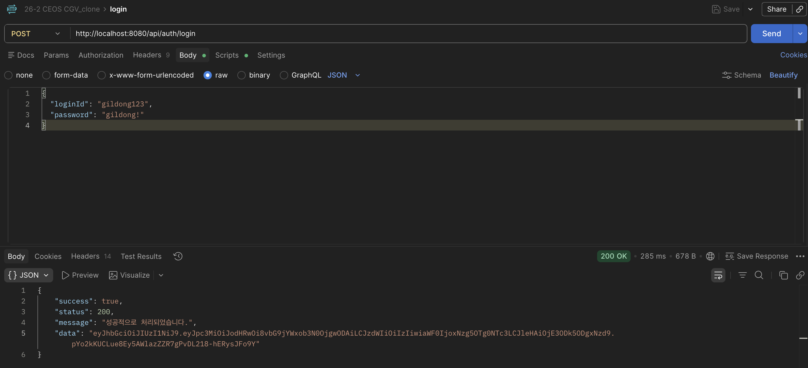

200 OK, Access Token 정상 발급

- 존재하지 않는 ID로 로그인

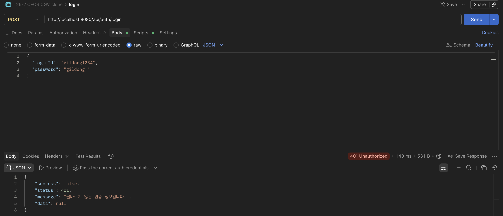

401 Unauthorized, 토큰 미발급

- 잘못된 비밀번호로 로그인

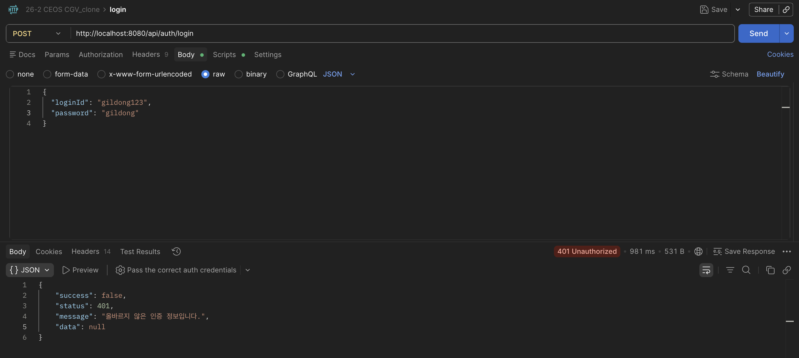

401 Unauthorized, 토큰 미발급

- 토큰 없이 공개 API 호출

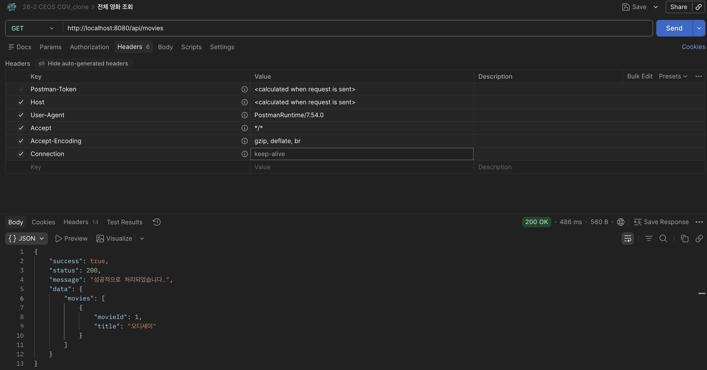

200 OK, 전체 영화 조회 등의 공개 API는 토큰 없이도 접근 가능하도록 설정

- 정상 토큰으로 보호된 API(찜한 영화 등록) 호출

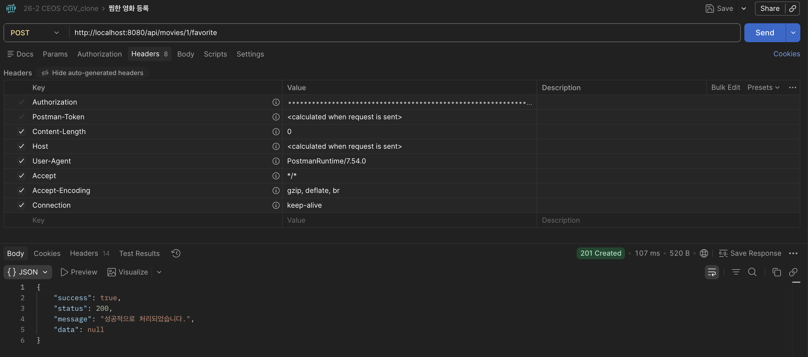

201 CREATED, 정상 호출

- 토큰 없이 보호된 API(찜한 영화로 등록) 호출

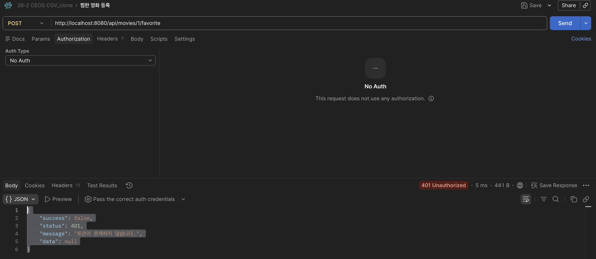

401 Unauthorized, 공통 응답 처리

- 만료된 토큰으로 보호된 API(찜한 영화로 등록) 호출

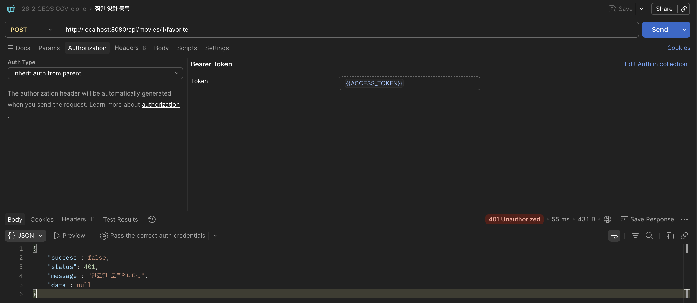

401 Unauthorized, “만료된 토큰입니다.”

- 변조된 토큰으로 보호된 API(찜한 영화로 등록) 호출

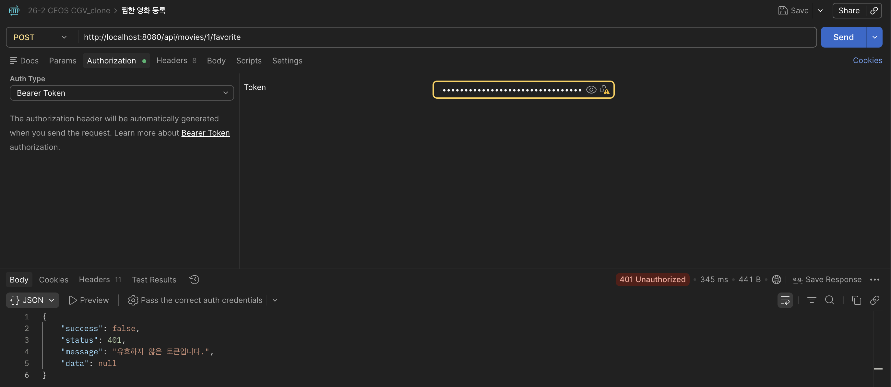

401 Unauthorized, “유효하지 않은 토큰입니다”

- 다른 키로 서명한 토큰

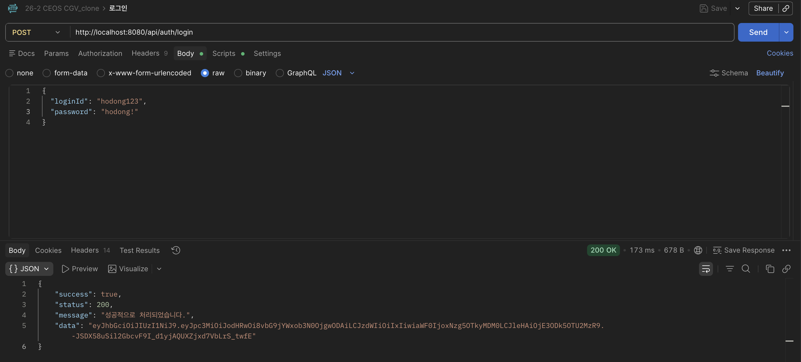

로그인하여 토큰을 발급받고,


환경변수로 등록된 시크릿 키를 변조(맨 앞에 1 추가)한 다음 찜한 영화 등록 요청을 보내면

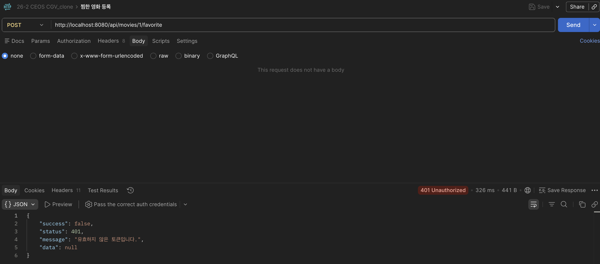

401 Unauthorized, “유효하지 않은 토큰입니다.”

- 일반 사용자로 관리자 API(영화 등록) 호출

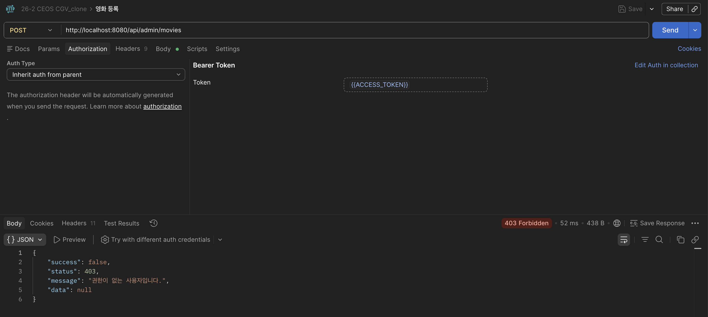

403 Forbidden, 공통 응답 Json

- 관리자로 관리자 API(영화 등록) 호출
    
  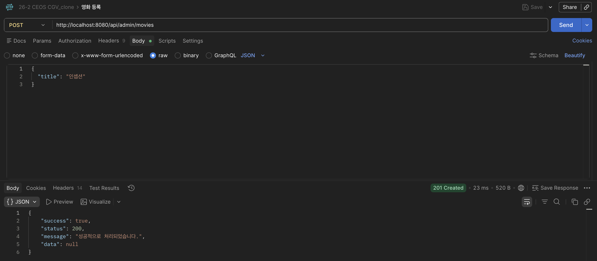


201 Created

- 정상 인증 요청 직후, 토큰 없이 보호된 API 호출

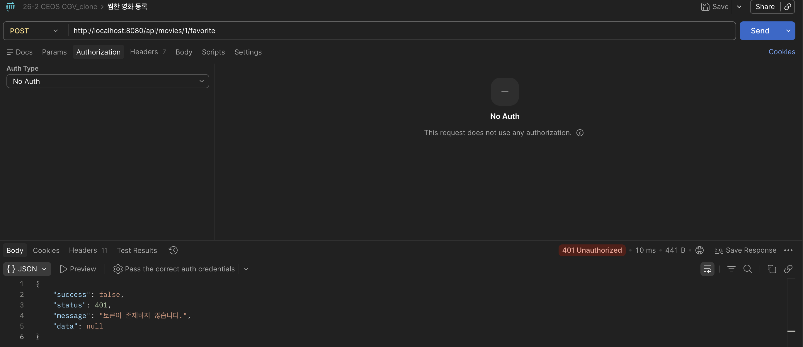

401 Unauthorized, “토큰이 존재하지 않습니다”

- 다른 사용자의 데이터 접근 (다른 사용자가 예매한 좌석 예매 취소 시도)

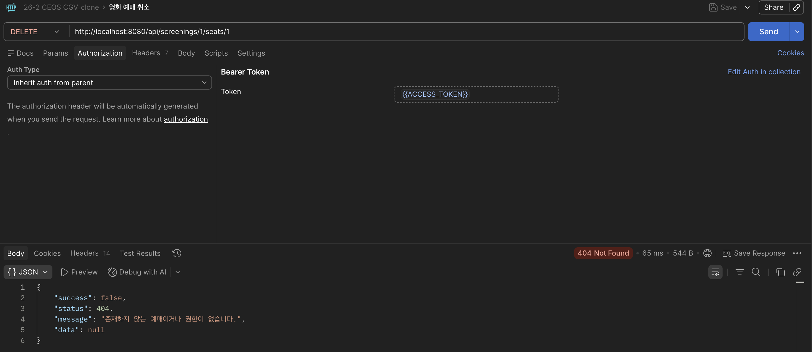

404 Not Found, "존재하지 않는 예매이거나 권한이 없습니다.”

- CORS 설정과 Preflight 요청

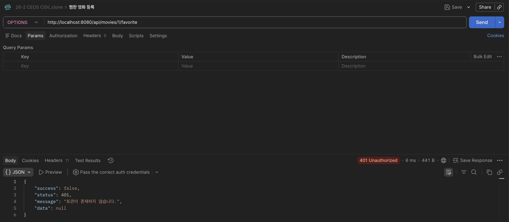

적용 전, 401 Unauthorized, “토큰이 존재하지 않습니다”

- OPTIONS 메서드
- 헤더 두 개 추가
    - Key: Origin, Value: http://localhost:3000
    - Key: Access-Control-Request-Method, Value: POST

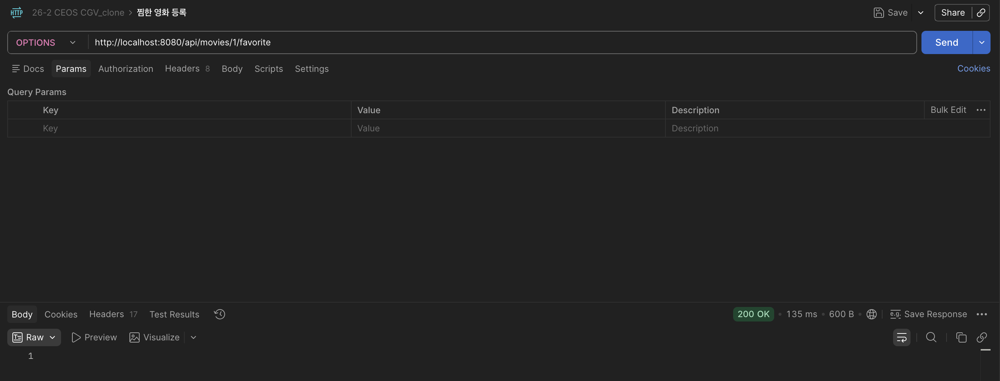

적용 후, 200 OK


# 4주차 README

## 1. 객체지향 코드 리팩토링

기존 코드는 엔티티가 단순히 데이터만 담고 있는 바구니에 가까웠고, 서비스 계층에서 데이터를 꺼내 직접 계산하거나 상태를 바꾸는 방식이 많았습니다. 
이번 리팩토링에서는 객체가 스스로의 데이터를 다루도록 역할을 넘기고 도메인의 책임을 강화하는 데 집중했습니다.

### 1-1. 주문 도메인 (Order, OrderItem)

- OrderItem 캡슐화와 계산 책임 부여
  - 기존에는 OrderItem이 가격과 수량만 필드로 가지고 있을 뿐, 소계 금액(가격 * 수량)을 계산하는 로직이 없어서 OrderService가 getter로 값을 꺼내 계산했습니다.
  - 이를 OrderItem 내부의 calculateSubtotal 메서드로 옮겨 객체가 스스로 자신의 금액을 계산하도록 변경했습니다.
  - 또한 생성자를 닫고 정적 팩터리 메서드를 도입하여 메뉴나 수량에 잘못된 값이 들어오지 않도록 생성 시점에 유효성 검증을 거치도록 했습니다.

- Order와 영속성 전이 적용
  - 주문 상태 변경이나 총 결제 금액 계산 로직을 Order 엔티티 내부로 응집시켰습니다.
  - Order와 OrderItem 사이에 CascadeType.ALL과 orphanRemoval을 적용하여, 주문 항목의 저장과 삭제 등 생명주기를 루트 엔티티인 Order에 맡기도록 개선했습니다. 덕분에 서비스 계층에서 OrderItemRepository를 직접 주입받아 일일이 저장할 필요가 없어졌습니다.

### 1-2. 예매 및 좌석 도메인 (Reservation, Seat)

- Seat 도메인의 상태 제어
  - 기존에는 외부에서 좌석의 예약 여부를 자유롭게 변경할 수 있어 무결성이 깨질 위험이 있었습니다.
  - 이를 reserveSeat와 cancelSeat 같은 명확한 도메인 메서드로 제한하고, 이미 예약된 좌석을 다시 예약하려고 하면 엔티티 내부에서 예외를 던지도록 캡슐화했습니다.

- Reservation 검증 로직 이전
  - 예매 생성 시 좌석 상태를 확인하고 예약자로 등록하는 흐름을 도메인 내부에서 검증하도록 정리하여, 서비스 코드가 단순하고 읽기 쉬운 흐름을 유지하도록 했습니다.


---

## 2. 동시성 문제 분석과 해결

### 2-1. 동시성 문제란?

두 개 이상의 스레드 또는 프로세스가 동일한 공유 자원에 접근하고, 그 중 하나 이상이 상태를 변경하려할 때 스레드의 실행 순서나 타이밍에 따라 데이터의 일관성과 정합성이 깨져 의도치 않은 결과가 발생하는 현상
Spring Boot 웹 애플리케이션은 기본적으로 Thread-Per-Request 방식으로 동작. 사용자의 HTTP 요청이 들어오면 Tomcat 스레드 풀에서 작업 스레드를 할당하여 컨트롤러와 서비스를 실행한다.

### 2-1. 서비스 내 동시성 문제가 발생하는 지점
 
이전 CGV 서비스에서는 크게 두 군데에서 동시성 문제가 발생할 수 있습니다.

1. 매점 메뉴 재고 차감
   - 동일한 팝콘 메뉴의 재고가 10개 남아있을 때, 두 사용자가 동시에 주문을 시도하면 둘 다 10개라는 재고를 읽어옵니다.
   - 각자 1개씩 주문하여 재고를 9개로 만들어 저장하면, 실제로는 2개가 팔렸는데 재고는 9개가 되는 갱신 분실 문제가 생깁니다. 

2. 상영관 좌석 예매 
   - 특정 좌석을 두 사용자가 찰나의 순간에 동시에 선택할 때 발생합니다.
   - 두 요청 모두 좌석이 비어있다고 판단하고 예매를 진행하게 됩니다. DB 유니크 제약조건이 걸려있다면 2중 예매는 막히겠지만, 늦게 도착한 사용자에게 비즈니스 안내 메시지가 아니라 알 수 없는 DB 에러가 터지게 됩니다.

### 2-2. 동시성 해결 방법 비교

동시성 문제는 다양한 계층(애플리케이션, DB, 분산 인프라 등)에서 해결할 수 있다. 대표적인 5가지 방법을 자세히 알아보자.

#### ① JVM 레벨 동시성 제어 (`synchronized`, `ReentrantLock`)
- **동작 원리**: Java의 객체 모니터 메커니즘을 이용. 각 Java 객체 헤더(Mark Word)에 존재하는 락을 획득한 스레드만 임계 영역에 진입(`monitorenter`)할 수 있으며, 블록 탈출 시 락을 반환(`monitorexit`)한다.
- **장점**:
  - 외부 인프라 없이 Java 언어 자체 기능으로 손쉽게 구현 가능.
  - 단일 JVM 내부에서는 시스템 콜이나 네트워크 I/O 없이 메모리 레벨에서 처리되므로 속도가 매우 빠름.
- **단점**:
  - **Spring `@Transactional` AOP 프록시와의 불일치 문제(트랜잭션 격리 실패)**:
    - Spring의 `@Transactional`은 AOP 프록시 기반으로 동작한다.
    - 실행 순서: `1. 프록시: 트랜잭션 시작(begin)` ➔ `2. 타깃 메서드: synchronized 블록 진입(락 획득)` ➔ `3. 비즈니스 로직 수행 및 영속성 컨텍스트 수정` ➔ `4. 타깃 메서드: synchronized 블록 탈출(락 해제)` ➔ `5. 프록시: 트랜잭션 커밋(DB commit)`.
    - 위 흐름 중 4번에서 Java 락이 해제된 직후, 5번 트랜잭션 커밋이 완료되기 전 찰나의 순간에 대기 중이던 다른 스레드가 락을 획득하고 DB를 조회한다면??
    - 이 스레드는 아직 커밋되지 않은 과거 데이터를 읽게 되어 `synchronized`를 걸었음에도 Lost Update 그대로 발생
  - **Scale-out시 무용지물**: 서버가 2대 이상으로 분산되면 각 서버는 독립된 JVM 힙 메모리를 사용하므로 인스턴스 간 락이 전혀 공유되지 않다.
    - 분산 환경이 아닌 단일 인스턴스 환경에서 로컬 인메모리 캐시 동기화, JVM 내부 정적 자원 보호 등에 사용한다.

#### ② DB 비관적 락 (Pessimistic Lock - `PESSIMISTIC_WRITE`)
- **동작 원리**: 데이터를 조회하는 시점에 RDBMS의 **배타 락(Exclusive Lock, `SELECT ... FOR UPDATE`)**을 걸어, 현재 트랜잭션이 커밋되거나 롤백될 때까지 다른 트랜잭션이 해당 Row를 수정하거나 읽지 못하도록 차단.
- **장점**:
  - 데이터 수정 충돌이 잦을 때, 롤백 및 재시도 없이 락을 획득한 순서대로 대기 후 순차 처리하므로 확실한 데이터 정합성을 보장.
  - 애플리케이션 서버가 여러 대로 스케일 아웃되어도 중앙 RDBMS에서 락을 관리하므로 분산 환경에서도 안정적으로 동작.
  - 재시도 로직을 애플리케이션 레벨에서 복잡하게 구현할 필요가 없다.
- **단점**:
  - 동시 요청들이 락 해제를 대기해야 하므로 동시 처리량(Throughput/TPS)이 저하될 수 있다.
  - 여러 테이블이나 행을 서로 다른 순서로 잠그는 트랜잭션이 얽힐 경우 Deadlock이 발생할 위험이 있어 락 획득 순서 관리가 필수적.
- **적절한 상황**: 충돌 발생 가능성이 매우 높고, 데이터의 정합성이 서비스 존폐에 직결되는 핵심 비즈니스 로직 

#### ③ DB 낙관적 락 (Optimistic Lock - `@Version`)
- **동작 원리**: DB 레벨의 물리적 락을 거는 게 아니라, 테이블에 `version` 컬럼을 두고 데이터 수정 시 `UPDATE ... WHERE id = ? AND version = ?` 쿼리를 날려 성공 시 버전을 1 증가시킴. 만약 다른 트랜잭션이 먼저 수정하여 버전이 변경되었다면 `OptimisticLockingFailureException` 예외가 발생.
- **장점**:
  - 실제 DB 락을 걸지 않으므로 트랜잭션 대기가 없어 읽기/쓰기 성능이 우수.
  - 락을 점유하지 않으므로 데드락이 원천적으로 발생하지 않는다.
- **단점**:
  - 충돌이 발생하면 트랜잭션이 롤백되므로, 충돌이 빈번한 상황에서는 대량의 예외 발생과 함께 애플리케이션 레벨의 복잡한 Retry 로직이 필요함.
  - 경합이 극심할 경우 반복적인 재시도로 인해 DB 커넥션과 CPU 자원이 낭비되어 성능이 급격히 저하.
- **적절한 상황**: 동시 수정 충돌이 발생할 확률이 극히 낮고, 읽기 작업이 쓰기 작업에 비해 압도적으로 많은 도메인.

#### ④ DB 네임드 락 (Named Lock - MySQL `GET_LOCK()`)
- **동작 원리**: 
  - 특정 테이블이나 레코드가 아닌, 사용자가 지정한 임의의 문자열(String Key)을 기준으로 MySQL 서버에서 락을 획득 및 반환하는 방식.
  - 동일한 MySQL 서버에 접속한 서로 다른 프로세스(커넥션, 세션)에서도 동일한 이름의 락을 공유하고 상호 배제 적용.
  - 락의 적용 범위는 MySQL 서버 전체이며, 락의 소유권은 획득한 특정 DB 세션에 귀속됨.
  - 동일한 이름의 락을 다른 세션에서 획득하려는 경우, 기존 락이 해제될 때까지 대기하거나 타임아웃 발생.
  - `GET_LOCK('lock_name', timeout)`으로 락 획득, `RELEASE_LOCK('lock_name')`으로 명시적 해제
- **장점**:
  - 엔티티의 스키마 변경 없이도 비즈니스 키(예: `order-store-1`) 단위로 세밀하게 락을 걸 수 있음.
  - 특정 레코드가 존재하지 않거나 여러 테이블에 걸친 작업에서도 작업 단위로 동시성 제어 가능.
  - 락 획득 타임아웃을 지정할 수 있어 무한 대기로 인한 시스템 마비를 방지할 수 있음.
  - 별도의 Redis 등 외부 분산 락 인프라 없이 동일한 MySQL 서버를 사용하는 여러 프로세스 간 동시성 제어 가능.
- **단점**:
  - 네임드 락은 DB 세션에 종속되므로 락을 획득한 커넥션을 유지하고, 동일한 커넥션으로 해제해야 함.
  - 트랜잭션 커넥션과 락 점유 커넥션을 분리하는 구조에서는 추가 DB 커넥션이 소모되므로 커넥션 풀 고갈 위험이 있음. 별도 커넥션 풀을 구성하거나 동일한 커넥션을 공유하는 등 커넥션 관리 전략 필요.
  - 일반적인 비관적 락은 트랜잭션이 종료되면 자동 해제되지만, 네임드 락은 트랜잭션의 커밋이나 롤백과 무관하게 유지됨. (네임드 락은 트랜잭션이 아닌 DB 세션에 종속되기 때문)
  - 명시적으로 `RELEASE_LOCK()`을 호출하거나 해당 DB 세션이 종료되어야 락이 해제됨.
  - 락 해제 로직 누락 시 동일한 이름의 락을 요청하는 다른 세션이 계속 대기하는 문제가 발생할 수 있으므로 `try-finally` 등을 통한 해제 보장 필요.
  - 서로 다른 MySQL 인스턴스 간에는 락이 공유되지 않음.
- **적절한 상황**: 분산 락을 도입하기 어렵고, 레코드 수준의 비관적 락을 걸기 모호한 분산 배치 작업이나 스케줄러 동기화 등.

#### ⑤ Redis 분산 락 (Distributed Lock - Lettuce vs Redisson)
- **동작 원리**: 여러 애플리케이션 서버가 중앙의 Redis 인메모리 저장소를 공유하여 락을 획득/해제.
  - **Lettuce (`SETNX`)**: `SETNX`(Set if Not Exists) 명령어로 락을 획득하고, 실패 시 일정 시간 슬립 후 재시도하는 스핀 락 방식.
  - **Redisson (Pub/Sub)**: 락 획득 실패 시 Redis 채널을 Subscribe하고 대기하다가, 락을 점유한 스레드가 해제(Publish)할 때 신호를 받아 락을 시도. 또한 Watchdog 기능으로 락 만료 시간을 자동 연장.
- **장점**:
  - DB 커넥션을 낭비하지 않고 인메모리 기반으로 초고속 락 획득/해제가 가능.
  - Redisson은 Pub/Sub 기반이라 Redis에 지속적인 폴링 부하를 주지 않는다.
  - MSA 및 대규모 분산 서버 환경에서 표준적인 글로벌 락으로 활용됨.
- **단점**:
  - 별도의 Redis 인프라 구축 및 유지보수 비용, 추가 라이브러리 의존성이 발생.
  - Redis 단일 장애점(SPOF) 고려 및 클러스터링 고가용성 설계가 필요함.
- **적절한 상황**: 수십 대 이상의 대규모 분산 서버 환경, 여러 서비스 간의 공통 자원 조율, 대용량 트래픽의 선착순 이벤트 등.

### 2-3. 우리 CGV 서비스에서 발견한 동시성 문제 지점

#### 지점 1: 스토어 상품 주문 시 재고 차감  (Lost Update)
- **발생 메커니즘**:
  1. 한 상품에 대한 고객 A, B가 동시에 주문 요청을 보냄
  2. 트랜잭션 A와 B가 거의 동시에 `menuStockRepository.findAllBy...`를 실행하여 동일한 상품 엔티티를 조회.
  3. 트랜잭션 A, B는 각각 `menuStock.decreaseStock(N)`을 실행하고 남아있는 재고를 `재고-N`으로 수정. (A, B의 N은 각각 다름)
  4. 트랜잭션 A가 커밋되며 `UPDATE menu_stock SET stock = 재고-N WHERE id = ?`를 실행.
  5. 트랜잭션 B가 커밋되며 `UPDATE menu_stock SET stock = 재고-N WHERE id = ?`로 덮어써 버림.
- **발생하는 문제**:
  - 실제 판매된 수량과 DB 상에 남은 재고량이 달라짐.
  - 실제 보유 재고를 초과하여 주문이 체결되는 문제가 발생할 수 있음.
- **해결 방법**: **DB 비관적 배타 락**
- **해당 방법을 선택한 이유**:
  - **다대일 수량 경쟁**: 한정된 잔여 재고를 두고 불특정 다수 고객이 경쟁하므로 동시 주문 충돌 빈도가 매우 높음.
  - **낙관적 락 배제 이유**: 충돌이 빈번한 상황에서 낙관적 락을 적용하면 잦은 롤백과 대량의 재시도로 인해 DB 커넥션 고갈과 시스템 자원 낭비가 심해짐.
  - **Redis 분산 락 배제 이유**: 현재 서비스 규모에서 외부 분산 인프라를 구축하고 운영하는 것은 오버엔지니어링이라고 판단.
  - **비관적 락 선택**: 충돌 빈도가 높고 잔여 수량의 정합성이 절대적으로 중요한 재고 도메인 특성상, 배타 락으로 요청을 순차 대기 처리하는 비관적 락이 롤백이나 재시도 오버헤드 없이 확실한 정합성을 보장하는 가장 알맞은 방식임.

#### 지점 2: 영화 좌석 예매 (Double Booking)
- **발생 메커니즘**:
  1. 인기 영화 상영 회차의 좌석 'G7'이 아직 예매되지 않은 상태(`isReserved = false`).
  2. 관객 A와 관객 B가 동시에 'G7' 좌석 예매 버튼을 클릭.
  3. 트랜잭션 A와 B 모두 `Seat`를 조회하고, `isReserved == false`인 상태를 확인.
  4. 두 트랜잭션 모두 `seat.reserveSeat()`의 유효성 검증을 통과하고 `isReserved = true`로 변경.
  5. 두 트랜잭션 모두 `Reservation.create(member, seat)` 객체를 생성하고 저장을 시도.
- **발생하는 문제**:
  - 데이터베이스 스키마 상 `reservation.seat_id`에 UNIQUE 제약조건이 걸려 있으므로 물리적 중복 레코드는 방어.
  - 하지만 늦게 커밋된 관객 B의 요청은 비즈니스 예외(`ErrorCode.ALREADY_RESERVED - 400 Bad Request`) 대신 **`DataIntegrityViolationException (500 Internal Server Error)`**을 맞닥뜨리게 됨.
- **해결 방법**: **좌석 조회 시 DB 비관적 락 적용 및 도메인 예외 처리**
- **해당 방법을 선택한 이유**:
  - **단일 자원 점유**: 수량 차감이 아니라 특정 상영 회차의 1자리 명당 좌석을 선점하는 도메인임.
  - **기존 DB 유니크 제약조건만 사용했을 때의 한계**: 물리적 중복 삽입은 막을 수 있지만, 늦게 커밋된 사용자에게 400 비즈니스 에러 대신 500 내부 서버 에러가 발생하는 치명적인 사용자 경험 저하가 발생함.
  - **비관적 락 선택**: 좌석 조회 시점에 배타 락을 걸어 트랜잭션을 직렬화하면, 선행 트랜잭션이 커밋된 후 후속 트랜잭션은 이미 예약 완료된 상태를 읽게 됨. 이를 통해 500 에러 대신 도메인 레벨에서 이미 예약된 좌석이라는 400 비즈니스 예외를 정상 반환하도록 제어할 수 있음.

#### 지점 3: 영화 및 영화관 찜하기 (Check-Then-Act)
- **발생 메커니즘**:
  - `if (favoriteMovieRepository.existsByMovieIdAndMemberId(...)) throw ...;` 검증 후 `save()`를 호출하는 전형적인 **Check-Then-Act** 패턴.
  - 사용자가 네트워크 지연 등으로 찜 버튼을 빠르게 더블 클릭하면 두 스레드가 동시에 `existsBy...`를 실행하고 둘 다 `false`를 반환받아 중복 `INSERT`가 발생.
- **발생하는 문제**:
  - `favorite_movie` 및 `favorite_theater` 테이블에 `(member_id, target_id)` 복합 유니크 제약조건이 설정되어 있지 않아 동일한 영화가 여러 번 중복 등록되는 데이터 오염이 발생.
- **해결 방법**: **DB 복합 유니크 제약조건**
- **해당 방법을 선택한 이유**:
  - **단일 사용자의 중복 요청**: 불특정 다수가 경쟁하는 자원이 아니라 동일 사용자의 더블 클릭이나 네트워크 지연으로 인한 멱등성 문제임.
  - **비관적 및 낙관적 락 배제 이유**: 단순 더블 클릭 방지를 위해 DB 락을 거는 것은 불필요한 트랜잭션 대기 시간과 커넥션 낭비를 유발함.
  - **복합 유니크 제약조건 선택**: 애플리케이션의 사전 검증을 두 요청이 동시에 통과하더라도, DB 인덱스 레벨에서 중복 생성을 원천 차단하면 락 오버헤드가 전혀 없이 비용 0으로 완벽하게 정합성을 보장할 수 있음.

#### 지점 4: Refresh Token Rotation(RTR) 재발급 레이스 컨디션
- **발생 메커니즘**:
  - 브라우저의 여러 탭이나 멀티 컴포넌트에서 Access Token 만료 시 동시에 `/auth/reissue`를 호출할 경우, 두 요청이 동시에 `storedToken.isUsed()`(false)를 확인하고 진입.
- **발생하는 문제**:
  - 타이밍에 따라 중복 토큰이 발급되거나, 한 트랜잭션이 먼저 커밋되어 `isUsed = true`로 바뀐 직후 뒤따라온 두 번째 요청이 실행되면 **정상 사용자를 토큰 탈취자(해커)로 오인하여 `AUTH_HIJACK_DETECTED` 예외를 던지고 사용자의 모든 기기 세션을 강제 로그아웃시키는 치명적인 오탐지 장애**가 발생.
- **해결 방법**: **비관적 락과 유예 기간 기반 멱등성 보장**
- **해당 방법을 선택한 이유**:
  - **단일 클라이언트의 동시 호출**: 브라우저 멀티 탭이나 병렬 비동기 요청으로 인해 거의 동시에 토큰 만료가 발생하여 재발급이 동시 호출되는 현상임.
  - **비관적 및 낙관적 락만 쓰면 안 되는 결정적 이유**: 락만 걸어 순차 처리하면 선행 요청이 토큰을 사용 완료 처리한 직후 후속 요청이 실행되어, 이미 사용된 토큰을 보고 정상 사용자를 해커로 100% 오인하여 모든 세션을 강제 로그아웃시키는 치명적인 오탐지 장애가 발생함.
  - **유예 기간 선택 이유**: 동시 접근을 막는 것뿐만 아니라, 직전 사용 토큰에 대해 일정 시간 동안 동일한 신규 토큰을 반환하는 멱등성으로 풀어야 함. 비관적 락으로 동시 발급 경합을 직렬화하고, 사용 직후 10초간의 유예 기간 동안은 신규 토큰을 그대로 재반환해주며, 유예 기간이 지난 후의 요청만 실제 탈취로 간주하여 정상 사용자의 세션을 안전하게 보호함.

### 2-4. 동시성 문제 재현 및 비관적 락 적용 전/후 결과 비교

#### 1) 멀티스레드 동시성 재현 메커니즘
- **도구**: `ExecutorService` (100개 스레드 풀) 및 3단계 `CountDownLatch` (`readyLatch`, `startLatch`, `doneLatch`) 동기화 패턴
- **동작 방식**:
  1. **준비 대기 (`readyLatch`)**: 100개 스레드가 모두 생성되어 출발선에 도달할 때까지 메인 스레드가 대기하여 스레드 생성 지연으로 인한 분산 실행 방지.
  2. **동시 출발 방아쇠 (`startLatch`)**: 모든 준비가 완료되면 단 1번의 신호로 100개 요청을 나노초 단위에서 일제히 트리거하여 완벽한 경합 유도.
  3. **결과 취합 (`doneLatch`)**: 100개 트랜잭션의 커밋/롤백이 완전히 끝난 후 최종 잔여 재고를 단건 조회하여 정합성 검증.

#### 2) 락 미적용 시 동시성 문제 실측 (As-Is)
- **조건**: 초기 재고 100개에 대해 100개 스레드가 각각 1개씩 동시 주문 요청
- **측정 결과**:
  - 요청 100건 모두 성공했으나, **최종 잔여 재고는 82개 잔존**
  - 소요 시간: 1,642 ms
- **원인 분석**: 여러 스레드가 서로의 변경 사항을 알지 못한 채 동일한 과거 스냅샷을 기반으로 재고를 덮어써 **82건의 갱신이 공중으로 증발하는 Lost Update** 발생.

#### 3) 비관적 락 적용 후 검증 결과 (To-Be)
- **[검증 1] 100개 동시 요청 정합성 100% 보장**:
  - 100개 동시 주문 시 100건 모두 순차 반영되어 **최종 남은 재고 정확히 0개**
  - 총 소요 시간: 647 ms
- **[검증 2] 재고 초과(품절 임박) 동시 요청 방어**:
  - 잔여 재고 10개에 대해 50개 스레드가 동시 주문 시, 선착순 10개만 정확히 성공하고 초과 40개는 즉시 품절 예외(400 Bad Request)로 롤백.
  - 최종 재고 0개 유지 및 **초과 판매(Overselling) 100% 원천 차단** (소요 시간: 103 ms)

---

## 3. 토스페이먼츠 결제 시스템 연동

매점 주문에 대해 토스페이먼츠 테스트 환경을 연동하여 결제 라이프사이클을 완성했습니다.

### 3-1. 주문 및 결제 흐름과 상태 머신

- 결제 흐름
  1. 클라이언트가 주문 생성 요청을 보내면 서버에 주문과 함께 READY 상태의 결제 데이터가 생성됩니다.
  2. 클라이언트가 토스 결제창을 띄워 카드 인증을 마치고 paymentKey와 주문 정보를 받아옵니다.
  3. 클라이언트가 서버로 결제 승인을 요청합니다.
  4. 서버는 금액과 주문 무결성을 검증한 뒤 토스페이먼츠 승인 API를 호출합니다.
  5. 승인이 완료되면 결제 상태를 DONE으로 바꾸고 잔액을 반영합니다.

- 결제 상태 전이
  - READY: 주문서 생성 후 결제 인증 대기
  - DONE: 토스 승인이 완료된 정상 결제 상태
  - PARTIAL_CANCELED: 결제 금액 중 일부만 취소되어 잔액이 남아있는 상태
  - CANCELED: 결제 전액이 취소된 상태
  - ABORTED: 결제 승인 실패 또는 중단 상태

### 3-2. 결제 승인 전 서버 검증 (클라이언트 요청을 믿지 않는 이유)

- 왜 클라이언트 데이터를 그대로 믿으면 안 될까?
  - 브라우저나 모바일 앱은 개발자 도구 또는 네트워크 프록시 툴을 통해 요청 값을 얼마든지 가로채고 바꿀 수 있습니다.
  - 악의적인 사용자가 15,000원짜리 팝콘 세트를 주문해놓고, 토스 결제창 인증이나 승인 요청 시 amount를 100원으로 변조하여 보낼 위험이 있습니다.

- 서버에서 수행한 3단계 검증
  1. 주문 존재 및 주문자 일치 여부 확인
  2. 우리 DB에 저장된 주문의 실제 총 금액과 클라이언트가 보낸 요청 금액이 정확히 일치하는지 비교 (불일치 시 즉시 차단)
  3. 해당 주문이 이미 결제 완료(DONE)된 상태인지 확인하여 중복 승인 방지

이 검증을 통과한 요청만 토스페이먼츠 승인 API로 전달되도록 설계했습니다.

### 3-3. 결제 조회와 역할 분담

결제 내역을 조회할 때마다 매번 토스 API를 호출하는 것은 불필요한 네트워크 비용을 발생시키고, 토스에 장애가 나면 우리 서비스의 조회 기능까지 마비됩니다. 
따라서 승인 시점에 결제 식별 키, 결제 수단, 승인 일시, 최종 금액 등의 핵심 데이터를 우리 DB에 저장해두고 조회를 처리하도록 역할을 나누었습니다. 토스는 카드사 망과의 승인 및 정산 책임을 맡고, 우리 서버는 주문 및 결제 이력 관리 책임을 맡습니다.

### 3-4. 전체 취소 및 부분 취소와 잔액 관리

- 잔액 관리
  - 결제 엔티티에 최초 승인 금액과 별개로 현재 취소 가능한 남은 잔액 필드를 두었습니다.
  - 부분 취소가 들어오면 남은 잔액에서 취소 요청 금액을 차감하고, 잔액이 0원이 되면 상태를 CANCELED로, 잔액이 남아있으면 PARTIAL_CANCELED로 변경합니다.

- 취소 이력 기록
  - 취소가 발생할 때마다 별도의 취소 이력 엔티티에 취소 사유, 취소 금액, 일시를 기록하여 여러 번의 부분 취소가 일어나도 전체 히스토리를 투명하게 추적할 수 있도록 했습니다.
  - 이미 전액 취소된 결제에 다시 취소를 요청하거나, 남은 잔액보다 큰 금액을 취소하려는 비정상 요청은 도메인 검증 단계에서 예외로 차단했습니다.


---

## 4. 중복 결제와 멱등성

네트워크 지연이나 사용자의 중복 클릭으로 인해 동일한 요청이 여러 번 들어오는 상황을 방어했습니다.

### 4-1. 동시성 제어와 멱등성의 차이

- 동시성 제어: 동일한 찰나의 순간에 여러 스레드가 동시에 자원에 접근할 때 순서를 제어해 데이터 정합성을 지키는 것입니다.
- 멱등성: 시간차를 두고 동일한 요청이 두 번 이상 들어와도, 시스템의 최종 상태가 처음 한 번 실행했을 때와 동일하게 유지되는 성질입니다.

둘 중 하나만 있어서는 결제 사고를 막을 수 없습니다. 동시성 제어만 되어 있다면 사용자가 2초 간격으로 결제 버튼을 두 번 눌렀을 때 두 번 다 정상 처리되어 이중 출금이 발생합니다. 반대로 멱등성 검사만 있고 락이 없다면, 거의 같은 시각에 두 요청이 들어왔을 때 둘 다 검증을 통과해버릴 수 있습니다. 따라서 두 안전장치가 함께 동작해야 합니다.

### 4-2. 결제 승인 및 취소에서 멱등성을 보장한 방법

- 승인 멱등성
  - 네트워크 타임아웃 등으로 클라이언트가 승인 요청을 재전송했을 때, 이미 해당 주문의 결제 상태가 DONE이라면 토스 승인 API를 다시 호출하지 않고 기존에 저장된 결제 성공 응답을 그대로 반환하도록 구현했습니다.

- 취소 멱등성
  - 토스페이먼츠의 취소 API를 호출할 때 가맹점이 고유하게 생성한 키를 Idempotency-Key 헤더에 실어 보냄으로써, 네트워크 재시도가 발생하더라도 토스 측에서 중복 환불이 일어나지 않도록 처리했습니다.


---

## 5. 외부 API 통신 고민과 예외 처리

### 5-2. 외부 API 통신 클라이언트 기술 비교

#### 1) `RestClient` (Spring 6.1+)
- **동작 원리**:
  - `WebClient`의 장점인 유려한 **Fluent API(메서드 체이닝)** 디자인을 수용하면서도, 하부 인프라는 전통적인 동기 서블릿 기반 `ClientHttpRequestFactory` 위에서 동작하도록 설계된 최신 동기 HTTP 클라이언트입니다.
  - 요청 준비(`RequestSpec`) ➔ 전송 및 수신(`ResponseSpec`) ➔ 상태 코드별 분기 처리(`.onStatus()`) ➔ 바디 변환(`.body()`) 과정이 함수형 체인으로 깔끔하게 연결됩니다.
- **장점**:
  - `spring-web` 모듈에 내장되어 있어 **추가 의존성(라이브러리)이 전혀 없습니다.**
  - `RestTemplate`의 장황하고 복잡한 예외 처리기 등록(`ResponseErrorHandler`) 없이, 인라인 `.onStatus()` 메서드로 HTTP 상태 코드별 커스텀 예외 변환이 극도로 직관적입니다.
  - Spring MVC의 동기식 요청-응답 스레드 모델 및 DB 트랜잭션 생명주기와 완벽하게 조화를 이룹니다.
  - `MockRestServiceServer`와 완벽히 호환되어 단위/통합 테스트 환경에서 외부 네트워크 격리 테스트가 매우 수월합니다.
- **단점 및 한계**:
  - 동기 블로킹 방식이므로, 대규모 스트리밍(SSE)이나 수만 건의 동시 연결을 단일 인스턴스에서 처리하는 고성능 논블로킹 I/O에는 적합하지 않습니다.

#### 2) `RestTemplate` (Spring 3.0+)
- **동작 원리**:
  - 템플릿-콜백 패턴을 바탕으로 HTTP 메서드에 대응하는 다수의 오버로딩 메서드(`getForObject`, `postForEntity`, `exchange` 등)를 제공하는 고전적인 동기 클라이언트입니다.
- **장점**:
  - 10년 이상 축적된 방대한 레퍼런스와 레거시 시스템 호환성을 자랑합니다.
- **단점 및 한계**:
  - 파라미터가 조금만 복잡해져도 `HttpEntity`, `ParameterizedTypeReference` 등의 객체 조립 코드가 기형적으로 장황해집니다.
  - 헤더 추가, 타임아웃, 예외 처리 코드가 비즈니스 로직과 강하게 결합되어 가독성이 떨어집니다.
  - **Spring 공식 문서에서 "신규 프로젝트에서는 `RestTemplate` 대신 `RestClient`를 사용할 것을 강력히 권장"**하며 사실상 기능 동결(Maintenance Mode) 상태에 있습니다.

#### 3) `WebClient` (Spring 5.0+ WebFlux)
- **동작 원리**:
  - Project Reactor(Mono/Flux)와 Netty 기반의 **이벤트 루프(Event Loop)** 아키텍처 위에서 동작하는 리액티브 완전 비동기-논블로킹 HTTP 클라이언트입니다.
  - 요청을 보낸 스레드가 응답을 기다리지 않고 즉시 다른 작업을 처리하며, 응답이 도착하면 이벤트 루프에 등록된 콜백이 실행됩니다.
- **장점**:
  - 적은 스레드로 수많은 동시 I/O 요청을 처리할 수 있어 처리량(Throughput)이 매우 뛰어납니다.
  - 실시간 데이터 스트리밍이나 대용량 파일 전송, 다수의 외부 마이크로서비스를 병렬 호출하여 조합하는 작업에 최적입니다.
- **단점 및 한계**:
  - **의존성 오버헤드**: 서블릿 기반(Tomcat) 프로젝트에 Netty와 리액티브 스트림 라이브러리(`spring-boot-starter-webflux`)를 강제로 추가해야 합니다.
  - **스레드 풀 혼용 및 블로킹 함정 (위험)**: 서블릿 스택에서 `WebClient`를 호출한 뒤 `.block()`으로 동기 변환하는 안티패턴을 사용하면, Netty의 이벤트 루프 스레드가 고갈되어 시스템 전체가 먹통이 되는 **데드락/레이턴시 급증 위험**이 있습니다.
  - 리액티브 패러다임(Mono/Flux)에 대한 높은 러닝커브와 디버깅의 난해함이 존재합니다.

#### 4) `OpenFeign` (Spring Cloud)
- **동작 원리**:
  - 인터페이스에 `@FeignClient`, `@GetMapping`, `@PostMapping` 등의 Spring MVC 어노테이션을 선언하면, 애플리케이션 시작 시 런타임에 동적 프록시(`InvocationHandler`)를 생성하여 HTTP 요청을 자동으로 조립하고 전송합니다.
- **장점**:
  - 비즈니스 코드와 HTTP 통신 로직이 완벽하게 분리되어 가독성이 매우 뛰어납니다.
  - 인터페이스 명세만으로 클라이언트를 생성할 수 있어 코드가 극단적으로 간결합니다.
- **단점 및 한계**:
  - **무거운 의존성 및 버전 호환성 제약**: Spring Cloud 릴리즈 트레인 의존성을 추가해야 하며, Spring Boot 메이저 버전과의 버전 호환성 관리가 까다롭습니다.
  - 동적 프록시와 리플렉션을 거치므로 내부 동작 추적 및 세밀한 네트워크 예외 디버깅이 어렵습니다.
  - 단순한 몇 개의 PG사 API를 연동하기 위해 Spring Cloud 전체 생태계를 도입하는 것은 전형적인 **오버엔지니어링(YAGNI 위반)**입니다.

### 5-2. RestClient를 선택한 이유 

- 가독성 높은 빌더 체이닝을 사용할 수 있다.
- 특히, `.onStatus()` 체인을 통해 토스페이먼츠의 4xx와 5xx를 감지하여 도메인 비즈니스 예외로 즉각 매핑할 수 있다는 장점이 있다.
- `WebClient`, `OpenFeign`과 달리 이미 사용중인 `spring-web` 모듈에 포함되어 있으므로 무거운 라이브러리 의존성 추가 및 버전 관리가 필요 없다.
- `spring-boot-starter-webmvc` 기반의 Thread-Per-Request 서블릿 모델로 동작하는 서버 특성과, 구현하려는 결제 프로세스는 사용자의 HTTP 요청-응답 주기 내에서 원자적이고 동기적으로 완료되어야 한다.
- 동기 블로킹 방식으로 동작하는 `RestClient`는 `@Transactional` 경계와 스레드 라이프사이클이 1:1로 정확하게 일치하여, 트랜잭션 롤백 및 예외 전파가 가장 직관적이고 안전하다고 판단.
- Spring Test 프레임워크의 `MockRestServiceServer`를 사용하여 실제 토스페이먼츠 테스트 서버에 HTTP 네트워크 요청을 보내지 않고도, 다양한 시나리오를 메모리 레벨에서 완벽하게 모킹하고 응답 지연을 시뮬레이션할 수 있다.


### 5-3. 외부 API 통신 장애 시나리오별 예외 처리 전략

외부 API에서 일시적인 인터넷 단절, PG사 정기 점검, 네트워크 지연 등이 언제든 발생할 수 있으므로,
발생 가능한 3개의 장애 시나리오에 대해 방어 및 복구 전략을 고민했습니다.

#### 기본 전제: 네트워크 타임아웃 설정
외부 API 호출 시 타임아웃을 지정하지 않으면, PG사 장애 시 우리 서버의 Tomcat 스레드가 무한정 대기(Thread Hang)하다가 결국 전체 WAS 스레드 풀이 고갈되어 서비스 전체가 다운되는 장애가 발생합니다.

- **Connect Timeout (5초)**: TCP 3-way handshake를 맺는 최대 허용 시간. 5초 내에 연결되지 않으면 PG사 네트워크 단절로 판단하고 빠른 실패 처리.
- **Read Timeout (5초)**: 연결 후 응답 패킷을 수신하기까지의 최대 대기 시간. 결제 승인 특성상 너무 짧으면 정상 결제 건이 타임아웃으로 유실되고, 너무 길면 사용자 응답 지연이 심화되므로 5초로 균형 있게 설정.

#### 시나리오 1

일시적 인터넷 오류, 잘못된 결제 파라미터 전달, 카드 한도 초과, 토스 서버 정기 점검 등으로 Toss Payments API 호출이 실패한 경우.

1. **HTTP 상태 코드 기반 분기 처리**:
  - `4xx Client Error`: `Payment` 엔티티의 상태를 `ABORTED`(중단)로 기록하고, 토스가 반환한 `code`와 `message`를 파싱하여 클라이언트에게 명확한 사유를 안내하도록 처리
  - `5xx Server Error` 또는 `TimeoutException`: 토스 측의 일시적 장애이므로 상태를 `FAILED`로 기록하고 에러 메시지를 반환
  - 주문 생성, 재고 차감을 하지 않는다.
2. **무분별한 재시도 X**:
  - 결제 승인 API 실패 시 우리는 결제 자체가 실패한건지, 결제는 성공했지만 네트워크 타임아웃으로 응답만 못 받은건지 알 수 없다.
  - 후자의 상황에서 재시도를 하면 중복 결제 위험이 있으므로 재시도를 하지 않고 결제 단건 조회 API를 먼저 호출하여 실제 승인 여부를 확인한 뒤 분기 처리. (GET, PUT 등 멱등한 요청은 재시도 OK)
3. 만약 다시 시도한다면?
- `Idempotency-Key` 헤더를 재사용
  * 재시도 요청을 보낼 때는 새로운 UUID를 발급하면 안 되며, 최초 요청 시 사용했던 고유 식별자(`orderId`)를 동일하게 실어서 전송하도록 구현하여 멱등성을 보장한다.

(추가 공부 내용, 코드에 적용하지는 않았음)
- 즉시 재시도는 일시 장애를 겪고 있는 PG사 서버에 부하를 가중시킬 수 있다. 1초 ➔ 2초 ➔ 4초 형태로 간격을 늘리거나 무작위(Jitter)를 섞어 요청을 분산시켜야 한다.
- 불필요한 재시도를 막기 위해 최대 3회 이내로 재시도를 제한하고, 최종 실패 시에는 사용자에게 안내 후 DLQ에 적재해야 한다.

#### 시나리오 2

고객의 카드는 실제로 결제 완료되어 결제 승인 문자까지 발송되었는데, 직후 우리 DB 서버의 순간적인 데드락, 네트워크 단절, OOM 등으로 인해 주문/예매 데이터가 DB에 저장되지 못하고 트랜잭션이 롤백되는 상황

트랜잭션을 통한 방어 로직 :
- 토스 승인 API 응답을 성공으로 수신한 직후 실행되는 모든 후속 DB 작업(결제 엔티티 저장, 주문 생성, 매점 재고 차감 등)을 `try-catch` 블록으로 감싸도록 구성
- 만약 DB 작업 중 어떤 런타임 예외라도 발생하면, `catch` 블록에서 즉시 방금 승인받은 `paymentKey`를 가지고 토스 결제 취소 API를 호출
- 취소 사유로 `"시스템 오류로 인한 자동 보상 취소"`를 전송하여 고객의 카드 승인을 즉시 무효화하고, 고객에게는 "주문 처리 중 오류가 발생하여 결제가 자동으로 취소되었습니다"라고 안전하게 안내

결제 취소 요청마저도 실패한다면?
- `catch` 블록에서 취소 실패 시, 별도의 독립 트랜잭션(`@Transactional(propagation = Propagation.REQUIRES_NEW)`)을 열어 `Payment` 상태를 `MANUAL_RECOVERY_REQUIRED` 상태로 저장하거나 별도의 `PaymentReconciliation` 테이블에 기록
- 매일/매시간 주기적으로 토스의 거래 내역 조회 API(`GET /v1/payments`)와 우리 DB를 대조하는 배치 프로그램을 실행하여, 토스에는 승인되어 있으나 우리 DB에는 완료되지 않은 건을 자동 취소하거나 운영팀 슬랙/이메일로 즉각 비상 알림을 발송

#### 시나리오 3

토스페이먼츠 API 버전 업그레이드로 신규 필드가 추가되거나, 알 수 없는 JSON 포맷이 반환되어 역직렬화가 실패하는 경우.

1. **Jackson 역직렬화 안전장치 설정**:
  - ObjectMapper에 `FAIL_ON_UNKNOWN_PROPERTIES = false` (또는 DTO 클래스 상단에 `@JsonIgnoreProperties(ignoreUnknown = true)`)를 설정
  - 이를 통해 PG사에서 새로운 필드를 추가하여 보내더라도 파싱 에러가 발생하지 않도록 유연하게 방어합니다.
2. **핵심 필수 필드 무결성 검증**:
  - 파싱 성공 여부와 별개로, 결제 승인에 필요한 필드(`paymentKey`, `orderId`, `totalAmount`)가 `null`이거나 공백인지 검증
  - 필수 필드가 누락되어 도착한 비정상 응답일 경우, 불완전한 상태로 결제가 완료되는 것을 방지하기 위해 즉시 `BusinessException(ErrorCode.PAYMENT_INVALID_RESPONSE)`를 발생

#### (추가 학습 내용, 구현은 하지 않음) 서킷 브레이커 패턴

만약 토스페이먼츠 전체 데이터센터에 화재나 대규모 장애가 발생하여 10분 이상 모든 요청이 타임아웃되고 있다면, 고객들이 계속해서 결제 버튼을 누를 때마다 서버의 스레드가 5초씩 물려 연쇄적으로 시스템이 다운될 위험이 있다.

- **Resilience4j Circuit Breaker 적용 시 효과**:
  - 최근 100건의 요청 중 실패율이 50%를 초과하면 서킷을 즉시 OPEN(차단 상태로 변경
  - 서킷이 열려 있는 동안에는 외부 토스 API를 실제로 호출하지 않고 0ms만에 즉시 에러를 반환하여 WAS 스레드 풀을 완벽하게 보호
  - 외부 시스템의 장애가 우리 CGV 서비스 전체 장애로 전이되는 연쇄 장애를 원천 차단하는 설계


---

## 6. Webhook 알아보기

### 6-1. Webhook이란?
- **정의**: 특정 시스템에서 어떤 이벤트가 발생했을 때, 사전에 등록된 다른 서버의 공인 URL로 HTTP POST 요청을 보내 알림과 데이터를 전달하는 '역방향 API(Reverse API)'이자 이벤트 주도형 Push 통신 모델.

### 6-2. Polling vs Webhook

- Polling 방식: 클라이언트나 우리 서버가 주기적으로 "결제 끝났나?" 계속 확인하는 방식. 상태가 바뀌지 않아도 계속 요청을 보내므로 네트워크 트래픽과 서버 자원이 낭비됨.
- Webhook 방식: 
  - 변경이 있을 때만 딱 한 번 호출되므로 리소스 낭비가 없고 즉각적인 처리가 가능. 
  - 외부에서 접근할 수 있는 Public URL 및 HTTPS 환경, 서명 검증 및 위변조 방어 필수.

### 6-3. 분산 시스템 관점에서의 Webhook 설계 시 고려할 점

1. At-Least-Once Delivery :
  - 네트워크 지연이나 가맹점 서버의 일시적 응답 지연으로 인해, 토스페이먼츠는 동일한 결제 건의 웹훅을 2번 이상 중복 발송할 수 있다.
  - 따라서 수신 서버는 반드시 멱등성(Idempotency)을 갖추도록 설계해야 함.
2. Out-of-Order Delivery :
  - 분산 네트워크의 특성상, 사용자의 정상 승인 API 응답보다 웹훅이 먼저 도착하거나, '결제 완료' 웹훅보다 '결제 취소' 웹훅이 먼저 도착하는 역전 현상이 드물게 발생할 수 있다.
  - 따라서 수신 서버는 무조건 덮어쓰지 않고, 엔티티의 상태 머신에 기반하여 유효한 상태 전이만 허용해야함.

### 6-4. 결제 시스템에서 Webhook이 필요한 이유

단순한 클라이언트 승인 API만으로는 상용 결제 시스템을 안정적으로 운영할 수 없다.

#### ① 비동기 결제 수단(가상계좌, 편의점 결제)의 완료 통보 수단
- 가상계좌(무통장 입금)는 사용자가 결제창을 닫고 몇 시간 뒤, 혹은 다음 날 자신의 은행 앱에서 돈을 입금함.
- 이때 사용자의 입금을 확인하고, CGV 서버로 "입금이 완료되었으니 좌석 예매를 확정하고 티켓을 발권하라"고 통보해 줄 수 있는 역할이 필요.

#### ② 사용자 브라우저 강제 종료 및 통신 단절 시 
- 사용자가 토스 결제창에서 카드 비밀번호를 입력하여 토스 서버는 정상 승인 완료(`DONE`).
- 그런데 직후 사용자가 브라우저를 닫아버리거나, 엘리베이터에 진입하여 모바일 데이터가 끊기거나, 스마트폰 배터리가 방전되어 우리 서버의 `POST /confirm` API를 호출하지 못하고 이탈.
- 이 경우 고객의 통장에서는 돈이 빠져나갔으나 우리 서버는 승인 사실을 전혀 모르는 문제 발생.
- 이때 토스페이먼츠가 백그라운드에서 우리 서버로 Webhook을 쏴줌으로써, 이탈한 고객의 결제 내역을 완벽하게 정상 복구할 수 있다.

#### ③ PG사 관리자 콘솔 직접 조작 동기화
- 고객이 CGV 고객센터로 전화하여 "환불해 주세요"라고 요청하여, 정산 담당자가 토스페이먼츠 가맹점 관리자 콘솔에 접속하여 수동으로 결제 취소 버튼을 누르는 경우.
- Webhook이 우리 서버에 취소 이벤트를 알려주지 않는다면 우리 DB와 PG사의 결제 상태는 불일치하게 됨.

#### ④ 데이터의 최종 일관성 (Eventual Consistency) 달성
- 우리 CGV 서버가 배포 중이거나 일시적인 DB 과부하로 다운되어 승인 요청을 놓쳤더라도, 토스페이먼츠의 재전송 덕분에 서버가 정상화된 후 재전송된 웹훅을 수신함으로써 최종적으로 양측의 데이터를 일치시킬 수 있음.


### 6-5. CGV 서버에 Webhook 도입 시 고려할 설계 포인트

#### 1: 보안 및 서명 위변조 검증 (Signature Verification)
- 웹훅 엔드포인트는 외부에서 호출할 수 있도록 공개된 URL이고 해커가 우리 엔드포인트로 가짜 결제 완료 JSON을 위조 발송하는 공격이 발생할 수 있다.
- **방어 대책**:
  - 토스페이먼츠가 발송 시 요청 헤더에 담아 보내는 `toss-signature` 값을 우리 서버에 보관된 `Webhook Secret Key`와 함께 HMAC-SHA256 해시 알고리즘으로 검증.
  - 서명이 불일치하거나 시크릿 키가 맞지 않으면 즉시 `401 Unauthorized`를 반환하고 모든 처리를 거부.

#### 2: 타임아웃 방지를 위한 즉시 응답과 비동기 분리
- 토스페이먼츠는 웹훅 전송 후 수 초 내에 `200 OK` 응답이 오지 않으면 실패로 간주하고 재전송을 반복. 
- 만약 웹훅 수신 컨트롤러 내부에서 DB 락 획득, 좌석 예매 생성, 알림톡/이메일 발송 등 무거운 작업을 동기적으로 수행하면 토스 측 타임아웃이 발생하여 불필요한 웹훅 재전송 루프에 빠지게 됨.
- **방어 대책**:
  - 컨트롤러는 1단계 서명 검증만 통과하면 Spring의 `ApplicationEventPublisher`를 통해 이벤트를 메모리 큐로 던지고 100ms 이내에 즉시 `200 OK`를 리턴.
  - 실제 비즈니스 로직(DB 갱신, 재고 차감, 티켓 발권)은 `@Async`를 적용한 백그라운드 비동기 워커 스레드가 안전하게 처리.

#### 3: 멱등성(Idempotency) 보장 및 순서 역전 방어
- 토스의 재전송 정책으로 동일한 웹훅이 2번 들어오거나, 이미 브라우저의 정상 `POST /confirm` API에 의해 결제 및 예매 처리가 끝난 뒤에 웹훅이 뒤늦게 도착할 수 있다.
- **방어 대책**:
  - 웹훅 핸들러는 먼저 `paymentRepository.findByPaymentKey()`를 조회하여 현재 DB 상태를 확인.
  - 만약 이미 `status == DONE`으로 처리 완료된 건이라면, 중복 재고 차감이나 중복 발권을 절대 수행하지 않고 로깅만 남긴 뒤 조용히 처리를 종료.
  - 이미 취소된 건(`CANCELED`)에 대해 이전 '승인' 웹훅이 뒤늦게 도착한 경우에도 상태 전이를 엄격히 차단하여 데이터 정합성을 보호.

#### 4단계: 동시성 경합(Race Condition) 방어
- 사용자의 브라우저를 통한 `POST /confirm` 요청과 토스페이먼츠의 Webhook 푸시가 거의 동시에 서버에 도착하여 동일한 `Payment` 엔티티를 수정하려 할 때 Lost Update나 중복 차감 경합이 발생할 수 있다.
- **방어 대책**:
  - 웹훅 처리 시에도 비관적 또는 낙관적 락을 적용하여, 동일한 주문/결제 건에 대해 한 번에 오직 하나의 트랜잭션만 상태를 변경할 수 있도록 직렬화를 보장.

#### 5단계: 웹훅 장애 대응: Dead Letter Queue (DLQ) 및 수동 재처리
만약 웹훅을 비동기로 처리하던 중 우리 DB 서버의 순간적인 다운이나 심각한 데이터 오류로 인해 영구적으로 웹훅 처리에 실패한다면?
- **Dead Letter Queue 저장**:
  - 3회 이상 처리 실패한 웹훅 페이로드는 버리지 않고 `WebhookFailLog` 테이블 또는 별도의 실패 큐(DLQ)에 저장합니다.
- **수동 재처리 어드민 콘솔 제공**:
  - 운영자가 관리자 페이지에서 실패한 웹훅 목록과 페이로드를 확인하고, 원인 해결 후 재처리 버튼을 눌러 수동으로 웹훅 이벤트를 재실행할 수 있는 관리 도구를 제공.
